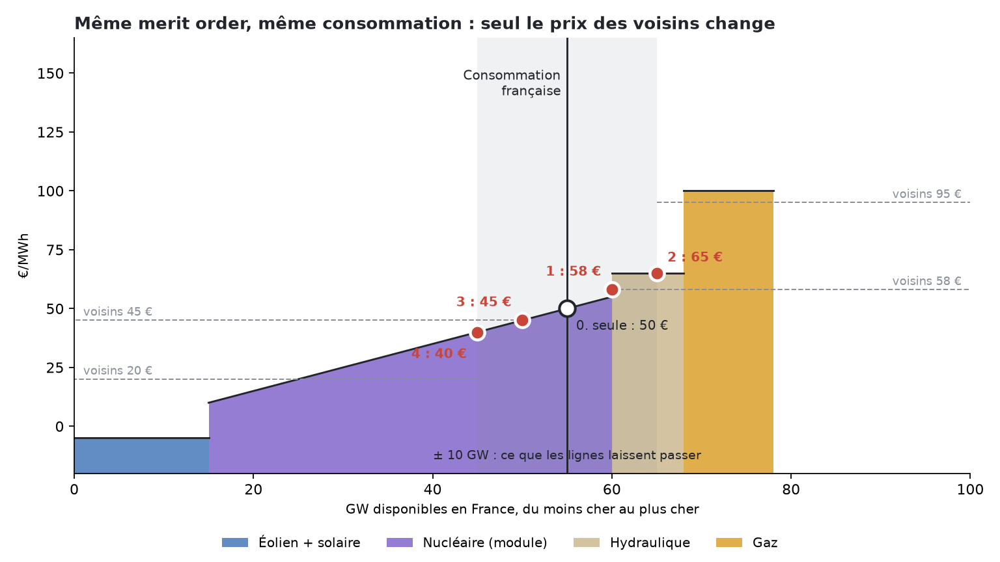
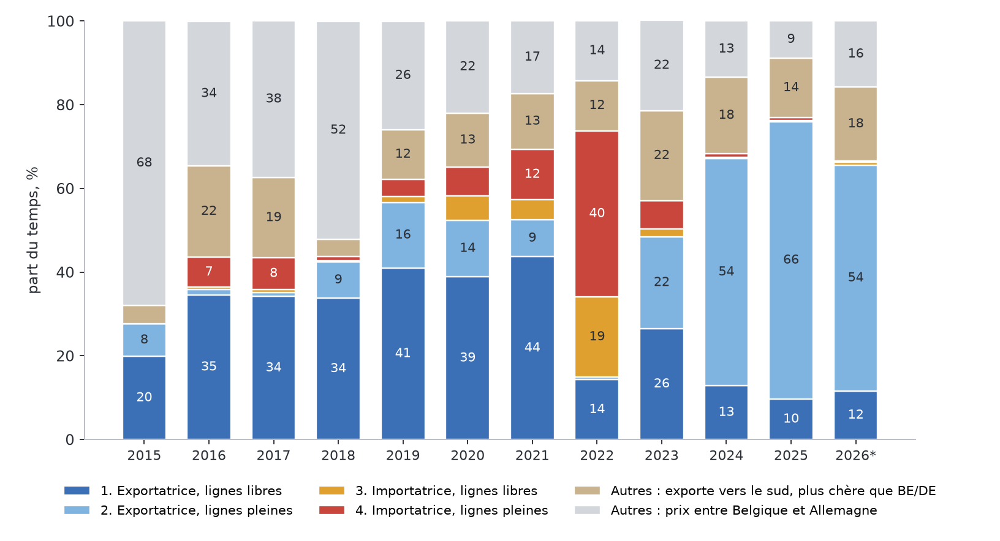

# Le marché de l'électricité et le prix d'un PPA — cours, version détaillée

*Pour Tom · PowerKlock · 31 octobre 2026*

Mêmes 14 chapitres que la version simple, avec en plus :
- les mécanismes et les formules, chacune expliquée en mots simples ;
- ce qu'on a testé, avec les chiffres ;
- les limites et les questions ouvertes.

Les schémas sont ceux de la version simple (`img/`). Les chiffres viennent :
- du débrief pricing (`docs/discussion/pricing/debrief-2026-10-31.md`) ;
- du dossier couplage (`docs/discussion/couplage/`) ;
- des commentaires de test dans `scripts/ppa_scenarios.py` et `scripts/ppa_model_risk.py` ;
- de `data/history/`, recalculés par `docs/discussion/cours/calc.py` ;
- de sources publiques vérifiées le 31 octobre 2026 (RTE, CRE, EDF, JAO, articles de recherche), listées en fin de
  document avec leurs liens.

Les chiffres des tests du 31 octobre qui ne sont écrits dans aucun fichier du dépôt sont signalés : analogues,
couverture des Monte Carlo, dates sèches et venteuses, coût des écarts combiné.

---

## Chapitre 1 — Les bases

### 1.1 L'enchère de la veille
- **Quoi.** Chaque jour à midi (heure de Paris), le couplage européen (SDAC) clôt l'enchère : les bourses (EPEX,
  Nord Pool…) ont reçu les offres de vente et d'achat pour chaque pas de
  temps du lendemain. Depuis le **1er octobre 2025**, ce pas de temps est le **quart d'heure** (avant : l'heure).
- **Courbe d'offre.** On trie les offres de vente par prix croissant : c'est le **merit order**.
- **Courbe de demande.** On trie les offres d'achat par prix décroissant.
- **Le prix.** C'est le point où les deux courbes se croisent. Tout MWh vendu est payé ce prix, quelle que soit son
  offre : c'est le **prix marginal**, ou *pay-as-clear*.

**Pourquoi chaque centrale offre à son coût variable.** Si elle offre plus cher, elle risque de ne pas être
appelée alors qu'elle aurait gagné de l'argent. Si elle offre moins cher, elle risque de produire à perte. Le coût
variable, c'est surtout le combustible et le CO2.
- **Gaz :** coût ≈ TTF ÷ 0,55 + 0,37 × EUA. On divise le prix du gaz par un rendement de 55 %, et on ajoute
  0,37 tonne de CO2 par MWh produit.
- **Charbon :** API2 ÷ 0,38 + 0,90 × EUA (`docs/discussion/couplage/methodologie.md`).

**Exception : l'eau des barrages.** Elle ne coûte rien, mais elle est rare. Le barrage offre donc à sa **valeur
d'usage** : le prix qu'il obtiendrait en gardant l'eau pour plus tard.

### 1.2 Le forward
- **Quoi.** Un forward fixe aujourd'hui le prix d'une livraison future : mois, trimestre, année civile (« Cal »).
- **Base ou pointe.** En *base*, c'est le même MW à toutes les heures ; en *pointe*, de 8 h à 20 h en semaine.
- **Ce qu'il reflète.** Le prix du forward suit l'espérance du marché sur le spot futur, plus ou moins une prime.
  Il intègre déjà le découplage de la France : l'écart Cal France − Allemagne passe de +3 €/MWh (livraison 2024) à
  −37 (livraison 2027) (`couplage/forwards.json`).
- **Il se trompe dans les deux sens :**

| Livraison | Cal France coté l'année d'avant | Spot réalisé |
|---|---|---|
| 2024 | 99,8 | 58,0 |
| 2025 | 63,8 | 61,1 |
| 2026 | 59,5 | 90,1 (janv.–oct.) |

Source : SEFE via la base PowerKlock, ENTSO-E.

### 1.3 Les prix négatifs
Un producteur accepte d'être payé moins que zéro si arrêter lui coûte plus cher que payer :
- un **nucléaire** qui ne peut pas baisser plus vite ;
- un **parc sous obligation d'achat** ou complément de rémunération ancien, payé quel que soit le prix ;
- une **cogénération** qui doit chauffer.

| | 2023 | 2024 | 2025 | 2026 (janv.–oct.) |
|---|---|---|---|---|
| Heures < 0 | 147 | 352 | 509 | 516 |
| Heures ≤ 0 | 184 | 549 | 735 | 685 |

Prix horaire = moyenne des quarts d'heure. RTE compte 352 heures négatives en 2024 et 513 en 2025 : notre comptage
retombe dessus. Le plancher de l'enchère est passé de −500 à −600 €/MWh le 28 mai 2026.

**Compter au quart d'heure.** Depuis le 1er octobre 2025, le prix est fixé par quart d'heure. Si on fait d'abord la
moyenne de chaque heure, on perd les quarts d'heure négatifs d'une heure dont la moyenne reste positive.

| Prix ≤ 0 en 2026 (janv.–oct.) | Heures |
|---|---|
| Comptés au quart d'heure (quarts d'heure ÷ 4) | **805** |
| Comptés sur la moyenne de chaque heure | 670 |
| pv magazine, 2 oct. 2026 | « environ 800 » |

C'est le comptage au quart d'heure qui retombe sur pv magazine. RTE compte **407 heures négatives au premier semestre
2026** (363 au premier semestre 2025), avec des records à **−478,8 €/MWh (26 avril)** et **−498,7 €/MWh (1er mai)**
(bilan du premier semestre 2026).

---

## Chapitre 2 — Capture et cannibalisation

### 2.1 Les formules
Pour un parc qui produit g_h à l'heure h, payé p_h :

- **Valeur du MWh** : V = Σ g_h p_h ÷ Σ g_h (moyenne des prix pondérée par la production)
- **Prix de base** : B = moyenne simple des p_h
- **Taux de capture** : c = V ÷ B

**Pourquoi V et B diffèrent.** On peut réécrire V = B + Cov(g, p) ÷ moyenne(g). La valeur du MWh égale le prix
moyen, plus un terme qui mesure si le parc produit plutôt aux heures chères (covariance positive) ou aux heures
bon marché (covariance négative).

**Convention du site** (jusqu'au 31 octobre ; depuis le 1er novembre, seulement strictement sous 0 €). La production
aux prix ≤ 0 n'est pas payée : p_h est remplacé par max(p_h, 0) et ces MWh
sont perdus. Le site publie la capture « payée » : valeur des MWh produits aux heures positives ÷ base.

### 2.2 Profil contre cannibalisation (méthode en 3 étapes)
On coupe Cov(g, p) en deux :
- **Profil :** la production moyenne de chaque case mois × heure, multipliée par le prix moyen de cette case. C'est
  ce que le parc gagnerait si les prix, à l'intérieur de chaque case, n'avaient aucun lien avec sa production
  (le soleil produit à midi l'été, et les midis d'été sont plutôt bon marché).
- **Cannibalisation :** le reste. À l'intérieur d'une même case, les heures où le parc produit plus sont moins chères,
  justement parce que lui et ses semblables produisent. Le site la définit ainsi : « ce que le profil a gagné moins ce
  qu'il gagnerait avec des prix sans lien ».

Chatziandreou et Karbach (arXiv 2607.27814, juillet 2026) écrivent le prix juste d'un PPA pay-as-produced comme
forward base + correction de profil + correction de covariance prix-volume. C'est la même décomposition.

### 2.3 Les chiffres

Capture « payée », d'après `data/history/fr_capture.json` :

| | 2020 | 2021 | 2022 | 2023 | 2024 | 2025 | 2026 (janv.–oct.) |
|---|---|---|---|---|---|---|---|
| Éolien | 0,94 | 0,94 | 0,84 | 0,89 | 0,90 | 0,89 | 0,89 |
| Solaire | 0,94 | 0,87 | 1,05 | 0,85 | 0,67 | 0,58 | 0,56 |

**Repère dans la littérature.** Hirth (2013) : la valeur du vent passe de 110 % à 50–80 % du prix moyen quand sa
part passe de 0 à 30 %.

### 2.4 Limites
- La capture dépend de la **base** choisie : spot de l'année, forward, ou spot des heures payées. Comparer deux
  chiffres de capture demande la même définition.
- Un parc réel n'a pas le profil national. Sa capture peut s'écarter de plusieurs points selon sa région et son
  orientation (le site a des captures régionales : `fr_regional_capture.json`).

---

## Chapitre 3 — Le PPA et son prix

### 3.1 La formule

**Prix PPA = Σ_mois [forward du mois × capture du mois × production payée du mois] ÷ Σ production payée
− prime de risque − coût des écarts + garanties d'origine − marge**

Chaque terme :
- **Forward du mois.** Le mois coté si on l'a, sinon le trimestre, sinon le Cal, découpé par une forme saisonnière.
  On ne prend que des produits liquides (SEFE / EEX).
- **Capture du mois.** Elle sort du générateur de scénarios (chapitre 9).
- **Prime de risque** (pricer v2, depuis le 31 octobre 2026) :
  - la bande du générateur, avec le Monte Carlo complet, donne une **dérive de capture**, σ = (P50 − P25) ÷ 0,6745 ÷
    √années : solaire 2,38,
    éolien 1,90 point par √année (fiche des paramètres du 1er novembre ; 2,75 / 2,12 le 31 octobre) ;
  - le pricer tire **10 000 trajectoires** (forward, volume, capture, liquidité), couvre le volume attendu au Cal, et
    retire **prime = valeur juste − 25e centile**. Le prix publié est donc le niveau qui tient 3 fois sur 4 ;
  - plus de déduction séparée pour le risque de modèle : la bande complète le contient déjà (chapitre 11). Avant le
    31 octobre, on retirait aussi le 75e centile des erreurs passées ;
  - la corrélation volume–capture est mesurée dans le générateur (0,24 solaire, 0,32 éolien au 1er novembre) au lieu
    d'être supposée ;
  - depuis le 1er novembre, le prix capté suit le prix de base selon sa sensibilité mesurée (0,96 € par € en solaire,
    0,95 en éolien), et la volatilité des forwards dépend de l'échéance (Cal+1 34 %, Cal+2 et Cal+3 21 %/an).
- **Coût des écarts.** Chapitre 12.
- **Garanties d'origine.** Prix des enchères (EEX).
- **Marge de gestion.** 1 €/MWh.

### 3.2 Pourquoi « non payé aux prix négatifs »
Les PPA récents prévoient souvent que l'acheteur ne paie pas les MWh produits à prix négatif (clause de
*curtailment*). Le parc s'arrête, ou il produit sans être payé. Ne pas compter ces MWh évite de surestimer la valeur :
- en 2025, 735 heures ≤ 0 (moyenne horaire ; 742 en comptant au quart d'heure, 722 dans les données horaires du
  pricer) tombaient presque toutes à midi, au printemps et en été ;
- c'est le cœur de la production solaire.

### 3.3 Prix publiés
Pricer v2, forwards des 30–31 octobre 2026, PPA 2027–2029 : **solaire 46,64 €/MWh, éolien 77,39 €/MWh**
(`pricing-v2/parametres.md`). Historique, le prix a bougé trois fois en un jour, pour des raisons de méthode (pas de marché) :
  - 31 oct., 20 h 57 : pricer v2 en ligne, **49,75 / 80,69** €/MWh (solaire / éolien) ;
  - 1er nov., 8 h 12 : le parc s'arrête seulement **strictement sous 0 €** (une heure à 0 € est produite et payée 0) :
    le même revenu se répartit sur plus de MWh payés, **42,88 / 77,20** ;
  - 1er nov., 12 h 25 : la prime de risque suit la sensibilité mesurée du prix capté au prix de base (0,96 € par €
    en solaire, 0,95 en éolien) ; la prime solaire passe de 5,98 à 2,2 € : **46,64 / 77,39** (prix publié actuel).
- (la v1 donnait 47,07 / 77,78 dans le débrief de la nuit du 30 au 31 octobre, et 48,43 / 80,29 au moment de la
  bascule vers la v2, avec les mêmes forwards : diaporama v2 simple, diapo 9).

Méthode :
- **une seule méthode**, le générateur, au lieu de la moyenne de quatre (qui se trompait de 2,59 € en solaire et
  2,84 € en éolien au rejeu, contre 0,76 et 0,56 pour le générateur seul) ;
- solaire **sans ancrage**, éolien **ancré** par un facteur hiver et un facteur été, choisis chaque semaine par le
  rejeu (chapitre 9) ;
- règle éolienne **pondérée par la production** ;
- source : `docs/discussion/pricing-v2/choix_v2.md` et `parametres.md`.

### 3.4 Questions ouvertes
- La prime de risque doit-elle dépendre de la durée du contrat ? Aujourd'hui l'horizon élargit la bande.
- Le site ne connaît pas les **prix de PPA observés**. Pexapark, lui, calibre ses modèles dessus.

---

## Chapitre 4 — Le système français

### 4.1 Nucléaire
- **Minimum technique.** Un réacteur peut baisser sa puissance, mais avec des limites :
  - de vitesse (EDF : de 100 % à 20 % de la puissance en 30 minutes environ, deux fois par jour, pour un réacteur en
    suivi de charge) ;
  - de nombre de cycles ;
  - de cycle de combustible : RTE indique que le **minimum technique courant** d'un réacteur varie **entre 25 % et
    100 %** de sa puissance nominale, « notamment [selon] l'avancement dans le cycle du combustible ». En fin de
    cycle, un réacteur ne module presque plus.
- **Le plus bas taux d'utilisation observé** (1er centile, production ÷ disponible) : **0,63 en 2024–2025**
  (`couplage/methodologie.md`).
- **Printemps 2026 : un nucléaire moins flexible** (RTE, bilan du premier semestre 2026) :
  - la modulation du parc a été d'environ **10 TWh**, contre près de **20 TWh** au premier semestre 2025, surtout
    parce qu'il y a eu moins d'arrêts pour modulation ;
  - le minimum technique du parc était d'environ **31 GW le 1er mai 2026** à midi, contre **19 GW le 1er mai 2025**,
    surtout parce que plus de réacteurs ne pouvaient pas moduler pour des raisons de cycle de combustible ;
  - conséquence : des prix négatifs plus profonds au printemps (records du 26 avril et du 1er mai).
- **Accord RTE–EDF approuvé par la CRE le 27 mars 2026** (délibération n° 2026-67). C'est un contrat d'option
  d'**imposition** sur tout le parc nucléaire, en quatre zones, du 4 avril au 30 octobre 2026 :
  - RTE peut demander à certains réacteurs de **rester en marche** pour régler la **tension haute** du réseau. Un
    réacteur arrêté pour des raisons économiques (prix bas) ne règle plus la tension ;
  - EDF reçoit une compensation dont la formule est connue à l'avance.

  **Effet réel :** d'après RTE, ces demandes « n'ont joué qu'un rôle marginal » dans la flexibilité du parc : la très
  grande majorité visait des réacteurs qu'EDF avait déjà prévu de garder en marche. Notre débrief du 31 octobre le
  présentait comme « un niveau minimum de production nucléaire » et comme la cause probable des erreurs de 2026 :
  c'est **à corriger**.
- **Volumes de modulation.** Kpler (février 2026) : la modulation du nucléaire français a augmenté de 17 % en 2025,
  et 70 % de ses volumes sont désormais commerciaux (prix bas), pas techniques.
- **Astier et Wolak (NBER, janvier 2026).** En 2024, les heures où toute la flexibilité disponible du nucléaire était
  déjà utilisée correspondent à des prix nuls ou négatifs. Piste non testée : nos données ne donnent pas la
  flexibilité restante centrale par centrale. Les « chroniques Pmin » déclarées au titre de REMIT, qu'utilise RTE, la
  donneraient.
- **Arrêts programmés.** EDF les place au printemps et en été (schéma `07_nucleaire_dispo.png`). Pour 2027, les
  arrêts déclarés à ENTSO-E (`fr_outages.json`, au 30 octobre 2026, `calc.py`) donnent :

  | | Janv. | Févr. | Mars | Avr. | Mai | Juin | Juil. | Août | Sept. | Oct. | Nov. | Déc. |
  |---|---|---|---|---|---|---|---|---|---|---|---|---|
  | Pic indisponible (GW) | 7,0 | 11,0 | 15,8 | 18,0 | 20,7 | 19,8 | 17,2 | 17,4 | 14,7 | 10,0 | 4,2 | 2,7 |

  En moyenne, 11,3 GW indisponibles. Ces plannings bougent souvent. EDF prévoit 350 à 370 TWh de nucléaire en 2026
  comme en 2027.
- **Chaleur et sécheresse.** Les centrales en bord de rivière doivent réduire leur production quand l'eau est trop
  chaude ou trop basse (limites de rejet thermique). RTE : en cas de sécheresse prolongée en fin d'été, l'effet
  pourrait atteindre **2 à 3 GW** (Bugey, Chooz, voire Cattenom), mais il reste « de second ordre » en volume annuel.

### 4.2 Hydraulique
Il y a trois sortes d'ouvrages :
- **le fil de l'eau :** il produit quand l'eau passe, on ne peut pas le stocker ;
- **les lacs :** ils stockent l'eau sur des semaines ou des mois ;
- **les STEP :** elles pompent l'eau vers le haut quand l'électricité est bon marché, et la turbinent quand elle est
  chère.

Le stock des réservoirs (ENTSO-E A72, `hydro_reservoirs.json`) dit combien d'énergie « de réserve » le pays a.

### 4.3 Exports
RTE, bilan 2025 :
- solde exportateur **92,3 TWh** (89 en 2024) ;
- exportatrice nette **près de 99 % du temps** ;
- valeur des exports **5,4 Md€** au prix français, « de l'ordre de 9 Md€ » au prix des pays acheteurs.

Par frontière, en TWh :

| Italie | Grande-Bretagne | Suisse | Belgique + Allemagne | Espagne |
|---|---|---|---|---|
| 26,2 | 22,6 | 20,1 | 23,1 | 0,2 |

### 4.4 Croissance du solaire, de l'éolien, des batteries
- Le générateur prend le **rythme de la dernière année**, jamais sous la trajectoire PPE3.
- Pour les voisins : leur rythme, plafonné par leurs objectifs 2030.
- Les batteries absorbent une partie du midi solaire. Leur effet sur la capture est testé dans
  `scripts/ppa_storage_test.py`.
- RTE (premier semestre 2026) : **7,4 GW** d'éolien et de solaire sous obligation d'achat peuvent désormais s'arrêter
  aux prix négatifs, et **22 GW** peuvent moduler à la demande de RTE (quatre fois plus qu'avant). Modulation
  renouvelable : 2,5 TWh au premier semestre 2026, contre 1,9 TWh un an plus tôt, soit environ 5 % de la production
  éolienne et solaire.
- RTE (bilan 2025) : la modulation de l'éolien et du solaire pendant les prix négatifs a doublé en 2025, à environ
  3 TWh (1,3 éolien, 1,6 solaire).

---

## Chapitre 5 — Le couplage européen

### 5.1 Une enchère pour toute l'Europe
Le couplage unique du day-ahead (SDAC) fait tourner un seul algorithme (Euphemia) :
- **ce qu'il reçoit :** les offres de chaque zone et les capacités entre zones ;
- **ce qu'il cherche :** le plus grand surplus total (gain des acheteurs + gain des vendeurs) ;
- **ce qu'il donne :** un prix par zone et des échanges entre zones.

Membres et dates :
- la Grande-Bretagne en est sortie le 1er janvier 2021 ;
- la Suisse n'en a jamais fait partie ;
- France–Belgique–Pays-Bas sont couplées depuis 2006 ;
- la zone Core est en flow-based depuis le **8 juin 2022**.

### 5.2 Rente de congestion
Rente = Σ (P_importateur − P_exportateur) × échange commercial, quart d'heure par quart d'heure.
- **Partage :** 50/50 entre les deux gestionnaires de réseau (ACER, décision 16/2023).
- **Usage en France :** la part de RTE, une fois les droits de long terme payés, est déduite du TURPE.
- **Ordre de grandeur :** recettes brutes de RTE sur les frontières de l'UE, 2,05 Md€ en 2025, dont 0,80 reversés
  aux détenteurs de droits de long terme (CRE).

Image : les deux villages et un camion (schéma `08_deux_villages.png`). Le camion ne gagne de l'argent que s'il est
plein.

### 5.3 Le flow-based
- **NTC (l'ancien calcul).** On donnait une capacité fixe par frontière.
- **Flow-based.** L'électricité ne suit pas les contrats : elle passe par tous les chemins, au prorata de leur
  impédance. Le flow-based contrôle donc chaque ligne critique (les *CNEC*) :
  - un échange France → Allemagne charge aussi des lignes en Belgique, en Suisse, en France ;
  - chaque échange a ses **coefficients de charge** (PTDF) sur chaque ligne ;
  - l'algorithme garde les échanges tant qu'aucune ligne ne dépasse sa marge.
- **Conséquence.** La « limite d'export de la France » n'est pas un nombre fixe. C'est la position nette maximale
  que la France peut atteindre, l'heure donnée, compte tenu de tout le reste (JAO publie `maxNetPos`).

### 5.4 Pourquoi la limite d'export de la France baisse
Limite Core moyenne (JAO, calcul PowerKlock) : **9,2 GW en 2023, 7,7 en 2024, 5,4 en 2025, 5,9 en 2026**.

**Cause (Boerman, 2026, « Flowbased: export restrictions of France », boerman.dev) :**
- les exports vers l'Italie passent par les lignes 400 kV **Creys–Saint-Vulbas** ;
- la seconde de ces lignes contraint **49 % du temps en 2026**, contre 21 % en 2025 (la première : 17 % contre 5 %) ;
- la valeur de ces lignes (ce que gagnerait l'Europe avec 1 MW de plus) est passée de 183–201 €/MWh en 2025 à
  311–318 €/MWh en 2026 ;
- RTE réserve une marge élevée pour les flux qui ne passent pas par le marché Core (*FUAF*).

La limite ne remontera qu'avec des renforcements du réseau.

**Une explication parmi d'autres.** Boerman décrit le mécanisme technique de la limite. Mais le dossier couplage
(diaporama `couplage_europeen.pdf`, page « Les causes ») liste plusieurs causes du découplage avec l'Allemagne : plus
de nucléaire disponible (33,8 → 46,9 GW), la limite JAO, des gestionnaires qui donnent 54 % des capacités au lieu de
70 % (ACER), le vent allemand. **Aucune source publique ne chiffre la part de chaque cause.**

### 5.4 bis Les quatre cas, sur un seul merit order
Même merit order français dans tous les dessins (consommation 55 GW, France seule à 50 €, ligne ±10 GW) ; seul le
prix des voisins change. Le prix français se lit sur la courbe française, à la production française : consommation
+ export, ou − import.

| Cas | Voisins | France | Fréquence (`cases_hist.json`) | 2025 / 2022 (diaporama « cas par cas ») |
|---|---|---|---|---|
| 1. Exportatrice, ligne libre | 58 € | 58 € (même prix) | 34–44 % en 2016–2021, 10 % en 2025 | 2025 : 75 / 75 €, rente 171 M€ |
| 2. Exportatrice, ligne pleine | 95 € | 65 € (lu à 55 + 10 GW) | 1–16 % jusqu'en 2022, 22 / 54 / 66 / 54 % en 2023–2026 | 2025 : ≈ 58 contre 102 €, 12,0 GW, rente 3,6 Md€ |
| 3. Importatrice, ligne libre | 45 € | 45 € | 19 % en 2022, 0 % en 2025 | 2022 : 331 €, rente 908 M€ |
| 4. Importatrice, ligne pleine | 20 € | 40 € (lu à 55 − 10 GW) | 40 % en 2022, ≈ 1 % en 2024–2025 | 2022 : 311 contre 230 €, 89 h de manque évitées, rente 3,1 Md€ (3,5 dans le récapitulatif du diaporama, écart non expliqué) |

Les 1 % du cas 4 en 2024–2025 sont des heures où l'Allemagne est à prix négatif, pas des heures de manque. Le reste
du temps (23 % en 2025), la France n'est dans aucun de ces quatre cas (prix différent selon les frontières).

### 5.5 Limites
- Notre limite JAO est une moyenne horaire. L'heure qui compte pour un parc solaire, c'est midi.
- Pour la Suisse et la Grande-Bretagne, la capacité est vendue aux enchères explicites, hors couplage.

---

## Chapitre 6 — France couplée ou coupée

### 6.1 Définitions
Une frontière est **couplée** quand les deux prix sont égaux au centime près. C'est la règle de la CRE :
- nos taux France–Allemagne : 49 % en 2021, 34 % en 2022, 29 % en 2023, 14 % en 2024, 11 % en 2025 ;
- ceux de la CRE : 49, 34, 29, 14 et 10 %.

Avec une tolérance de 1 € (`calc.py`), les heures où France et Allemagne sont à moins de 1 € l'une de l'autre sont :

| 2020 | 2021 | 2022 | 2023 | 2024 | 2025 | 2026 (janv.–oct.) |
|---|---|---|---|---|---|---|
| 57 % | 54 % | 39 % | 46 % | 25 % | 17 % | 19 % |

### 6.2 Prix des heures coupées
- **France moins chère que l'Allemagne en 2025 :** 67 % des heures, 58 € contre 103 € en moyenne (débrief). Selon
  la règle : 68 % pour tout écart d'un centime (diaporama couplage, page 10), 63 % pour un écart d'au moins 5 € (page 7).
- **Heures coupées de 2025, selon le vent allemand :**
  - vent allemand faible : 67,5 € en France contre 123 € en Allemagne ;
  - vent allemand fort : 42,4 € contre 82 €.

  L'export vers Core reste le même dans les deux cas (4,5 GW). C'est la France qui suit l'Allemagne, par ses autres
  frontières.

**Part de la production éolienne tombée dans des heures coupées :**

| | 2023 | 2024 | 2025 |
|---|---|---|---|
| Réalité (heures coupées) | 18,5 % | 49 % | 67,5 % |
| Autre définition : France au moins 5 € sous l'Allemagne (diaporama couplage, page 29) | — | 49 % | 68 % (8 % en 2021) |
| Indicateur prévisible | 17 % | 39 % | 66 % |

L'indicateur prévisible, c'est le surplus français au-delà de la limite Core, calculé à l'avance.

### 6.3 La France isolée : la méthode
**Volume demandé aux centrales pilotables** (nucléaire, lacs, STEP, gaz, charbon, fioul), d'après RTE éCO2mix :

RD = consommation + exports nets − éolien − solaire − fil de l'eau − bioénergies

**Courbe apprise.** P = f(RD, nucléaire disponible, coût du gaz, coût du charbon, mois, heure, week-end, éolien +
solaire, année), avec des arbres de gradient forcés à monter avec RD et avec les combustibles.

**Bornes physiques**, appliquées ensuite :
- sous le **minimum nucléaire**, le surplus est écrêté, et le prix = la médiane des prix négatifs de l'année ;
- au-dessus de toute la capacité, c'est une **pénurie** : le prix = le plafond du marché, et ces heures sont comptées
  à part.

**France isolée.** On fait exports nets = 0 et on relit la courbe à RD − exports.

**Validation.** Sur les heures coupées, le modèle se trompe de **±15 à 20 € sur une heure**. Son biais annuel est de
+0,6 à +2,6 € de 2020 à 2025, et de **+8 € en 2026**.

### 6.4 La France isolée : les résultats

| Année | Prix réel | France isolée (modèle) | Écart |
|---|---|---|---|
| 2020 | 32 | 19 | +14 |
| 2021 | 107 | 78 | +29 |
| 2022 | 273 | 295 | −22 |
| 2023 | 96 | 65 | +31 |
| 2024 | 58 | 19 | +39 |
| 2025 | 61 | 23 | +38 |
| 2026 (janv.–oct.) | 89 | 38 | +51 |

En €/MWh. **Robustesse 2025 :** de 17 à 25 € pour la France isolée, selon le plancher d'écrêtement choisi et les
heures d'apprentissage.

**Vérification sans modèle.** On compare France couplée et France coupée à situation française égale : même année,
même trimestre, même moment de la journée, même surplus par tranches de 2 GW. L'écart n'est que de −2 à +9 € en
2023–2025. Le prix français dépend d'abord de son surplus. Le couplage décide s'il rejoint ses voisins.

### 6.5 Où va l'argent (2025)
- la consommation française vaut **17,1 Md€ de plus** au prix spot. **Ce n'est pas la facture** : les clients
  achètent à terme ;
- les acheteurs étrangers paient **10,0 Md€** ;
- le nucléaire reçoit **16,2 Md€** de plus ;
- l'éolien et le solaire **2,8 Md€**, ce qui allège le soutien public des parcs sous contrat ;
- la rente de congestion vaut **4,5 Md€**, côté France et côté voisins.

### 6.6 Limites
- La France isolée n'a **jamais existé**. Le chiffre est une **borne théorique** à court terme : même parc, même
  consommation.
- À long terme, deux effets jouent en sens contraire, et **le sens net est inconnu** :
  - une France isolée en surplus aurait arrêté plus de tranches, ce qui monte son prix ;
  - ses offres n'auraient plus de coûts d'opportunité européens, ce qui le baisse.
- **Aucune étude publiée** ne chiffre l'effet du couplage sur le prix français. On ne peut donc pas recouper le chiffre.

---

## Chapitre 7 — Les interactions

### 7.1 Vent et prix
Prix moyen français de 2025, par dixième des heures rangées selon le vent français (schéma `12_vent_prix.png`) :
- de 74 € à environ 2,5 GW de vent ;
- à **41 €** pour le dixième des heures le plus venteux (environ 15 GW en moyenne).

Les heures sans vent du tout ne sont pas les plus chères. Ce sont souvent des heures d'été, avec beaucoup de soleil.

**Deux causes se cumulent :**
1. le vent français descend dans le merit order français ;
2. le vent allemand souffle en même temps (même météo), donc les voisins achètent moins et paient moins.

**Mesure (Stiewe, Xu, Eicke et Hirth, régression sur 30 zones européennes, 2015–2023) :** valeur perdue, en points de
« value factor », par point de pénétration supplémentaire (l'article donne −0,486 pour le vent des voisins, arrondi
à 0,48 dans le résumé).

| Filière | Pénétration nationale | Pénétration des voisins |
|---|---|---|
| Éolien | −0,62 point | −0,49 point |
| Solaire | −1,39 point | −2,38 point |

C'est la **cannibalisation transfrontalière**. Pour le solaire, le soleil des voisins pèse plus que le nôtre : le midi
européen est synchrone, et les voisins (Allemagne, Espagne) ont plus de solaire.

### 7.2 Solaire et midi
Avril–septembre 2025, heure moyenne (schéma `05_solaire_midi.png`) :
- le prix tombe d'environ 60 € le matin à **moins de 5 € vers 14 h** ;
- puis il remonte à plus de 80 € le soir.

C'est la « courbe de canard ».

### 7.3 Sécheresse et vent
**Corrélation** entre le remplissage des réservoirs et le vent : **+0,32**, et **+0,42 en hiver**.

| Année | Réservoirs | Vent |
|---|---|---|
| 2017 (sèche) | −20 % | −7 % |
| 2026 (sèche) | −14 % | −4 % |
| 2020 (humide) | +26 % | +14 % |

Ces chiffres viennent de l'analyse de la session du 31 octobre (ENTSO-E A72, RTE). Le script n'est pas dans le dépôt.

**Mécanisme :**
- les dépressions atlantiques apportent vent et pluie ;
- les anticyclones sont calmes, secs, souvent chauds ;
- la chaleur baisse aussi le nucléaire (eau des rivières trop chaude).

**Conséquence pour le pricing.** Une année sèche cumule :
- moins d'hydraulique ;
- moins de vent ;
- parfois moins de nucléaire.

Le prix moyen monte, et la capture de l'éolien peut monter aussi (il souffle quand l'eau manque). Tirer la météo
**par semaines entières de la même année** garde ces liens. Tirer chaque variable à part les casserait.

### 7.4 Gaz
**Heures coupées, prix ÷ coût d'une centrale à gaz :**
- **0,61 en moyenne en 2025 et en 2026**, alors que le gaz est passé de 94 à 127 € ;
- plus finement : 0,42–0,45 pour les heures coupées venteuses, 0,72–0,78 pour les heures coupées calmes, stable de
  2024 à 2026.

**Pourquoi.** Même coupée, la France vend à l'Italie, à la Suisse et à la Grande-Bretagne, où le gaz fixe le prix. Et
l'eau des barrages se valorise au prix futur, qui dépend du gaz.

**Conséquence.** Exprimer les prix en proportion du coût du gaz (ce que fait le générateur) est justifié.

### 7.5 Questions ouvertes
- La corrélation sécheresse–vent repose sur une dizaine d'années. Une année isolée peut la contredire.
- Le ratio prix ÷ gaz de 0,6 tiendra-t-il si la limite Core change fortement ?

---

## Chapitre 8 — 2026, une année à part

### 8.1 Ce qui s'est passé

| | 2025 | 2026 (janv.–oct.) | Source |
|---|---|---|---|
| Coût d'une centrale à gaz | 94 € (débrief) ; 96 € en janv.–oct. (`calc.py`) | 127 € | SEFE, calcul PowerKlock |
| Prix spot France | 61 € | 90 € | ENTSO-E |
| Heures ≤ 0 €, comptées au quart d'heure | 742 | 805 | `calc.py` |
| Part de l'éolien de janv.–oct. produite en janv.–mars | 35,5 % | 43,7 % | RTE éCO2mix |
| Limite d'export Core | 5,4 GW | 5,9 GW | JAO |

À cela s'ajoutent :
- un **nucléaire moins flexible** au printemps : minimum technique du parc 31 GW le 1er mai, contre 19 GW en 2025
  (RTE) ;
- une **sécheresse** (réservoirs −14 % en moyenne annuelle ; RTE note des stocks proches de la moyenne à fin juin,
  puis pv magazine relève −1,5 GW d'hydraulique en septembre).

### 8.2 Capture de l'éolien en 2026
On mesure, pour janvier–octobre (`fr_capture.json`) :
- **valeur d'un MWh produit aux heures positives ÷ base** : **0,971 en 2025 → 0,976 en 2026** ;
- **toute la production comptée** (non payée aux prix ≤ 0) : **0,891 → 0,888**.

- **convention du pricer (« curt »)** : capture des MWh payés, calculée **mois par mois** sur le prix moyen du mois,
  puis moyenne pondérée par la production payée (`scripts/ppa_scenarios.py`, données horaires `ppa_lab`) :
  **0,936 en 2025 → 0,976 en 2026**. C'est le chiffre du pricer (session du 31 octobre). Ce n'est pas un chiffre
  RTE : les bilans RTE 2025 et du premier semestre 2026 ne donnent aucun taux de capture.

Trois définitions, trois niveaux. Le sens est le même (2026 au moins aussi bon que 2025), mais on ne compare que des
chiffres de même définition.

**Pourquoi l'éolien a bien tenu.** Il a soufflé plus en hiver, aux heures chères, et moins en même temps que le
soleil. C'est de la météo, pas une tendance.

### 8.3 Pourquoi 2026 met les modèles en difficulté
- **Les pics des heures calmes.** Avec le gaz à 127 €, la règle de prix sous-estime les pics des heures calmes
  (erreur horaire de 33 €). Cela fausse la valeur relative du vent sur les vraies données.
- **Le nucléaire moins flexible.** Aucune année d'apprentissage n'a eu un minimum technique aussi haut au printemps
  (31 GW contre 19 GW). C'est une cause probable des erreurs sur 2026. Ce n'est pas l'accord RTE–EDF sur la tension,
  comme le disait le débrief : RTE juge son rôle marginal.
- **Le biais du modèle couplage.** Celui de la France isolée monte à +8 € en 2026, contre +1 € en 2024–2025.

### 8.4 Leçon
Une année aussi atypique pèse lourd dans un rejeu de 9 cas. Plusieurs méthodes « gagnent » en moyenne mais perdent
4 à 11 € sur 2026 sans ancrage. Exemples :
- la correction par situation : −4 à −8 € ;
- le « tout combiné » : −11 €.

Elles ont été écartées pour cette raison.

---

## Chapitre 9 — Le générateur de scénarios

### 9.1 Les étapes (`scripts/ppa_scenarios.py`)
1. **Météo.** On enchaîne de vraies semaines passées, de la même saison et avec le même type de jours, en gardant
   tout ce qui s'est passé ces jours-là : vent, soleil, consommation, nucléaire, voisins. Les liens du chapitre 7
   restent donc intacts.
2. **Parc.** On pose cette météo sur le parc de l'année livrée : la production par GW est ramenée au niveau récent
   (arrêts, autoconsommation).
3. **Prix de chaque heure.** Prix = coût d'une centrale à gaz × un coefficient. Ce coefficient dépend de la
   situation de l'heure, en deux régimes :
   - **France couplée** ;
   - **France coupée :** son surplus dépasse la limite d'export JAO.

   Les prix négatifs sont traités à part, en €, car ils ne dépendent pas du gaz. La dernière année d'apprentissage
   pèse deux fois plus que la précédente (adopté le 31 oct.).
4. **Capture de chaque mois.** Prix moyen obtenu par le parc ÷ prix moyen du mois. Le parc s'arrête strictement sous
   0 € depuis le 1er novembre (avant : aux prix ≤ 0).
5. **Répétition.** Pour le prix publié, **60 années tirées** par année livrée et par filière
   (`scripts/ppa_generator.py`, `n=60`) ; dans les tests de rejeu, 30 (60 ne change le résultat que de 0,03 €). Les
   « milliers » des diaporamas v2 désignent en fait les 10 000 trajectoires du Monte Carlo du pricer. L'année la plus présente fait en moyenne 30 % des jours tirés (48 % au maximum) : la variété reste
   bonne (diaporama v2 détaillé, diapo 8).

### 9.2 Le biais de l'éolien

**Le constat.** Sans ancrage, la règle par cases surévalue l'éolien d'environ **+2,6 €/MWh**, et cette erreur est
**presque constante** d'un cas à l'autre. Même sur l'année qu'elle a apprise, elle paie les heures de vent environ
**3 % trop cher** l'hiver (facteur d'ancrage 0,97). L'été, c'est l'inverse : facteur 1,06, la règle sous-paie
(diaporama v2 détaillé, diapo 15). Dans le détail, la règle est 6,9 € trop haute dans les heures où la France est
coupée et 6,4 € trop basse dans les heures couplées (diapo 14).

**Pourquoi.** Une case fait la moyenne de toutes ses heures. Or, à l'intérieur d'une case, les heures les plus
venteuses sont aussi :
- celles où l'Allemagne est venteuse ;
- celles où la France est plus coupée ;
- celles où les voisins paient moins.

La case donne aux heures venteuses le prix moyen de la case, donc **trop haut**.

**Trois modèles construits autrement font la même erreur :**
- la règle par cases ;
- le modèle d'optimisation par semaine ;
- la régression mensuelle.

Le problème vient donc de l'information disponible, pas de la forme du modèle.

**Raffiner les cases avec le vent n'a pas suffi :**

| Variante | Erreur éolien sans ancrage (€/MWh) |
|---|---|
| Règle publiée | 2,62 |
| Grille surplus × part du vent | 2,31 |
| Pente du vent | 2,38 |
| Courbe de pénétration | 2,39 |

### 9.3 L'ancrage

**Formule.** capture ancrée(année livrée) = capture du générateur(année livrée) × [capture réelle(dernière année
connue) ÷ capture du générateur(dernière année connue)]

**En mots.** On fait tourner le générateur sur la dernière année réelle et on regarde de combien il se trompe. On
applique le même rapport à l'année livrée. L'erreur de niveau s'annule. Le générateur ne donne plus que le
**changement** : parc, batteries, régimes. C'est la balance qui pèse 3 % trop lourd, qu'on règle avec un poids connu.

**Les variantes.** Il y a trois modes, choisis par filière selon le rejeu, et mesurés à nouveau chaque semaine :
- **sans ancrage ;**
- **ancrage annuel :** un facteur pour l'année ;
- **ancrage hiver/été :** un facteur pour octobre–mars, un autre pour avril–septembre.

**Rejeu (9 cas), en €/MWh :**

| | Sans ancrage | Ancrage annuel | Ancrage hiver/été |
|---|---|---|---|
| Solaire | **0,76** | 1,18 | 1,22 |
| Éolien | 2,62 | 0,96 | **0,84** |

D'où le choix publié : solaire sans ancrage, éolien ancré hiver/été.

**Ancrages testés et écartés :**

| Ancrage | Solaire | Éolien |
|---|---|---|
| Par mois | 2,14 | 1,69 |
| Par trimestre | 2,09 | 1,52 |
| Sur la météo réelle de l'année | 1,95 | 1,42 |
| Moitié du facteur | 0,96 | 1,51 |

**Le défaut.** L'ancrage suppose que l'erreur de l'an dernier sera celle de l'an prochain. Si l'année connue est
atypique (2026), le facteur l'est aussi.

### 9.4 Les analogues (tests du 31 oct., `PK_KNN`)

**Principe.** Pour chaque heure simulée, on cherche les K heures apprises les plus proches selon :
- la part du solaire et de l'éolien en France et dans la région ;
- ce que la France doit exporter au-delà de sa limite Core ;
- l'heure ;
- la saison.

Le prix de l'heure simulée est la moyenne de leurs prix (en proportion du gaz).

**Variantes testées :**
- le tirage d'**un** analogue par heure, avec un rang commun à toute la semaine (« semaine chère ou bon marché ») ;
- des pentes locales ;
- des marchés « en avance » sur la France (Allemagne, Espagne) comme réservoir d'analogues ;
- un hybride avec la règle.

**Résultat.** Le vent est corrigé **sans ancrage** : erreur d'environ **1,1 €/MWh** contre 2,62. L'analogue d'une
heure venteuse est une vraie heure venteuse passée, avec tout ce qui l'accompagnait.

**Mais le solaire extrapole mal.** Le parc futur est plus solaire que tout ce qu'on a vu. Les heures passées les plus
proches d'un midi de 2028 sont donc les **pires midis connus**, et l'analogue ne sait pas aller au-delà. Résultat :
la capture solaire est mal prévue.

**Statut (note v2 du 1er novembre).** Analogues seuls : solaire 4,1 € d'erreur, écartés. Mélange 50/50 analogues +
règle : meilleur sur les formats glissants (0,68 et 1,03) mais moins bon sur les années civiles (0,89 contre 0,63 pour
la v2), et son pourcentage aurait fini par bouger : refusé. Les options restent dans le code, désactivées.

### 9.5 Ce que fait la littérature
- **Qorbanian, Löhndorf et Wozabal** (arXiv 2024, *European Journal of Operational Research* 2025) : un modèle
  fondamental dont les coûts sont appris sur l'historique, avec une erreur pondérée par la production de la filière
  pricée (« we set w_t to the expected capacity factors […] of the technology we want to price »). Ils le testent sur
  l'Espagne, l'Allemagne et la France, avec la vraie demande résiduelle et les vrais échanges. C'est **en France**
  qu'il marche **le moins bien**.
  Chez nous, c'est le seul gain qui tient sur tous les tirages : éolien 2,62 → 2,10–2,20 sans ancrage, 0,84 → 0,48–0,71
  ancré. Mais il dégrade le solaire (0,76 → 1,41).
- **Modo Energy :** sans aligner la météo des prix et celle de la production, on surestime les revenus de plus de 10 %
  en 2045. Notre générateur est aligné par construction.

### 9.6 Questions ouvertes
- Tranché en v2 : un seul générateur ; seule la pondération suit la filière pricée (l'éolien pondéré par sa
  production). Le mélange avec les analogues a été refusé.
- La valeur réelle de l'éolien baisse d'une année à l'autre plus vite que tous les modèles ne le prévoient. Ni la
  limite d'export ni le gaz ne l'expliquent. C'est la piste à creuser.

---

## Chapitre 10 — Tester honnêtement

### 10.1 Le protocole
- **Les cas.** Livraisons 2023, 2024, 2025 et 2026 (mois complets seulement), pricées 1, 2 et 3 ans avant. Seuls les
  cas qui ont des limites JAO comptent, ce qui fait **9 cas par filière**.
- **La règle du jeu.** Pour chaque cas, on n'utilise que les années complètes connues à la date du pricing.
- **L'erreur.** Erreur d'un cas = valeur du MWh pricée − valeur réalisée, en €/MWh. La production n'est pas payée aux
  prix ≤ 0. On résume les 9 cas par l'**erreur moyenne absolue**, et on regarde aussi le **biais** (la moyenne signée).

### 10.2 Biais contre dispersion
- **Biais :** une erreur toujours dans le même sens, par exemple l'éolien sans ancrage à +2,6 €. Une correction
  simple, comme l'ancrage, l'enlève.
- **Dispersion :** une erreur qui change de sens d'un cas à l'autre. Aucune correction simple ne l'enlève.

**Exemple :** « pondération + pente du vent » ramène le biais de l'éolien à **+0,45 €**, mais l'erreur moyenne reste
**1,93 €**. Le biais a disparu, la dispersion est restée.

### 10.3 Le hasard des tirages
Le générateur tire des semaines au hasard.

| Tirage | Modèle publié, éolien ancré hiver/été | Modèle pondéré |
|---|---|---|
| 1 | 0,84 | 0,71 |
| 2 | 0,77 | 0,64 |
| 3 | 0,71 | 0,48 |

En €/MWh. L'écart entre tirages atteint **0,2 €**.

**La règle :** un gain ne compte que s'il dépasse 0,2 €, ou s'il tient sur tous les tirages. Passer de 30 à 60
tirages ne bouge le rejeu que de 0,03 € au plus.

### 10.4 Pourquoi 9 cas limitent les conclusions
- Les 9 cas ne sont **pas indépendants**. Les trois horizons d'une même livraison partagent la même année réelle :
  il n'y a en fait que 4 années livrées.
- Une seule année atypique, comme 2026, déplace la moyenne.
- Le risque est de choisir la méthode qui a eu de la chance sur ces quatre années. C'est du **surapprentissage du
  choix**. Garde-fous :
  - un seuil de 0,2 € ;
  - des vérifications sur plusieurs tirages ;
  - la préférence pour les méthodes qui ont une raison physique.

### 10.5 Question ouverte (Tom, 30 oct.)
Faut-il un choix de méthode annuel, avec un historique recalculé et un seuil de 0,2 €, pour que la méthode ne change
pas d'une semaine à l'autre ? La question est toujours en suspens.

---

## Chapitre 11 — Risque, P50 et P75

### 11.1 Définitions
- **Pq.** C'est la valeur que la réalité dépasse avec une probabilité de (100 − q) %.
  - **P50 :** la médiane.
  - **P75 (prix prudent) :** la réalité est au-dessus 3 fois sur 4.
- **Le cas d'un PPA.** L'acheteur, ou le producteur qui se couvre, veut un prix qu'il ne regrettera pas trop souvent.
  Le pricer prend donc un niveau prudent, puis retire la différence avec le P50 : c'est la **prime de risque**.

### 11.2 Monte Carlo et ses angles morts
Un Monte Carlo tire des futurs et lit la distribution. Il **ne connaît que les risques qu'on lui donne**.

**Test du 31 oct. : la météo seule ne suffit pas.** Avec le générateur qui ne tire que la météo, la bande P10–P90 a
contenu la réalité dans **environ 45 % des mois**. Il en faudrait 80 %.

**Le Monte Carlo complet** (en ligne dans le pricer v2 depuis le 31 octobre) tire pour chaque scénario :
- la **croissance du parc** au-delà de la dernière année : × U(0,6 ; 1,4) ;
- le **niveau du nucléaire** : × lognormale(0 ; 4 %), car EDF annonce 350–370 TWh par an, environ ±3 %. Avec en plus
  **5 % de chances d'une année de type 2022** ;
- la **limite d'export Core** : × lognormale(0 ; 20 % × √années). Repère : elle est passée de 9,2 GW (2023) à 5,4 GW
  (2025), puis 5,9 en 2026 ;
- le **niveau de consommation** : × lognormale(0 ; 2 %), selon le rythme de l'électrification ;
- les **semaines analogues** tirées « chères ou bon marché » : un rang commun à toute la semaine (pannes,
  combustibles, comportement) ;
- la **disponibilité nucléaire de la semaine tirée** ;
- une **année sèche ou humide**.

**Résultat :** le prix prudent a tenu dans **78 à 89 % des cas** (cible : 75 % ; fiche des paramètres du 1er novembre ;
la note du 31 octobre donnait 78 % en solaire, 78–100 % en éolien). Avec
la bande météo seule, le prix prudent éolien n'avait tenu dans **aucun** cas (note v2). Un premier test du 31 octobre
donnait 78 à 89 %.

### 11.3 Le percentile pondéré des erreurs passées (risque de modèle, jusqu'au 31 octobre)
Depuis la v2, la bande complète contient déjà l'erreur du modèle, et cette déduction n'est plus appliquée à part.
L'idée reste utile pour vérifier la prudence. `scripts/ppa_model_risk.py` :
1. Il rejoue le générateur sur chaque livraison depuis 2023, à 1, 2 et 3 ans.
2. Il note l'erreur de capture (en points) de chaque cas.
3. Il prend le **75e centile pondéré** de ces erreurs. Le poids d'un cas est **divisé par deux pour chaque année
   d'ancienneté** de sa livraison.
4. Le pricer retire forwards × ce centile.

En mots : si le prix avait été fixé ainsi par le passé, il n'aurait pas dépassé la valeur réalisée 3 fois sur 4.

**La théorie.** Barber, Candès, Ramdas et Tibshirani, « Conformal prediction beyond exchangeability », *Annals of
Statistics* 51(2), 2023, pp. 816–845 :
- la prédiction conforme donne une marge garantie en prenant un quantile des erreurs passées ;
- quand le monde change, pondérer davantage les erreurs récentes garde une garantie presque aussi bonne ;
- la perte de garantie est bornée par la distance entre le passé pondéré et le présent.

**L'image du bus en retard.** Pour arriver à l'heure 3 fois sur 4, on prend le 75e centile de ses retards passés, en
regardant surtout les plus récents, parce que les horaires changent.

### 11.4 Garder de la variété
Si on demande aux analogues ou au tirage de respecter trop de critères (même nucléaire, même gaz, même limite, même
vent…), seules une ou deux années passées conviennent. Tous les scénarios reprennent alors les mêmes semaines, et la
bande se resserre artificiellement.

**Règle :** peu de critères, ceux qui comptent le plus, et vérifier le nombre d'années différentes réellement tirées.

### 11.5 Questions ouvertes
- Le générateur fait trop peu varier le **volume** (solaire 2,1 % contre environ 5 % en réalité) : l'écart de volume
  est pris dans les vraies années (6,5 % solaire, 9 % éolien).
- **Liquidité** : 5,1 % × √années au-delà du dernier Cal coté, sans source d'écart achat–vente.
- Les paramètres (±40 % de parc, 5 % de crise) sont des jugements, pas des estimations. Il faut les tester sur plus
  d'années.

---

## Chapitre 12 — Coût des écarts

### 12.1 Formule
Coût par MWh = −Σ (réalisé − prévu) × (prix d'écart − spot) × 0,25 h ÷ Σ production, au quart d'heure
(`fr_imbalance_cost.json`).

**En mots :**
- si le parc produit moins que prévu quand le système manque d'énergie, il paie un prix d'écart plus haut que le
  spot ;
- s'il produit plus quand le système a trop, son surplus est racheté sous le spot.

Le signe moins fait qu'un coût est positif.

### 12.2 National contre parc seul
- **Le chiffre du site est national.** C'est l'erreur de la prévision France entière, donc l'erreur d'un portefeuille
  qui couvrirait tout le pays. Les erreurs locales se compensent (nuage ici, soleil là).
- **Un parc seul a une erreur relative bien plus grande**, donc un coût par MWh plus élevé.
- **Un agrégateur moyen** est entre les deux.

Le pricer applique le coût national. Pour un parc seul, il faudrait ajouter une marge.

### 12.3 Quelle prévision ?
Sur 12 mois, en éolien : **3,06 €/MWh** avec la prévision J-1 du gestionnaire de réseau (ENTSO-E A69), **2,82** avec
notre prévision combinée. Notre propre calcul sur `fr_imbalance_cost.json` (novembre 2025 – octobre 2026) donne 3,07
pour la prévision du gestionnaire : il recoupe.

En solaire, la prévision du gestionnaire reste meilleure. Depuis le 31 octobre :
- notre prévision est **interpolée au quart d'heure** (une heure plate ratait les rampes du solaire) ;
- chaque filière prend la prévision qui s'est **le moins trompée sur 12 mois**.

### 12.4 Limites
- Le coût mensuel est très variable : de −2,8 à +14 €/MWh selon le mois (schéma `20_cout_ecarts.png`).
- Le prix d'écart dépend de règles de marché qui changent (pas de 15 minutes, réserves).

---

## Chapitre 13 — Ce qu'on a testé, ce qu'on a gardé

### 13.1 Les tests

Rejeu 2023–2026, 9 cas, erreur moyenne en €/MWh.

| Test | Solaire sans ancrage | Éolien sans ancrage | Éolien ancré hiver/été | Verdict |
|---|---|---|---|---|
| **Modèle publié v1 (avant le 31 oct.)** | **0,76** | 2,62 | 0,84 | référence (v2 : éolien 0,56) |
| Pondéré par la production | 1,41–1,43 | 2,10–2,20 | 0,48–0,71 | meilleur éolien, pire solaire |
| Pondération + part du vent quand la France est coupée | 1,1 | 2,01 | 0,56 | **adoptée en v2 (éolien)** |
| Pondération + pente du vent | — | 1,93 (biais +0,45) | 0,71 | presque sans biais, dispersé |
| Résidu du jour réel | 1,88–3,98 | 2,09–4,35 | 0,83–1,60 | ✗ |
| Grille surplus × part du vent | 0,93 | 2,31 | 0,86 | ✗ |
| Grande-Bretagne / Pays-Bas + Autriche | 1,96–2,27 | 2,49–2,95 | 0,65–1,32 | ✗ |
| Tout combiné | 2,36 | 3,49 | 0,82 | ✗ (−11 € sur 2026) |
| Correction par situation | 2,57 | 1,73 | 0,72 | ✗ (−4 à −8 € sur 2026) |
| Limite JAO réelle (oracle) | 0,93 | 2,59 | 0,76 | n'explique pas l'erreur |
| Météo depuis 2023 seulement | 1,44 | 3,02 | 1,01 | ✗ |
| Analogues seuls (31 oct.) | 4,1 | ≈ 1,1 | — | écartés |
| Mélange 50/50 analogues + règle | — | — | 0,89 (années civiles), contre 0,63 en v2 | refusé |
| Moyenne des 4 anciennes méthodes | 2,59 | — | 2,84 | remplacée par le générateur seul (v2) |
| Modèle d'optimisation par semaine | — | paie trop le vent (+4,3) | — | ✗ |
| Régression mensuelle | 3,2–6,3 | 1,73–3,42 | — | ✗ instable |

Risque et écarts :

| Test | Résultat | Verdict |
|---|---|---|
| Monte Carlo météo seule | P10–P90 ≈ 45 % | trop étroit |
| Monte Carlo complet | prix prudent tenu 78–89 % | **adopté en v2** |
| Prévision combinée des écarts | éolien 3,06 → 2,82 | gardée pour l'éolien |

### 13.2 Ce qui a été décidé, ce qui reste ouvert
**Décidé (pricer v2, en ligne le 31 octobre 2026)** :
1. une seule méthode, le générateur ; les anciennes restent des repères hors du prix ;
2. l'ancrage choisi chaque semaine par le rejeu, même règle pour les deux filières ;
3. la règle éolienne pondérée par la production ;
4. un prix prudent (3 fois sur 4), avec P25, P50, P75 affichés ;
5. la bande du Monte Carlo complet, sans déduction séparée du risque de modèle.

**Ouvert** :
1. l'éolien reste ancré : sans ancrage, tous les modèles le surévaluent de 2 à 2,7 €, et le biais est dans les heures
   coupées (règle 6,9 € trop haute) ;
2. convention des prix négatifs : depuis le 1er novembre, arrêt strictement sous 0 € (seuil réglable par contrat) ;
3. captures jusqu'en 2030 : à prolonger pour les PPA longs ;
4. arrêts nucléaires 2027 : une option (éolien +2 points), impossible à tester sur le passé ;
5. prix de PPA observés comme repère (abonnement Pexapark, usage interne).

### 13.3 Ce que font les professionnels
- **Pexapark :**
  - là où des prix de PPA sont observés, il calibre sur la cannibalisation implicite de ces prix (une forme d'ancrage
    sur le marché) ;
  - ailleurs, il extrapole à partir des capacités et de la cannibalisation passée.
- **Modo Energy :** aligne la météo de la production et celle des prix.
- **AFRY, Aurora :** modèles fondamentaux complets, centrale par centrale, sur toute l'Europe, avec des scénarios de
  long terme.
- **Qorbanian et al. :** un modèle fondamental appris sur l'historique. La France est le pays où il marche le moins
  bien.

### 13.4 Ce qu'il faut retenir du tout
- Les prix de l'électricité dépendent de liens qui arrivent ensemble : météo, voisins, réseau, gaz, nucléaire.
- Un bon pricer garde ces liens (de vraies semaines), mesure ses erreurs honnêtement (le rejeu), et règle sa
  prudence sur ses erreurs passées (le percentile pondéré).
- Le plus dur reste l'éolien : sa valeur baisse plus vite que ce que les modèles prévoient. Le prochain chantier,
  c'est de comprendre pourquoi.

---

## Chapitre 14 — Le fournisseur et ses produits

Source principale : diaporama `formation/partie2/Formation_partie2_fournisseur.pdf` (13 diapositives, citées
« diapo n »), tiré de la formation Energy Management de Tom (2024), mis à jour pour 2026. Les montants hors diaporama
viennent de textes officiels, avec le lien.

### 14.1 Le métier et sa marge
Trois rôles (diapo 2) : fournisseur face au client ; **responsable d'équilibre** face à RTE (équilibre son périmètre
au quart d'heure, paie les écarts) ; accès au marché (EEX, EPEX SPOT, gré à gré).

Marge brute ≈ **5 à 10 % de la facture** (diapo 2 ; ordre de grandeur de la formation, pas de source publique
trouvée). Conséquence : une erreur de 10 % sur le coût de l'énergie efface la marge. D'où le **back-to-back** (chaque
vente fixe est couverte à terme le jour même) et les **primes de risque**.

### 14.2 Les produits et le partage du risque
| Produit | Prix payé | Risque client | Risque fournisseur |
|---|---|---|---|
| Prix fixe | connu à la signature | aucun | élevé |
| Indexé spot | moyenne mensuelle ou trimestrielle du day-ahead | moyen | moyen |
| Indexé forward | moyenne des cotations à terme (101, 103…) | moyen | moyen |
| Dynamique | day-ahead de chaque quart d'heure | élevé | faible |
| Click volume | blocs MW fixés à la demande, reste au spot | moyen à élevé | faible |
| Click % | part de la consommation fixée par étapes, reste au spot | faible à moyen | élevé |

Source : diapo 3. Le click % laisse un risque élevé au fournisseur parce que chaque click fixe une part **avec sa
forme** : le fournisseur garde la forme et le volume.

**Code A·B·C** (diapo 5, schéma `c_abc.png`) : A = mois de cotation, B = mois d'écart, C = mois livrés. 101 : cotation
sur M−1, livraison M. 103 : cotation sur M−1, livraison du trimestre suivant. 12012 : cotation sur 12 mois, livraison
des 12 suivants.

**Couverture d'un indexé forward.** Le prix client = moyenne arithmétique des clôtures sur la période de cotation. Le
fournisseur achète **1/X** du volume chaque jour de bourse (X = nombre de séances ; 1/21 pour un 101 d'octobre si
septembre compte 21 séances). Son coût moyen égale alors la moyenne des clôtures, au spread d'achat près. Il garde le
**volume** et la **forme**.

### 14.3 Fixe contre spot, 2025
| | €/MWh |
|---|---|
| Cal 2025 base, moyenne des clôtures de 2024 | 63,77 |
| Spot France 2025, moyenne annuelle | 61,08 |
| Spot mensuel le plus bas (mai) / le plus haut (février) | 19,4 / 122,7 |

Sources : diapo 4 ; valeurs exactes dans `formation/partie2/charts.py`. **Attribution du Cal** : le diaporama écrit
« EEX » ; le cours (chapitre 1) écrit « SEFE via la base PowerKlock » ; `charts.py` dit « PowerKlock warehouse ».
Les trois désignent la même série : des cotations EEX relayées par SEFE dans la base. À citer ainsi : *Cal EEX, via
SEFE et la base PowerKlock*.

Attention à la comparaison de la diapo 4 : 63,8 contre 61,1 compare deux prix **base**. Un client réel paie sa
forme dans les deux cas (voir 14.5).

### 14.4 Couverture et position ouverte
Séquence (diapo 7) : signature → Cal base ; Y−1 → trimestres ; Q−1 → mois ; J−1 à 12 h → day-ahead au quart
d'heure ; J → intraday ; après → écarts au prix RTE.

**Position ouverte** = achats + production − consommation (diapo 7). Négative : court ; positive : long ; nulle :
plat.

**Miroir du pricer PPA.** Le pricer v2 couvre le volume attendu du parc au Cal (chapitre 3.1, « couvre le volume
attendu au Cal »). Le parc est long aux heures solaires et court ailleurs ; le portefeuille de consommation est court
l'hiver et aux pointes. Les deux supportent un **risque de forme résiduel** une fois le ruban couvert.

### 14.5 Coût de forme
**Définition** (diapo 9) : coût de forme = P_profil − P_base, avec
- P_profil = Σ_q c_q · p_q ÷ Σ_q c_q (consommation c et prix day-ahead p de chaque quart d'heure q) ;
- P_base = moyenne simple des p_q.

**Décomposition.** Le diaporama ne donne pas la formule. La lecture habituelle :
- **saisonnier** = Σ_m (C_m ÷ C) · B_m − P_base, où B_m est le prix base du mois m et C_m ÷ C sa part de la
  consommation annuelle ;
- **infra-mensuel** = P_profil − Σ_m (C_m ÷ C) · B_m.

**France 2025** (35 036 quarts d'heure, consommation RTE, prix day-ahead ; calcul PowerKlock) :

| Étape | €/MWh |
|---|---|
| Prix base (spot moyen) | 61,08 |
| + forme saisonnière | +3,88 |
| + forme infra-mensuelle | +1,77 |
| = prix payé par le profil | 66,73 |
| Coût de forme | **+5,65** |
| Ratio profil ÷ base | **1,092** |

**Le miroir de la capture.** Capture d'un parc = P_parc ÷ P_base < 1 (le solaire produit quand c'est bon marché).
Ratio d'un profil de consommation = P_profil ÷ P_base > 1. La cannibalisation solaire creuse le prix de midi : elle
baisse la capture du parc et augmente la forme infra-mensuelle du consommateur, qui consomme peu à midi.

**Additif contre multiplicatif.**
- Additif (diapo 8, `c_stack.png`) : Cal + coût de forme = 63,77 + 5,65 = **69,42 €**.
- Multiplicatif (convention du cours pour le PPA : forward × capture) : 63,77 × 66,73 ÷ 61,08 = **69,67 €**.
- Écart = (Cal − P_base) × (ratio − 1) = (63,77 − 61,08) × 0,0925 ≈ **0,25 €**.

L'écart est petit en 2025 parce que le Cal était proche du spot. Si le Cal valait le double du spot de référence,
l'écart vaudrait environ 9 % de ce spot. Le multiplicatif suppose que la forme suit le niveau des prix (vrai si la
hausse vient du gaz, qui renchérit surtout les heures chères) ; l'additif suppose un écart en euros stable. **Question
ouverte** : aucune des deux n'a été testée sur plusieurs années pour un profil de consommation. Pour rester
cohérent avec le pricer PPA (une méthode partout), le ratio est le choix naturel.

**Limites.**
- Le +5,65 € est mesuré **après coup** sur le spot 2025. À la signature, le fournisseur l'estime avec les cotations
  mois, trimestres et pointe, plus l'historique du profil.
- Il vaut pour la **consommation française entière** ; un client donné a sa forme (bureau, usine en 3×8, logement
  chauffé à l'électricité).
- 35 036 quarts d'heure : 4 de moins que 365 × 96. Le fichier ne dit pas lesquels manquent.

### 14.6 Construire un prix fixe
**Prix = A × prix de référence + B** (diapo 8). A porte ce qui suit le prix (forme, équilibrage) ; B ce qui n'en
dépend pas (certificats, frais, marge). Étages : commodité base, forme, primes (volume, prix, écarts), GO et CEE,
capacité, frais, marge.

### 14.7 Risques
Formules de la diapo 10 (signe : gain du fournisseur) :
- **Prix** : (spot − forward) × forme réalisée ;
- **Volume** : (forward − spot moyen) × (volume réel − volume prévu) ;
- **Forme** : forward × (forme réelle − forme prévue).

Horizon : un fixe porte le volume sur toute la durée, un 101 sur un mois ; un dynamique n'a presque pas de risque
long terme.

**Ils ne s'additionnent pas.** Les trois dépendent des mêmes causes (température, nucléaire, gaz). Un hiver froid
pousse ensemble la consommation, le spot et le poids des heures chères. La bonne méthode est celle du chapitre 11 :
tirer des futurs joints, calculer la marge dans chacun, et prendre prime = marge moyenne − marge au quantile prudent
(le P75 du pricer). Le pricer PPA mesure la corrélation volume–capture (0,24 solaire, 0,32 éolien) ; un modèle
fournisseur devrait mesurer la corrélation température–consommation–prix au lieu de la supposer.

### 14.8 Écarts
- **ISP 15 minutes depuis le 1er janvier 2025** (avant : 30 minutes) — CRE, délibération 2025-153. À distinguer du
  **MTU 15 minutes du day-ahead**, au 1er octobre 2025 (chapitre 5).
- Volume d'écart = prévision − volume alloué : mesuré au quart d'heure (compteurs communicants), profilé sinon.
- Coût = écart × (prix d'écart − day-ahead) (diapo 11). Même formule que le chapitre 12, côté soutirage.
- Leviers : prévision et intraday ; **foisonnement** du portefeuille (chapitre 12 : 3,06 → 2,82 €/MWh pour l'éolien
  national selon la prévision ; aucun chiffre côté consommation dans nos fichiers) ; prime d'écart ou
  **pass-through**.

### 14.9 La facture 2026
| Étage | Ce qui est vérifié | Source |
|---|---|---|
| Capacité | Nouveau mécanisme : RTE certifie, organise l'enchère, perçoit une « taxe de répartition des coûts » dont la CRE fixe le montant unitaire, répartie selon la consommation de la période ; 1re livraison nov. 2026 – mars 2027 | CRE 2026-42 |
| CEE | 6e période du 1er janv. 2026 au 31 déc. 2030 ; 1 050 TWhc/an, dont 280 « précarité » | décret 2025-1048 ; DGEC |
| GO | 1 GO = 1 MWh renouvelable | diapo 12 |
| TURPE 7 | En vigueur au 1er août 2025, pour environ quatre ans | CRE 2025-39, 2025-40 |
| Accise | 30,85 €/MWh ménages et assimilés au 1er févr. 2026, jusqu'au 31 juillet (26,58 PME et haute puissance), majoration outre-mer comprise | BOFiP |
| TVA | 20 % sur tout depuis le 1er août 2025 (fin du 5,5 % sur l'abonnement) | Médiateur de l'énergie |

**ARENH et VNU** (dossier couplage, diapos 19 et 25) : ARENH à 42 €/MWh jusqu'au 31 décembre 2025, 43,8 % de la
consommation d'un client TRVE en 2025 ; TRVE 2026 énergie 63,9 contre 103,0 €/MWh en 2025 ; VNU au-dessus de 78 et
110 €/MWh, revenu nucléaire estimé 2026 : 66,08 €/MWh, donc rien à reverser.

### 14.10 Questions ouvertes
- **Montant de la capacité 2026-27** : la CRE l'a constaté le 10 septembre 2026. Un cabinet d'avocats (Seban)
  rapporte 1,667 Md€ à financer et 18 646,63 €/MW de « puissance soutirée corrigée » ; non lu dans le texte de la
  CRE, donc **non retenu**.
- **Accise après le 1er août 2026** : baissée par la loi de finances 2026 ; niveau non trouvé dans un texte officiel.
- **Coût des CEE par MWh** d'électricité : pas de chiffre officiel.
- **Marge 5–10 %** : ordre de grandeur de la formation, sans source publique.
- Additif ou multiplicatif pour la forme : à tester sur plusieurs années (14.5).

### Sources
- CRE 2025-153 — https://www.cre.fr/fileadmin/Documents/Deliberations/2025/250611_2025-153_ISP15.pdf
- CRE 2026-42 — https://www.cre.fr/fileadmin/Documents/Deliberations/2026/260210_2026-42_Methodologie_mecanisme_capacite.pdf
- CRE 2025-39 (TURPE 7 HTB) — https://www.cre.fr/fileadmin/Documents/Deliberations/2025/250204_2025-39_TURPE_7_HTB.pdf
- CRE 2025-40 (TURPE 7 HTA-BT) — https://www.cre.fr/fileadmin/Documents/Deliberations/2025/250204_2025-40_TURPE_7_HTA-BT.pdf
- Décret 2025-1048 — https://www.legifrance.gouv.fr/jorf/id/JORFTEXT000052486193
- DGEC, webinaire P6 — https://www.ecologie.gouv.fr/sites/default/files/documents/2025-12-02%20Webinaire%20DGEC%20P6%20CEE%20vweb.pdf
- BOFiP, accise 2026 — https://bofip.impots.gouv.fr/bofip/14903-PGP.html
- Médiateur de l'énergie, TVA — https://www.energie-info.fr/hausse-de-la-tva-les-changements-le-1er-aout-2025-sur-vos-factures-denergie/
- CRE, TRVE 2026 — https://www.cre.fr/fileadmin/Documents/Deliberations/2026/260114_2026-06_TRVE_2026.pdf
- CRE, VNU 2026 — https://www.cre.fr/fileadmin/Documents/Deliberations/2026/260226_2026-52_Tarif_unitaire_minoration_du_vnu_2026.pdf
- Seban Avocats (non officiel, capacité) — https://www.seban-associes.avocat.fr/?p=130316

---

## Sources externes (vérifiées le 31 octobre 2026)

**Marché et règles**
- EPEX SPOT et al., *Euphemia public description* —
  https://www.mercatoelettrico.org/EN/MenuBiblioteca/Documenti/20181212EuphemiaPublicDescription.pdf
- CRE, annexe de la délibération 2018-176 sur le flow-based —
  https://www.cre.fr/fileadmin/Documents/Deliberations/import/180906-2018-176_FLOW_BASED_annexe.pdf
- JAO, outil de publication Core — https://publicationtool.jao.eu/core
- CRE, règles du mécanisme d'ajustement et des responsables d'équilibre (délibération 2022-71) —
  https://www.cre.fr/fileadmin/Documents/Deliberations/import/220310_2022-71_MA-RE.pdf

**Système français**
- RTE, *Bilan électrique 2025* —
  https://assets.rte-france.com/prod/public/2026-02/Bilan-electrique-2025-principaux-resultats.pdf
- RTE, *Bilan du système électrique, premier semestre 2026* —
  https://assets.rte-france.com/prod/public/2026-07/2026-07-16-bilan-semestre1.pdf
- CRE, délibération n° 2026-67 du 27 mars 2026 —
  https://www.cre.fr/fileadmin/Documents/Deliberations/2026/260327_2026-67_Approbation_Accord_Injection_THT.pdf
- CRE, *Rapport de surveillance des marchés de gros 2025* —
  https://www.cre.fr/fileadmin/Documents/Rapports_et_etudes/2026/Rapport_de_surveillance_2025.pdf
- EDF, estimation de production nucléaire —
  https://www.edf.fr/groupe-edf/espaces-dedies/journalistes/tous-les-communiques-de-presse/estimation-de-production-nucleaire-d-edf-en-france
- Kpler, « Nuclear modulation insights » (février 2026) —
  https://www.kpler.com/blog/nuclear-modulation-insights-volumes-and-units-behaviours
- pv magazine, 2 octobre 2026 —
  https://www.pv-magazine.com/2026/10/02/france-hits-record-800-hours-of-negative-zero-electricity-prices/
- Boerman (2026), « Flowbased: export restrictions of France » — https://boerman.dev/posts/flowbased/highfuaf2026/

**Recherche**
- Hirth (2013), « The market value of variable renewables », *Energy Economics* —
  https://cadmus.eui.eu/bitstream/handle/1814/27135/RSCAS_2013_36.pdf
- Stiewe, Xu, Eicke et Hirth, « Cross-border cannibalization » — https://arxiv.org/abs/2405.17166
- Qorbanian, Löhndorf et Wozabal, « Valuation of Power Purchase Agreements… », *EJOR* 2025 —
  https://arxiv.org/abs/2403.08846
- Barber, Candès, Ramdas et Tibshirani, « Conformal prediction beyond exchangeability », *Annals of Statistics* 2023 —
  https://arxiv.org/abs/2202.13415

**Professionnels**
- Pexapark : méthode, cannibalisation, prix de marché du risque —
  https://help.platform.pexapark.com/en/articles/9582613-what-is-the-pexapark-calculation-methodology ;
  https://help.platform.pexapark.com/en/articles/9577860-how-do-you-account-for-cannibalization
- Modo Energy, « Capturing cannibalisation » — https://forecastdocs.modoenergy.com/docs/capturing-cannibalisation

*Sources internes : `docs/discussion/pricing/debrief-2026-10-31.md`, `docs/discussion/couplage/methodologie.md`,
`docs/discussion/couplage/sources.md`, `scripts/ppa_scenarios.py` (commentaires de test), `scripts/ppa_model_risk.py`,
`data/history/` (recalcul : `docs/discussion/cours/calc.py`).*
