# Le marché de l'électricité et le prix d'un PPA — cours, version simple

*Pour Tom · PowerKlock · 31 octobre 2026*

**Comment s'en servir.** 13 chapitres courts. Chacun se lit seul. Pour chaque chapitre :
l'idée en deux ou trois phrases, un schéma, un vrai chiffre du site, un encadré « à retenir », et un texte à dire à voix haute
(2 à 3 minutes). Pour aller plus loin, la version détaillée (`cours_detail.md`) suit les mêmes chapitres.

Tous les chiffres viennent des données du site, des dossiers de recherche (`docs/discussion/`) ou de sources publiques
(RTE, CRE, EDF, JAO, articles de recherche), vérifiées le 31 octobre 2026. La source est écrite sous chaque schéma,
et chaque chapitre finit par « Pour aller plus loin » : les textes de référence, avec leur lien. Quand un chiffre est
incertain, c'est dit.

---

## Chapitre 1 — Les bases : le prix spot, le forward, les prix négatifs

### L'idée
Chaque jour, une enchère fixe le prix de chaque heure du lendemain : c'est le **prix spot**. On range les
centrales de la moins chère à la plus chère. La dernière dont on a besoin fixe le prix, et **tout le monde est payé
ce prix**. C'est le *merit order*.

On peut aussi fixer un prix à l'avance, pour un mois ou une année entière : c'est le **forward** (le « Cal » pour
une année civile). Et quand il y a trop d'électricité que personne ne peut arrêter, le prix peut devenir **négatif**.

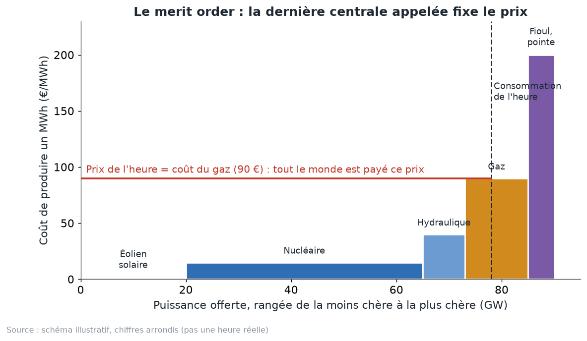

### Le vrai chiffre
Heures à prix **négatif** en France : **147 en 2023, 352 en 2024, 509 en 2025** (RTE compte 352 et 513 : même
ordre). RTE en compte déjà **407 au premier semestre 2026**, avec deux records : **−478,8 €/MWh le 26 avril** et
**−498,7 €/MWh le 1er mai**.

Prix **nuls ou négatifs** en 2026 : environ **800 heures** selon pv magazine. Notre calcul donne **805 heures** si on
compte au quart d'heure (le marché fixe un prix par quart d'heure depuis octobre 2025), mais seulement **670** si on
fait d'abord la moyenne de chaque heure : la moyenne cache des quarts d'heure négatifs.

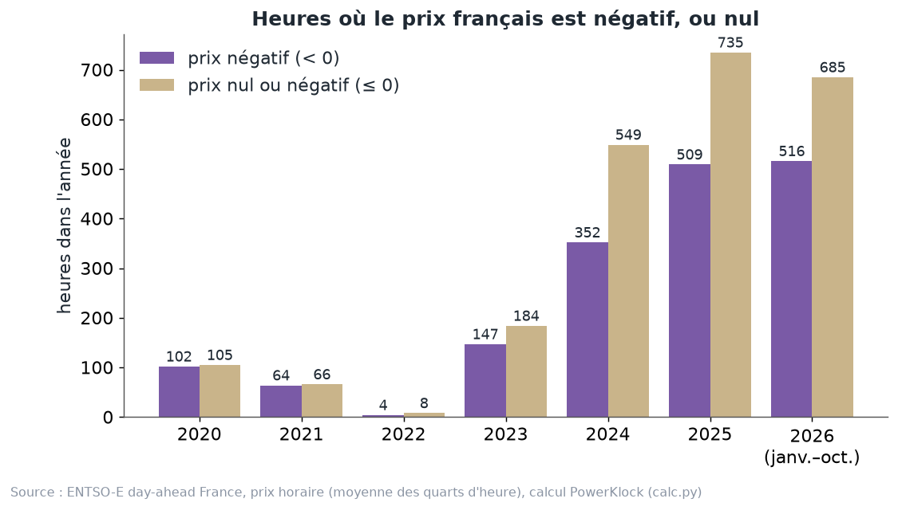

> **À retenir**
> - Un seul prix par heure, fixé par la dernière centrale nécessaire.
> - Le forward est un prix fixé à l'avance ; il peut se tromper (Cal 2026 coté 59,5 €, spot réalisé 90 €).
> - Prix négatif = trop de production qui ne s'arrête pas.

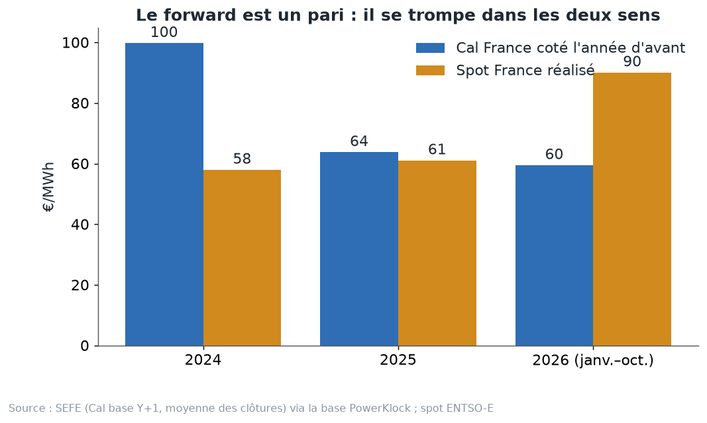

### Pour aller plus loin
- EPEX SPOT, *Euphemia public description* : comment l'enchère européenne calcule les prix —
  https://www.mercatoelettrico.org/EN/MenuBiblioteca/Documenti/20181212EuphemiaPublicDescription.pdf
- RTE, *Bilan électrique du premier semestre 2026* (prix négatifs, p. 33 et suivantes) —
  https://assets.rte-france.com/prod/public/2026-07/2026-07-16-bilan-semestre1.pdf
- pv magazine, 2 oct. 2026, « France hits record 800 hours of negative, zero electricity prices » —
  https://www.pv-magazine.com/2026/10/02/france-hits-record-800-hours-of-negative-zero-electricity-prices/

### À dire à voix haute
« Imagine une vente aux enchères chaque matin. Les centrales disent : moi je produis pour tant d'euros. On les
range de la moins chère à la plus chère : d'abord le vent et le soleil, presque gratuits ; puis le nucléaire ; puis
les barrages ; puis le gaz ; et tout au bout, le fioul. On monte l'escalier jusqu'à couvrir la consommation de
l'heure. La dernière marche qu'on a dû monter, c'est le prix. Et tout le monde touche ce prix, même l'éolienne qui ne
coûte presque rien. C'est comme au marché : le dernier cageot vendu fixe le prix de tous les cageots.

Le forward, c'est autre chose. C'est un prix qu'on fixe aujourd'hui pour livrer plus tard. Comme réserver un hôtel
six mois avant. Parfois on paie trop, parfois on a fait une affaire. En 2024, le marché avait coté 100 euros, et le
spot a fini à 58. En 2026, c'est l'inverse : 60 coté, 90 réalisé.

Et les prix négatifs ? Quand il y a beaucoup de soleil et de vent, et que des centrales ne peuvent pas ou ne
veulent pas s'arrêter, il y a trop d'électricité. Alors on paie pour qu'on vous la prenne. En France, on est passé
de moins de deux cents heures en 2023 à plus de sept cents en 2025. »

---

## Chapitre 2 — La capture et la cannibalisation

### L'idée
Un parc solaire produit surtout à midi. Or à midi, tous les parcs solaires produisent en même temps : le prix
baisse. Le MWh solaire vaut donc **moins que le prix moyen**. Le rapport « ce que vaut le MWh du parc ÷ prix moyen »
s'appelle le **taux de capture**. Quand ce taux baisse parce qu'il y a de plus en plus de parcs, on parle de
**cannibalisation** : les parcs se mangent la valeur entre eux.

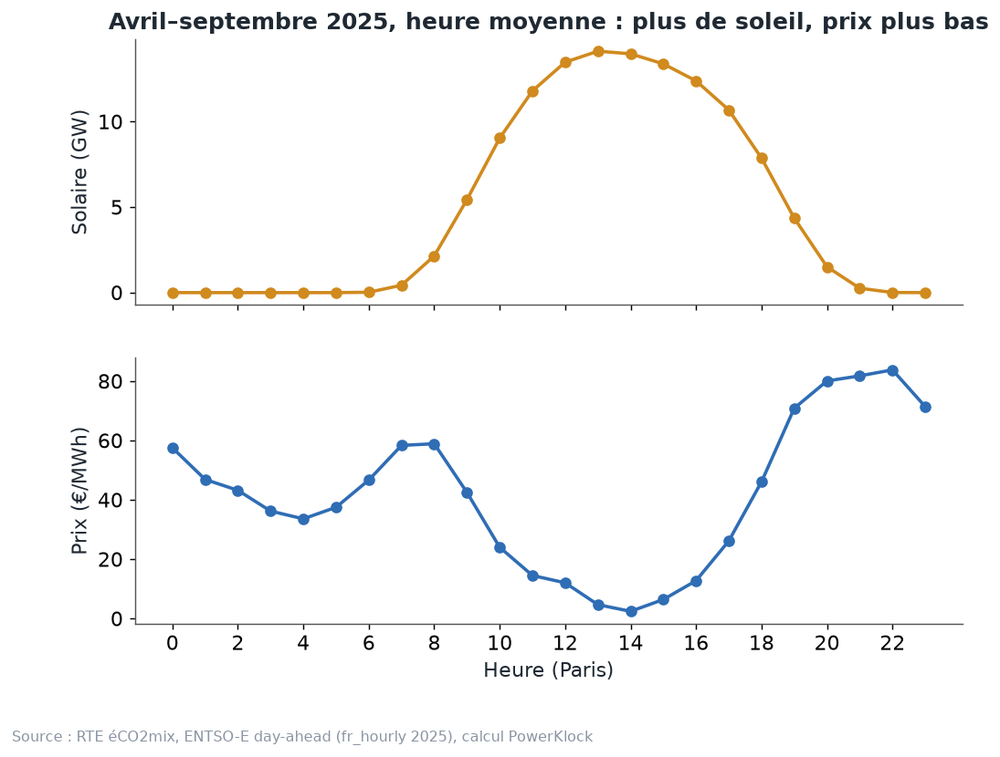

### Le vrai chiffre
Taux de capture du solaire en France (production non payée aux prix ≤ 0) : **0,85 en 2023, 0,67 en 2024, 0,58 en
2025, 0,56 de janvier à octobre 2026**. L'éolien reste vers **0,89**.

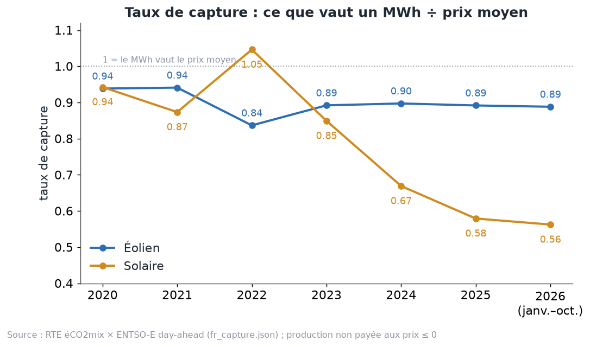

> **À retenir**
> - Capture = valeur du MWh produit ÷ prix moyen.
> - Le solaire perd vite de la valeur : tout le monde produit à la même heure.
> - L'éolien perd moins : le vent souffle à des heures plus variées, souvent la nuit et l'hiver.

### Pour aller plus loin
- L. Hirth (2013), « The market value of variable renewables », *Energy Economics* : la référence sur la
  cannibalisation. La valeur du vent passe de 110 % à 50–80 % du prix moyen quand sa part passe de 0 à 30 % —
  https://cadmus.eui.eu/bitstream/handle/1814/27135/RSCAS_2013_36.pdf
- Pexapark, « How do you account for cannibalization? » —
  https://help.platform.pexapark.com/en/articles/9577860-how-do-you-account-for-cannibalization

### À dire à voix haute
« Pense à un marchand de glaces sur une plage. S'il est seul, il vend ses glaces cher. Si vingt marchands arrivent
sur la même plage, à la même heure, le prix des glaces baisse pour tout le monde. Le soleil, c'est pareil : tous
les panneaux de France produisent en même temps, à midi. Donc à midi, l'électricité ne vaut presque rien. Regarde le
schéma : la courbe du soleil monte, celle du prix descend. Elles sont en miroir.

Le taux de capture mesure ça. Si un MWh solaire vaut 56 % du prix moyen, la capture est de 0,56. En 2022, elle
était au-dessus de 1, parce que le soleil produisait pendant les heures chères. En 2025, elle est à 0,58. Ça, c'est
la cannibalisation : les parcs solaires se volent la valeur entre eux.

L'éolien résiste mieux. Le vent ne souffle pas toujours en même temps partout, et il souffle plus l'hiver et la nuit,
quand on consomme beaucoup. Sa capture reste autour de 0,89. »

---

## Chapitre 3 — Ce qu'est un PPA et comment on le price

### L'idée
Un **PPA** est un contrat long (souvent 3 à 15 ans) entre un producteur et un acheteur, à un prix fixe. En
**pay-as-produced**, l'acheteur prend toute la production, à l'heure où elle arrive. Il prend donc le risque du
profil : il reçoit beaucoup de MWh à midi, quand ils valent peu.

Le prix se construit en cascade : **forward × capture − prime de risque − coût des écarts + garanties d'origine − marge**.

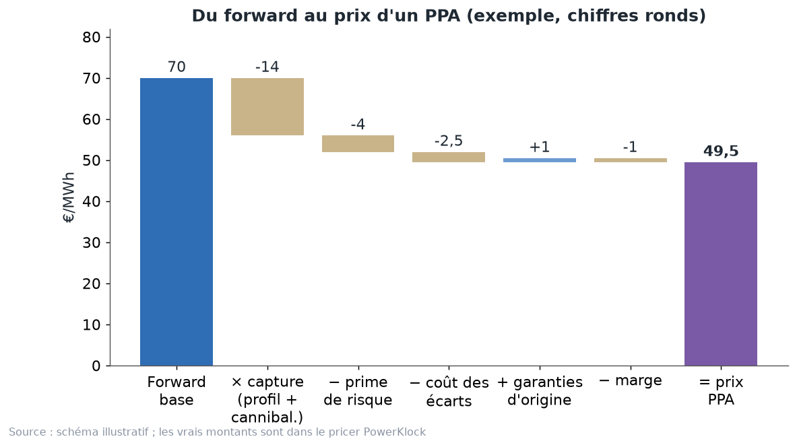

La **méthode en 3 étapes** de Tom :
1. **le forward** : le prix moyen attendu d'un MWh « plat » (le même chaque heure) ;
2. **le profil** : on n'achète pas un MWh plat mais un MWh solaire ou éolien, qui tombe à certaines heures et
   certains mois ;
3. **la cannibalisation** : ces heures sont moins chères *justement parce que* le parc et ses semblables produisent.

Convention du site : **la production n'est pas payée quand le prix est ≤ 0** (le parc s'arrête, ou le contrat ne la
paie pas).

### Le vrai chiffre
Prix publiés au 31 octobre 2026 (pricer PowerKlock, contrat 2027–2029) : **solaire 47,07 €/MWh, éolien
77,78 €/MWh**. Ils bougent chaque jour avec les forwards.

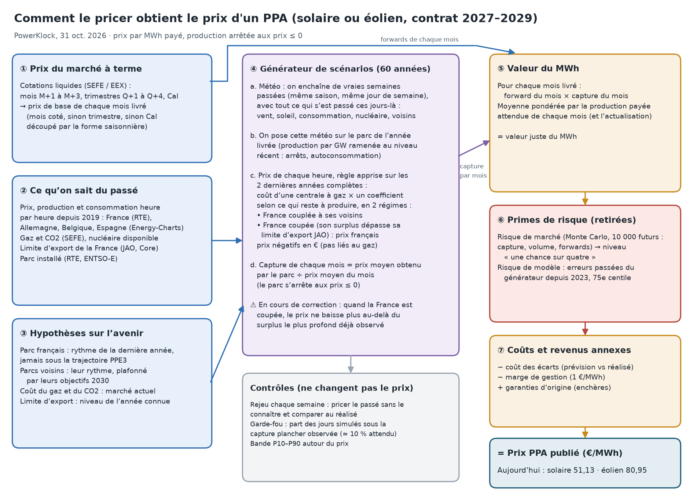

> **À retenir**
> - PPA pay-as-produced : l'acheteur prend tout, quand ça vient.
> - Prix = forward × capture, moins les risques et les coûts, plus les garanties d'origine.
> - La capture, c'est le profil + la cannibalisation.

### Pour aller plus loin
- Pexapark : prix d'un PPA = valeur attendue − prix de marché du risque —
  https://help.platform.pexapark.com/en/articles/9577400-what-are-ppa-prices-shown-on-pexaquote-and-the-market-price-of-risk
- Qorbanian, Löhndorf et Wozabal, « Valuation of Power Purchase Agreements for Corporate Renewable Energy
  Procurement », *European Journal of Operational Research*, 2025 — https://arxiv.org/abs/2403.08846

### À dire à voix haute
« Un PPA, c'est comme un abonnement de longue durée chez un maraîcher. Tu t'engages à acheter toutes ses tomates,
quand elles poussent, à un prix fixé d'avance. Le problème : ses tomates arrivent toutes en août, quand il y en a
partout. Donc tu ne vas pas payer le prix moyen de la tomate dans l'année. Tu vas payer moins.

Pour trouver le bon prix, on part du forward : le prix moyen d'un MWh livré à toutes les heures pareil. Ensuite on
le corrige par la capture : un MWh solaire vaut, disons, 60 % de ça. Puis on retire une prime de risque, parce que
personne ne sait vraiment ce que vaudra le solaire en 2028. On retire le coût des écarts : le parc ne produit jamais
exactement ce qu'il a annoncé. On ajoute la valeur des garanties d'origine, le petit certificat vert. Et on retire
une marge pour celui qui gère le contrat.

Ta méthode en trois étapes découpe la capture en deux morceaux. Le profil, c'est l'effet calendrier : le soleil
produit en été et à midi. La cannibalisation, c'est l'effet foule : ces heures sont moins chères justement parce que
tout le monde produit. »

---

## Chapitre 4 — Le système français

### L'idée
La France, c'est d'abord le **nucléaire** : beaucoup de puissance, bon marché, qui peut baisser un peu sa production
(moduler) mais pas descendre à zéro facilement. Ensuite l'**hydraulique** (barrages, lacs, pompage), qui sert de
réserve. Le **solaire et l'éolien** grandissent vite. Résultat : la France a souvent trop d'électricité, et elle
**exporte**.

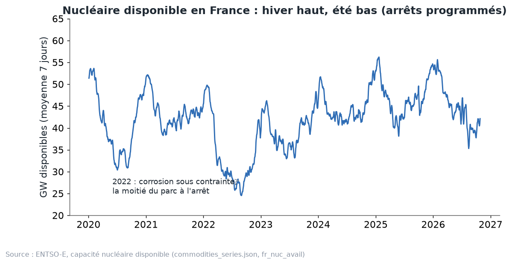

### Le vrai chiffre
- La France a été **exportatrice nette près de 99 % du temps en 2025**, record de **92,3 TWh** (RTE, bilan 2025).
  Nouveau record au premier semestre 2026 : **51,0 TWh** en six mois (RTE).
- Le nucléaire ne descend pas à zéro : le **minimum technique** d'un réacteur va de **25 % à 100 %** de sa puissance,
  selon l'avancement de son cycle de combustible (RTE). Au printemps 2026, beaucoup de réacteurs étaient en fin de
  cycle : le minimum du parc était d'environ **31 GW le 1er mai 2026**, contre **19 GW le 1er mai 2025**. Le nucléaire
  a donc moins modulé : environ **10 TWh** au premier semestre 2026, contre près de **20 TWh** un an plus tôt.
- Le **27 mars 2026**, la CRE a approuvé un accord RTE–EDF : RTE peut demander à certains réacteurs de **rester
  allumés** pour tenir la **tension** du réseau (du 4 avril au 30 octobre 2026). D'après RTE, ces demandes n'ont joué
  qu'un **rôle marginal** : elles visaient surtout des réacteurs qu'EDF gardait déjà en marche.
- 2027 : les arrêts programmés déclarés vont jusqu'à **environ 21 GW indisponibles en même temps fin mai** (18 GW en
  avril, 11 GW en moyenne sur l'année ; ENTSO-E, au 30 octobre 2026, ces plannings bougent). EDF prévoit 350 à
  370 TWh de nucléaire en 2026 comme en 2027.

> **À retenir**
> - Nucléaire = la base, il module mais garde un minimum, qui dépend du combustible.
> - Disponibilité du nucléaire haute en hiver, basse en été (on fait les arrêts quand on consomme moins).
> - Sécheresse et chaleur font baisser le nucléaire en bord de rivière (jusqu'à 2 à 3 GW selon RTE) et l'hydraulique.
> - La France exporte presque tout le temps.

### Pour aller plus loin
- RTE, *Bilan du premier semestre 2026*, chapitre 6 (« Un parc nucléaire […] qui a moins modulé ») —
  https://assets.rte-france.com/prod/public/2026-07/2026-07-16-bilan-semestre1.pdf
- CRE, délibération n° 2026-67 du 27 mars 2026 (accord d'imposition pour la tension haute) —
  https://www.cre.fr/fileadmin/Documents/Deliberations/2026/260327_2026-67_Approbation_Accord_Injection_THT.pdf
- Kpler (février 2026), la modulation nucléaire française en 2025 : +17 %, dont 70 % pour des raisons économiques —
  https://www.kpler.com/blog/nuclear-modulation-insights-volumes-and-units-behaviours
- EDF, estimation de production nucléaire (350–370 TWh en 2026 et 2027) —
  https://www.edf.fr/groupe-edf/espaces-dedies/journalistes/tous-les-communiques-de-presse/estimation-de-production-nucleaire-d-edf-en-france

### À dire à voix haute
« Le système français ressemble à une grande maison avec une énorme chaudière : le nucléaire. Elle chauffe pour
pas cher, mais elle n'aime pas qu'on la baisse trop. On peut la moduler un peu, pas l'éteindre et la rallumer comme
une lampe. Et sa marge de baisse dépend de son carburant : un réacteur en fin de cycle de combustible ne peut presque
plus baisser. Au printemps 2026, beaucoup de réacteurs étaient dans ce cas : le nucléaire a deux fois moins modulé
qu'en 2025, et les prix négatifs ont été plus profonds.

À côté, il y a les barrages. C'est la batterie naturelle du pays : on garde l'eau pour les heures chères. Et il y a
le solaire et l'éolien, qui poussent vite.

Le nucléaire n'est pas toujours là. Regarde la courbe : chaque été, la disponibilité baisse, parce qu'EDF fait ses
arrêts quand on consomme peu. En 2022, c'était la crise : la moitié du parc arrêtée pour des problèmes de corrosion.
Et en été sec, les rivières sont trop chaudes pour refroidir les centrales : encore moins de nucléaire.

Au total, la France a souvent trop d'électricité. En 2025, elle a exporté presque tout le temps : 99 % des heures,
92 térawattheures sur l'année, un record. »

---

## Chapitre 5 — Le couplage européen

### L'idée
Trois règles :
1. **Un prix par zone**, le même pour tous dans la zone.
2. **Une seule enchère pour toute l'Europe** : elle calcule en même temps le prix de chaque pays et les échanges.
3. **Les échanges sont limités par les lignes.** Tant qu'une ligne a de la place, les prix s'égalisent. Quand elle
   est pleine, les prix se séparent, et l'écart × le volume échangé fait la **rente de congestion**.

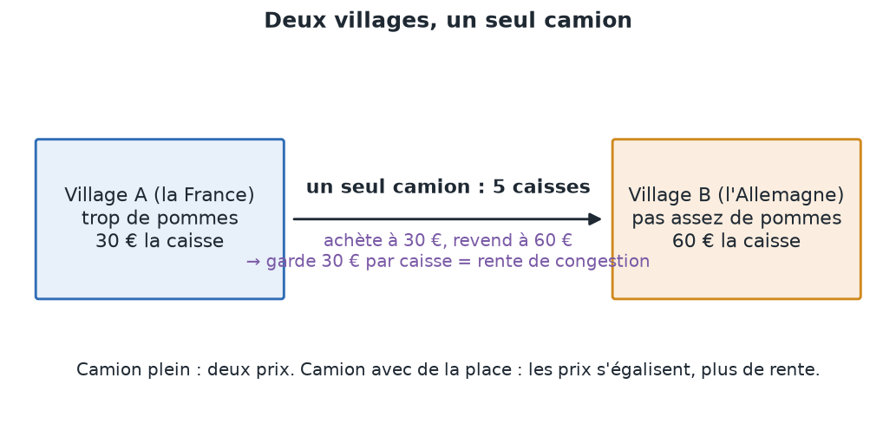

Dans la zone **Core** (France, Belgique, Allemagne, Pays-Bas, Europe centrale), on calcule la place sur les lignes
avec le modèle **flow-based** depuis le 8 juin 2022 : il regarde le vrai chemin de l'électricité dans le réseau.

### Le vrai chiffre
La limite d'export de la France vers Core baisse : **9,2 GW en 2023, 7,7 en 2024, 5,4 en 2025, 5,9 en 2026**
(moyenne horaire). Une raison : les exports vers l'Italie chargent les lignes 400 kV **Creys–Saint-Vulbas**, et
ce qui passe vers l'Italie ne peut plus passer vers Core. La seconde de ces lignes limite les échanges **49 % du
temps en 2026**, contre 21 % en 2025 (Boerman, 2026).

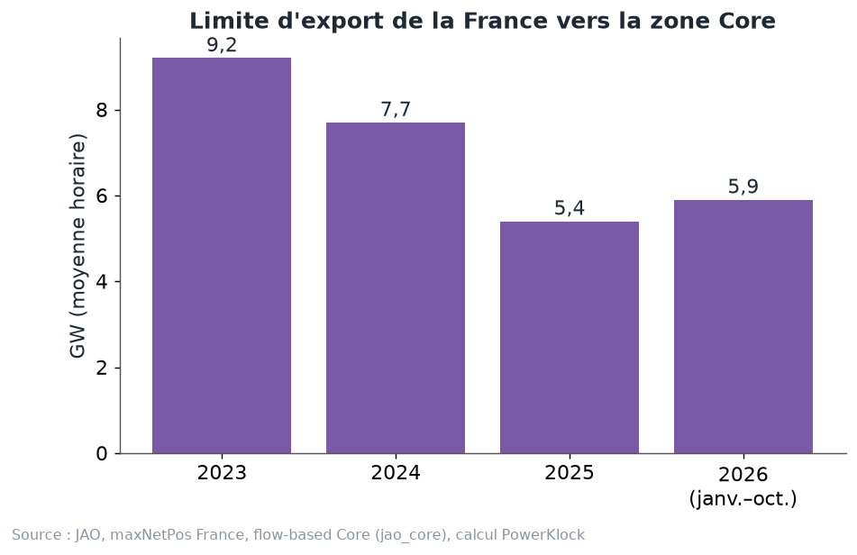

> **À retenir**
> - Ligne libre = un seul prix. Ligne pleine = deux prix + une rente.
> - La France peut exporter de moins en moins vers Core.

### Pour aller plus loin
- Boerman (2026), « Flowbased: export restrictions of France » — https://boerman.dev/posts/flowbased/highfuaf2026/
- JAO, outil de publication Core flow-based (limites d'export, lignes critiques) — https://publicationtool.jao.eu/core
- Le flow-based expliqué simplement (PTDF, lignes critiques, marge minimale de 70 %) : CRE, annexe de la délibération
  2018-176 — https://www.cre.fr/fileadmin/Documents/Deliberations/import/180906-2018-176_FLOW_BASED_annexe.pdf

### À dire à voix haute
« Deux villages. Au village A, il y a trop de pommes : la caisse vaut 30 euros. Au village B, il en manque : la caisse
vaut 60. Un seul camion relie les deux, il porte cinq caisses. Il achète à 30, revend à 60, et garde la différence :
c'est la rente de congestion.

Si le camion était plus grand, A enverrait des pommes jusqu'à ce que les deux prix soient égaux. C'est ce qui se
passe quand la ligne électrique a de la place : un seul prix pour les deux pays.

Le village A, c'est la France. Le camion, c'est la ligne. Et son propriétaire, ce sont les gestionnaires de réseau,
RTE et ses voisins, qui se partagent la rente.

Le problème : le camion rétrécit. Vers la zone Core, la France pouvait exporter 9 gigawatts en 2023. En 2025, c'est
5,4. Pourquoi ? Une partie des lignes sert aussi à envoyer de l'électricité vers l'Italie, notamment deux lignes très
chargées près de Lyon, Creys et Saint-Vulbas. Ce qui part vers l'Italie prend la place de ce qui pourrait partir vers
l'Allemagne. »

---

## Chapitre 6 — La France couplée ou coupée

### L'idée
Avant, la France avait souvent le même prix que l'Allemagne. Aujourd'hui, elle a souvent trop d'électricité et la
ligne est pleine : elle est **coupée**, et son prix tombe en dessous. Mais **même coupée, elle suit l'Allemagne**,
par ses autres frontières (Italie, Suisse, Grande-Bretagne, Espagne).

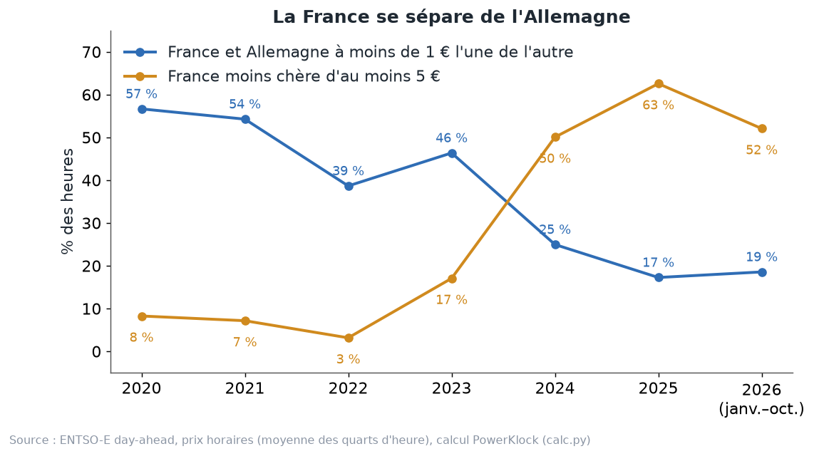

### Le vrai chiffre
- Heures où France et Allemagne sont à moins de 1 € l'une de l'autre : **57 % en 2020, 17 % en 2025**.
- France moins chère : **67 % des heures en 2025**, prix moyen 58 € contre 103 € pendant ces heures.
- **67 % de la production éolienne française de 2025** est tombée pendant des heures coupées.
- Le couplage a-t-il fait monter le prix spot français ? **Oui, les années où la France exporte** : environ
  **+38 €/MWh en 2025** par rapport à une France isolée (estimation de modèle, jamais observée).

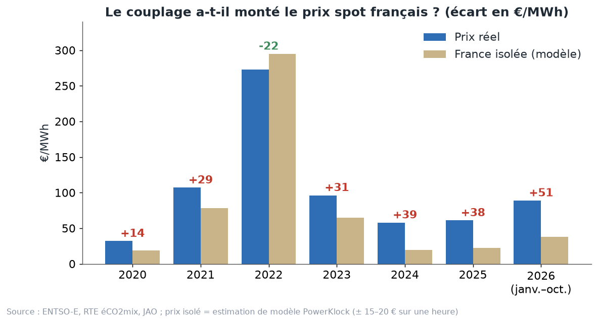

> **À retenir**
> - La France est de moins en moins au prix allemand.
> - Coupée, son prix baisse, mais il suit quand même les voisins.
> - Sans échanges, la France en surplus aurait un prix bien plus bas : exporter fait monter le prix français.

### Pour aller plus loin
- CRE, *Rapport de surveillance des marchés de gros 2025*, pp. 79–82 (convergence des prix) —
  https://www.cre.fr/fileadmin/Documents/Rapports_et_etudes/2026/Rapport_de_surveillance_2025.pdf
- RTE, *Bilan électrique 2025* (exports, prix découplés) —
  https://assets.rte-france.com/prod/public/2026-02/Bilan-electrique-2025-principaux-resultats.pdf
- Le dossier PowerKlock : `docs/discussion/couplage/couplage_europeen.pdf` et `methodologie.md`.

### À dire à voix haute
« En 2020, plus d'une heure sur deux, la France et l'Allemagne avaient presque le même prix. En 2025, c'est moins
d'une heure sur cinq. Les deux marchés se sont séparés.

Pourquoi ? Parce que la France a de plus en plus de surplus, et le camion vers l'Allemagne est plein. Alors le
prix français descend tout seul. En 2025, la France était moins chère deux heures sur trois : 58 euros contre 103.

Mais attention : même séparée, la France ne vit pas seule. Elle exporte encore vers l'Italie, la Suisse, la
Grande-Bretagne. Quand le vent allemand tombe, le prix allemand monte, ces voisins paient plus, et le prix français
monte aussi.

Dernière question : le couplage a-t-il fait monter le prix en France ? Pour le prix spot, oui, les années où la
France exporte. Notre modèle estime qu'une France isolée, en 2025, aurait eu un prix autour de 23 euros au lieu de 61.
Pourquoi ? Avec 90 térawattheures de trop et personne à qui les vendre, le nucléaire aurait dû moduler sans arrêt.
Mais attention : c'est une estimation, une France isolée n'a jamais existé. Et en 2022, c'était l'inverse : la France
importait, et les voisins ont fait baisser son prix. »

---

## Chapitre 7 — Les interactions

### L'idée
Le prix d'une heure dépend de plusieurs choses qui **arrivent ensemble** :
- **le vent** : les heures venteuses sont moins chères, en partie parce que l'Allemagne est venteuse en même temps ;
- **le soleil** : il fait baisser les prix de midi ;
- **le vent et le soleil des voisins** pèsent presque autant que les nôtres ;
- **la sécheresse** : une année sèche est aussi une année peu venteuse, et souvent chaude (moins de nucléaire) ;
- **le gaz** : il donne le niveau général des prix, même quand la France est coupée.

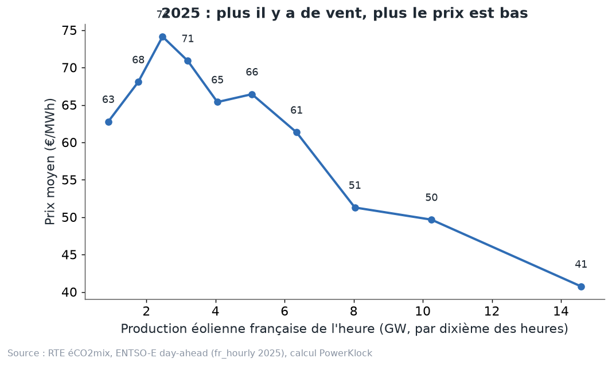

### Le vrai chiffre
- Stiewe, Xu, Eicke et Hirth (30 zones européennes, 2015–2023) : un point de plus d'éolien chez les **voisins** fait
  perdre **0,49 point** de valeur à l'éolien, contre **0,62** pour un point d'éolien **national**. Pour le solaire :
  **2,38** (voisins) contre **1,39** (national). Si le vent monte d'un point partout à la fois, l'éolien perd un peu
  plus d'1 point ; pour le solaire, presque 4.
- Lien entre remplissage des réservoirs et vent : **+0,32** (+0,42 en hiver). 2017 : réservoirs −20 %, vent −7 %.
  2026 : −14 % / −4 %. 2020 (humide) : +26 % / +14 %.
- Heures coupées : prix ÷ coût d'une centrale à gaz ≈ **0,6**, stable de 2024 à 2026.

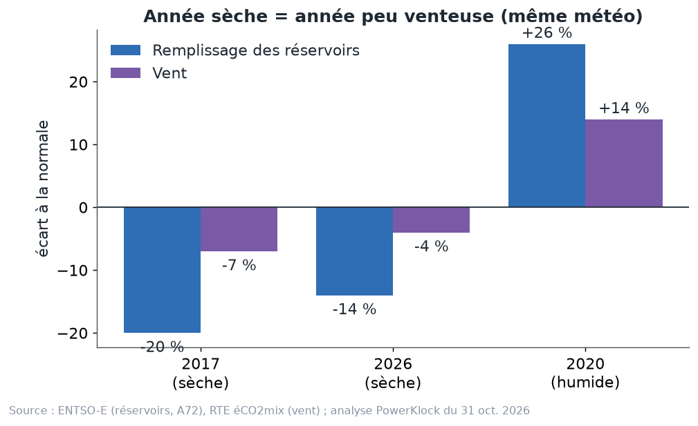

> **À retenir**
> - Rien n'arrive seul : vent, pluie, chaleur, voisins vont ensemble.
> - Une dépression atlantique apporte vent **et** pluie. Un anticyclone : calme, sec, souvent chaud.
> - Le gaz fixe l'échelle des prix ; le reste fixe la position sur l'échelle.

### Pour aller plus loin
- Stiewe, Xu, Eicke et Hirth, « Cross-border cannibalization: Spillover effects of wind and solar energy on
  interconnected European electricity markets » — https://arxiv.org/abs/2405.17166
- RTE, *Bilan du premier semestre 2026* : chaleur, sécheresse et nucléaire en bord de rivière (perspectives) —
  https://assets.rte-france.com/prod/public/2026-07/2026-07-16-bilan-semestre1.pdf

### À dire à voix haute
« Quand il y a du vent en France, il y a souvent du vent en Allemagne aussi. C'est la même météo, qui traverse
l'Europe. Donc quand nos éoliennes tournent, celles des voisins tournent aussi, et personne n'a besoin de notre
électricité. Le prix baisse deux fois.

Des chercheurs, Stiewe et ses collègues, l'ont mesuré en 2025. Le vent des voisins fait presque autant de mal à nos
éoliennes que notre propre vent. Et pour le solaire, c'est même pire : le soleil des voisins pèse plus que le nôtre.

Deuxième lien, plus surprenant : la pluie et le vent vont ensemble. Les grosses dépressions venues de l'Atlantique
apportent les deux. À l'inverse, un anticyclone, c'est calme, sec, souvent chaud. En 2017, année sèche, les
réservoirs étaient 20 % sous la normale, et le vent 7 % sous la normale. En 2020, année humide, tout était au-dessus.
Et une année chaude et sèche, c'est aussi moins de nucléaire, parce que les rivières sont trop chaudes.

Enfin, le gaz. Même quand la France est coupée, son prix reste à peu près 60 % du coût d'une centrale à gaz. Le gaz
donne l'échelle ; le vent et le soleil disent où on se place sur l'échelle. »

---

## Chapitre 8 — 2026, une année à part

### L'idée
2026 cumule plusieurs chocs : une **crise du gaz** (le gaz cher fait monter les prix), **beaucoup d'heures à prix
nul ou négatif**, une **sécheresse** en fin d'été, et un **nucléaire moins flexible** au printemps (beaucoup de
réacteurs en fin de cycle de combustible). Les prix sont à la fois plus hauts
en moyenne et plus souvent à zéro.

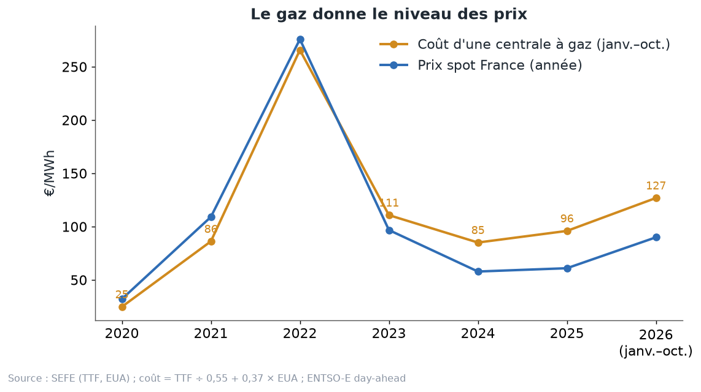

### Le vrai chiffre
- Coût d'une centrale à gaz (TTF ÷ 0,55 + 0,37 × CO2) : **127 €/MWh** de janvier à octobre 2026, contre
  **94 € en 2025** (96 € sur janvier–octobre 2025 dans notre calcul).
- Environ **800 heures** de prix nul ou négatif (pv magazine ; **805** dans notre calcul au quart d'heure), contre
  549 sur toute l'année 2024.
- Minimum technique du parc nucléaire : **31 GW** le 1er mai 2026, contre **19 GW** un an plus tôt (RTE).
- L'éolien a gardé sa valeur : **43 % de sa production de janvier à octobre 2026 est tombée de janvier à mars**,
  contre **35 %** en 2025. Plus de vent en hiver, moins en même temps que le soleil.

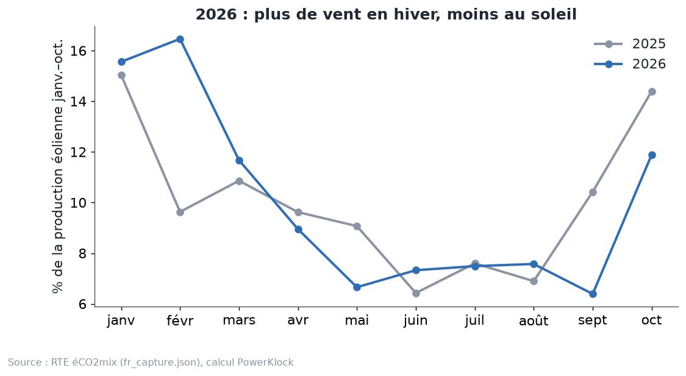

> **À retenir**
> - 2026 : gaz cher → prix moyens hauts ; beaucoup de solaire → beaucoup d'heures à zéro.
> - L'éolien a eu de la chance : il a soufflé l'hiver, aux heures chères.
> - Une année aussi spéciale ne doit pas servir seule de modèle.

**Point incertain.** Le brief parle d'une capture éolienne passée de 0,936 à 0,976. Je retrouve **0,976** pour 2026
(valeur d'un MWh produit aux heures à prix positif ÷ prix moyen, janvier–octobre), mais **0,971** pour 2025 avec la
même mesure, pas 0,936. Avec toute la production comptée (non payée aux prix ≤ 0), c'est 0,891 → 0,888 : stable.
À vérifier ensemble : d'où vient le 0,936 ?

**Correction par rapport à nos notes de recherche.** Le débrief du 31 octobre disait que l'accord RTE–EDF fixait
« un niveau minimum de production nucléaire » et qu'il était la cause probable des erreurs sur 2026. En lisant la
délibération de la CRE et le bilan de RTE : l'accord sert à garder des réacteurs allumés pour la tension, et RTE
juge son rôle marginal. La vraie cause de la moindre modulation est le cycle du combustible.

### Pour aller plus loin
- RTE, *Bilan du premier semestre 2026* : prix négatifs (chapitre 5), nucléaire (chapitre 6) —
  https://assets.rte-france.com/prod/public/2026-07/2026-07-16-bilan-semestre1.pdf
- pv magazine, 2 oct. 2026 (800 heures) —
  https://www.pv-magazine.com/2026/10/02/france-hits-record-800-hours-of-negative-zero-electricity-prices/

### À dire à voix haute
« 2026 est une année bizarre. D'un côté, le gaz est cher : une centrale à gaz coûte 127 euros le MWh à faire
tourner, contre 94 l'an dernier. Comme le gaz fixe le prix des heures difficiles, les prix moyens montent.

De l'autre côté, il y a tellement de soleil à midi que le prix tombe à zéro ou en dessous environ 800 heures, et on
n'est qu'en octobre. Bien plus que sur toute l'année 2024.

Pourquoi des prix négatifs si profonds au printemps ? RTE l'explique : beaucoup de réacteurs étaient en fin de
cycle de combustible et ne pouvaient presque plus baisser. Le nucléaire a modulé deux fois moins qu'en 2025. Ajoute
la sécheresse de fin d'été : moins d'eau dans les barrages, un peu moins de nucléaire en bord de rivière.

Et l'éolien ? Il s'en sort bien. Cette année, il a beaucoup soufflé en janvier, février, mars : 43 % de sa
production de l'année jusqu'ici, contre 35 % l'an dernier. L'hiver, c'est quand l'électricité est chère. Donc ses
MWh ont valu plus. C'est de la chance météo, pas une tendance. »

---

## Chapitre 9 — Prévoir la capture : le générateur de scénarios

### L'idée
Pour savoir ce que vaudra un MWh solaire en 2028, on fabrique des années possibles :
1. on reprend de **vraies semaines de météo passées** (vent, soleil, consommation) ;
2. on les pose sur le **parc futur** (plus de solaire, plus d'éolien) ;
3. on calcule la production de chaque heure ;
4. une **règle apprise sur le passé** donne le prix de chaque heure ;
5. on en tire la capture de chaque mois.

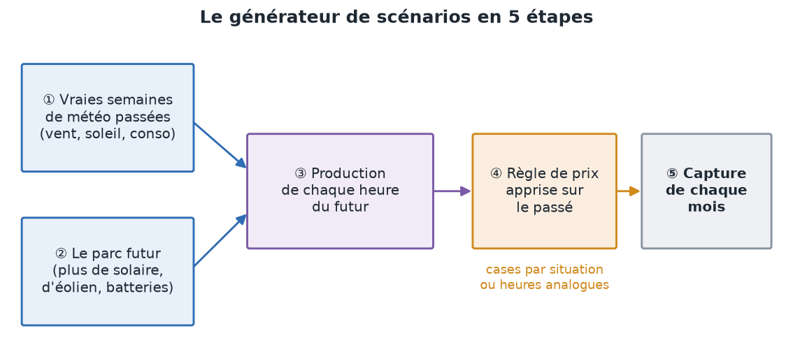

La règle classique range les heures dans des **cases** (« France coupée, beaucoup de surplus, midi »…). Elle paie
l'éolien **trop cher d'environ +2,6 €/MWh**, et ça de façon constante. Même sur l'année qu'elle a apprise, elle lit
3 % trop haut. On corrige avec l'**ancrage** : on mesure l'erreur sur la dernière année réelle, et on la retire.

Les **analogues** sont une autre idée : pour chaque heure simulée, on cherche les heures passées qui lui ressemblent
le plus, et on prend leur prix.

### Le vrai chiffre
Erreur de rejeu de l'éolien sans ancrage : **2,62 €/MWh** avec les cases, **environ 1,1** avec les analogues. Mais
les analogues se trompent sur le solaire.

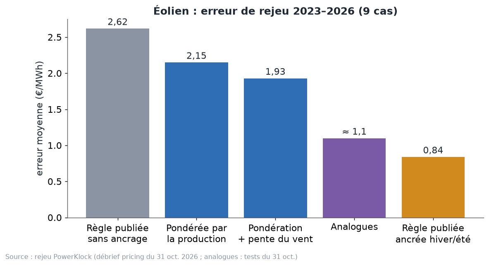

> **À retenir**
> - Générateur = vraie météo passée + parc futur + règle de prix.
> - Les cases surpaient le vent : plusieurs choses arrivent ensemble les heures venteuses.
> - Ancrage = régler la balance qui pèse 3 % trop lourd.
> - Les analogues règlent le vent, mais pas le solaire du futur.

### Pour aller plus loin
- Modo Energy, « Capturing cannibalisation » : sans aligner la météo des prix et celle de la production, les revenus
  solaires sont surestimés de plus de 10 % en 2045 — https://forecastdocs.modoenergy.com/docs/capturing-cannibalisation
- Qorbanian, Löhndorf et Wozabal (2025) : apprendre les coûts en pondérant chaque heure par la production de la
  filière pricée ; testé sur l'Espagne, l'Allemagne et la France, c'est en France qu'il marche le moins bien —
  https://arxiv.org/abs/2403.08846

### À dire à voix haute
« On ne connaît pas la météo de 2028. Alors on rejoue le passé : on prend une vraie semaine de janvier 2021, une
vraie semaine de mars 2024, et on les enchaîne. Mais on y met le parc de 2028, avec beaucoup plus de panneaux. On
obtient la production de chaque heure. Puis il faut un prix : on utilise une règle apprise sur les années passées.

La règle classique range les heures dans des cases, comme des tiroirs. Problème : pour l'éolien, elle se trompe
toujours dans le même sens, d'environ 2,6 euros de trop. Pourquoi ? Parce qu'une heure venteuse, c'est aussi une
heure où l'Allemagne est venteuse, où la France est coupée, où il fait souvent doux. Plusieurs choses arrivent
ensemble, et un tiroir ne les voit pas toutes.

L'ancrage, c'est comme une balance de cuisine qui affiche toujours 3 % de trop. On ne la jette pas : on pèse un
objet connu, on voit l'erreur, et on la retire.

Les analogues, c'est une autre idée. Pour chaque heure du futur, on cherche les dix heures passées qui lui
ressemblent le plus, et on prend leur prix. Ça marche bien pour le vent : l'erreur tombe vers 1 euro. Mais pour le
solaire, ça coince. Le futur aura plus de soleil que tout ce qu'on a déjà vu. Alors les heures les plus proches,
ce sont les pires midis du passé, et on extrapole mal. »

---

## Chapitre 10 — Tester une méthode honnêtement

### L'idée
Pour savoir si une méthode marche, on **fait semblant d'être dans le passé**. On se place fin 2022, on price 2023,
2024 et 2025 avec seulement ce qu'on savait alors. Puis on compare au réel. C'est le **rejeu**.

On a **9 cas** par filière (livraisons 2023 à 2026, pricées 1 à 3 ans avant). On mesure l'erreur en €/MWh. On
regarde deux choses : le **biais** (se tromper toujours dans le même sens) et la **dispersion** (se tromper un coup
en haut, un coup en bas).

### Le vrai chiffre
- Modèle publié : erreur **0,76 €/MWh** en solaire (sans ancrage), **0,84** en éolien (ancré hiver/été).
- Le hasard des tirages fait bouger le résultat de **jusqu'à 0,2 €** : un gain plus petit ne prouve rien.

(Schéma : celui du chapitre 9.)

> **À retenir**
> - Rejeu = pricer le passé sans tricher, puis comparer.
> - Biais : toujours trop haut. Dispersion : tantôt haut, tantôt bas.
> - 9 cas, c'est peu : une seule mauvaise année pèse lourd.
> - Un gain de moins de 0,2 € peut être du hasard.

### À dire à voix haute
« Comment savoir si une méthode est bonne ? On fait comme un prévisionniste météo qui vérifie ses vieilles
prévisions. On se met fin 2022, on oublie tout ce qui s'est passé après, et on price 2023. Puis on regarde ce que
2023 a vraiment donné.

On fait ça pour toutes les combinaisons possibles : livraison 2023, 2024, 2025, 2026, pricées un, deux ou trois ans
avant. Ça fait neuf cas.

Deux sortes d'erreurs. Le biais, c'est une montre qui avance toujours de cinq minutes : facile à corriger. La
dispersion, c'est une montre qui avance un jour, retarde le lendemain : beaucoup plus gênant.

Et attention au hasard. Le générateur tire des semaines au sort. Si on change le tirage, le résultat bouge de
jusqu'à 20 centimes. Donc une méthode qui gagne 10 centimes n'a rien prouvé. Et neuf cas, c'est peu : une année
spéciale comme 2026 peut tout faire basculer. »

---

## Chapitre 11 — Le risque : P50 et P75

### L'idée
Le prix futur n'est pas un chiffre, c'est un **éventail**. **P50** = le prix au milieu : une chance sur deux d'être
au-dessus. **P75** = le prix prudent : la vraie valeur sera **au-dessus 3 fois sur 4**.

On obtient l'éventail par **Monte Carlo** : on tire des milliers de futurs possibles. Mais un Monte Carlo **ne
connaît que les risques qu'on lui donne**.

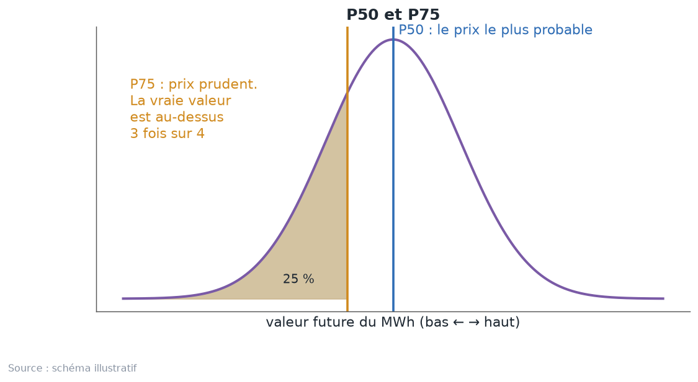

### Le vrai chiffre
- Monte Carlo avec la **météo seule** : la bande P10–P90 contenait la réalité dans **environ 45 % des mois** (il en
  faudrait 80 %). Trop étroit.
- Monte Carlo **complet** (semaines tirées « chères ou bon marché », croissance du parc, nucléaire avec une année
  rare type 2022, limite d'export Core, consommation) : le P75 a tenu dans **78 à 89 % des cas**.

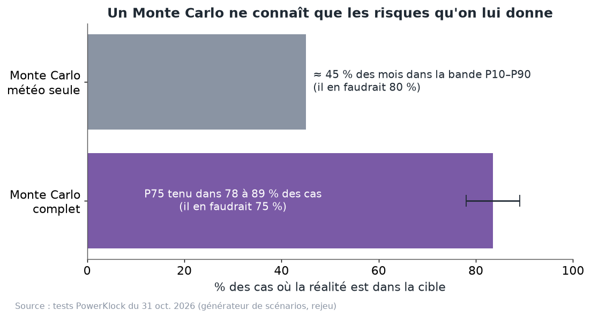

Autre méthode : regarder **nos erreurs passées** et prendre leur 75e centile, en donnant plus de poids aux années
récentes (Barber, Candès, Ramdas et Tibshirani, *Annals of Statistics*, 2023).

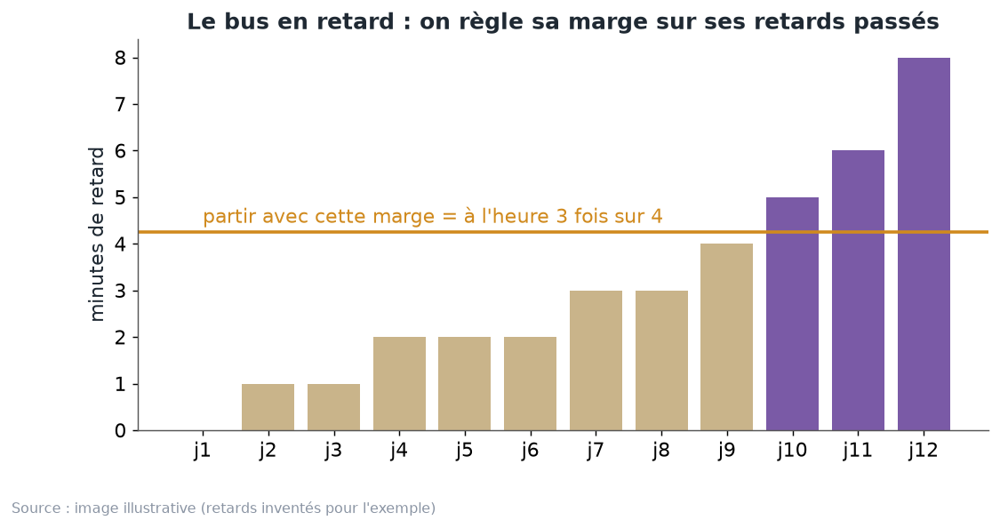

> **À retenir**
> - P50 = milieu, P75 = prudent (au-dessus 3 fois sur 4).
> - Un Monte Carlo trop simple rassure à tort.
> - Les erreurs passées sont une bonne règle de prudence.
> - Trop de critères de tirage → tous les scénarios reprennent les mêmes années : il faut garder de la variété.

### Pour aller plus loin
- Barber, Candès, Ramdas et Tibshirani, « Conformal prediction beyond exchangeability », *Annals of Statistics* 51(2),
  2023 — https://arxiv.org/abs/2202.13415
- Pexapark, le « prix de marché du risque » dans un PPA —
  https://help.platform.pexapark.com/en/articles/9577400-what-are-ppa-prices-shown-on-pexaquote-and-the-market-price-of-risk

### À dire à voix haute
« Personne ne connaît le prix de 2028. Alors on ne donne pas un chiffre, on donne un éventail. Le P50, c'est le
milieu : une chance sur deux d'être au-dessus, une sur deux en dessous. Le P75, c'est le prix prudent : trois fois
sur quatre, la réalité sera meilleure.

Pour fabriquer l'éventail, on tire des milliers de futurs : c'est le Monte Carlo. Mais il a un défaut : il ne connaît
que les risques qu'on lui a appris. Si on ne lui donne que la météo, il oublie que le nucléaire peut s'effondrer,
que la ligne vers l'Allemagne peut rétrécir, que le parc peut grandir plus vite. Résultat : quand on l'a testé, la
réalité tombait dans sa bande seulement une fois sur deux. Il était trop sûr de lui.

Avec tous ces risques ajoutés, le P75 a tenu dans 78 à 89 % des cas. C'est ce qu'on voulait : au moins trois fois
sur quatre.

Il y a une autre façon de faire, très simple. Pense à ton bus. Il est souvent en retard. Pour être à l'heure trois
fois sur quatre, tu regardes ses retards passés, tu prends celui qui couvre trois jours sur quatre, et tu pars avec
cette marge. Et tu fais plus attention aux retards récents, parce que les horaires changent. C'est l'idée de
Barber et de ses collègues : on règle sa prudence sur ses propres erreurs passées. »

---

## Chapitre 12 — Le coût des écarts

### L'idée
Un parc annonce la veille ce qu'il va produire. Le jour J, il produit un peu plus ou un peu moins. Cette erreur se
règle au **prix d'écart**, qui est souvent défavorable. Coût = **erreur de prévision × (prix d'écart − prix spot)**.

Pour un **parc seul**, les erreurs sont grandes. Pour **toute la France**, elles se compensent en partie : un parc
produit trop, un autre pas assez. C'est l'effet **portefeuille**.

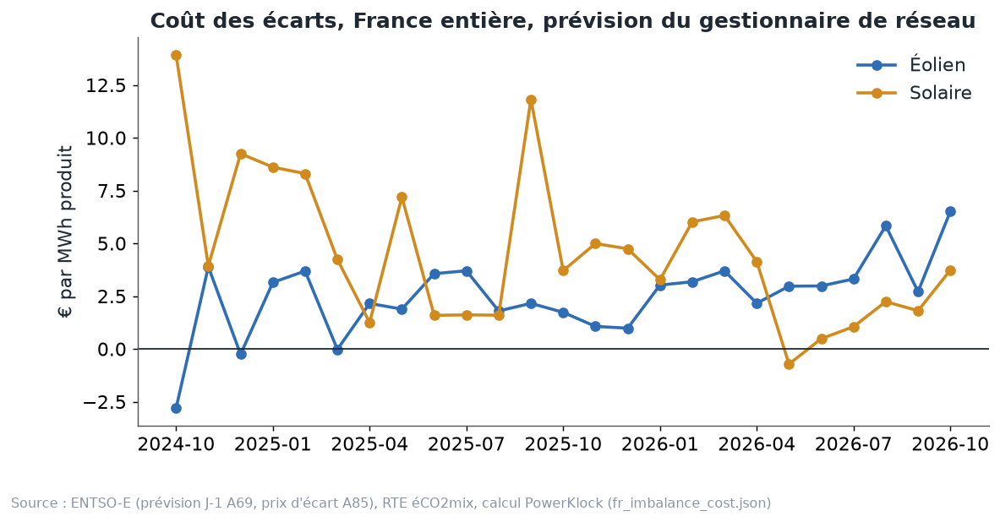

### Le vrai chiffre
Coût des écarts, éolien France entière, sur 12 mois : **3,06 €/MWh** avec la prévision du gestionnaire de réseau,
**2,82 €/MWh** avec notre prévision combinée. Pour le solaire, la prévision du gestionnaire reste meilleure.

> **À retenir**
> - Écart = se tromper de prévision, payé au prix d'écart.
> - Plus le portefeuille est grand, plus les erreurs se compensent.
> - Le site prend, pour chaque filière, la prévision qui s'est le moins trompée sur 12 mois.

### Pour aller plus loin
- CRE : le prix de règlement des écarts, les règles du mécanisme d'ajustement et des responsables d'équilibre
  (délibération 2022-71) — https://www.cre.fr/fileadmin/Documents/Deliberations/import/220310_2022-71_MA-RE.pdf
- RTE, *Bilan du premier semestre 2026*, chapitre 7 : 22 GW d'éolien et de solaire modulables à la demande de RTE —
  https://assets.rte-france.com/prod/public/2026-07/2026-07-16-bilan-semestre1.pdf

### À dire à voix haute
« Chaque parc dit la veille : demain je produirai tant. Le lendemain, la météo change un peu. S'il produit moins que
prévu, quelqu'un doit combler le trou, et ce quelqu'un se fait payer cher. S'il produit plus, son surplus est
racheté bon marché. Dans les deux cas, ça coûte : c'est le coût des écarts.

Un parc seul, c'est un pari risqué. Mais si tu regroupes cent parcs dans toute la France, les erreurs se compensent :
un nuage sur la Bretagne, un grand soleil en Provence. C'est comme une compagnie d'assurance : plus elle a de clients,
plus ses comptes sont prévisibles.

Pour l'éolien, notre prévision combinée fait mieux que celle du gestionnaire de réseau : 2,82 euros par MWh au lieu
de 3,06. Pour le solaire, c'est l'inverse, la sienne est meilleure. Alors le site garde, pour chaque filière, celle
qui s'est le moins trompée sur l'année passée. »

---

## Chapitre 13 — Ce qu'on a testé, ce qu'on a gardé

### Le tableau

| Test | Résultat | Verdict |
|---|---|---|
| Règle par cases, publiée | solaire 0,76 sans ancrage ; éolien 2,62 sans ancrage, 0,84 ancré | **gardée** |
| Pondérer l'apprentissage par la production de la filière | éolien 2,15 sans ancrage, 0,61 ancré ; solaire 1,41 | mieux pour l'éolien, pire pour le solaire : **à décider** |
| Pondération + grille surplus × vent | éolien ancré 0,56 | meilleur éolien ancré : **à décider** |
| Pondération + pente du vent | biais éolien +0,45 seulement, erreur 1,93 | presque plus de biais, encore dispersé |
| Analogues | éolien ≈ 1,1 sans ancrage ; solaire mauvais | **testé, pas branché** |
| Modèle d'optimisation par semaine | surpaye le vent autant que la règle | écarté |
| Régression mensuelle de la capture | instable (éolien 1,7 à 3,4) | écartée |
| Grande-Bretagne, Pays-Bas, Autriche comme modèles | pas mieux | écartés |
| Monte Carlo météo seule | bande trop étroite (≈ 45 %) | insuffisant |
| Monte Carlo complet | P75 tenu 78–89 % | **en test, pas publié** |
| Prévision des écarts combinée | éolien 3,06 → 2,82 | **gardée pour l'éolien** |

### Les décisions qui restent à Tom
1. Pondérer par la production pour l'éolien seulement, ou pour les deux filières ?
2. Garder l'ancrage de l'éolien (aucune méthode ne s'en passe encore).
3. Stabilité du choix de méthode : choix annuel, seuil de 0,2 € ?
4. Brancher le Monte Carlo complet pour la prime de risque ?

### Ce que font les professionnels
- **Pexapark** : calibre ses courbes de capture sur les prix de PPA observés, « le consensus du marché, pas une
  prévision économique » (une forme d'ancrage sur le marché).
- **Modo Energy** : aligne la météo de la production et celle des prix (notre générateur le fait par construction).
- **AFRY, Aurora** : modèles complets du système européen, centrale par centrale.

> **À retenir**
> - Beaucoup de tests, peu de vainqueurs : c'est normal.
> - L'ancrage reste nécessaire pour l'éolien ; le marché fait pareil.
> - Les décisions ouvertes sont des choix de prudence, pas des erreurs.

### À dire à voix haute
« Récapitulons. On a testé une vingtaine d'idées. La plupart n'ont pas battu le modèle publié. C'est normal : un bon
modèle est difficile à battre, et neuf cas de rejeu, c'est peu pour trancher.

Ce qui marche : pondérer l'apprentissage par la production de l'éolien améliore l'éolien. Les analogues enlèvent
presque toute l'erreur du vent, mais cassent le solaire. Le Monte Carlo complet donne enfin un P75 qui tient. Et notre
prévision combinée fait baisser le coût des écarts de l'éolien.

Ce qui reste à décider, c'est à toi : est-ce qu'on accepte une règle différente pour l'éolien et le solaire ? Est-ce
qu'on garde l'ancrage ? Est-ce qu'on publie le Monte Carlo complet ?

Et les pros ? Pexapark fait en gros de l'ancrage, mais sur des prix de contrats réels qu'on n'a pas. Aurora et AFRY
font tourner des modèles géants, centrale par centrale. Nous, on est entre les deux : simple, transparent, testé
honnêtement. »

---

## Pour continuer

Dis-moi par exemple :
- « chapitre 5, à l'oral » — je te le raconte ;
- « un schéma sur la rente de congestion » — je le dessine ;
- « la version détaillée du chapitre 9 » — formules et tests ;
- « interroge-moi sur le chapitre 2 ».

*Sources principales : `docs/discussion/pricing/debrief-2026-10-31.md` ; `docs/discussion/couplage/` (diaporama,
méthodologie, sources) ; données `data/history/` ; chiffres recalculés par `docs/discussion/cours/calc.py`, schémas
par `charts.py`.*
