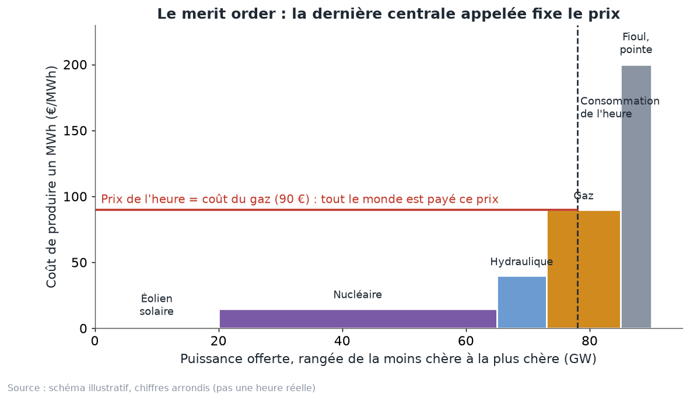
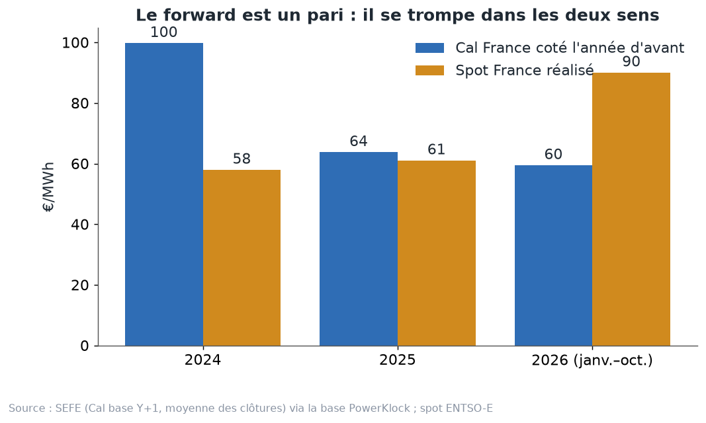
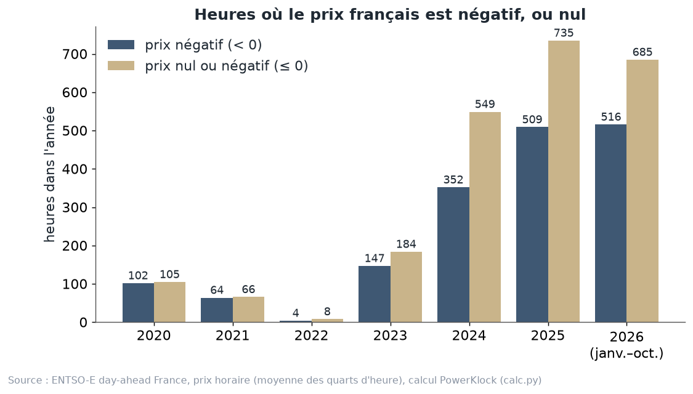

# Chapitre 1 à l'oral — les bases : prix spot, merit order, forward, prix négatifs, version complète

*Pour Tom · 1er novembre 2026 · à lire à voix haute, environ 15 minutes*

## 1. Le prix spot : une enchère chaque jour
L'électricité se stocke mal. Ce qui est produit doit être consommé au même moment. Il faut donc décider, chaque
jour, qui produit quoi le lendemain, et à quel prix. C'est le rôle de l'**enchère de la veille** (le *day-ahead*).
Le prix qui en sort s'appelle le **prix spot**.

Comment ça se passe :
- Chaque jour, avant **midi** (heure de Paris), les producteurs et les acheteurs déposent leurs offres pour le
  lendemain, auprès des bourses (EPEX, Nord Pool…).
- Les vendeurs disent : « je produis tant de MWh, à partir de tel prix ».
- Les acheteurs disent : « j'achète tant de MWh, jusqu'à tel prix ».
- Depuis le **1er octobre 2025**, il y a une offre par **quart d'heure**. Avant, c'était par heure.
- Un seul programme, **Euphemia**, calcule les prix de toute l'Europe d'un coup (le couplage, SDAC). On le verra au
  chapitre 5.
- Le prix est borné : pas plus de **4 000 €/MWh**, pas moins de **−600 €/MWh** (−500 jusqu'au 28 mai 2026).

L'image : un grand marché aux enchères qui ferme tous les jours à midi, et qui fixe en une fois les prix des 96
quarts d'heure du lendemain.

**Une unité, pour ne pas se perdre.** Un MWh, c'est un mégawattheure : une puissance d'un mégawatt pendant une heure.
Les prix sont toujours en euros par MWh (€/MWh).

## 2. Le merit order : l'escalier des centrales
Comment l'enchère trouve-t-elle le prix ? On range les offres de vente de la moins chère à la plus chère. Ça forme un
escalier : c'est le **merit order**, « l'ordre de mérite ».

Sur le schéma (chiffres arrondis, pas une heure réelle) :
- d'abord le **vent et le soleil**, presque gratuits : pas de combustible ;
- puis le **nucléaire**, peu cher à faire tourner ;
- puis l'**hydraulique** ;
- puis le **gaz** ;
- tout au bout, le **fioul** et les centrales de pointe.

On trace la consommation de l'heure : un trait vertical. On monte l'escalier jusqu'à ce trait. **La dernière marche
dont on a besoin fixe le prix.** Sur le schéma, c'est le gaz, à 90 €.

**Et tout le monde touche ce prix.** L'éolienne, qui ne coûte presque rien, est payée 90 € comme la centrale à gaz.
On appelle ça le prix marginal, ou *pay-as-clear*. C'est comme au marché aux fruits : le dernier cageot vendu fixe le
prix de tous les cageots.

**Pourquoi chaque centrale offre à son coût variable.** Le coût variable, c'est ce que coûte un MWh de plus :
surtout le combustible et le CO2.
- Si une centrale offre plus cher que ce coût, elle risque de ne pas être appelée, alors qu'elle aurait gagné de
  l'argent.
- Si elle offre moins cher, elle risque de produire à perte.
- Le plus simple pour elle, c'est donc d'offrir à son vrai coût.

**Le coût d'une centrale à gaz**, la formule qu'on utilise (dossier couplage, `methodologie.md`) :
- coût ≈ prix du gaz (TTF) ÷ 0,55 + 0,37 × prix du CO2 (EUA) ;
- on divise par 0,55 parce que la centrale transforme 55 % de l'énergie du gaz en électricité ;
- on ajoute 0,37 tonne de CO2 par MWh produit, qu'il faut payer.

Pour le charbon : prix du charbon (API2) ÷ 0,38 + 0,90 × prix du CO2.

Notre calcul donne un coût moyen d'une centrale à gaz de **127 €/MWh de janvier à octobre 2026**, contre **96 €
sur les mêmes mois de 2025** (calcul `calc.py`, prix SEFE). C'est la crise du gaz de 2026 (chapitre 8).

**L'exception : l'eau des barrages.** L'eau ne coûte rien, mais elle est rare : un lac ne se remplit pas sur
commande. Le barrage n'offre donc pas à zéro. Il offre à la **valeur d'usage** de l'eau : ce qu'il gagnerait en la
gardant pour plus tard, par exemple pour un soir d'hiver. Comme quelqu'un qui garde sa dernière bouteille d'eau dans
le désert : elle ne lui a rien coûté, mais il ne la vend pas pour trois sous.

**Ce qu'il faut garder en tête pour la France.** Le gaz fixe souvent le prix, même quand la France n'en brûle presque
pas, parce qu'elle est reliée à ses voisins. Même quand la France est coupée de l'Allemagne, son prix reste
proportionnel au coût du gaz : en moyenne environ **0,6 fois** ce coût dans les heures coupées de 2025 et de 2026
(débrief du 31 octobre). On y revient aux chapitres 6 et 7.

## 3. Le forward : fixer le prix à l'avance
Le spot, c'est le prix du lendemain. Mais un industriel, ou un parc solaire, veut souvent connaître son prix des
mois ou des années à l'avance. Pour ça, il y a le **forward**.

Un forward, c'est un contrat signé aujourd'hui pour une livraison future, à un prix fixé aujourd'hui. On peut
acheter :
- un **mois** ;
- un **trimestre** ;
- une **année civile** entière : on l'appelle le **Cal** (pour *calendar*). « Cal 2027 », c'est toute l'année 2027.

Et deux formes :
- **base** : le même MW à toutes les heures, jour et nuit, semaine et week-end ;
- **pointe** : de 8 h à 20 h, en semaine seulement.

L'image : **réserver une chambre d'hôtel six mois avant**. On fixe le prix tout de suite. Parfois on paie trop, parfois
on a fait une affaire. Mais on sait à quoi s'attendre.

**Le forward est un pari, et il se trompe dans les deux sens.**

| Livraison | Cal France coté l'année d'avant | Spot réalisé |
|---|---|---|
| 2024 | 99,8 | 58,0 |
| 2025 | 63,8 | 61,1 |
| 2026 | 59,5 | 90,1 (janvier–octobre) |

Source : SEFE via la base PowerKlock (moyenne des clôtures de l'année d'avant), spot ENTSO-E (`couplage/forwards.json`).

- En 2024, le marché avait coté presque 100 €, et le spot a fini à 58 €. Celui qui avait acheté à l'avance a payé
  cher.
- En 2025, le forward a vu juste, à 3 € près.
- En 2026, c'est l'inverse de 2024 : coté 60, réalisé 90.

**Le forward bouge vite.** Le Cal 2027 France a été coté en moyenne **64,8 €** de janvier à fin octobre 2026
(`forwards.json`). Le 30 octobre 2026, il clôturait à **128,16 €** (`pricing-v2/parametres.md`), soit environ le
double de sa moyenne de l'année. Les Cal suivants sont bien plus bas : **70,94 €** pour 2028 et **62,97 €** pour 2029
(même source). Le marché parie donc sur une année 2027 chère, puis un retour au calme. Ce n'est qu'un pari.

**Le forward voit déjà le découplage de la France.** L'écart entre le Cal France et le Cal Allemagne est passé de
**+3 €/MWh** pour la livraison 2024 à **−37 €** pour la livraison 2027 (`couplage/forwards.json`) : la France est
attendue nettement moins chère que l'Allemagne.

**Pourquoi c'est central pour un PPA.** Le prix d'un PPA part du forward (chapitre 3). Si le forward bouge de 10 €,
le prix du PPA bouge presque d'autant. C'est le premier étage de la fusée.

## 4. Les prix négatifs : on paie pour qu'on vous prenne l'électricité
Un prix négatif, c'est un monde à l'envers : le producteur **paie** pour livrer. Pourquoi accepterait-il ?

Parce que s'arrêter lui coûterait encore plus cher. Qui est dans ce cas :
- un **réacteur nucléaire** qui ne peut pas baisser plus vite, ou plus bas ;
- un **parc sous obligation d'achat**, ou sous un ancien complément de rémunération : il est payé par l'État quel
  que soit le prix du marché, donc il n'a pas de raison de s'arrêter ;
- une **cogénération**, qui doit produire de la chaleur pour une usine ou un réseau de chauffage, et produit de
  l'électricité en même temps.

L'image : un **embouteillage sur une autoroute sans sortie**. Trop de voitures arrivent en même temps, et certaines ne
peuvent pas faire demi-tour. Alors on paie ceux qui acceptent de se retirer.

Quand ça arrive : surtout à **midi, au printemps et en été**, quand le soleil produit beaucoup, que la consommation est
modérée, et que le nucléaire ne peut pas descendre plus bas.

**Les chiffres.**

| | 2023 | 2024 | 2025 | 2026 (janv.–oct.) |
|---|---|---|---|---|
| Heures à prix négatif (< 0) | 147 | 352 | 509 | 516 |
| Heures à prix nul ou négatif (≤ 0) | 184 | 549 | 735 | 685 |

Source : ENTSO-E, prix horaire = moyenne des quarts d'heure, calcul PowerKlock (`calc.py`).

- RTE compte **352** heures négatives en 2024 et **513** en 2025 : notre comptage retombe dessus.
- RTE en compte déjà **407 au premier semestre 2026**, contre 363 au premier semestre 2025.
- Deux records en 2026 : **−478,8 €/MWh le 26 avril** et **−498,7 €/MWh le 1er mai** (RTE, bilan du premier
  semestre 2026).
- En 2025, il y a eu **225 heures à exactement 0 €** (`parametres.md`). C'est pour ça que « négatif » et « nul ou
  négatif » donnent des chiffres si différents.

**Le piège : compter au quart d'heure.** Depuis le 1er octobre 2025, il y a un prix par quart d'heure. Si on fait
d'abord la moyenne de chaque heure, on perd les quarts d'heure négatifs d'une heure dont la moyenne reste positive.

| Prix nuls ou négatifs en 2026 (janvier–octobre) | Heures |
|---|---|
| Comptés au quart d'heure (nombre de quarts d'heure ÷ 4) | **805** |
| Comptés sur la moyenne de chaque heure | 670 |
| pv magazine, 2 octobre 2026 | « environ 800 » |

C'est le comptage au quart d'heure qui retombe sur pv magazine. **Désormais, on compte au quart d'heure.**

L'image : une classe où un élève a 2 sur 20 et un autre 18. La moyenne de 10 cache celui qui a 2. La moyenne de
l'heure cache de la même façon le quart d'heure négatif.

**Les parcs commencent à s'arrêter.** D'après RTE (bilan 2025), l'éolien et le solaire ont réduit leur production
pendant les prix négatifs deux fois plus en 2025 : environ **3 TWh**, dont 1,3 pour l'éolien et 1,6 pour le solaire.
Un parc qui vend au prix du marché a intérêt à s'arrêter quand le prix passe sous zéro.

**Et le nucléaire ?** Une correction importante (déjà faite dans le cours, à ne pas oublier) :
- au printemps 2026, le nucléaire a moins baissé sa production qu'en 2025 (environ 10 TWh de modulation contre près
  de 20 TWh) ;
- la raison, c'est le **cycle du combustible** : le minimum technique du parc était d'environ **31 GW le 1er mai
  2026**, contre **19 GW** un an plus tôt (RTE, bilan du premier semestre 2026) ;
- ce n'est **pas** l'accord RTE–EDF du 27 mars 2026, qui sert à régler la tension du réseau et dont RTE juge le rôle
  « marginal » (CRE, délibération 2026-67).

Une recherche récente va dans le même sens : en 2024, les heures où toute la souplesse disponible du nucléaire était
utilisée correspondent à des prix nuls ou négatifs (Astier et Wolak, NBER, janvier 2026, cité dans le débrief).

## 5. Ce que ça change pour un PPA
Trois idées à emporter vers les chapitres suivants :
- **Le merit order explique la cannibalisation.** Quand le soleil produit beaucoup, il pousse le gaz hors de
  l'escalier, et le prix tombe. Le solaire fait donc baisser le prix des heures où il produit (chapitre 2).
- **Le forward est le point de départ du prix d'un PPA**, et il se trompe. D'où une prime de risque (chapitre 3).
- **Les heures négatives tombent en plein cœur de la production solaire.** Dans le pricer, la production n'est pas
  payée quand le prix est négatif ou nul (chapitre 3). Plus il y a d'heures ≤ 0, plus le MWh solaire perd de la
  valeur.

## À retenir
1. Une enchère chaque jour avant midi, un prix par quart d'heure depuis octobre 2025.
2. Merit order : on range les centrales de la moins chère à la plus chère ; la dernière nécessaire fixe le prix, et
   tout le monde touche ce prix.
3. Chaque centrale offre à son coût variable ; le barrage offre à la valeur de son eau.
4. Le forward fixe le prix à l'avance ; il se trompe dans les deux sens (100 coté, 58 réalisé en 2024 ; 60 coté,
   90 réalisé en 2026).
5. Prix négatif = trop de production qui ne peut pas ou ne veut pas s'arrêter. 147 heures en 2023, 509 en 2025.
6. Depuis octobre 2025, on compte les prix négatifs au quart d'heure : 805 heures ≤ 0 en 2026, pas 670.

## Question pour vérifier
Imagine un dimanche de mai, à 13 h, très ensoleillé, avec peu de consommation.
- (a) Quelle centrale est probablement la dernière marche de l'escalier, et pourquoi le prix peut-il passer sous
  zéro ?
- (b) Si le prix d'une heure est +5 €, mais que deux de ses quarts d'heure sont à −20 €, combien de « temps à prix
  négatif » compte-t-on avec chaque méthode ?
- (c) Un acheteur a pris du Cal 2026 à 59,5 €. Le spot a fini à 90 €. A-t-il gagné ou perdu, par rapport à acheter au
  spot ?

## Pour aller plus loin
- EPEX SPOT et al., *Euphemia public description* —
  https://www.mercatoelettrico.org/EN/MenuBiblioteca/Documenti/20181212EuphemiaPublicDescription.pdf
- RTE, *Bilan électrique 2025* —
  https://assets.rte-france.com/prod/public/2026-02/Bilan-electrique-2025-principaux-resultats.pdf
- RTE, *Bilan du système électrique, premier semestre 2026* (prix négatifs, p. 33 et suivantes) —
  https://assets.rte-france.com/prod/public/2026-07/2026-07-16-bilan-semestre1.pdf
- pv magazine, 2 octobre 2026, « France hits record 800 hours of negative, zero electricity prices » —
  https://www.pv-magazine.com/2026/10/02/france-hits-record-800-hours-of-negative-zero-electricity-prices/
- CRE, délibération n° 2026-67 du 27 mars 2026 —
  https://www.cre.fr/fileadmin/Documents/Deliberations/2026/260327_2026-67_Approbation_Accord_Injection_THT.pdf
- Dossier PowerKlock : `docs/discussion/cours/calc.json`, `docs/discussion/couplage/forwards.json`,
  `docs/discussion/couplage/methodologie.md`.
