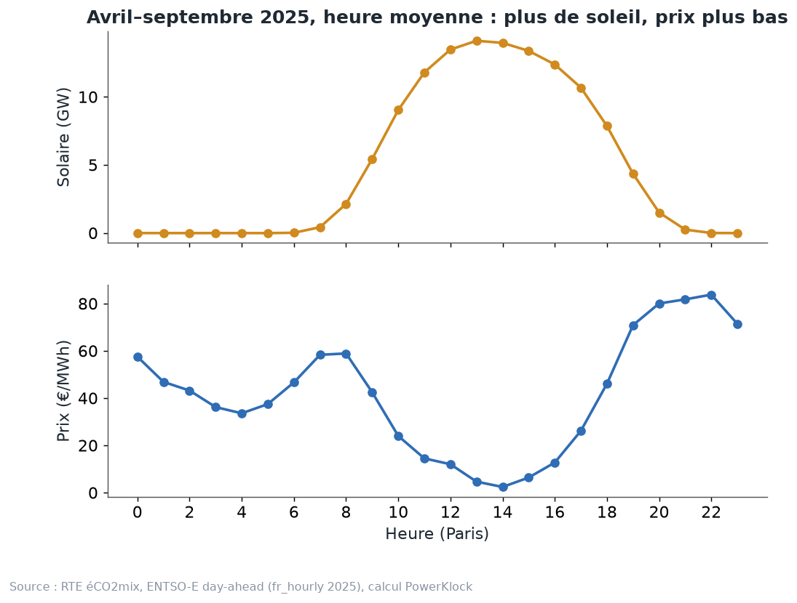
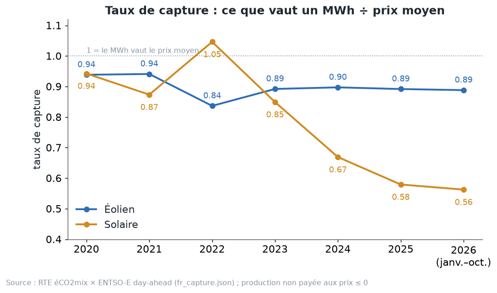
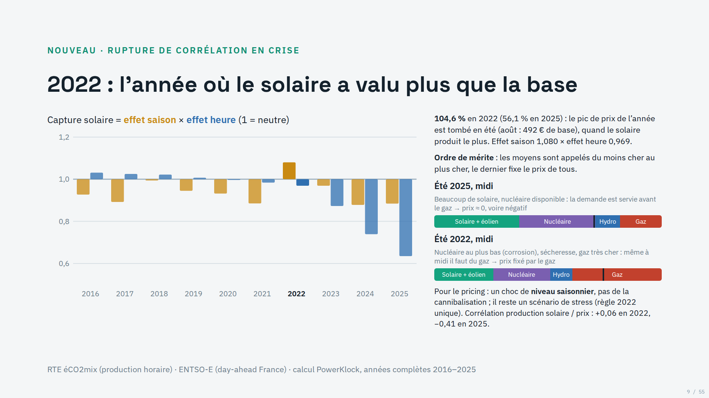
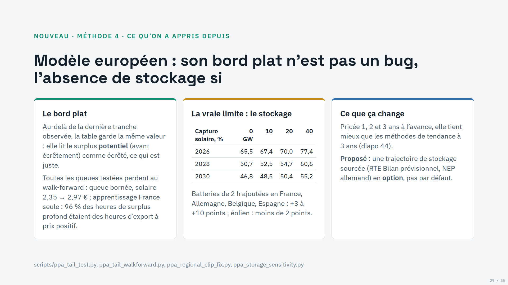

# Chapitre 2 à l'oral — capture et cannibalisation, version complète

*Pour Tom · 1er novembre 2026 · à lire à voix haute, environ 15 minutes*

## 1. Un MWh n'a pas la même valeur à toutes les heures
Au chapitre 1, on a vu que le prix change à chaque quart d'heure. Un MWh produit un soir d'hiver vaut beaucoup. Un
MWh produit un dimanche de mai à 13 h vaut presque rien, parfois moins que rien.

Un parc solaire ou éolien ne choisit pas ses heures. Il produit quand il y a du soleil ou du vent. La question est
donc simple : **combien vaut, en moyenne, un MWh de ce parc**, comparé au prix moyen de l'année ?

L'image : **le marchand de glaces sur la plage**. Seul, il vend ses glaces cher. Si vingt marchands arrivent sur la
même plage, à la même heure, le prix des glaces baisse pour tout le monde. Le soleil, c'est pareil : tous les
panneaux de France produisent en même temps, à midi.

Regarde le schéma (heure moyenne, avril à septembre 2025, RTE éCO2mix et ENTSO-E) :
- en haut, la production solaire monte le matin, culmine vers 13 h, redescend le soir ;
- en bas, le prix fait exactement l'inverse : il est au plus bas en début d'après-midi, et remonte le soir quand le
  soleil se couche ;
- les deux courbes sont **en miroir**.

## 2. Le taux de capture : la formule, en mots simples
Trois quantités, pour un parc qui produit une certaine quantité à chaque heure :
- **La valeur du MWh du parc (V).** On multiplie la production de chaque heure par le prix de cette heure, on
  additionne, et on divise par la production totale. C'est une moyenne des prix **pondérée par la production** : les
  heures où le parc produit beaucoup comptent beaucoup.
- **Le prix de base (B).** La moyenne simple des prix de toutes les heures. C'est ce que vaudrait un MWh « plat »,
  produit pareil à toutes les heures.
- **Le taux de capture (c) = V ÷ B.**

Si la capture vaut 1, le MWh du parc vaut le prix moyen. Si elle vaut 0,56, il vaut 56 % du prix moyen.

L'image : **un bulletin scolaire avec coefficients**. La moyenne simple de l'année, c'est B. Mais le parc a mis ses
plus gros coefficients sur les matières où il a les plus mauvaises notes (les midis d'été). Sa moyenne pondérée, V,
est donc plus basse.

**Pourquoi V et B diffèrent.** On peut écrire :
V = B + (lien entre production et prix) ÷ production moyenne.

Ce « lien », les statisticiens l'appellent la **covariance**. En mots :
- si le parc produit plutôt aux heures chères, le lien est positif, et V dépasse B ;
- s'il produit plutôt aux heures bon marché, le lien est négatif, et V tombe sous B.

Le solaire produit aux heures où le prix baisse : le lien est négatif, sa capture passe sous 1.

**La convention du site.** La production aux heures où le prix est négatif ou nul n'est pas payée : ces MWh sont
perdus. Le site publie la capture « payée » : la valeur des MWh produits aux heures à prix positif, divisée par la
base. (Le pricer, lui, est passé le 1er novembre à « non payé seulement si le prix est strictement négatif » :
chapitre 3.)

## 3. Les vrais chiffres en France

Capture « payée » (RTE éCO2mix × ENTSO-E, `data/history/fr_capture.json`) :

| | 2020 | 2021 | 2022 | 2023 | 2024 | 2025 | 2026 (janv.–oct.) |
|---|---|---|---|---|---|---|---|
| Éolien | 0,94 | 0,94 | 0,84 | 0,89 | 0,90 | 0,89 | 0,89 |
| Solaire | 0,94 | 0,87 | 1,05 | 0,85 | 0,67 | 0,58 | 0,56 |

Comment le lire :
- **Le solaire s'effondre** : de 0,85 en 2023 à 0,58 en 2025, puis 0,56 sur les dix premiers mois de 2026. Un MWh
  solaire vaut un peu plus de la moitié d'un MWh moyen.
- **2022 est à part** : le solaire est au-dessus de 1. Cette année-là, le soleil produisait pendant des heures chères
  (crise du gaz et nucléaire très bas). C'est pour ça que le générateur de scénarios exclut 2022 de ses années
  d'apprentissage (chapitre 9).
- **L'éolien tient** autour de 0,89 : il perd peu.

**2022 en détail : un choc de saison, pas d'heure.** Le diaporama du 28 octobre (« Revue des méthodes PPA »,
diapo 9) découpe la capture solaire en deux effets qui se multiplient :
- l'**effet saison** : le solaire produit surtout l'été ; vaut-il plus ou moins parce que les mois d'été sont chers ou
  bon marché ? En 2022 : **1,080**. Le pic de prix de l'année est tombé en été (août : 492 € de base) ;
- l'**effet heure** : à l'intérieur de chaque mois, vaut-il plus ou moins parce qu'il produit à midi ? En 2022 :
  **0,969**, déjà sous 1 ;
- 1,080 × 0,969 ≈ 1,046 : la capture de **104,6 %** en 2022 (56,1 % en 2025, même source, toutes heures comptées).

Autrement dit, même en 2022, midi valait un peu moins que le reste de la journée. C'est la saison qui a tout porté.

La **corrélation** entre la production solaire et le prix (de −1 à +1 ; 0 = aucun lien) le confirme : **+0,06 en
2022**, **−0,41 en 2025** (diapo 9). En 2022, produire beaucoup ne faisait presque pas baisser le prix. En 2025, oui.

*Diapo 9 du 28 octobre 2026 : RTE éCO2mix × ENTSO-E, calcul PowerKlock, années complètes 2016–2025. Le violet est
le nucléaire.*

Les deux barres de droite sont **deux merit orders d'un midi d'été** :
- **été 2025** : beaucoup de solaire, nucléaire disponible. La demande est servie avant d'arriver au gaz : prix vers
  0, voire négatif ;
- **été 2022** : nucléaire au plus bas (corrosion), sécheresse, gaz très cher. Même à midi, il faut du gaz : c'est le
  gaz qui fixe le prix.

L'image : le marchand de glaces de 2022 vendait sur une plage où il manquait de glace. Peu importe qu'il y ait
d'autres marchands : tout se vendait cher.

**Ce qu'on en tire pour pricer** (diapo 9) : 2022 est un **choc de niveau saisonnier**, pas de la cannibalisation. On
ne l'apprend pas comme une année normale ; on la garde comme **scénario de stress**.

**Le lien avec les prix négatifs.** La chute du solaire depuis 2023 suit la montée des heures à prix nul ou négatif
(chapitre 1) : 184 heures en 2023, 735 en 2025. En 2025, ces heures tombaient presque toutes à midi, au printemps et
en été (`cours_detail.md`), c'est-à-dire au cœur de la production solaire.

**Pourquoi on lit parfois 722, 735 ou 742 heures pour 2025.** Ce n'est pas une erreur, ce sont trois façons de
compter :
- **735** : les heures ≤ 0 € dans la série **horaire** que le cours utilise (`data/history/fr_hourly/2025.json`,
  recalcul `calc.py`, champ `h_le0` de `calc.json`) ;
- **742** : les **quarts d'heure** ≤ 0 €, divisés par 4 (`calc.json`, `le0_quarter_hours`). Depuis le 1er octobre
  2025, le prix est fixé au quart d'heure : une heure dont la moyenne est positive peut cacher un quart d'heure
  négatif. C'est le bon comptage depuis cette date ;
- **722** : le chiffre du diaporama du 28 octobre (diapo 8), tiré des données horaires du banc d'essai (`ppa_lab`,
  ENTSO-E). On n'a pas isolé précisément pourquoi il est 13 heures sous le 735 ; probablement une autre façon de
  ramener les quarts d'heure de fin 2025 à l'heure.

On cite toujours le comptage avec sa définition.

## 4. La cannibalisation : les parcs se mangent entre eux
Quand la capture baisse **parce qu'il y a de plus en plus de parcs**, on parle de **cannibalisation**. Chaque nouveau
panneau ajoute de la production aux mêmes heures, ce qui fait encore baisser le prix de ces heures, pour lui et pour
tous les autres.

Le lien avec le merit order (chapitre 1) : à midi, le solaire pousse les centrales chères hors de l'escalier. La
dernière marche est plus basse, donc le prix aussi. Plus il y a de solaire, plus on descend l'escalier, jusqu'au
sous-sol : les prix négatifs.

**Ce que dit la recherche.**
- **Hirth (2013)**, la référence : la valeur du vent passe de **110 %** à **50 à 80 %** du prix moyen quand sa part
  dans la production passe de 0 à 30 %.
- **Stiewe, Xu, Eicke et Hirth** (30 zones européennes, 2015–2023) : ce sont aussi **les parcs des voisins** qui
  cannibalisent. Pour le vent, un point de pénétration chez les voisins enlève 0,49 point de valeur, presque autant
  que chez soi (0,62). Pour le solaire, c'est même plus fort chez les voisins : 2,38 contre 1,39. On appelle ça la
  « cannibalisation transfrontalière ».

L'image : la plage n'est pas fermée. Les marchands de glaces de la plage d'à côté vendent aussi à vos clients.

**Ce qui peut freiner la cannibalisation : le stockage.** Une batterie se charge à midi, quand le prix est bas, et se
décharge le soir. Elle ajoute de la demande aux heures solaires : le prix de midi baisse moins.

Le 28 octobre, on a mesuré l'effet avec le modèle européen (diapo 29 de la « Revue des méthodes PPA ») : on ajoute
des batteries de 2 heures en France, Allemagne, Belgique et Espagne, et on regarde la capture solaire.

| Capture solaire, % | 0 GW | 10 GW | 20 GW | 40 GW |
|---|---|---|---|---|
| 2026 | 65,5 | 67,4 | 70,0 | 77,4 |
| 2028 | 50,7 | 52,5 | 54,7 | 60,6 |
| 2030 | 46,8 | 48,5 | 50,4 | 55,2 |

- En **2030**, avec **40 GW** de batteries dans les quatre pays, la capture solaire passe de **46,8 % à 55,2 %** :
  plus 8 points.
- Selon l'année et la quantité : **+3 à +10 points** en solaire ; **moins de 2 points** en éolien (diapo 29).

*Diapo 29 du 28 octobre 2026 : `scripts/ppa_storage_sensitivity.py`. Chiffres du modèle européen, une des anciennes
méthodes, dans la convention de capture du banc d'essai ; ce sont des ordres de grandeur, pas des prévisions.*

Deux précautions :
- ces niveaux de capture (65,5 % en 2026) ne sont pas ceux du tableau ci-dessus : autre modèle, autre convention ;
  seul l'**écart** dû aux batteries est à retenir ;
- les 40 GW sont une hypothèse de test. La proposition du 28 octobre était d'ajouter une trajectoire de stockage
  sourcée (RTE Bilan prévisionnel, plan de réseau allemand) en **option**, pas par défaut. Le générateur v2 pose déjà
  des batteries sur les parcs de l'année livrée (chapitre 9).

## 5. Pourquoi l'éolien résiste mieux, et pourquoi il faut rester prudent
L'éolien perd moins de valeur que le solaire, pour deux raisons :
- **le vent ne souffle pas partout en même temps** : la production est plus étalée que celle du soleil, qui culmine
  partout à midi ;
- **il souffle plus l'hiver et la nuit**, quand on consomme beaucoup et que les prix sont plus hauts.

Mais l'éolien n'est pas à l'abri :
- en 2025, **67,5 %** de la production éolienne française est tombée dans des heures où la France était coupée de ses
  voisins (débrief du 31 octobre) ;
- dans ces heures-là, le vent français fait baisser le prix français, et lui seul ;
- d'une année à l'autre, la valeur réelle de l'éolien a baissé plus que tous nos modèles ne le prévoyaient. Sans
  recalage sur la dernière année réelle, tous les modèles le surévaluent d'environ 2 à 2,7 €/MWh
  (`pricing-v2/choix_v2.md`). C'est une vraie incertitude, pas résolue.

## 6. La méthode en 3 étapes : profil, puis cannibalisation
Ta méthode découpe la différence entre V et B en deux morceaux.

**Étape 1, le forward.** Le prix d'un MWh plat. C'est B (on le verra au chapitre 3).

**Étape 2, le profil : l'effet calendrier.** On découpe l'année en cases « mois × heure » (par exemple : juillet,
13 h). Dans chaque case, on prend la production moyenne du parc et le prix moyen. Le profil, c'est ce que le parc
gagnerait si, **à l'intérieur de chaque case**, les prix n'avaient aucun lien avec sa production. Le soleil produit à
midi l'été, et les midis d'été sont plutôt bon marché : le profil coûte déjà quelque chose.

**Étape 3, la cannibalisation : l'effet foule.** C'est le reste. À l'intérieur d'une même case, les heures où le parc
produit plus sont moins chères, **justement parce que** lui et ses semblables produisent. Un mardi de juillet très
ensoleillé à 13 h est moins cher qu'un mardi de juillet nuageux à 13 h.

L'image : le profil, c'est savoir que **les glaces se vendent moins cher l'été** ; la cannibalisation, c'est
constater que **les jours de grand soleil**, quand tous les marchands sont sur la plage, elles se vendent encore moins
cher.

**Les vrais chiffres du pricer** (`pricing-v2/parametres.md`, calculés avant le passage à la règle « strictement
négatif ») :

| €/MWh | Profil mensuel | Cannibalisation horaire |
|---|---|---|
| Solaire | −5,97 | −26,82 |
| Éolien | +7,87 | −10,68 |

Comment le lire :
- pour le **solaire**, le profil coûte un peu (environ 6 €), mais la cannibalisation coûte beaucoup plus (environ
  27 €) : le problème, ce n'est pas l'été, ce sont les midis où tout le monde produit ;
- pour l'**éolien**, le profil **rapporte** (environ +8 €) : le vent souffle plus l'hiver, quand les mois sont chers.
  Mais la cannibalisation reprend environ 11 € ;
- la somme des deux donne la décote totale du prix capté.

Ici, le profil est mesuré par les forwards des mois comparés au Cal, et la cannibalisation par les heures à
l'intérieur du mois (`parametres.md`).

**Tu n'es pas seul à découper comme ça.** Chatziandreou et Karbach (arXiv 2607.27814, juillet 2026) écrivent le prix
juste d'un PPA pay-as-produced comme : forward base + correction de profil + correction du lien prix-volume. C'est la
même décomposition. Leur calibrage porte sur l'Allemagne 2023–2024, pour des PPA courts.

**Un piège connu, évité par construction.** Modo Energy montre que si la météo du profil de production n'est pas la
même que celle des prix, on sous-estime la cannibalisation, et on surestime les revenus de plus de 10 % en 2045. Le
générateur PowerKlock tire production et prix dans les mêmes semaines réelles : ils sont alignés (débrief du
31 octobre).

## 7. Les pièges : il y a plusieurs captures
**Le plus grand piège : la capture a plusieurs définitions.** Exemple vécu avec l'éolien :
- **0,89** en 2025 : la capture « payée » nationale du site (tableau plus haut) ;
- **0,923** en 2025 : le calcul du pricer, dans sa convention « curt ». On prend la capture des MWh payés mois par
  mois, puis la moyenne pondérée par la production ;
- **0,936 → 0,976** de 2025 à 2026 : la même convention, mais sur janvier–octobre seulement (year to date) ;
- **0,971 → 0,976** : d'un seul bloc sur janvier–octobre ;
- **0,891 → 0,888** : avec toute la production comptée, même celle des prix ≤ 0.

Aucun de ces chiffres ne vient de RTE : RTE ne publie pas de taux de capture. **On ne compare que des chiffres de même
définition** (`SESSION_DISCUSSION.md`).

**Le même piège en solaire, pour 2025 : 77,0 %, 58 % ou 56 % ?** Trois chiffres, trois recettes :
- **0,58** : la capture « payée » du site (`fr_capture.json`). On prend la valeur de toute la production, en comptant
  à 0 € les MWh des heures ≤ 0, et on divise par le prix moyen de l'année. Les MWh non payés **restent** dans la
  production : ils font baisser la moyenne ;
- **56 %** (56,1 %) : « toutes heures » (diapos 7 et 9 du 28 octobre). Toute la production est comptée **à son vrai
  prix**, même négatif. C'est la plus basse, puisque les prix négatifs pèsent dedans ;
- **77,0 %** : la convention « arrêt » du banc d'essai des anciennes méthodes (diapos 17 et 20). On calcule **mois
  par mois** la valeur des seuls MWh payés, rapportée au prix moyen du mois, puis on fait la moyenne pondérée par la
  production. Deux choses la font monter : les MWh non payés sortent du calcul au lieu de compter pour 0, et le
  calcul au mois retire l'effet saison (les mois d'été moins chers).

L'image : la moyenne d'une classe. Selon qu'on compte les absents à zéro, qu'on les retire, ou qu'on fait la moyenne
trimestre par trimestre, on n'obtient pas la même note, alors que les copies sont les mêmes.

Une réserve : la recette exacte du 77,0 % est déduite des notes du diaporama et du code du banc d'essai
(`scripts/ppa_backtest_detail.py`) ; elle est cohérente avec l'écart observé, mais je ne l'ai pas recalculée. La
diapo 8 rappelle d'ailleurs qu'une ancienne convention, qui retirait les heures ≤ 0 des deux côtés, rendait le
solaire 2025 « plus beau d'environ 7 €/MWh ».

**Deuxième piège : le year to date n'est pas l'année entière.** Dans la convention du pricer, l'année entière finit
toujours un peu sous le cumul à fin octobre : 0,906 en 2024 et 0,923 en 2025. Les deux derniers mois changent donc le
résultat ; on n'a pas isolé précisément pourquoi. Pour pricer, on s'ancre sur une année civile complète, pas sur un cumul partiel.

**Troisième piège : la base.** La capture dépend du prix moyen choisi : spot de l'année, forward, ou spot des seules
heures payées.

**Quatrième piège : un parc n'est pas la France.** Un vrai parc n'a pas le profil national. Sa capture peut s'écarter
de plusieurs points selon sa région et son orientation. Test sur les régions RTE en solaire : partir du national et
ajouter l'écart propre du parc se trompe de 1,2 point, contre 5,5 points en regardant le parc seul
(`parametres.md`).

**Une nuance utile : la décote est surtout un montant en euros.** Quand le prix de base monte d'un euro, le prix capté
monte d'environ 0,96 € en solaire et 0,95 € en éolien (même mois d'une année sur l'autre, trois dernières années,
`parametres.md`). Autrement dit, la décote en euros bouge peu quand les prix montent. Elle se comporte moins comme un
pourcentage fixe qu'on pourrait le croire. C'est mesuré, pas certain : sur 2024–2025 seul, on trouve 0,84 en solaire.

## À retenir
1. Capture = valeur du MWh du parc ÷ prix moyen. En dessous de 1, le parc produit plutôt aux heures bon marché.
2. Le solaire est passé de 0,85 (2023) à 0,58 (2025) et 0,56 (2026, janvier–octobre). L'éolien tient vers 0,89.
3. Cannibalisation : plus il y a de parcs qui produisent aux mêmes heures, plus ces heures sont bon marché. Les
   parcs des voisins comptent presque autant que les nôtres.
4. Méthode en 3 étapes : forward, profil (l'effet calendrier), cannibalisation (l'effet foule). En solaire, c'est la
   cannibalisation qui coûte le plus.
5. Toujours dire quelle capture on utilise, et ne comparer que des chiffres de même définition et sur des années
   complètes.

## Question pour vérifier
Imagine qu'on ajoute beaucoup de batteries en France, qui se chargent à midi et se déchargent le soir.
- (a) Qu'arrive-t-il, d'après toi, au prix de midi et à la capture solaire ?
- (b) Lequel des deux morceaux bouge le plus : le profil ou la cannibalisation ?
- (c) Un collègue te dit : « la capture éolienne 2026 est de 0,976, donc mieux qu'en 2025 (0,923) ». Qu'est-ce qui
  cloche ?

## Pour aller plus loin
- L. Hirth (2013), « The market value of variable renewables », *Energy Economics* —
  https://cadmus.eui.eu/bitstream/handle/1814/27135/RSCAS_2013_36.pdf
- Stiewe, Xu, Eicke et Hirth, « Cross-border cannibalization » — https://arxiv.org/abs/2405.17166
- Pexapark, « How do you account for cannibalization? » —
  https://help.platform.pexapark.com/en/articles/9577860-how-do-you-account-for-cannibalization
- Modo Energy, « Capturing cannibalisation » — https://forecastdocs.modoenergy.com/docs/capturing-cannibalisation
- Chatziandreou et Karbach (juillet 2026), arXiv 2607.27814 — https://arxiv.org/abs/2607.27814
- Dossier PowerKlock : `data/history/fr_capture.json`, `fr_regional_capture.json`,
  `docs/discussion/pricing-v2/parametres.md`, `docs/discussion/pricing/debrief-2026-10-31.md`.
