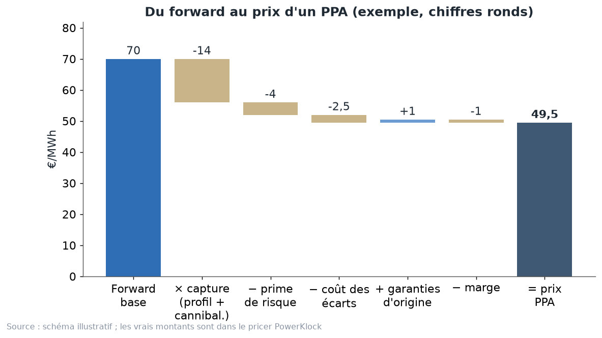
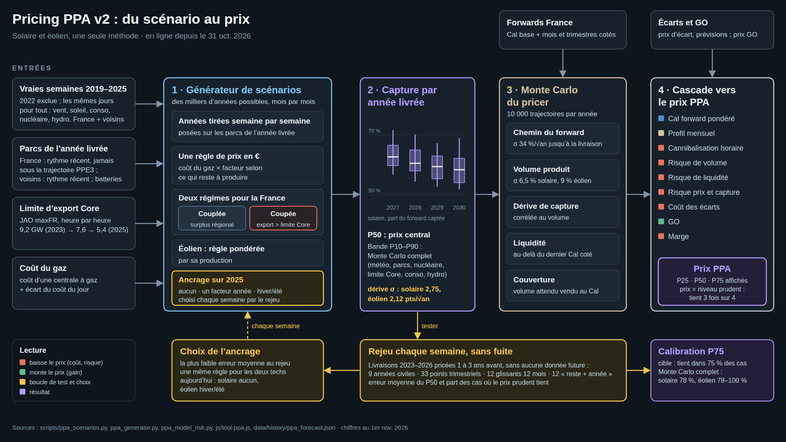

# Chapitre 3 à l'oral — le PPA et son prix, version complète

*Pour Tom · 1er novembre 2026 · à lire à voix haute, environ 15 minutes*

## 1. Qu'est-ce qu'un PPA
Un **PPA** (*Power Purchase Agreement*), c'est un contrat de vente d'électricité **long**, souvent de 3 à 15 ans,
entre un producteur (un parc solaire ou éolien) et un acheteur (un industriel, un fournisseur), **à un prix fixé
d'avance**.

Pourquoi les deux y gagnent :
- le **producteur** sait combien il touchera chaque MWh pendant des années : sa banque lui prête plus facilement ;
- l'**acheteur** sait combien il paiera, et il achète de l'électricité renouvelable, avec ses certificats.

**Le format qu'on price : le pay-as-produced.** L'acheteur prend **toute** la production du parc, **à l'heure où elle
arrive**, au prix fixe. Il ne choisit ni la quantité ni les heures.

L'image : **l'abonnement chez un maraîcher**. Tu t'engages à acheter toutes ses tomates, quand elles poussent, à un
prix fixé d'avance. Le problème : ses tomates arrivent toutes en août, quand il y en a partout. Tu ne vas donc pas
payer le prix moyen de la tomate dans l'année. Tu vas payer moins, sinon tu perds de l'argent.

Ce que l'acheteur prend comme risques :
- **le risque de profil** : il reçoit beaucoup de MWh à midi, quand ils valent peu (chapitre 2) ;
- **le risque de volume** : une année peu ventée, il reçoit moins que prévu, et doit acheter le reste au marché ;
- **le risque de prix** : le marché peut baisser pendant 3 ans, et lui reste à son prix fixe.

Le prix d'un PPA doit donc répondre à une question : **combien vaut, aujourd'hui, un MWh de ce parc livré dans le
futur, une fois tous ces risques payés ?**

## 2. La cascade : du forward au prix du PPA
Le prix se construit en cascade, étage par étage :

**Prix PPA = forward × capture − prime de risque − coût des écarts + garanties d'origine − marge**

Le schéma est un exemple en chiffres ronds (pas un vrai prix) : on part de 70 €, la capture enlève 14 €, la prime de
risque 4 €, les écarts 2,5 €, les garanties d'origine ajoutent 1 €, la marge enlève 1 €, et on arrive à 49,5 €. Les
vrais montants sont dans le pricer (section 6).

Chaque étage, avec une image :
- **Le forward** : le prix d'un MWh « plat », livré pareil à toutes les heures, coté aujourd'hui pour les années du
  contrat (chapitre 1). C'est le prix de la tomate moyenne de l'année.
- **× la capture** : le MWh du parc ne vaut pas le MWh plat. On multiplie par le taux de capture (chapitre 2). C'est
  la décote de la tomate d'août.
- **− la prime de risque** : personne ne sait vraiment ce que vaudra le solaire en 2028. Celui qui prend ce risque se
  fait payer. C'est l'**assurance**.
- **− le coût des écarts** : le parc ne produit jamais exactement ce qu'il a annoncé la veille. L'écart se règle à un
  prix moins favorable que le spot. C'est le **bus qui arrive en retard** : il faut payer un taxi pour le trajet
  manquant (chapitre 12).
- **+ les garanties d'origine (GO)** : un certificat électronique qui prouve qu'un MWh a été produit à partir d'une
  source renouvelable. Une GO correspond à un MWh, et le registre français est tenu par EEX pour le ministère (EEX,
  lien en fin de chapitre). L'acheteur les reçoit avec l'électricité : c'est un **petit plus** qui s'ajoute au prix.
- **− la marge** : la rémunération de celui qui gère le contrat.

## 3. Ta méthode en 3 étapes
Ta méthode découpe le cœur de la cascade, « forward × capture », en trois étapes :

1. **Le forward** : le prix moyen attendu d'un MWh plat.
2. **Le profil** : on n'achète pas un MWh plat, mais un MWh solaire ou éolien, qui tombe à certaines heures et
   certains mois. C'est l'**effet calendrier**.
3. **La cannibalisation** : ces heures sont moins chères **justement parce que** le parc et ses semblables produisent.
   C'est l'**effet foule**.

Profil + cannibalisation = la capture. Les vrais chiffres du pricer (`pricing-v2/parametres.md`, avant le passage à la
règle « strictement négatif ») :
- **solaire** : profil −5,97 €, cannibalisation −26,82 € ;
- **éolien** : profil +7,87 €, cannibalisation −10,68 €.

En solaire, c'est l'effet foule qui coûte cher. En éolien, l'effet calendrier rapporte (le vent souffle l'hiver),
mais l'effet foule reprend plus.

**Le forward, mois par mois.** Le pricer ne prend pas un seul chiffre par année :
- il prend le **mois** coté si on l'a, sinon le **trimestre**, sinon le **Cal**, découpé par une forme saisonnière ;
- il pondère chaque mois par la **production attendue** du parc : un mois de juillet compte beaucoup pour le solaire,
  un mois de janvier beaucoup pour l'éolien ;
- il n'utilise que des **produits liquides**, ceux qui s'échangent vraiment (SEFE / EEX). C'est une de tes règles.

La formule complète, en mots : pour chaque mois, forward du mois × capture du mois × production payée du mois ; on
additionne, on divise par la production payée totale, puis on applique le reste de la cascade.

**Comment on découpe un Cal en mois** (« Revue des méthodes PPA » du 28 octobre, diapo 12).
- Chaque mois prend le contrat le plus fin qui est coté : le mois, sinon le trimestre, la saison, puis le Cal.
- Ce qui reste est découpé par des **ratios historiques** du prix spot (années complètes, sans 2022). Exemple :
  **janvier = 1,22 × le Cal**, **mai = 0,62 × le Cal**.
- L'image : partager une facture d'électricité annuelle entre les mois. On sait que janvier coûte plus que mai ; on
  répartit selon les années passées, sauf pour les mois dont on connaît déjà la facture exacte.

**Pourquoi c'est important : le forward vu par un parc n'est pas le Cal** (diapo 13, forwards du 27 octobre).
Forward pondéré par la production, €/MWh :

| | Cal | Mois cotés | Cal × forme historique |
|---|---|---|---|
| Solaire 2027 | 120,30 | **112,96** (0,94) | 114,74 (0,95) |
| Éolien 2027 | 120,30 | **134,93** (1,12) | 128,83 (1,07) |
| Solaire 2028 | 70,72 | 71,22 (1,01) | 69,97 (0,99) |
| Éolien 2028 | 70,72 | 82,23 (1,16) | 75,76 (1,07) |

Comment le lire :
- le marché cotait une très forte prime d'hiver pour 2027 (janvier vers 210 €, mai vers 64 €) ;
- l'éolien, qui produit l'hiver, voit un forward **12 % au-dessus** du Cal ; le solaire, **6 % en dessous** ;
- ces chiffres datent du 27 octobre ; le Cal 2027 était depuis monté à 128,16 € (forwards des 30–31 octobre).

**Mois cotés ou forme historique ?** (diapo 14). On a testé les deux comme **prévision** de la forme de l'année, sur
2023–2025 (trimestres cotés au 4e trimestre de l'année d'avant). Erreur moyenne du facteur saisonnier, en points :
- solaire : **4,3** avec l'historique, **6,1** avec les trimestres cotés ;
- éolien : **1,8** avec l'historique, **3,5** avec les trimestres cotés.

L'historique prévoit donc **mieux**. Mais on a quand même choisi les mois cotés. Pourquoi ? Parce qu'un PPA est un
prix de marché : les mois cotés, c'est ce qu'un acheteur peut **verrouiller aujourd'hui** en se couvrant mois par
mois. L'image : la météo de l'an dernier prévoit peut-être mieux le prix des parapluies, mais si le magasin te les
vend à un prix ferme aujourd'hui, c'est ce prix-là qui compte pour ton budget.

**Le facteur k** (diapo 14) : pour chaque année, k = valeur sur les mois cotés ÷ valeur sur le Cal avec la forme
historique. Il corrige le niveau du forward vu par le parc. Dans le pricer v2, c'est lui qui fait la ligne « profil
mensuel » de la cascade (`v2_detail.html`, diapos 3 et 4).

## 4. La convention : pas payé quand le prix est négatif
**La règle du site** : la production n'est pas payée quand le prix est négatif. Pourquoi ?
- Les PPA récents prévoient souvent que l'acheteur **ne paie pas** les MWh produits à prix négatif. C'est une clause
  d'arrêt (*curtailment*). Le parc s'arrête, ou il produit sans être payé.
- Compter ces MWh au prix fixe surestimerait la valeur du parc.
- En 2025, il y a eu **735 heures à prix nul ou négatif** dans la série horaire (742 en comptant au quart d'heure,
  722 dans les données du banc d'essai du 28 octobre ; les définitions sont au chapitre 2), presque toutes à midi,
  au printemps et en été : le cœur de la production solaire (`calc.py`, `cours_detail.md`).

**Pourquoi il faut compter l'arrêt heure par heure, et pas sur un prix moyen.** L'exemple le plus clair est la
diapo 31 de la « Revue des méthodes PPA » (28 octobre) : les prix de 11 h à 16 h, été 2025 (915 heures).
- **52 %** de ces heures sont à prix ≤ 0 €.
- Le **prix moyen** de ces heures : **8,1 €**.
- Ce que touche un parc qui s'arrête quand le prix est négatif ou nul : à chaque heure, le prix s'il est positif,
  sinon 0. En moyenne : **11,4 €**.

Le parc touche plus que le prix moyen, parce que l'arrêt lui évite de payer les heures négatives. C'est
l'**inégalité de Jensen** : la moyenne du « meilleur de prix et 0 » n'est pas le « meilleur de la moyenne et 0 ».
L'image : un parapluie qu'on ouvre seulement quand il pleut. Ton trajet moyen n'est pas « un peu mouillé » : certains
jours tu es sec, d'autres tu es protégé. Une méthode qui raisonne sur un prix moyen, comme l'ancienne simulation
météo, rate cet effet. C'est la raison la plus nette de compter l'arrêt heure par heure, dans le générateur comme
dans l'historique.

L'image : un **contrat de livraison de lait** qui dit : « les jours où la laiterie est pleine, on ne vous prend pas
votre lait ». Le producteur doit en tenir compte dans son prix.

**Un changement du 1er novembre, à connaître.**
- Jusqu'au 31 octobre, la règle était : pas payé quand le prix est **nul ou négatif** (≤ 0).
- Depuis le 1er novembre au matin, le pricer applique : pas payé seulement quand le prix est **strictement négatif**
  (< 0). Une heure à 0 € est produite et payée 0 €.
- Ça compte : il y a eu **225 heures à exactement 0 €** en 2025 (`parametres.md`).
- La règle stricte s'applique **partout** : à l'historique, à la règle de prix, au générateur et au rejeu
  (`parametres.md`). Les chiffres de rejeu datés du 31 octobre ou d'avant ont été calculés avec « ≤ 0 ».
- Le seuil est réglable dans le pricer : il faut le choisir **à chaque contrat**, selon sa clause de prix négatifs.

## 5. Le pricer v2 : comment PowerKlock calcule le prix
Le pricer v2 est **en ligne depuis le 31 octobre 2026**. Il remplace une moyenne de quatre méthodes par une seule.

On lit le schéma de gauche à droite, en quatre blocs.

**Bloc 1 : le générateur de scénarios.** Il fabrique des années possibles (combien : voir l'encadré plus bas) :
- faites de **vraies semaines de 2019 à 2025** (2022 exclue), où vent, soleil, consommation, nucléaire et hydraulique
  sont pris les mêmes jours, en France et chez les voisins ;
- posées sur les **parcs de l'année livrée** (France : rythme récent, jamais sous la trajectoire PPE3 ; batteries) ;
- avec **une seule règle de prix en euros** : coût d'une centrale à gaz × un facteur qui dépend de ce qui reste à
  produire ;
- et **deux régimes** : France couplée à ses voisins, ou coupée quand son export dépasse sa limite Core de l'heure
  (chapitres 5 et 6).

L'image : un **simulateur de vol**. On rejoue de nombreux vols avec de vraies conditions météo du passé, mais sur
l'avion d'aujourd'hui.

**Combien d'années tirées ? Deux nombres à ne pas mélanger.**
- Le **générateur publié** tire **60 années** par année livrée et par filière (`data/history/ppa_forecast.json`,
  champ `sims` ; `scripts/ppa_generator.py`). Le **rejeu** en tire **30 par cas** ; un test avec 60 au lieu de 30
  donne le même résultat à 0,03 € près (débrief du 31 octobre).
- Le **Monte Carlo du pricer** (bloc 3) tire **10 000 trajectoires**.
- Les diaporamas v2 et la fiche des paramètres parlent de « milliers d'années » : c'est une approximation. Le
  « milliers » vaut pour les 10 000 trajectoires du pricer, pas pour les années tirées du générateur.

**Pour l'éolien, une règle pondérée par la production.** La règle de prix est apprise en donnant plus de poids aux
heures où le vent produit (idée de Qorbanian, Löhndorf et Wozabal). Erreur éolienne au rejeu : **0,84 → 0,56 €/MWh**.

**Un recalage, choisi par une règle : l'ancrage.**
- Formule : capture(année) = générateur(année) × réalisé(2025) ÷ générateur(2025).
- Trois modes : aucun, un facteur sur l'année, un facteur hiver et un facteur été.
- Chaque semaine, le rejeu garde le mode qui s'est le moins trompé, avec la même règle pour les deux technologies.
- Aujourd'hui : **solaire sans ancrage**, **éolien ancré hiver/été**.
- Pourquoi l'éolien reste ancré : sans ancrage, tous les modèles testés le surévaluent de 2 à 2,7 €, et l'erreur est
  dans les heures où la France est coupée. Aucune méthode testée ne la supprime (débrief du 31 octobre).

**Bloc 2 : la capture par année livrée.** Le générateur donne une capture centrale (P50) et une bande P10–P90.

**Bloc 3 : le Monte Carlo du pricer.** Il tire **10 000 trajectoires** : chemin du forward, volume produit, dérive de
la capture, liquidité. Il suppose que le volume attendu est revendu au Cal (couverture *back to back*).

**Bloc 4 : la cascade et le prix prudent.**
- La prime de risque = **valeur juste − 25e centile** des 10 000 futurs.
- Le prix publié est donc le **prix prudent** : il tient **3 fois sur 4**. P25, P50 et P75 sont affichés.
- Ta règle : « ne pas perdre d'argent systématiquement ».

L'image : un **parapluie**. On ne s'habille pas pour la météo moyenne, mais pour 3 jours sur 4.

**Le Monte Carlo complet.** La bande ne tire pas que la météo. Elle tire aussi la croissance des parcs (± 40 %), le
nucléaire (avec 5 % de chance d'une année type 2022), la limite Core, la consommation, une année sèche ou humide. La
bande contient donc déjà l'erreur du modèle : plus de déduction séparée pour le risque de modèle. Avant le
31 octobre, on en retirait une à part.

**Comment on sait que ça marche : le rejeu.** On se replace dans le passé, sans aucune donnée future :
- livraisons 2023–2026 pricées 1 à 3 ans avant (9 cas par technologie), plus des points trimestriels et glissants ;
- erreur moyenne du générateur seul : **0,76 €/MWh en solaire, 0,56 en éolien** ;
- l'ancienne moyenne de quatre méthodes se trompait de **2,59 et 2,84 €** ;
- le prix prudent a tenu dans **78 à 89 %** des cas (cible 75 %) ;
- le hasard des tirages vaut environ **0,2 €** : seuls les gains plus grands que ça comptent.

## 6. Les vrais chiffres d'aujourd'hui
Contrat 2027–2029, forwards des 30–31 octobre 2026.

**Les ingrédients** (`pricing-v2/parametres.md`) :

| Étage | Valeur |
|---|---|
| Cal France base | 2027 : 128,16 · 2028 : 70,94 · 2029 : 62,97 €/MWh |
| Capture (générateur v2) | solaire ≈ 57 % du Cal, éolien ≈ 93 % |
| Coût des écarts | solaire 2,49, éolien 2,82 €/MWh |
| Garanties d'origine | + 1,81 €/MWh |
| Marge | 1 €/MWh |
| Volatilité des forwards | Cal+1 34 % par an |
| Dispersion du volume | solaire ± 6,5 %, éolien ± 9 % |
| Dégradation des panneaux | 0,4 % par an (hypothèse) |

**La vraie cascade, telle qu'au 31 octobre au soir** (`pricing-v2/v2_simple.html`, diapo 3 ; détail dans
`v2_detail.html`, diapo 5). PPA 2027–2029, forwards des 30–31 octobre, €/MWh, ancienne règle d'arrêt (≤ 0) :

| Étage | Solaire | Éolien |
|---|---|---|
| Forward Cal (pondéré par la production) | 88,98 | 87,72 |
| Profil mensuel (facteur k) | −5,97 | +7,87 |
| Cannibalisation horaire | −26,82 | −10,68 |
| Risque de volume | −0,09 | −0,42 |
| Risque de liquidité | 0,00 | 0,00 |
| Risque prix et capture | −4,68 | −1,79 |
| Coût des écarts | −2,49 | −2,82 |
| Garanties d'origine | +1,81 | +1,81 |
| Marge | −1,00 | −1,00 |
| **Prix PPA (31 oct.)** | **49,75** | **80,69** |

Comment la lire :
- le forward pondéré est vers 88–89 €, tiré par un Cal 2027 très haut (128,16 €) ;
- en solaire, tout se joue sur la cannibalisation : près de 27 € ;
- en éolien, le profil mensuel **rapporte** près de 8 € (il produit l'hiver), et la cannibalisation est plus faible ;
- la liquidité vaut 0, car 2027, 2028 et 2029 sont toutes cotées.

**Ce tableau n'est plus le prix d'aujourd'hui.** Le 1er novembre, deux changements de méthode l'ont modifié
(ci-dessous) : **46,64 / 77,39** (`parametres.md`). La prime solaire, en particulier, n'est plus 4,68 € : le
détail exact de la nouvelle cascade n'est pas publié ligne par ligne dans les fichiers ; seuls la prime solaire
(5,98 → 2,2 €) et le prix final le sont.

**Le prix publié au 1er novembre : solaire 46,64 €/MWh, éolien 77,39 €/MWh** (`parametres.md`).

Il a bougé trois fois en un jour, pour des raisons de **méthode**, pas de marché (mêmes forwards) :
- **31 octobre, 20 h 57** : le pricer v2 est mis en ligne, **49,75 / 80,69**. Et la v1 ? Deux chiffres circulent,
  tous deux justes à leur date :
  - **47,07 / 77,78** : la v1 dans le débrief de la nuit du 30 au 31 octobre (`pricing/debrief-2026-10-31.md`) ;
  - **48,43 / 80,29** : la v1 au moment de la bascule, le 31 octobre, avec les mêmes forwards que la v2
    (`v2_simple.html`, diapo 9). C'est la bonne comparaison avec la v2 : environ +1,3 € en solaire et +0,4 € en
    éolien ;
- **1er novembre, 8 h 12** : une heure à 0 € est désormais produite et payée 0. Le même revenu se répartit sur plus
  de MWh payés, donc le prix par MWh baisse : **42,88 / 77,20** ;
- **1er novembre, 12 h 25** : la prime de risque suit maintenant la sensibilité mesurée du prix capté au prix de base
  (0,96 € par € en solaire, 0,95 en éolien) au lieu d'une part fixe. La prime solaire tombe de 5,98 à 2,2 € :
  **46,64 / 77,39**.

L'image : le prix d'un plat au restaurant. Si on change la taille de la portion (les heures à 0 € comptées), le
prix par bouchée change, même si le plat coûte pareil. Toujours dire **de quelle date et de quelle méthode** est un
prix. Ensuite, il bouge chaque jour avec les forwards.

**Une remarque sur la forme de la courbe.** Le Cal 2027 (128,16 €) est environ deux fois plus cher que le Cal 2029
(62,97 €). Un PPA 2027–2029 tire donc une bonne part de sa valeur de la première année. Avec ces mêmes cotations, un
contrat qui commencerait en 2028 vaudrait nettement moins.

## 7. Limites et questions ouvertes
- **L'éolien reste ancré.** On corrige un biais qu'on n'explique pas encore.
- **Le volume varie trop peu dans le générateur** (solaire 2,1 % contre environ 5 %). L'écart de volume du pricer vient
  donc des vraies années.
- **Captures jusqu'en 2030 seulement** : à prolonger pour les PPA longs.
- **Liquidité** : au-delà du dernier Cal coté, on ajoute une incertitude de 5,1 % par année, mais sans source d'écart
  achat–vente.
- **Arrêts nucléaires 2027** : une option seulement (éolien + 2 points), impossible à tester sur le passé.
- **La prime de risque doit-elle dépendre de la durée du contrat ?** Aujourd'hui, l'horizon élargit seulement la
  bande.
- **Pas de prix de PPA observés.** Pexapark, lui, calibre ses modèles sur des transactions réelles. Nous ne les avons
  pas.

**Tes règles, qui tranchent tout le reste** (`choix_v2.md`) : pas de recalibrage caché ; une seule méthode pour le
solaire et l'éolien ; produits liquides seulement ; réalisme face à l'historique ; tests sur des années complètes ;
jamais changer le pourcentage d'un mélange à chaque pricing.

## À retenir
1. PPA pay-as-produced : l'acheteur prend toute la production, quand elle vient, à prix fixe. Il prend le risque de
   profil, de volume et de prix.
2. Prix = forward × capture − prime de risque − coût des écarts + garanties d'origine − marge.
3. Ta méthode : forward, profil (effet calendrier), cannibalisation (effet foule).
4. Les MWh produits à prix négatif ne sont pas payés ; le seuil (≤ 0 ou < 0) se choisit selon la clause du contrat.
5. Pricer v2 : une seule méthode, le générateur ; un prix prudent qui tient 3 fois sur 4 ; testé par rejeu chaque
   semaine.
6. Prix publié au 1er novembre : solaire 46,64, éolien 77,39 €/MWh ; un prix se cite toujours avec sa date et sa
   méthode.

## Question pour vérifier
Un client veut un PPA solaire 2027–2029, avec une clause qui le fait payer même les heures à 0 €, mais pas les heures
négatives.
- (a) Par rapport à la règle « ≤ 0 », le prix du PPA monte-t-il ou baisse-t-il ? Pourquoi ?
- (b) Si le Cal 2027 retombe demain de 128 € à 70 €, quel étage de la cascade bouge le plus, et dans quel sens va le
  prix ?
- (c) Pourquoi le prix publié est-il le prix qui tient 3 fois sur 4, et pas le prix central ?

## Pour aller plus loin
- Pexapark, prix d'un PPA = valeur attendue − prix de marché du risque —
  https://help.platform.pexapark.com/en/articles/9577400-what-are-ppa-prices-shown-on-pexaquote-and-the-market-price-of-risk
- Pexapark, méthode de calcul —
  https://help.platform.pexapark.com/en/articles/9582613-what-is-the-pexapark-calculation-methodology
- Qorbanian, Löhndorf et Wozabal, « Valuation of Power Purchase Agreements for Corporate Renewable Energy
  Procurement », *European Journal of Operational Research*, 2025 — https://arxiv.org/abs/2403.08846
- EEX, registre français des garanties d'origine —
  https://www.eex.com/en/services/registry-services/french-guarantees-of-origin-registry
- Dossier PowerKlock : `docs/discussion/pricing-v2/choix_v2.md`, `parametres.md`, `schema_v2.png`,
  `docs/discussion/pricing/debrief-2026-10-31.md`.
