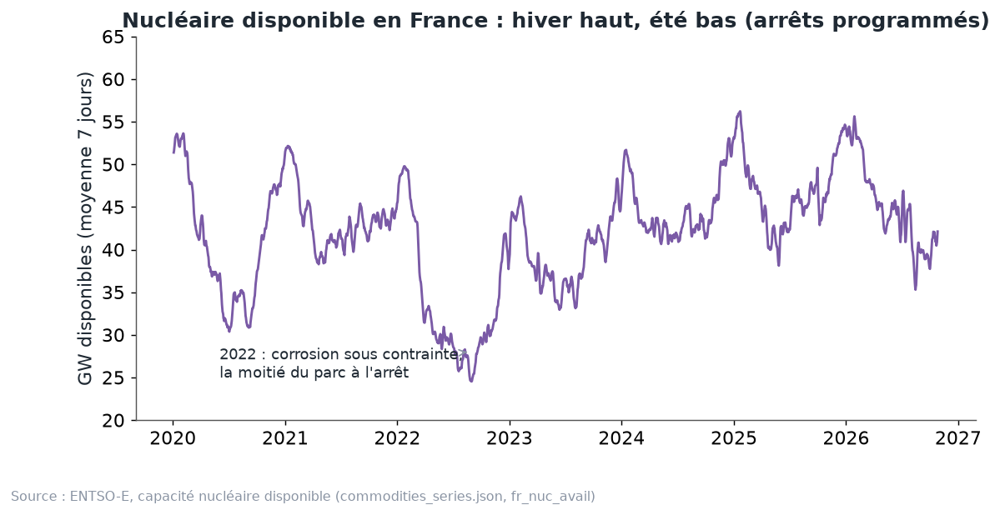

# Chapitre 4 à l'oral — le système français, version complète

*Pour Tom · 1er novembre 2026 · à lire à voix haute, environ 15 minutes*

## 1. La maison et sa grosse chaudière
Le système électrique français ressemble à une grande maison chauffée par une énorme chaudière : le **nucléaire**.
Elle produit beaucoup et pour pas cher. Mais elle n'aime pas qu'on la baisse trop, et on ne l'éteint pas comme une
lampe.

Autour de la chaudière, il y a trois autres choses :
- les **barrages** : la réserve d'eau de la maison, qu'on garde pour les heures chères ;
- le **solaire et l'éolien** : ils produisent quand il y a du soleil ou du vent, et ils poussent vite ;
- les **voisins** : quand la maison produit trop, elle vend le surplus par les lignes.

Le parc installé fin 2025, d'après RTE (bilan 2025) :
- nucléaire **63,0 GW**, Flamanville 3 compris ;
- solaire **30,4 GW** (+5,9 GW en un an). Il a dépassé l'hydraulique, à **25,7 GW** ;
- éolien terrestre **23,9 GW**, éolien en mer **1,9 GW** ;
- gaz **12,4 GW**.

En 2025, le nucléaire a produit **373,0 TWh** (RTE). Plus de 95 % de l'électricité française était bas carbone.

**L'idée du chapitre.** La France a souvent plus d'électricité qu'elle n'en consomme. Le prix français dépend donc
surtout de deux choses : jusqu'où le nucléaire peut baisser, et combien la France peut vendre à ses voisins.

## 2. Le nucléaire module, mais pas jusqu'à zéro
**Moduler**, c'est baisser la production quand on n'a pas besoin de tout, puis la remonter. C'est comme lever le pied
de l'accélérateur sans couper le moteur.

Un réacteur peut moduler, avec trois sortes de limites :
- **la vitesse.** D'après EDF, un réacteur en suivi de charge peut passer de 100 % à 20 % de sa puissance en environ
  30 minutes, deux fois par jour ;
- **le nombre de fois.** On ne peut pas monter et descendre sans arrêt ;
- **le cycle du combustible.** C'est la limite la plus importante.

**Le minimum technique.** C'est la puissance la plus basse qu'un réacteur peut tenir sans s'arrêter. RTE indique
qu'il varie **entre 25 % et 100 %** de sa puissance, « notamment [selon] l'avancement dans le cycle du combustible »
(bilan du premier semestre 2026).
- En milieu de cycle, un réacteur peut descendre bas : il est souple.
- En fin de cycle, il ne module presque plus. Son minimum peut aller jusqu'à 100 % : il tourne à fond ou il s'arrête.

**L'image.** Un cycliste en milieu d'étape peut ralentir et accélérer comme il veut. En fin d'étape, il n'a plus de
marge : il garde son rythme ou il descend du vélo. Les réacteurs, c'est pareil avec leur combustible.

**Le minimum du parc.** Pour tout le parc, RTE additionne les minimums déclarés par EDF, réacteur par réacteur (les
« chroniques Pmin », publiées au titre de REMIT). Il dépend :
- du nombre de réacteurs allumés : plus élevé en hiver, quand presque tous tournent ;
- de leur place dans le cycle du combustible ;
- du jour : EDF garde ses marges de baisse pour les week-ends et les jours fériés, quand on consomme moins.

**La modulation change de forme.**
- Kpler (février 2026) : la modulation du nucléaire a augmenté de **17 %** en 2025, et **70 %** de ses volumes sont
  désormais commerciaux (le prix est bas), pas techniques.
- RTE (bilan 2025) : le nucléaire module maintenant plus **en milieu de journée**, au printemps et en été. Avant, il
  modulait plutôt la nuit et le week-end. La cause, c'est le soleil de midi.
- Dans nos données, le plus bas taux d'utilisation du nucléaire observé (1er centile, production ÷ disponible) est de
  **0,63** en 2024–2025 (`couplage/methodologie.md`).

**Ce que dit la recherche.** Astier et Wolak (NBER, janvier 2026) montrent qu'en 2024, les heures où toute la
flexibilité du nucléaire était déjà utilisée correspondent à des prix nuls ou négatifs. Autrement dit : quand la
chaudière est au plus bas et qu'il reste trop d'électricité, le prix plonge.

## 3. Printemps 2026 : un nucléaire moins souple
Au premier semestre 2026, le nucléaire a beaucoup moins modulé. Les chiffres viennent de RTE, bilan du premier
semestre 2026, chapitre 6.
- **Modulation :** environ **10 TWh**, contre près de **20 TWh** au premier semestre 2025. (La synthèse du même bilan
  écrit « 15 à 20 TWh » pour 2025 : RTE précise que ses estimations sont incertaines.)
- **Pourquoi :** surtout moins d'arrêts de réacteurs pour modulation, et un peu moins de baisses de puissance.
- **Minimum technique du parc :** en moyenne **36,6 GW** de janvier à juin 2026, soit **+4,0 GW (+12 %)** par rapport
  à 2025. La production moyenne était de **43,7 GW**. La marge de baisse était donc petite.
- **Fin avril et début mai :** le minimum était **8,8 GW** plus haut qu'un an plus tôt.

**Le 1er mai, à midi.**
- Minimum technique : environ **31 GW** en 2026, contre **19 GW** en 2025.
- Production nucléaire entre 12 h et 16 h : **32,0 GW** en 2026, contre **21,6 GW** en 2025.
- Dans les deux cas, le parc était tout près de son minimum. Il ne pouvait pas descendre plus.

**Pourquoi c'est arrivé** (RTE) : plus de réacteurs avaient une modulation limitée, surtout pour des raisons de
cycle du combustible, et moins de réacteurs étaient à l'arrêt.

**La conséquence.** Des prix négatifs plus profonds. RTE relève deux records : **−478,8 €/MWh le 26 avril** et
**−498,7 €/MWh le 1er mai 2026**. Et **407 heures** de prix négatifs au premier semestre 2026, soit 10 % du temps.

**Un point important.** Ces jours-là, la France n'a pas « importé » des prix négatifs de ses voisins. RTE note
qu'elle était très exportatrice à midi les 26 avril et 1er mai 2026, alors qu'elle importait plus de 6 GW depuis
Core sur les mêmes créneaux en 2025. Le surplus était bien français.

## 4. L'accord RTE–EDF sur la tension : ce qu'il est, et ce qu'il n'est pas
**Ce qu'il est.** Le 27 mars 2026, la CRE a approuvé un accord entre RTE et EDF (délibération n° 2026-67). C'est une
**option** : RTE peut demander à certains réacteurs de **rester allumés**, du 4 avril au 30 octobre 2026, pour régler la
**tension** du réseau. EDF reçoit alors une compensation, avec une formule connue à l'avance.

**La tension, en image.** La tension, c'est comme la pression de l'eau dans les tuyaux d'une maison. Elle doit rester
dans une plage : ni trop haute, ni trop basse. Les grosses centrales aident à la régler, comme des vannes. Un réacteur
arrêté parce que le prix est bas ne règle plus rien. Dans certaines zones, RTE a donc besoin d'en garder quelques-uns
allumés.

**Ce qu'il n'est pas.** Ce n'est **pas un minimum national de production nucléaire**. Notre débrief du 31 octobre
le présentait ainsi, et c'était faux.

**Son effet réel** (RTE, bilan du premier semestre 2026, section 6.2) : un **rôle marginal**.
- La très grande majorité des demandes visait des réacteurs qu'EDF avait déjà prévu de garder en marche.
- Au premier semestre, seuls **11 jours** ont connu une imposition effective, avec **un à trois réacteurs**.
- Le 1er mai 2026, l'imposition explique **moins de 2 GW** sur les environ 10 GW d'écart de production avec le
  1er mai 2025.
- Quand un réacteur est imposé alors qu'EDF voulait l'arrêter, EDF baisse souvent un autre réacteur ailleurs. L'effet
  est surtout **géographique**, pas sur le total.

**À retenir de cette section.** Si le nucléaire a moins modulé en 2026, c'est le **combustible**, pas l'accord sur la
tension.

## 5. Le nucléaire n'est pas toujours là

Regarde la courbe. Chaque année, elle dessine une vague : haute en hiver, basse en été.
- **Pourquoi.** EDF place ses arrêts programmés (rechargement du combustible, maintenance) au printemps
  et en été, quand on consomme moins.
- **2022, le creux.** Des problèmes de corrosion sous contrainte : la moitié du parc à l'arrêt. La France a importé,
  et le prix a explosé.
- **Depuis,** la disponibilité remonte chaque année. RTE prévoyait environ **45 GW** en moyenne jusqu'à fin août 2026,
  contre 43 GW en 2025, près des records.

**2027.** Les arrêts déjà déclarés à ENTSO-E (au 30 octobre 2026, `calc.py`) donnent :
- jusqu'à environ **21 GW** indisponibles en même temps, fin mai (20,7 GW le 22 mai) ;
- **18 GW** au plus fort d'avril ;
- **11 GW** en moyenne sur l'année.

Attention : ces plannings bougent souvent. EDF prévoit **350 à 370 TWh** de nucléaire en 2026 comme en 2027.

**Chaleur et sécheresse.** Les centrales au bord des fleuves rejettent de l'eau chaude. Quand le fleuve est déjà
trop chaud, ou trop bas, elles doivent baisser leur production.
- Pendant les canicules de 2026, la perte de disponibilité a atteint jusqu'à environ **8 GW fin juin** et **9 GW vers
  mi-juillet**, selon les jours (RTE, bilan du premier semestre 2026).
- En cas de sécheresse longue en fin d'été, l'effet pourrait atteindre **2 à 3 GW** de plus (Chooz, voire Cattenom).
- Mais sur l'année, RTE juge ces pertes « de second ordre » en volume.

## 6. L'hydraulique : la batterie naturelle
Il y a trois sortes de barrages :
- **le fil de l'eau** : l'usine produit quand l'eau passe. On ne peut rien stocker. C'est un moulin sur une rivière ;
- **les lacs** : ils gardent l'eau des semaines ou des mois. C'est un réservoir qu'on ouvre quand le prix est haut ;
- **les STEP** (stations de transfert d'énergie par pompage) : elles pompent l'eau vers le haut quand l'électricité
  est bon marché, et la font redescendre dans les turbines quand elle est chère. C'est une vraie batterie.

**L'eau a un prix.** Le gestionnaire d'un lac ne turbine pas dès qu'il peut. Il compare le prix d'aujourd'hui au prix
qu'il pourra obtenir plus tard. On appelle ça la **valeur de l'eau**. Et ce prix futur dépend beaucoup du gaz
(chapitre 7) : même en France, l'eau des lacs se valorise donc en partie au prix du gaz.

**Les chiffres (RTE).**
- 2025 : **62,4 TWh**, soit −12,9 TWh après une année 2024 exceptionnelle. C'est un niveau normal.
- Premier semestre 2026 : **34,5 TWh** (−0,4 TWh). L'hiver a été très humide, le printemps parmi les dix moins
  pluvieux depuis 1959. Les stocks, faibles en début d'année, sont revenus près de la moyenne fin juin.

Pour le générateur, le stock des réservoirs (ENTSO-E, `hydro_reservoirs.json`) dit combien d'énergie « de réserve »
le pays a. On en reparle au chapitre 7 : une année sèche est souvent aussi une année peu venteuse.

## 7. Les exports : la France vend presque tout le temps
**2025** (RTE, bilan 2025) :
- solde exportateur record de **92,3 TWh** (89 TWh en 2024) ;
- la France a été exportatrice nette **près de 99 % du temps** ;
- par frontière, en TWh : Italie **26,2**, Belgique + Allemagne **23,1**, Grande-Bretagne **22,6**, Suisse **20,1**,
  Espagne **0,2**.

**Premier semestre 2026** (RTE) : nouveau record, **51,0 TWh** en six mois, contre 37,8 TWh au premier semestre 2025.
- Allemagne–Belgique 13,9, Grande-Bretagne 12,4, Italie 14,4, Suisse 11,3 TWh.
- Espagne : à peu près à l'équilibre, légèrement importatrice (−1,0 TWh).

**Combien ça rapporte.**
- 2025 : **5,4 Md€** au prix français, « de l'ordre de 9 Md€ » au prix des pays acheteurs.
- Premier semestre 2026 : **3,0 Md€**, ou environ **5,7 Md€** au prix des acheteurs. Le MWh exporté vaut
  **61,2 €** au prix français, **111,6 €** au prix des pays acheteurs.

RTE écrit que la France n'a pas « bradé » son électricité. Mais l'écart entre les deux prix montre une chose : les
lignes sont souvent pleines, et le prix français reste en dessous de celui de ses clients. C'est le sujet des
chapitres 5 et 6.

## 8. Le solaire et l'éolien poussent, les batteries arrivent
- **Solaire :** +5,9 GW en 2025, 30,4 GW en fin d'année (RTE). Il a dépassé l'hydraulique en puissance.
- **Éolien :** le terrestre ralentit pour la troisième année (+0,9 GW en 2025). L'éolien en mer avance (Yeu–Noirmoutier).
- **Début 2026 :** le rythme baisse un peu. **2,1 GW** de renouvelables en plus sur les cinq premiers mois de 2026,
  contre 2,5 GW un an plus tôt (dont solaire +1,9 GW, éolien terrestre +0,2 GW).

**Dans le générateur PowerKlock :**
- le solaire et l'éolien français grandissent au **rythme de la dernière année**, jamais sous la trajectoire PPE3 ;
- ceux des voisins grandissent à leur propre rythme, plafonné par leurs objectifs 2030.

**Les batteries.** Elles se chargent à midi, quand le soleil fait baisser le prix, et se vident le soir. Elles
remontent donc un peu le prix de midi. Leur effet sur la capture est testé dans `scripts/ppa_storage_test.py`. On ne
donne pas de chiffre ici : le cours n'en a pas de vérifié.

## 9. Le solaire et l'éolien savent aussi baisser
Longtemps, beaucoup de parcs produisaient même à prix négatif. Ceux sous **obligation d'achat** touchaient un tarif
fixe, quel que soit le prix du marché. Ils n'avaient aucune raison de s'arrêter. Ça change.
- **2025** (RTE) : la modulation de l'éolien et du solaire pendant les prix négatifs a **doublé**, à environ **3 TWh**
  (1,3 éolien terrestre, 1,6 solaire).
- **Depuis mi-avril 2026,** EDF OA (l'acheteur obligé) peut demander aux parcs sous obligation d'achat de s'arrêter aux
  prix négatifs. Cela concernait environ **7,4 GW** en juin 2026 (5,1 GW d'éolien, 2,3 GW de solaire).
- **22 GW** d'éolien et de solaire peuvent maintenant moduler à la demande de RTE : quatre fois plus qu'avant.
- **Premier semestre 2026 :** **2,5 TWh** modulés (1,4 solaire, 1 éolien terrestre, 0,1 éolien en mer), contre 1,9 TWh
  un an plus tôt. C'est **6 %** du productible solaire et **4 %** de l'éolien terrestre.

**L'image.** Avant, seule la chaudière savait baisser. Maintenant, les panneaux et les éoliennes ont aussi un bouton.
Plus il y a de boutons, moins le prix a besoin de plonger pour équilibrer le système.

## 10. Ce que ça change pour un PPA
- **Le minimum nucléaire fixe le plancher du prix.** Quand le nucléaire est à son minimum et qu'il reste du surplus, le
  prix tombe à zéro ou en dessous. Un printemps où le combustible rend le parc rigide, comme 2026, donne plus d'heures
  négatives. Ce sont des heures solaires.
- **Les arrêts programmés comptent.** Un printemps 2027 avec jusqu'à 21 GW indisponibles laisserait plus de place
  au solaire et à l'éolien, et soutiendrait la capture. Mais ces plannings bougent.
- **Les exports sont la soupape.** Ce que la France ne peut pas vendre à ses voisins fait baisser son propre prix.
- **Un parc qui s'arrête aux prix négatifs** ne vend pas ces MWh-là. C'est pour ça que notre prix PPA ne paie pas la
  production aux prix ≤ 0 (chapitre 3).

## À retenir
1. Le nucléaire est la base. Il module, mais garde un minimum qui va de 25 à 100 % de la puissance, selon le
   combustible.
2. Au printemps 2026, le parc était moins souple (environ 31 GW de minimum le 1er mai, contre 19 GW) : deux fois moins
   de modulation, et des prix négatifs records.
3. L'accord RTE–EDF sur la tension n'est pas un minimum national : RTE juge son rôle « marginal ».
4. Le nucléaire est haut en hiver, bas en été. 2027 : jusqu'à environ 21 GW d'arrêts déclarés fin mai.
5. Les barrages sont la batterie naturelle, et l'eau se valorise au prix futur.
6. La France exporte presque tout le temps : 92,3 TWh en 2025, 51,0 TWh au seul premier semestre 2026.
7. Le solaire et l'éolien grandissent, et savent de plus en plus s'arrêter aux prix négatifs.

## Question pour vérifier
Imagine un printemps 2027 où beaucoup de réacteurs sont **en milieu de cycle** (donc souples), et où les arrêts
programmés atteignent bien 21 GW fin mai. Qu'arrive-t-il, d'après toi :
- (a) au nombre d'heures à prix négatif en mai, par rapport à 2026 ;
- (b) à la capture d'un parc solaire français ce printemps-là ;
- (c) à la part des exports dans l'équilibre du système à midi ?

## Pour aller plus loin
- RTE, *Bilan du système électrique, premier semestre 2026* (chapitre 6 sur le nucléaire, chapitre 7 sur la
  modulation renouvelable) — https://assets.rte-france.com/prod/public/2026-07/2026-07-16-bilan-semestre1.pdf
- RTE, *Bilan électrique 2025, principaux résultats* —
  https://assets.rte-france.com/prod/public/2026-02/Bilan-electrique-2025-principaux-resultats.pdf
- CRE, délibération n° 2026-67 du 27 mars 2026 —
  https://www.cre.fr/fileadmin/Documents/Deliberations/2026/260327_2026-67_Approbation_Accord_Injection_THT.pdf
- Kpler, « Nuclear modulation insights » (février 2026) —
  https://www.kpler.com/blog/nuclear-modulation-insights-volumes-and-units-behaviours
- EDF, estimation de production nucléaire —
  https://www.edf.fr/groupe-edf/espaces-dedies/journalistes/tous-les-communiques-de-presse/estimation-de-production-nucleaire-d-edf-en-france
- Dossier PowerKlock : `docs/discussion/cours/cours_detail.md` (chapitre 4), `calc.py` (arrêts 2027),
  `docs/discussion/couplage/methodologie.md` (minimum nucléaire du modèle).
