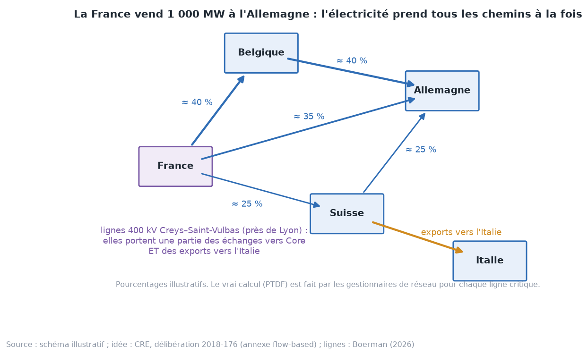
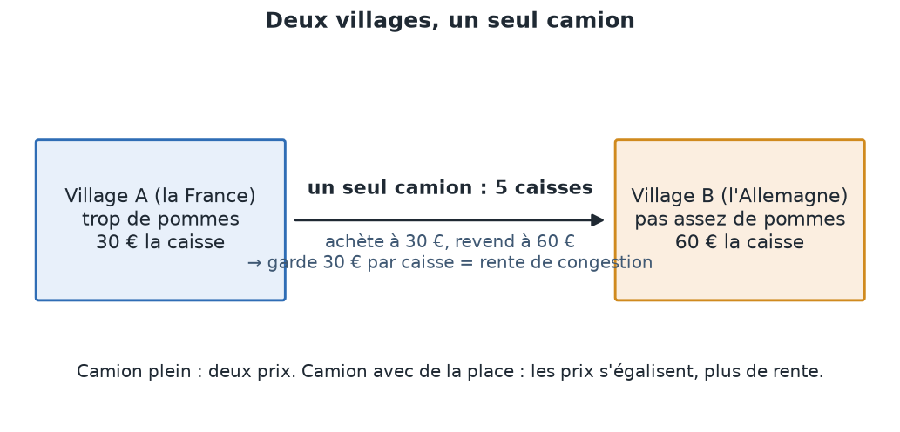
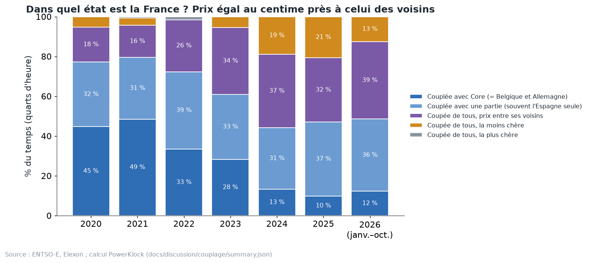
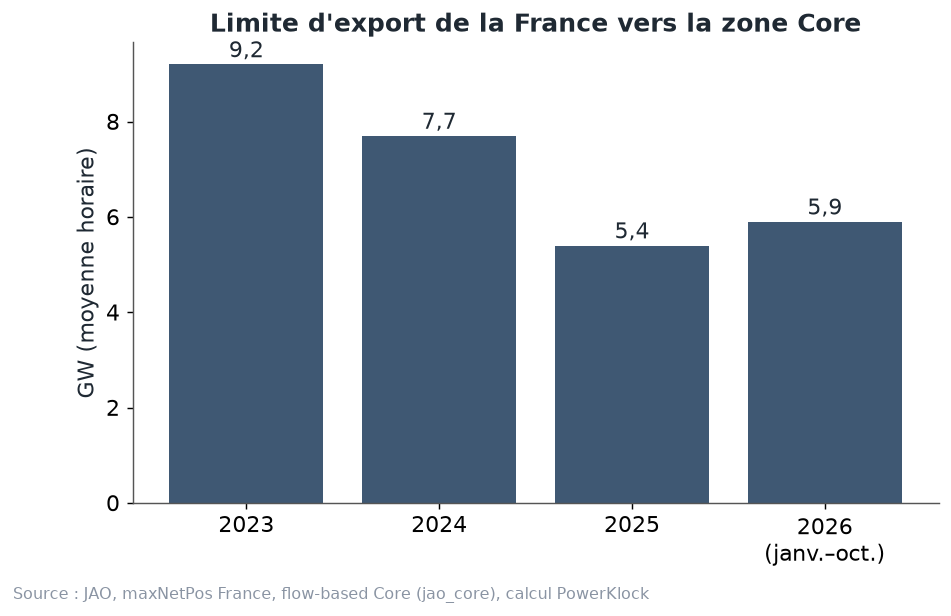

# Chapitre 5 à l'oral — le couplage européen, version complète

*Pour Tom · 1er novembre 2026 · à lire à voix haute, environ 15 minutes*

## 1. Pourquoi coupler les marchés
Chaque pays a ses centrales, avec leurs coûts. Coupler, c'est laisser l'électricité aller du pays où elle est
bon marché vers celui où elle est chère. Le pays vendeur gagne : il vend plus cher que chez lui. Le pays acheteur
gagne aussi : il paie moins cher que chez lui.

C'est la même idée que le commerce entre deux villes : chacune fait ce qu'elle fait le moins cher. L'ACER, le
régulateur européen, estime le gain des échanges d'électricité à environ **34 milliards d'euros en 2021**.

## 2. Comment marche l'enchère
- Chaque jour, avant **midi**, chaque producteur et chaque acheteur dépose ses offres pour le lendemain, dans sa zone.
- Depuis le **1er octobre 2025**, il y a une offre par **quart d'heure**, plus par heure.
- Un seul programme, **Euphemia**, calcule tout en même temps pour l'Europe (le *couplage unique*, SDAC). Il
  cherche les échanges qui créent le plus de gain total, sans dépasser ce que les lignes peuvent porter.
- Il en sort **un prix par zone** et **un échange par frontière**.
- Bornes : le prix ne peut pas dépasser **4 000 €/MWh**, ni descendre sous **−600 €/MWh** (−500 jusqu'au 28 mai 2026).

**Qui est dedans ?**
- Les pays de l'UE (et la Norvège).
- La **Suisse** n'en a jamais fait partie.
- La **Grande-Bretagne** en est sortie le **1er janvier 2021**.

Avec ces deux-là, la capacité des lignes est vendue à part, aux enchères (« explicites »). C'est pour ça que la
France n'a presque jamais le même prix que la Suisse ou la Grande-Bretagne.

## 3. Les lignes : deux façons de compter la place
**L'ancienne façon (NTC).** On donnait une capacité fixe par frontière : « France → Allemagne : 3 000 MW ». Simple,
mais faux : l'électricité ne suit pas les contrats.

**La façon actuelle (flow-based)**, en zone Core depuis le **8 juin 2022** :
- Quand la France vend 1 000 MW à l'Allemagne, l'électricité prend **tous les chemins à la fois** : une partie passe
  par la Belgique, une partie directement, une partie par la Suisse. Comme l'eau qui coule dans un delta.
- Pour chaque ligne importante (une **ligne critique**, ou CNEC), les gestionnaires calculent quelle part de chaque
  échange y passe. Ce sont les **PTDF**. Exemple de la littérature : si une ligne a un PTDF de 0,45, alors 1 000 MW
  d'export y ajoutent 450 MW.
- L'enchère accepte une combinaison d'échanges tant qu'**aucune** ligne critique ne déborde.

**La règle des 70 %.** Le droit européen (règlement 2019/943) demande que chaque ligne critique laisse au moins
**70 %** de sa capacité aux échanges entre zones. En 2024, les gestionnaires de Core n'en ont donné en moyenne que
**54 %** sur les lignes les plus chargées (ACER). Atteindre 70 % aurait apporté au moins **580 millions d'euros** de
gain (ACER, 2025).

**Conséquence.** La « limite d'export de la France » n'est pas un nombre fixe. C'est le maximum que la France peut
exporter vers Core à cette heure-là, compte tenu de tout le reste du réseau. JAO la publie chaque heure (`maxNetPos`).

## 4. La rente de congestion : deux villages, un camion
Rappel de l'image : le village A a trop de pommes (30 €), le village B pas assez (60 €), un seul camion de 5 caisses.
Le camion achète à 30, revend à 60, et garde 30 € par caisse.

En électricité, avec un cas du dossier couplage :
- la France est à 32 €, l'Allemagne à 60 €, la ligne pleine passe 5 000 MW ;
- le producteur français touche 32 €, l'acheteur allemand paie 60 € ;
- les 28 € d'écart × 5 000 MWh = **140 000 € par heure** vont aux gestionnaires de la ligne.

**Qui reçoit la rente ?**
- Elle est partagée **50/50** entre les gestionnaires des deux côtés (ACER, décision 16/2023).
- En France, RTE en reverse une partie aux détenteurs de droits de long terme, et le reste fait baisser le
  **TURPE**, le tarif de réseau payé par les consommateurs.

**Les chiffres 2025 (CRE)** : recettes brutes de RTE sur les frontières de l'UE, **2,05 milliards d'euros**.
- Par frontière : Italie 0,97, Core 0,72, Espagne 0,35.
- Reversé aux détenteurs de droits de long terme : 0,80 milliard.
- Excédent déduit du TURPE : **0,46 milliard**.

## 5. Dans quel état est la France ?
On dit qu'une frontière est **couplée** quand les deux prix sont égaux **au centime près** (règle de la CRE).

En 2025 :
- **couplée avec Core** (même prix que la Belgique et l'Allemagne) : **10 %** du temps, contre 49 % en 2021 ;
- **couplée avec une partie des voisins** : **37 %**, presque toujours l'Espagne seule. France et Espagne forment
  un bloc exportateur ;
- **coupée de tous, entre ses voisins** : **32 %** ;
- **coupée de tous, la moins chère** : **21 %**. La France exporte alors **14,1 GW** en moyenne, son prix est de
  **51 €** et celui de l'Allemagne de **94 €** ;
- **coupée de tous, la plus chère** : **0 %** depuis 2024. La France n'importe plus à pleine ligne.

**Le point clé.** Plus la France est coupée, plus son prix est bas : 75 € quand elle est couplée avec Core, 51 €
quand elle est la moins chère de tous. Mais même là, elle exporte à fond. Notre modèle estime que sans ces exports,
son prix serait de l'ordre de 4 € (estimation, jamais observée).

## 6. Pourquoi la limite vers Core baisse
Limite d'export moyenne de la France vers Core (JAO) : **9,2 GW en 2023, 7,7 en 2024, 5,4 en 2025, 5,9 en 2026**.

**L'explication (Boerman, 2026).**
- La France exporte beaucoup vers l'**Italie**, par la Suisse. Ces flux, hors du marché Core, sont **prévus à
  l'avance** par RTE et réservés sur les lignes : c'est le *FUAF*.
- Ils passent par deux lignes 400 kV près de Lyon, **Creys–Saint-Vulbas**.
- Ce qui est réservé pour l'Italie n'est plus disponible pour Core. Plus de FUAF, moins de marge, donc une limite
  d'export plus basse pour la France.
- La seconde ligne Creys–Saint-Vulbas limite les échanges **49 % du temps en 2026**, contre 21 % en 2025.
- Sa « valeur » (ce que gagnerait l'Europe avec 1 MW de plus sur cette ligne) est passée d'environ **190 à
  310 €/MWh**.
- Pas de remontée à attendre sans renforcement du réseau.

**L'image.** Le camion vers l'Allemagne et le camion vers l'Italie partagent le même pont. Plus on réserve de
place sur le pont pour l'Italie, moins il en reste pour l'Allemagne.

## 7. Ce que ça change pour un PPA
- **67,5 %** de la production éolienne française de 2025 est tombée dans des heures où la France était coupée de ses
  voisins. Pendant ces heures-là, le vent français fait baisser le prix français, pas le prix européen. La
  cannibalisation est plus forte.
- C'est pour ça que le générateur de scénarios a **deux régimes**, « couplée » et « coupée ». Il décide du régime de
  chaque heure en comparant le surplus français à la limite d'export JAO de l'heure.
- Si la limite remonte un jour (renforcement du réseau), la France sera plus souvent au prix de ses voisins, et la
  capture du solaire et de l'éolien remontera. Si elle continue de baisser, l'inverse. C'est un des risques que le
  Monte Carlo complet tire au hasard : limite × lognormale de 20 % × √années.

## À retenir
1. Une seule enchère pour l'Europe, un prix par zone, des échanges limités par les lignes.
2. Flow-based : l'électricité prend tous les chemins, et chaque ligne critique compte.
3. Ligne pleine = deux prix + une rente pour les gestionnaires de réseau (en France, une partie baisse le TURPE).
4. La France est de moins en moins au prix de ses voisins : 10 % du temps avec Core en 2025.
5. La limite vers Core baisse surtout à cause des flux vers l'Italie sur les lignes près de Lyon.
6. Pour un PPA, c'est central : la plupart des MWh éoliens tombent dans des heures où la France est seule face à
   son surplus.

## Question pour vérifier
Imagine que RTE renforce les lignes Creys–Saint-Vulbas en 2028. Qu'arrive-t-il, d'après toi :
- (a) au prix spot moyen français ;
- (b) à la capture d'un parc solaire français ;
- (c) à la rente de congestion à la frontière avec l'Allemagne ?

## Pour aller plus loin
- EPEX SPOT et al., *Euphemia public description* —
  https://www.mercatoelettrico.org/EN/MenuBiblioteca/Documenti/20181212EuphemiaPublicDescription.pdf
- CRE, annexe flow-based de la délibération 2018-176 —
  https://www.cre.fr/fileadmin/Documents/Deliberations/import/180906-2018-176_FLOW_BASED_annexe.pdf
- ACER, capacité transfrontalière et règle des 70 % — https://www.acer.europa.eu/monitoring/cross-zonal-electricity-trade-2025
- CRE, rapport sur l'utilisation des recettes de congestion 2025 —
  https://www.cre.fr/fileadmin/Documents/Rapports_et_etudes/2026/260407_Rapport_Utilisation_recettes_congestion_2025.pdf
- Boerman (2026), « Flowbased: export restrictions of France » — https://boerman.dev/posts/flowbased/highfuaf2026/
- JAO, outil de publication Core — https://publicationtool.jao.eu/core
- Dossier PowerKlock : `docs/discussion/couplage/couplage_europeen.pdf`, `methodologie.md`, `sources.md`.
