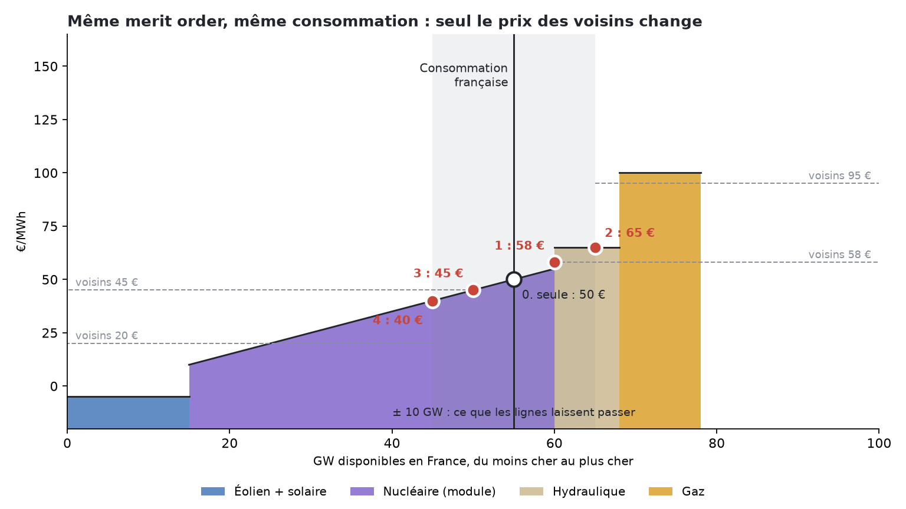
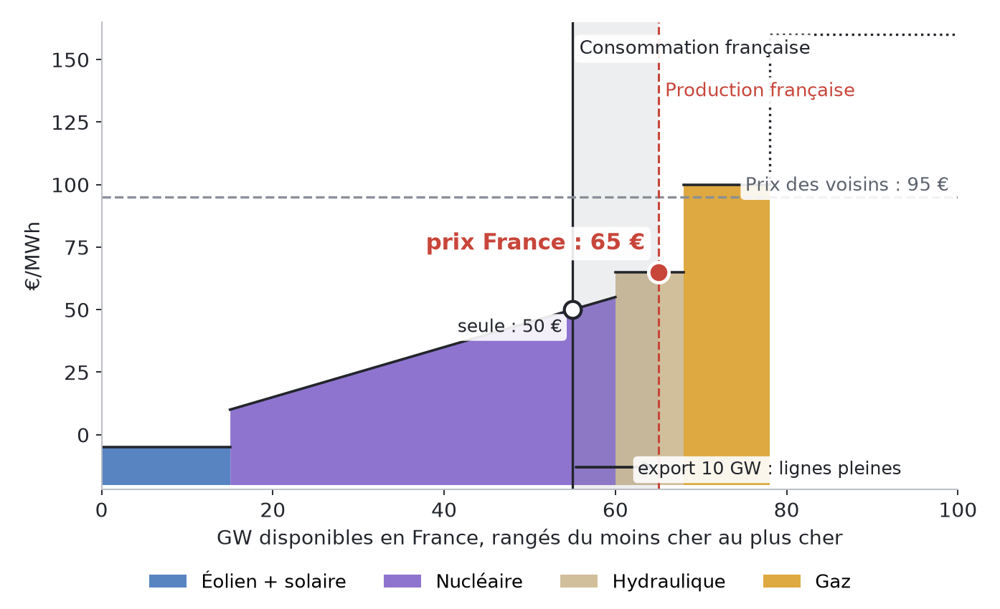
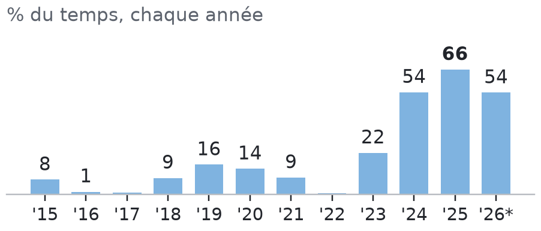
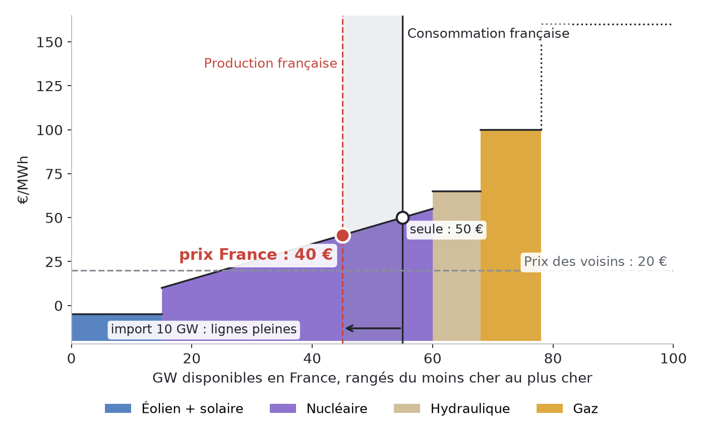
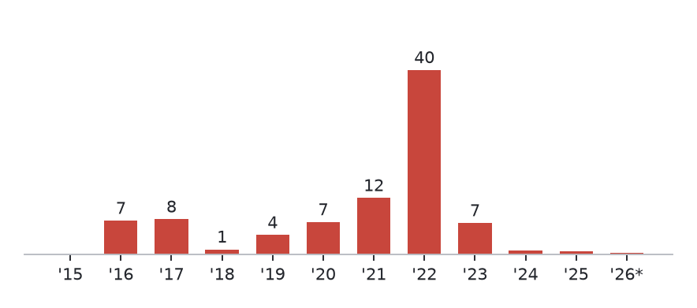
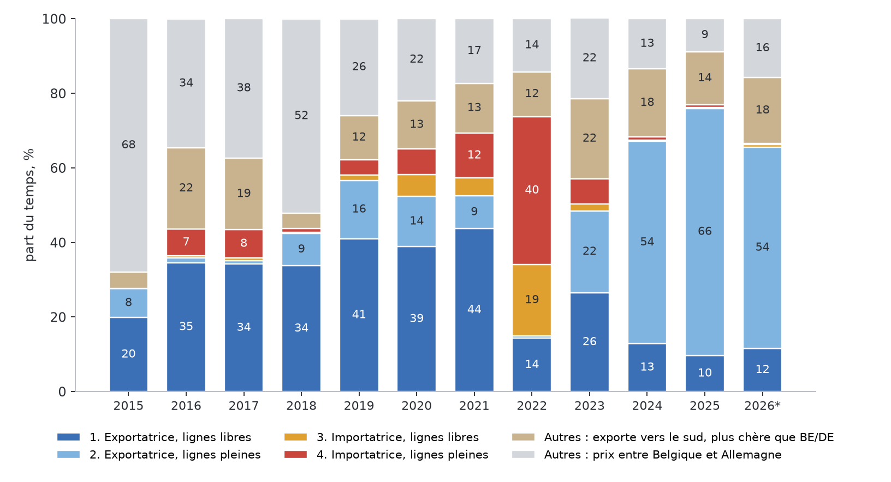

# Chapitre 5 à l'oral — le couplage européen, version complète

*Pour Tom · 1er novembre 2026, complété le 5 novembre (les quatre cas) · à lire à voix haute, environ 25 minutes*

## 1. Pourquoi coupler les marchés
Chaque pays a ses centrales, avec leurs coûts. Coupler, c'est laisser l'électricité aller du pays où elle est
bon marché vers celui où elle est chère. Le pays vendeur gagne : il vend plus cher que chez lui. Le pays acheteur
gagne aussi : il paie moins cher que chez lui.

C'est la même idée que le commerce entre deux villes : chacune fait ce qu'elle fait le moins cher. L'ACER, le
régulateur européen, estime le gain des échanges d'électricité à environ **34 milliards d'euros en 2021**.

## 2. Comment marche l'enchère
- Chaque jour, avant **midi**, chaque producteur et chaque acheteur dépose ses offres pour le lendemain, dans sa zone.
- Depuis le **1er octobre 2025**, il y a une offre par **quart d'heure**, plus par heure.
- Un seul programme, **Euphemia**, calcule tout en même temps pour l'Europe (le *couplage unique*, SDAC). Il
  cherche les échanges qui créent le plus de gain total, sans dépasser ce que les lignes peuvent porter.
- Il en sort **un prix par zone** et **un échange par frontière**.
- Bornes : le prix ne peut pas dépasser **4 000 €/MWh**, ni descendre sous **−600 €/MWh** (−500 jusqu'au 28 mai 2026).

**Qui est dedans ?**
- Les pays de l'UE (et la Norvège).
- La **Suisse** n'en a jamais fait partie.
- La **Grande-Bretagne** en est sortie le **1er janvier 2021**.

Avec ces deux-là, la capacité des lignes est vendue à part, aux enchères (« explicites »). C'est pour ça que la
France n'a presque jamais le même prix que la Suisse ou la Grande-Bretagne.

## 3. Les lignes : deux façons de compter la place
**L'ancienne façon (NTC).** On donnait une capacité fixe par frontière : « France → Allemagne : 3 000 MW ». Simple,
mais faux : l'électricité ne suit pas les contrats.

**La façon actuelle (flow-based)**, en zone Core depuis le **8 juin 2022** :
- Quand la France vend 1 000 MW à l'Allemagne, l'électricité prend **tous les chemins à la fois** : une partie passe
  par la Belgique, une partie directement, une partie par la Suisse. Comme l'eau qui coule dans un delta.
- Pour chaque ligne importante (une **ligne critique**, ou CNEC), les gestionnaires calculent quelle part de chaque
  échange y passe. Ce sont les **PTDF**. Exemple de la littérature : si une ligne a un PTDF de 0,45, alors 1 000 MW
  d'export y ajoutent 450 MW.
- L'enchère accepte une combinaison d'échanges tant qu'**aucune** ligne critique ne déborde.

**La règle des 70 %.** Le droit européen (règlement 2019/943) demande que chaque ligne critique laisse au moins
**70 %** de sa capacité aux échanges entre zones. En 2024, les gestionnaires de Core n'en ont donné en moyenne que
**54 %** sur les lignes les plus chargées (ACER). Atteindre 70 % aurait apporté au moins **580 millions d'euros** de
gain (ACER, 2025).

**Conséquence.** La « limite d'export de la France » n'est pas un nombre fixe. C'est le maximum que la France peut
exporter vers Core à cette heure-là, compte tenu de tout le reste du réseau. JAO la publie chaque heure (`maxNetPos`).

## 4. Les quatre cas sur un seul merit order
Pour comprendre ce que le couplage fait au prix français, on prend **un seul dessin**, et on n'y touche plus. Ce
dessin vient du dossier couplage (`couplage/couplage_cas.pdf`, pages 1 à 10) et de la formation
(`formation/Formation_couplage_europeen.pdf`, pages 3 à 8). Le parc et les prix sont **inventés pour l'exemple** ;
les vrais chiffres viennent après chaque cas.

*Merit order simplifié, parc et prix illustratifs (couplage_cas.pdf). Le violet est le nucléaire. Point blanc : la
France seule ; points rouges : le prix français dans chaque cas.*

### La référence : la France seule
- La courbe range toutes les centrales françaises, de la moins chère à la plus chère : éolien et solaire, nucléaire
  qui module, hydraulique, gaz.
- La consommation de l'heure : **55 GW** sur le dessin. Elle ne bouge presque pas avec le prix.
- Seule, la France produit exactement ce qu'elle consomme. Le prix se lit au croisement : **50 €/MWh**.
- Les lignes vers les voisins laissent passer **10 GW** au plus, dans un sens ou dans l'autre.

Dans les quatre cas, **rien ne change en France** : même courbe, même consommation. Seul change le prix des voisins.

**La règle de lecture, à garder en tête.** Le prix français se lit toujours sur la courbe française, **au niveau de
ce que la France produit**. Quand elle exporte, elle produit plus que sa consommation : on lit plus à droite, plus
cher. Quand elle importe, elle produit moins : on lit plus à gauche, moins cher.

**L'image.** Un marché de village. Si des acheteurs d'à côté viennent acheter des pommes, les vendeurs du village
vendent plus, et le prix monte. Si des vendeurs d'à côté viennent vendre leurs pommes, le prix baisse.

Ce cas « seule » n'arrive **jamais** en vrai : la France échange à chaque heure (couplage_cas.pdf, page 1).

**Comment on compte les cas dans les vraies données** (couplage_cas.pdf, note des pages 2 à 10) :
- « ligne pas saturée » : le prix français est égal à celui de la Belgique **et** de l'Allemagne, au centime près ;
- « ligne saturée » : la France est moins chère que les deux (si elle exporte) ou plus chère que les deux (si elle
  importe) ;
- « exportatrice » ou « importatrice » : le sens des échanges commerciaux de l'heure.

On ne regarde donc ici que la **Belgique et l'Allemagne**, pas tous les voisins. On y revient à la section 6.

### Cas 1 : exportatrice, ligne pas saturée
**Le mécanisme.** Les voisins sont un peu plus chers : **58 €**. La France leur vend. Chaque GW vendu déplace le point
de lecture vers la droite, et le prix français monte. Avec **5 GW** d'export, il atteint 58 € : le même prix que les
voisins. On s'arrête là. La ligne (10 GW) avait encore de la place. **Un seul prix pour tous.**

**Quand ça arrive** (couplage_cas.pdf, page 3, année 2025) :
- surtout en **milieu de journée** (9 h, 11 h, 12 h, 13 h), et en **février, août et mars** ;
- la raison : le solaire allemand fait baisser le prix allemand jusqu'au niveau français ;
- heure typique : **dimanche 16 mars 2025, de 0 h à 1 h**. France, Allemagne et Belgique à **90,0 €**, la France
  exporte 7,8 GW. (C'est l'heure la plus proche des valeurs médianes du cas, pas une heure de midi : ne pas s'en
  étonner.)

**Combien de fois** (`couplage/cases_hist.json`, part du temps) :

| 2016–2021 | 2022 | 2023 | 2024 | 2025 | 2026 (janv.–oct.) |
|---|---|---|---|---|---|
| 34 à 44 % chaque année | 14 % | 26 % | 13 % | **10 %** | 12 % |

C'était le cas le plus courant jusqu'en 2021. Il recule depuis que la France a plus à exporter que la ligne.

**Prix et rente en 2025** : France et Allemagne à **75 €** (page 3). Presque pas de rente : pas d'écart avec la
Belgique et l'Allemagne, et **171 M€** sur les autres frontières (`cases5.json`, page 2).

*Une petite incohérence des diaporamas :* couplage_cas.pdf (page 2) écrit « 34 à 44 % de 2016 à 2021 », la formation
(page 4) « 35 à 44 % ». Le fichier `cases_hist.json` donne 33,8 % en 2018, donc **34 à 44 %**. On garde ce chiffre.

### Cas 2 : exportatrice, ligne saturée

*Formation, page 5 : parc et prix illustratifs.*

**Le mécanisme.** Les voisins sont beaucoup plus chers : **95 €**. Pour rejoindre leur prix, la France devrait
exporter **13 GW**. La ligne n'en passe que **10**. On lit donc le prix français à « consommation + 10 GW », soit
65 GW : **65 €**. Le prix français monte un peu, mais reste **30 € sous les voisins**.

**La rente.** Sur la ligne pleine, on achète à 65 € en France et on revend à 95 € chez les voisins. **30 € × 10 GW,
soit 300 000 € par heure**, vont aux gestionnaires de réseau (formation, page 5). C'est le camion plein de la
section 5.

**Quand ça arrive** (couplage_cas.pdf, page 5, année 2025) :
- surtout le **soir et la nuit** (17 h, 18 h, 6 h, 4 h), quand le solaire allemand s'arrête et que le gaz fixe le
  prix allemand ;
- surtout en **novembre, avril et septembre**. Sur la carte mois × heure du dossier (`heat_exp_sat.png`), presque
  toutes les nuits et les soirées d'avril, de mai et de septembre sont dans ce cas ; les midis de mai à août le sont
  beaucoup moins, parce que le soleil allemand rapproche alors les deux prix ;
- heure typique : **mardi 29 avril 2025, de 23 h à minuit**. France **52,5 €**, Allemagne **97,8 €**, Belgique
  96,5 €, Italie 98,9 €, Espagne 17,9 €. La France exporte 11,8 GW.

*Part du temps dans le cas 2, chaque année. Source : `cases_hist.json` (prix ENTSO-E, échanges Energy-Charts),
calcul PowerKlock ; * janvier–octobre.*

**Combien de fois.** Entre **1 et 16 %** du temps de 2015 à 2022, puis **22 %** en 2023, **54 %** en 2024, **66 %**
en 2025 et 54 % sur janvier–octobre 2026 (`cases_hist.json`). C'est devenu le cas normal : nucléaire revenu,
consommation basse, limite d'export Core plus basse (section 7).

**Prix et rente en 2025.** France environ **58 €**, Allemagne environ **102 €** dans ces heures (`cases5.json` :
57,5 et 102,4 € ; le diaporama écrit 58 / 102 à la page 4 et 58 / 103 à la page 5 : les fichiers diffèrent de
moins d'un euro, selon le nombre d'heures retenues). La France exporte **12,0 GW** en moyenne. Rente : **3,6 Md€**
en 2025, les deux côtés réunis (`cases5.json`, pages 4 et 10). En principe, la moitié revient à RTE, dont l'excédent
est déduit du TURPE.

### Cas 3 : importatrice, ligne pas saturée
**Le mécanisme.** Les voisins sont un peu moins chers : **45 €**. La France leur achète. Chaque GW importé déplace le
point de lecture vers la gauche : les centrales françaises les plus chères s'arrêtent, parce qu'importer coûte moins
cher qu'elles. Avec **5 GW** d'import, le prix français tombe à 45 €, le prix des voisins. **Un seul prix pour tous.**

**Quand ça arrive** (couplage_cas.pdf, page 7) : surtout en **2022**, l'été (août, septembre, juillet), la nuit et le
matin (0 h, 1 h, 7 h, 8 h). Le nucléaire français ne produisait que **29,8 GW** dans ces heures. Ce n'étaient pas les
voisins qui étaient bas : c'est la France seule qui était haute. Heure typique : **dimanche 24 juillet 2022, de 5 h à
6 h**, France, Allemagne et Belgique à **302,8 €**, la France importe 2,9 GW.

**Combien de fois** (`cases_hist.json`) : **19 %** en 2022 ; 5 à 6 % en 2020 et 2021 ; moins de 2 % les autres
années ; 0,2 % en 2025 (le diaporama arrondit à 0 %).

**Prix et rente.** En 2022 : France = Allemagne = **331 €** en moyenne dans ces heures, 3,4 GW importés. Peu de rente
avec la Belgique et l'Allemagne ; **908 M€** en 2022 sur les autres frontières (`cases5.json`, page 6).

### Cas 4 : importatrice, ligne saturée

*Formation, page 7 : parc et prix illustratifs.*

**Le mécanisme.** Les voisins sont beaucoup moins chers : **20 €**. Pour rejoindre leur prix, la France voudrait
importer **30 GW**. La ligne n'en passe que **10**. On lit le prix français à « consommation − 10 GW », soit 45 GW :
**40 €**. Le prix baisse, mais reste **20 € au-dessus des voisins**. Même calcul de rente que pour le cas 2 : 20 € ×
10 GW, soit 200 000 € par heure sur le dessin.

**Quand ça arrive** (couplage_cas.pdf, page 9) : surtout en **2022**, en **milieu de journée** (11 h à 14 h), l'été
(juillet, septembre, juin). Le solaire allemand fait baisser le prix voisin, pendant que le nucléaire français est à
**30,6 GW**. Heure typique : **samedi 8 octobre 2022, de 9 h à 10 h**. France **268,4 €**, Allemagne **191,1 €**,
Belgique 167,5 €. La France importe 4,0 GW.

*Part du temps dans le cas 4, chaque année. Source : `cases_hist.json`, calcul PowerKlock ; * janvier–octobre.*

**Combien de fois** (`cases_hist.json`) : **40 %** en 2022 ; 7 à 12 % en 2016, 2017, 2020, 2021 et 2023 ; puis
**environ 1 %** (0,8 % en 2024, 0,7 % en 2025) et 0,3 % sur janvier–octobre 2026.

**Attention aux rares heures de 2024–2025.** Ce ne sont pas des heures de manque. Dans ces 65 à 74 heures, le prix
allemand est **négatif** en moyenne (−6,7 € en 2024, −10,8 € en 2025), et la France est à 17,2 puis 10,2 €
(`cases5.json`). C'est l'Allemagne qui déborde de soleil et de vent, et la France lui prend un peu d'électricité.

**Sécurité.** En 2022, les imports étaient au maximum (4,6 GW en moyenne dans ces heures). Seule, la France aurait
manqué d'énergie **89 heures** cette année-là, avec un manque allant jusqu'à **7,5 GW** (estimation de modèle,
couplage_cas.pdf page 8 ; couplage_europeen.pdf page 22).

**Rente.** Forte : **3,1 Md€** en 2022 (`cases5.json` : 3 099 M€ ; couplage_cas.pdf, page 8). La CRE a fait reverser
**1,94 Md€** aux utilisateurs du réseau au titre de 2022, grâce aux recettes d'interconnexion (CRE, versement
exceptionnel de RTE).

*Une incohérence du diaporama :* le récapitulatif (couplage_cas.pdf, page 10) écrit 3,5 Md€ pour la rente du cas 4
en 2022. Le fichier de données donne 3,1 Md€, comme la page 8. On garde **3,1 Md€** ; on ne sait pas d'où vient le
3,5.

### Le récapitulatif

*Part du temps dans chaque cas face à la Belgique et l'Allemagne, 2015 – octobre 2026. Source : PowerKlock, prix
ENTSO-E et échanges Energy-Charts ; même prix = écart de moins d'un centime ; * janvier–octobre.*

Trois époques (formation, page 8) :
1. **Jusqu'en 2021** : la France exporte souvent au même prix que ses voisins (cas 1).
2. **2022** : la moitié du nucléaire à l'arrêt, la France importe **59 %** du temps (cas 3 et 4 : 19 + 40 %), souvent
   plus chère que ses voisins.
3. **Depuis 2024** : nucléaire revenu, exports records, la ligne est pleine **66 %** du temps en 2025 (cas 2). La France
   est alors bien moins chère que l'Allemagne.

**Le reste du temps** (23 % en 2025) n'entre dans aucun des quatre cas : le prix français est entre ceux de la
Belgique et de l'Allemagne (9 %), ou plus cher que les deux alors que la France exporte, vers l'Italie, la Suisse et
la Grande-Bretagne (14 %), souvent quand l'Allemagne déborde de vent et de soleil (`cases_hist.json` ;
couplage_cas.pdf, page 10).

**Ce qu'il faut retenir du dessin.**
- Exportatrice : le prix français **monte**. Importatrice : il **baisse**.
- Ligne libre : il rejoint les voisins. Ligne pleine : il s'arrête avant, et l'écart devient une **rente**.
- Rien n'a changé en France : seul le prix des voisins a bougé.

## 5. La rente de congestion : deux villages, un camion
Rappel de l'image : le village A a trop de pommes (30 €), le village B pas assez (60 €), un seul camion de 5 caisses.
Le camion achète à 30, revend à 60, et garde 30 € par caisse.

En électricité, avec un cas du dossier couplage :
- la France est à 32 €, l'Allemagne à 60 €, la ligne pleine passe 5 000 MW ;
- le producteur français touche 32 €, l'acheteur allemand paie 60 € ;
- les 28 € d'écart × 5 000 MWh = **140 000 € par heure** vont aux gestionnaires de la ligne.

**Qui reçoit la rente ?**
- Elle est partagée **50/50** entre les gestionnaires des deux côtés (ACER, décision 16/2023).
- En France, RTE en reverse une partie aux détenteurs de droits de long terme, et le reste fait baisser le
  **TURPE**, le tarif de réseau payé par les consommateurs.

**Les chiffres 2025 (CRE)** : recettes brutes de RTE sur les frontières de l'UE, **2,05 milliards d'euros**.
- Par frontière : Italie 0,97, Core 0,72, Espagne 0,35.
- Reversé aux détenteurs de droits de long terme : 0,80 milliard.
- Excédent déduit du TURPE : **0,46 milliard**.

## 6. Dans quel état est la France ?
On dit qu'une frontière est **couplée** quand les deux prix sont égaux **au centime près** (règle de la CRE).

En 2025 :
- **couplée avec Core** (même prix que la Belgique et l'Allemagne) : **10 %** du temps, contre 49 % en 2021 ;
- **couplée avec une partie des voisins** : **37 %**, presque toujours l'Espagne seule. France et Espagne forment
  un bloc exportateur ;
- **coupée de tous, entre ses voisins** : **32 %** ;
- **coupée de tous, la moins chère** : **21 %**. La France exporte alors **14,1 GW** en moyenne, son prix est de
  **51 €** et celui de l'Allemagne de **94 €** ;
- **coupée de tous, la plus chère** (plus chère que **tous** ses voisins et importatrice) : **0 heure** en 2024 et
  en 2025, presque rien en 2026 (couplage_europeen.pdf, page 9 ; `summary.json`).

**Deux définitions, à ne pas mélanger.** « Coupée de tous, la plus chère » compare la France à **tous** ses voisins.
Le cas 4 de la section 4 ne la compare qu'à la **Belgique et l'Allemagne**. Le cas 4 existe encore un peu : environ
**1 %** du temps en 2024 et 2025 (0,8 et 0,7 %, `cases_hist.json`), des heures où l'Allemagne est à prix négatif.
Dans ces heures, la France est plus chère que la Belgique et l'Allemagne, mais pas plus chère que tous ses voisins.
Donc il est faux de dire « la France n'importe plus jamais à pleine ligne » : elle le fait encore quelques dizaines
d'heures par an face à Core, mais jamais en étant la plus chère de tous.

De même, le cas 2 (**66 %** en 2025) n'est pas « coupée de tous » (**53 %** : 32 + 21). Dans le cas 2, la France est
moins chère que la Belgique et l'Allemagne, mais elle peut avoir le prix de l'Espagne. Les deux chiffres sont justes ;
ils répondent à deux questions différentes.

**Le point clé.** Plus la France est coupée, plus son prix est bas : 75 € quand elle est couplée avec Core, 51 €
quand elle est la moins chère de tous. Mais même là, elle exporte à fond. Notre modèle estime que sans ces exports,
son prix serait de l'ordre de 4 € (estimation, jamais observée).

## 7. Pourquoi la limite vers Core baisse
Limite d'export moyenne de la France vers Core (JAO) : **9,2 GW en 2023, 7,7 en 2024, 5,4 en 2025, 5,9 en 2026**.

**Plusieurs causes, pas une seule.** Le dossier couplage (couplage_europeen.pdf, page 23, « Les causes ») en liste
plusieurs pour le découplage de la France :
- **plus de surplus** : nucléaire disponible de **33,8 GW** en 2022 à **46,9 GW** en 2025 ; éolien + solaire de 6,5 à
  9,4 GW en moyenne ; consommation basse (50,7 GW en moyenne en 2025, « en retrait par rapport aux niveaux
  d'avant-crise », dit RTE) ;
- **moins de place sur les lignes Core** : la limite JAO, de 9,2 à 5,4 GW ;
- **des lignes Core sous-utilisées** : 54 % de la capacité donnée en 2024, au lieu des 70 % exigés (ACER, section 3) ;
- **le vent et le soleil allemands** : quand ils débordent, c'est l'Allemagne qui passe sous la France.

Les deux premières causes et la dernière expliquent pourquoi la France **déborde** plus souvent la ligne. Les deux du
milieu expliquent pourquoi la ligne **rétrécit**. Le dossier le dit clairement : **aucune source publique ne chiffre
la part de chaque cause** dans la baisse de la limite JAO.

**Le mécanisme technique de la limite (Boerman, 2026).** C'est l'explication documentée de **comment** la limite se
forme, pas la preuve que c'est la seule cause.
- La France exporte beaucoup vers l'**Italie**, par la Suisse. Ces flux, hors du marché Core, sont **prévus à
  l'avance** par RTE et réservés sur les lignes : c'est le *FUAF*.
- Ils passent par deux lignes 400 kV près de Lyon, **Creys–Saint-Vulbas**.
- Ce qui est réservé pour l'Italie n'est plus disponible pour Core. Plus de FUAF, moins de marge, donc une limite
  d'export plus basse pour la France.
- La seconde ligne Creys–Saint-Vulbas limite les échanges **49 % du temps en 2026**, contre 21 % en 2025.
- Sa « valeur » (ce que gagnerait l'Europe avec 1 MW de plus sur cette ligne) est passée de **183–201 €/MWh en
  2025 à 311–318 €/MWh en 2026**.
- Selon Boerman, pas de remontée à attendre sans renforcement du réseau.

**L'image.** Le camion vers l'Allemagne et le camion vers l'Italie partagent le même pont. Plus on réserve de
place sur le pont pour l'Italie, moins il en reste pour l'Allemagne.

## 8. Ce que ça change pour un PPA
- **Environ deux tiers** de la production éolienne française de 2025 est tombée dans des heures où la France était
  séparée de ses voisins. Le chiffre exact dépend de la définition :
  - **67,5 %** dans les heures « coupées » du débrief du 31 octobre (`pricing/debrief-2026-10-31.md`) ;
  - **68 %** dans les heures où la France est **au moins 5 € sous l'Allemagne** (couplage_europeen.pdf, page 29). Avec
    cette définition, la part monte de **8 % en 2021** à 49 % en 2024, puis 68 % en 2025.

  Pendant ces heures-là, le vent français fait baisser le prix français, pas le prix européen. La cannibalisation
  est plus forte.
- C'est pour ça que le générateur de scénarios a **deux régimes**, « couplée » et « coupée ». Il décide du régime de
  chaque heure en comparant le surplus français à la limite d'export JAO de l'heure.
- Si la limite remonte un jour (renforcement du réseau), la France sera plus souvent au prix de ses voisins, et la
  capture du solaire et de l'éolien remontera. Si elle continue de baisser, l'inverse. C'est un des risques que le
  Monte Carlo complet tire au hasard : limite × lognormale de 20 % × √années.

## À retenir
1. Une seule enchère pour l'Europe, un prix par zone, des échanges limités par les lignes.
2. Flow-based : l'électricité prend tous les chemins, et chaque ligne critique compte.
3. Ligne pleine = deux prix + une rente pour les gestionnaires de réseau (en France, une partie baisse le TURPE).
4. Un seul merit order, quatre cas : exportatrice, le prix monte ; importatrice, il baisse ; ligne pleine, il
   s'arrête avant les voisins et l'écart devient une rente. Jusqu'en 2021, surtout le cas 1 ; en 2022, les cas 3 et
   4 (59 %) ; en 2025, le cas 2 (66 %).
5. La France est de moins en moins au prix de ses voisins : 10 % du temps avec Core en 2025.
6. La France se découple pour plusieurs raisons : plus de surplus, une limite JAO plus basse, des lignes Core
   sous-utilisées, le vent allemand. Le mécanisme technique de la limite (Boerman) passe par les flux vers l'Italie
   près de Lyon ; personne ne chiffre la part de chaque cause.
7. Pour un PPA, c'est central : la plupart des MWh éoliens tombent dans des heures où la France est seule face à
   son surplus.

## Question pour vérifier
Imagine que RTE renforce les lignes Creys–Saint-Vulbas en 2028. Qu'arrive-t-il, d'après toi :
- (a) au prix spot moyen français ;
- (b) à la capture d'un parc solaire français ;
- (c) à la rente de congestion à la frontière avec l'Allemagne ?

Et une question sur le dessin : une heure de nuit en avril 2025, l'Allemagne est à 98 € et la France exporte à pleine
ligne. Dans quel cas est-on, et pourquoi le prix français n'est-il pas à 98 € ?

## Pour aller plus loin
- EPEX SPOT et al., *Euphemia public description* —
  https://www.mercatoelettrico.org/EN/MenuBiblioteca/Documenti/20181212EuphemiaPublicDescription.pdf
- CRE, annexe flow-based de la délibération 2018-176 —
  https://www.cre.fr/fileadmin/Documents/Deliberations/import/180906-2018-176_FLOW_BASED_annexe.pdf
- ACER, capacité transfrontalière et règle des 70 % — https://www.acer.europa.eu/monitoring/cross-zonal-electricity-trade-2025
- CRE, rapport sur l'utilisation des recettes de congestion 2025 —
  https://www.cre.fr/fileadmin/Documents/Rapports_et_etudes/2026/260407_Rapport_Utilisation_recettes_congestion_2025.pdf
- Boerman (2026), « Flowbased: export restrictions of France » — https://boerman.dev/posts/flowbased/highfuaf2026/
- JAO, outil de publication Core — https://publicationtool.jao.eu/core
- Dossier PowerKlock : `docs/discussion/couplage/couplage_europeen.pdf` (pages 9, 22, 23, 29),
  `couplage_cas.pdf` (les quatre cas, pages 1 à 10), `methodologie.md`, `sources.md` ; données `cases_hist.json`,
  `cases5.json`, `case_profiles.json`.
- Formation : `docs/discussion/formation/Formation_couplage_europeen.pdf` (pages 3 à 8).
