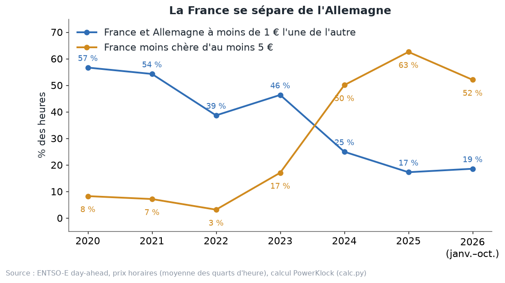
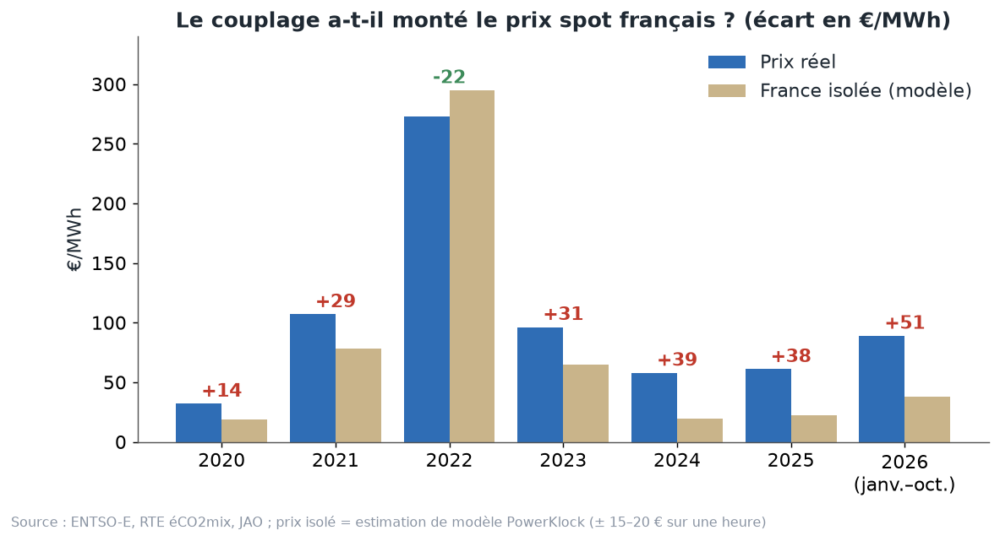

# Chapitre 6 à l'oral — la France couplée ou coupée, version complète

*Pour Tom · 1er novembre 2026 · à lire à voix haute, environ 15 minutes*

## 1. Deux mots à bien comprendre
On reprend les deux villages et le camion du chapitre 5.
- **Couplée** : le camion a encore de la place. Les deux villages ont **le même prix**.
- **Coupée** : le camion est plein. Chaque village garde **son propre prix**, et l'écart va au propriétaire du camion
  (la rente de congestion).

**Comment on compte.** Il y a deux règles, et il faut toujours dire laquelle on utilise.
- **Au centime près** (la règle de la CRE) : deux prix sont égaux si l'écart est sous 0,01 €. Nos taux
  France–Allemagne : 49 % en 2021, 34 % en 2022, 29 % en 2023, 14 % en 2024, 11 % en 2025. Ceux de la CRE : 49, 34,
  29, 14 et 10 %. Ils retombent les uns sur les autres.
- **À 1 € près** (`calc.py`) : plus tolérant. Il compte comme « presque égaux » des prix séparés par quelques
  centimes d'arrondi ou par une petite congestion. Exemple : « couplée avec Core » passe de 10 % à 17 % en 2025
  (dossier couplage).

Ce chapitre utilise surtout la règle à 1 €, parce que c'est celle du schéma qui suit. Quand on parle des « états de
couplage » (couplée avec Core, coupée de tous), c'est la règle au centime.

## 2. La France s'est séparée de l'Allemagne

La courbe bleue : la part des heures où la France et l'Allemagne sont à **moins de 1 €** l'une de l'autre (`calc.py`,
prix ENTSO-E).

| 2020 | 2021 | 2022 | 2023 | 2024 | 2025 | 2026 (janv.–oct.) |
|---|---|---|---|---|---|---|
| 57 % | 54 % | 39 % | 46 % | 25 % | 17 % | 19 % |

En 2020, plus d'une heure sur deux, les deux pays avaient presque le même prix. En 2025, moins d'une heure sur cinq.

La courbe orange : la part des heures où la France est **moins chère d'au moins 5 €**. Elle passe de **8 %** en 2020
à **63 %** en 2025, puis **52 %** sur janvier–octobre 2026.

**Les prix moyens annuels** (ENTSO-E, dossier couplage) :
- 2020–2021 : prix proches, la France souvent un peu plus chère ;
- 2022 : crise, la France plus chère (277 € contre 236 €), elle importe ;
- 2024 : **58 € contre 79 €** ; 2025 : **61 € contre 90 €**.

RTE (bilan 2025) le dit aussi : les prix français se sont « largement découplés de ceux de l'ensemble des pays
voisins ».

**Pourquoi** (dossier couplage, page « Les causes ») :
- **plus de surplus** : nucléaire disponible de 33,8 GW en 2022 à 46,9 GW en 2025 ; éolien + solaire de 6,5 à 9,4 GW
  en moyenne ; consommation basse (50,7 GW en moyenne en 2025) ;
- **moins de place sur les lignes Core** : limite d'export de la France de 9,2 GW (2023) à 5,4 GW (2025), surtout à
  cause des flux vers l'Italie (chapitre 5).

**L'image.** Le village A produit de plus en plus de pommes, et le camion rétrécit. Il est plein de plus en plus
souvent.

## 3. Quand la France est coupée, elle est presque toujours la moins chère
**Deux heures sur trois.** En 2025, la France est moins chère que l'Allemagne environ deux heures sur trois.
Le chiffre exact dépend de la règle :
- **68 %** des heures si on compte toute heure où la France est sous l'Allemagne, même d'un centime (dossier
  couplage, frontière par frontière) ;
- **67 %** dans le débrief du 31 octobre ;
- **63 %** si on exige au moins 5 € d'écart (`calc.py`, 5 460 heures).

Dans ces heures, le prix moyen est d'environ **58 € en France contre 103 € en Allemagne** (débrief), soit 45 €
d'écart.

**Et quand la France est plus chère ?** En 2025, ça arrive environ 1 800 heures (1 822). On pourrait croire que la
France manque d'électricité. Non : le dossier couplage montre qu'elle **exporte dans 96 %** de ces heures (7,7 GW en
moyenne). C'est l'Allemagne qui déborde de vent et de soleil : l'éolien et le solaire y couvrent **64 %** de sa
consommation dans ces heures (contre 36 % quand la France est moins chère), et son prix est négatif dans **23 %** de
ces heures.

**Coupée en importatrice : jamais depuis 2024.** La France n'importe plus à pleine ligne (dossier couplage, 0 heure
en 2024 et 2025).

## 4. Même coupée, la France suit l'Allemagne
C'est le point le plus surprenant du chapitre.

On prend les heures coupées de 2025 et on les sépare en deux, selon le vent **allemand** (débrief du 31 octobre) :

| Heures coupées 2025 | Prix France | Prix Allemagne | Export vers Core |
|---|---|---|---|
| Vent allemand faible | **67,5 €** | 123 € | 4,5 GW |
| Vent allemand fort | **42,4 €** | 82 € | 4,5 GW |

La ligne vers Core est pleine dans les deux cas : la France y exporte la même chose. Pourtant, le prix français bouge
de 25 € avec le vent allemand.

**Pourquoi ?** La France a d'autres portes de sortie :
- l'**Italie**, la **Suisse**, la **Grande-Bretagne**, l'**Espagne**.
- Quand le vent allemand tombe, le prix allemand monte. Les pays autour (Italie, Suisse…) voient leurs prix monter
  aussi, et paient plus cher l'électricité française qui leur arrive par les autres frontières. Le prix français
  monte.

**L'image.** Le village A a un camion vers B, plein. Mais il a aussi des charrettes vers C, D et E. Quand les pommes
manquent en B, les prix montent aussi en C, D et E. Les charrettes vendent plus cher, et le prix monte en A.

**Le lien avec la recherche.** C'est ce que Stiewe, Xu, Eicke et Hirth appellent la **cannibalisation
transfrontalière** : le vent des voisins fait baisser la valeur de nos éoliennes presque autant que notre propre vent
(on le détaille au chapitre 7).

## 5. Le vent tombe surtout dans les heures coupées
Part de la production éolienne française tombée dans des heures où la France est coupée :

| | 2023 | 2024 | 2025 |
|---|---|---|---|
| Réalité | 18,5 % | 49 % | **67,5 %** |
| Indicateur prévisible | 17 % | 39 % | 66 % |

Sources : débrief du 31 octobre. L'**indicateur prévisible**, c'est le surplus français au-delà de la limite d'export
Core, calculé à l'avance. Il suit très bien la réalité, surtout en 2025.

**Pourquoi c'est logique.** Le vent souffle souvent longtemps, et sur toute l'Europe en même temps. C'est justement
quand il y a du vent que la France a le plus de surplus, donc que la ligne est pleine. Le MWh éolien vaut alors le
prix français, pas le prix allemand.

C'est pour ça que notre générateur de scénarios a **deux régimes**, « couplée » et « coupée ». Il choisit le régime de
chaque heure en comparant le surplus français à la limite d'export JAO de l'heure.

## 6. Et si la France était isolée ? Une estimation de modèle
**La question.** Le couplage a-t-il fait monter le prix spot français ?

Pour y répondre, il faudrait connaître le prix d'une France **sans aucun échange**. Ce monde n'a jamais existé. On
doit donc l'**estimer** avec un modèle. Tout ce qui suit est une estimation, pas une observation.

**La méthode, en quatre étapes** (dossier couplage, `methodologie.md`) :
1. **Le volume demandé aux centrales pilotables** (nucléaire, lacs, STEP, gaz, charbon, fioul), d'après RTE éCO2mix :
   consommation + exports nets − éolien − solaire − fil de l'eau − bioénergies.
2. **La courbe apprise.** Un modèle apprend, sur environ 60 000 heures (2020–2026), le prix en fonction de ce volume,
   du nucléaire disponible, du coût du gaz et du charbon, et du moment (mois, heure, week-end). Le modèle est forcé
   à monter avec le volume et avec le prix des combustibles.
3. **La France isolée.** Même heure, mêmes centrales, même vent, même soleil, mais **exports = 0**. On relit la courbe
   à ce volume plus petit.
4. **Les bornes physiques.**
   - Sous le minimum nucléaire (63 % du nucléaire disponible en 2024–2025), il faut écrêter le surplus : le prix vaut
     alors le prix négatif médian de l'année (environ 0 €).
   - Au-dessus de toute la capacité, c'est une pénurie : on compte ces heures à part.

**L'image.** C'est comme estimer le prix des pommes du village A si le pont était coupé. On connaît la courbe des
vendeurs de A. On regarde à quel prix ils vendraient s'il fallait tout écouler sur place.

**La validation.** On vérifie le modèle sur les heures coupées, où le prix réel est déjà celui du marché français
seul. Chaque heure est prédite par un modèle qui ne l'a jamais vue.
- Une heure prise seule : erreur de **±15 à 20 €**.
- Biais annuel : **+0,6 à +2,6 €** de 2020 à 2025, et **+8 €** en 2026.
- Le biais est toujours positif : le modèle surestime un peu le prix isolé. L'effet du couplage est donc plutôt
  sous-estimé.

## 7. Les résultats : +38 € en 2025

| Année | Prix réel | France isolée (modèle) | Écart |
|---|---|---|---|
| 2020 | 32 | 19 | +14 |
| 2021 | 107 | 78 | +29 |
| 2022 | 273 | 295 | **−22** |
| 2023 | 96 | 65 | +31 |
| 2024 | 58 | 19 | +39 |
| 2025 | 61 | 23 | **+38** |
| 2026 (janv.–oct.) | 89 | 38 | +51 |

En €/MWh, hors heures de pénurie.

**Comment le lire.**
- **Les années où la France exporte,** le couplage fait monter son prix spot. En 2025, une France isolée aurait eu
  environ **23 €** au lieu de **61 €**. Avec 90 TWh de trop et personne à qui les vendre, le nucléaire aurait modulé
  sans arrêt, et il aurait fallu écrêter environ **8,9 TWh** de surplus.
- **En 2022, c'est l'inverse :** la France importait, et les voisins ont fait **baisser** son prix (−22 €). Ils ont
  aussi couvert **89 heures** où, seule, elle aurait manqué d'énergie.
- **Robustesse 2025 :** le prix isolé va de **17 à 25 €**, selon le plancher choisi et les heures d'apprentissage.

**Le paradoxe.** La France est de plus en plus coupée de l'Allemagne, mais l'écart avec une France isolée
**grandit**. Pourquoi ? Même coupée, elle exporte toujours à pleine ligne. Dans l'état « coupée, la moins chère » de
2025, elle exporte **14,1 GW** en moyenne, à **51 €**. Sans ces exports, le modèle donne un prix de l'ordre de **4 €**.

**Les limites, à dire à chaque fois.**
- C'est une **borne théorique à court terme** : même parc, même consommation.
- À long terme, deux effets jouent en sens contraire. Une France isolée en surplus aurait arrêté plus de réacteurs
  (prix plus haut). Ses offres n'auraient plus de coûts d'opportunité européens (prix plus bas). **Le sens net est
  inconnu.**
- **Aucune étude publiée** ne chiffre l'effet du couplage sur le prix français. On ne peut donc pas recouper ce
  chiffre.

## 8. La comparaison sans modèle
On peut aussi regarder les données sans modèle. On compare les heures où la France est **couplée avec Core** aux
heures où elle est **coupée de tous**, mais **à situation française égale** : même année, même trimestre, même moment
de la journée, même surplus français (par tranches de 2 GW).

| Année | Couplée (brut) | Coupée (brut) | Écart à situation égale | Heures coupées comparées |
|---|---|---|---|---|
| 2023 | 99 € | 86 € | +9 € | 66 % |
| 2024 | 68 € | 54 € | +2 € | 39 % |
| 2025 | 74 € | 56 € | −2 € | 23 % |

Source : `couplage/observed.json`, calcul PowerKlock.

**Comment le lire.**
- L'écart brut est grand : **18 €** en 2025. Mais ce ne sont pas les mêmes heures : le vent, la saison et la
  consommation ne sont pas les mêmes.
- À situation égale, l'écart tombe à **−2 à +9 €** en 2023–2025.
- **Le prix français dépend d'abord de son surplus.** Le couplage décide surtout s'il rejoint ses voisins ou non.

**Pourquoi les deux chiffres ne se contredisent pas.** La comparaison sans modèle oppose deux mondes où la France
**échange dans les deux cas**. Elle ne dit pas ce que serait une France sans aucun échange. Le +38 € répond à une
autre question : « et si le pont n'existait pas du tout ? ». Attention aussi : en 2025, on ne compare que 23 % des
heures coupées, car beaucoup n'ont pas d'heure couplée semblable.

## 9. Où va l'argent (2025)
Si le prix spot français est plus haut grâce au couplage, l'argent ne disparaît pas. Le dossier couplage (calcul
PowerKlock, comparé à la France isolée) donne pour 2025 :

**D'où vient l'argent :**
- la consommation française vaut **17,1 Md€** de plus **au prix spot**. **Ce n'est pas la facture** : les clients
  achètent surtout à terme, avec un ou deux ans de lissage ;
- les acheteurs étrangers paient **10,0 Md€** pour les exports.

**Qui le reçoit :**
- le **nucléaire** : **16,2 Md€** de chiffre d'affaires en plus. EDF est détenue à 100 % par l'État depuis juin 2023.
  Jusqu'en 2025, l'ARENH vendait une partie du nucléaire à 42 € : c'est donc un maximum ;
- l'**hydraulique** : 2,6 Md€ ;
- l'**éolien et le solaire** : **2,8 Md€**. Pour les parcs sous contrat de soutien, l'État paie la différence entre
  le tarif garanti et le prix de marché : un prix plus haut allège la dépense publique ;
- gaz, charbon, fioul et bioénergies : 1,2 Md€ ;
- la **rente de congestion** : **4,5 Md€**, partagée entre RTE et les voisins. L'excédent de la part de RTE fait
  baisser le TURPE (459,7 M€ en 2025, CRE).

**L'image.** Le village A vend ses pommes plus cher grâce au pont. Les habitants de A paient leurs pommes plus cher
aussi, mais les vergers (surtout celui de l'État) encaissent plus, et le péage du pont rembourse une partie de
l'entretien des routes.

## 10. Ce que ça change pour un PPA
- **Un MWh éolien vaut le prix de la zone quand la ligne a de la place, et seulement le prix français quand elle est
  pleine.** En 2025, deux MWh éoliens sur trois sont tombés dans des heures coupées.
- **Même coupée, la France suit les voisins.** Un modèle qui ignore le vent allemand se tromperait sur le prix des
  heures coupées.
- **La limite d'export est un risque du PPA.** Si elle remonte (nouvelles lignes), la France rejoint plus souvent ses
  voisins, et la capture remonte. Si elle baisse encore, l'inverse.
- **Le forward a déjà intégré le découplage** : l'écart Cal France − Allemagne passe de +3 € (livraison 2024) à
  −37 € (livraison 2027) (SEFE, dossier couplage).

## À retenir
1. Couplée = même prix que le voisin. Coupée = ligne pleine, deux prix. Toujours dire la règle (au centime ou à 1 €).
2. France et Allemagne à moins de 1 € : 57 % des heures en 2020, 17 % en 2025.
3. Quand elle est coupée, la France est presque toujours la moins chère, et elle exporte quand même à pleine ligne.
4. Même coupée, elle suit l'Allemagne, par l'Italie, la Suisse, la Grande-Bretagne et l'Espagne.
5. 67,5 % de l'éolien français de 2025 est tombé dans des heures coupées.
6. France isolée : 23 € au lieu de 61 € en 2025, soit +38 € dus au couplage. C'est une estimation de modèle, jamais
   observée.
7. Sans modèle, à situation égale, couplée ou coupée change peu le prix : c'est le surplus qui décide.

## Question pour vérifier
Une heure de mai 2025, la France est coupée de tous ses voisins et la ligne vers Core est pleine. D'un coup, le vent
tombe en Allemagne. D'après toi :
- (a) le prix français monte-t-il, baisse-t-il ou reste-t-il pareil, et par quel chemin ;
- (b) l'export de la France vers Core change-t-il ;
- (c) pourquoi le chiffre « +38 € » ne contredit-il pas l'écart de −2 € trouvé sans modèle ?

## Pour aller plus loin
- CRE, *Rapport de surveillance des marchés de gros 2025*, pp. 79–82 (convergence des prix) —
  https://www.cre.fr/fileadmin/Documents/Rapports_et_etudes/2026/Rapport_de_surveillance_2025.pdf
- RTE, *Bilan électrique 2025* (exports, prix découplés) —
  https://assets.rte-france.com/prod/public/2026-02/Bilan-electrique-2025-principaux-resultats.pdf
- CRE, rapport sur l'utilisation des recettes de congestion 2025 —
  https://www.cre.fr/fileadmin/Documents/Rapports_et_etudes/2026/260407_Rapport_Utilisation_recettes_congestion_2025.pdf
- Stiewe, Xu, Eicke et Hirth, « Cross-border cannibalization » — https://arxiv.org/abs/2405.17166
- Dossier PowerKlock : `docs/discussion/couplage/couplage_europeen.pdf`, `methodologie.md` (sections 2, 3 bis et 7),
  `sources.md` ; `docs/discussion/pricing/debrief-2026-10-31.md` (section 4).
