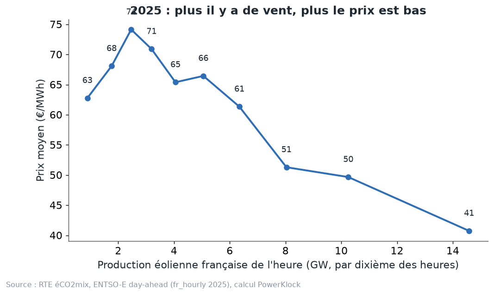
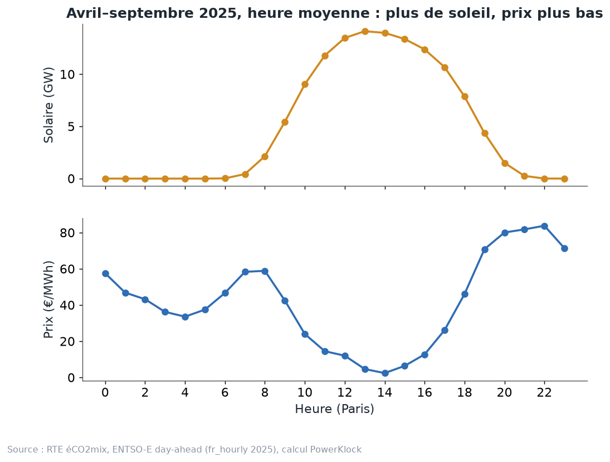
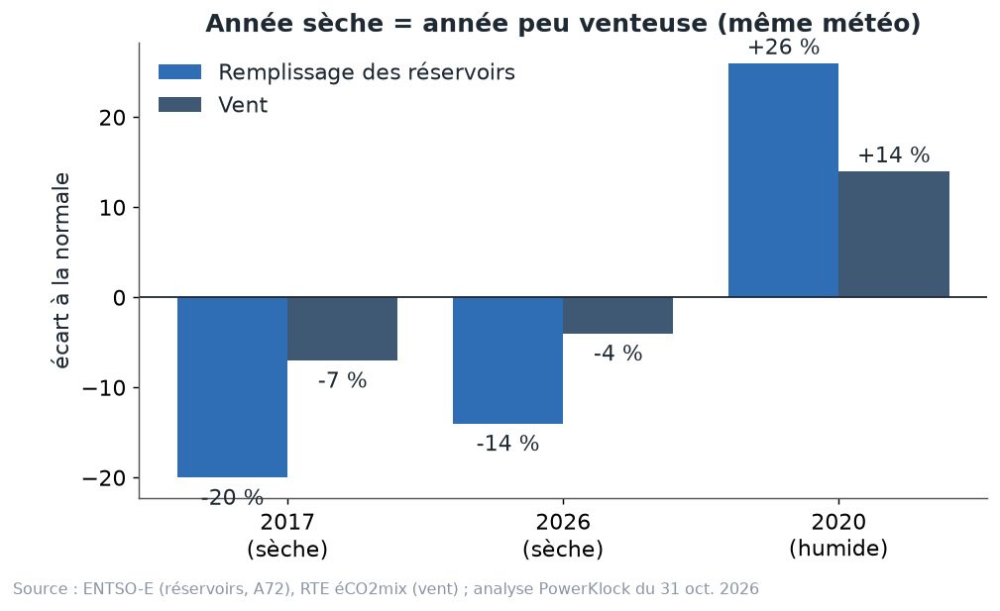
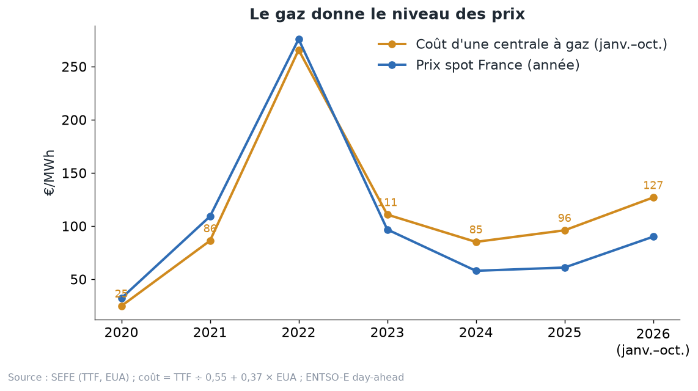

# Chapitre 7 à l'oral — les interactions, version complète

*Pour Tom · 1er novembre 2026 · à lire à voix haute, environ 15 minutes*

## 1. Rien n'arrive seul
Le prix d'une heure ne dépend pas d'une seule chose. Il dépend de plusieurs choses qui **arrivent ensemble** :
- le **vent**, chez nous et chez les voisins ;
- le **soleil**, chez nous et chez les voisins ;
- la **pluie**, qui remplit les barrages ;
- la **chaleur**, qui gêne le nucléaire ;
- le **gaz**, qui donne le niveau général des prix.

Ces choses ne sont pas indépendantes. C'est la même météo qui les apporte. Une grosse dépression venue de
l'Atlantique apporte du vent **et** de la pluie, sur toute l'Europe de l'Ouest. Un anticyclone, c'est l'inverse :
calme, sec, souvent chaud.

**L'image.** C'est comme un orchestre. On ne peut pas comprendre la musique en écoutant un seul instrument. Le vent,
la pluie et le soleil jouent la même partition, et le gaz donne le tempo.

**Pourquoi c'est important pour un PPA.** Si on tire le vent, la pluie et la chaleur au hasard, chacun de son côté,
on casse ces liens. On obtient des années qui n'existent pas, par exemple une année très sèche mais très venteuse.
C'est pour ça que notre générateur tire la météo **par semaines entières d'une même année réelle** : les liens restent
intacts.

## 2. Le vent et le prix

On range toutes les heures de 2025 selon la production éolienne française, et on les coupe en dix paquets égaux. Pour
chaque paquet, on calcule le prix moyen (RTE éCO2mix, ENTSO-E, calcul PowerKlock).
- Autour de **2,5 GW** de vent, le prix moyen est de **74 €**.
- Pour le dixième des heures le plus venteux (environ **15 GW** en moyenne), il tombe à **41 €**.

**Une petite surprise.** Les heures sans vent du tout ne sont pas les plus chères (63 € pour le premier paquet). Ce
sont souvent des heures d'été, avec beaucoup de soleil, qui fait déjà baisser le prix.

**Pourquoi le vent fait baisser le prix : deux causes qui s'additionnent.**
1. **Chez nous.** Le vent ne coûte rien à produire. Il entre en bas du merit order et pousse les centrales plus
   chères hors du marché. Le prix baisse.
2. **Chez les voisins.** Quand il y a du vent en France, il y a souvent du vent en Allemagne aussi : c'est la même
   météo qui traverse l'Europe. Les voisins ont alors moins besoin de notre électricité, et la paient moins cher.

**L'image.** Tu vends des parapluies au marché. Quand il pleut, tu en as beaucoup à vendre. Mais il pleut aussi chez
tous les vendeurs voisins. Tout le monde a des parapluies en même temps, et le prix baisse deux fois.

C'est ce que les spécialistes appellent la **cannibalisation** : plus il y a d'éoliennes, plus elles produisent
toutes en même temps, et moins chaque MWh éolien vaut.

## 3. Le vent et le soleil des voisins
**L'étude.** Stiewe, Xu, Eicke et Hirth ont mesuré cet effet sur **30 zones de prix européennes, de 2015 à 2023**. Ils
regardent la « valeur » de l'éolien et du solaire. C'est le **value factor** : le prix capté par la filière, divisé
par le prix moyen. Pour nous, c'est la capture du chapitre 2.

Ils mesurent combien cette valeur baisse quand la part du vent ou du soleil augmente d'un point, chez nous et chez
les voisins :

| Filière | Un point de plus chez nous | Un point de plus chez les voisins |
|---|---|---|
| Éolien | −0,62 point de valeur | −0,49 point de valeur |
| Solaire | −1,39 point de valeur | **−2,38 point de valeur** |

(L'article donne −0,486 pour le vent des voisins, arrondi à 0,48 dans son résumé.)

**Comment le lire.**
- **Pour l'éolien,** le vent des voisins pèse presque autant que le nôtre. Si la part du vent monte d'un point
  partout en même temps, l'éolien perd environ **1 point** de valeur.
- **Pour le solaire, c'est pire :** le soleil des voisins pèse **plus** que le nôtre. Si la part du solaire monte d'un
  point partout, le solaire perd presque **4 points**.

**Pourquoi le solaire est plus touché.** Le midi est le même pour tout le monde. Quand il fait beau à Paris, il fait
souvent beau à Berlin et à Madrid, à la même heure. Et nos voisins, l'Allemagne et l'Espagne surtout, ont beaucoup de
solaire. Les auteurs notent d'ailleurs que les interconnexions stabilisent mieux la valeur de l'éolien que celle du
solaire.

**Le lien avec le chapitre 6.** Même quand la France est coupée, le vent allemand fait bouger le prix français : 67,5 €
dans les heures coupées de 2025 où le vent allemand est faible, 42,4 € quand il est fort (débrief du 31 octobre). C'est
la même cannibalisation transfrontalière, vue dans nos propres données.

**Pour le pricing.** Un modèle qui ne regarde que la France sous-estime la cannibalisation. C'est pour ça que le
générateur fait grandir le solaire et l'éolien des voisins aussi, à leur propre rythme, plafonné par leurs objectifs
2030.

## 4. Le soleil et le midi

Avril–septembre 2025, heure moyenne (RTE éCO2mix, ENTSO-E, calcul PowerKlock) :
- le prix est autour de **60 €** le matin, vers 7–8 h ;
- il tombe à **moins de 5 €** vers **14 h**, quand le soleil est au plus haut ;
- il remonte à **plus de 80 €** le soir, quand le soleil se couche et que tout le monde rentre chez soi.

C'est la **courbe de canard** : vue de profil, la courbe du prix a la forme d'un canard, avec le ventre creux à midi
et le cou dressé le soir.

**Et ça grossit.** RTE prévoyait, pour l'été 2026, un pic de production solaire « de l'ordre de 20 GW » en milieu de
journée (bilan du premier semestre 2026). Chaque année, il y a plus de panneaux, et le creux de midi se creuse.

**Ce qui amortit le creux :**
- le nucléaire qui module à midi (chapitre 4) ;
- les STEP et les batteries, qui se chargent à midi ;
- les exports, tant que les lignes ont de la place ;
- le solaire et l'éolien qui s'arrêtent aux prix négatifs.

**Pour un PPA solaire.** C'est le cœur de la cannibalisation solaire. Notre capture solaire « payée » est passée de
**0,85 (2023) à 0,56 (2026, janvier–octobre)** (`fr_capture.json`).

## 5. La sécheresse et le vent

C'est le lien le plus surprenant : **une année sèche est souvent aussi une année peu venteuse.**

**Les chiffres** (analyse de la session du 31 octobre, réservoirs ENTSO-E A72 et vent RTE) :
- lien (corrélation) entre le remplissage des réservoirs et le vent : **+0,32** sur l'année, **+0,42 en hiver** ;
- **2017**, année sèche : réservoirs **−20 %** sous la normale, vent **−7 %** ;
- **2026**, année sèche : réservoirs **−14 %**, vent **−4 %** ;
- **2020**, année humide : réservoirs **+26 %**, vent **+14 %**.

Une corrélation de +0,32, c'est un lien réel mais modéré : les deux vont souvent dans le même sens, pas toujours.

**Un mot sur 2026.** RTE décrit un premier semestre contrasté : un hiver très humide (le février le plus pluvieux
jamais observé), puis un printemps parmi les dix moins pluvieux depuis 1959. Les stocks d'eau, faibles en début
d'année, étaient revenus près de la moyenne fin juin. Notre « −14 % » est une moyenne sur l'année : il ne dit pas que
les barrages étaient bas tous les mois. (Ce chiffre vient de l'analyse du 31 octobre ; le script n'est pas dans le
dépôt.)

**Le mécanisme.**
- Les **dépressions atlantiques** apportent vent **et** pluie.
- Les **anticyclones** sont calmes, secs, souvent chauds.
- **La chaleur baisse aussi le nucléaire** : l'eau des fleuves est trop chaude pour refroidir les centrales. Pendant
  les canicules de 2026, la perte a atteint jusqu'à environ 8 à 9 GW certains jours (RTE).
- RTE note aussi que les canicules conduisent « régulièrement (mais pas systématiquement) à une forte diminution de
  la production éolienne en Europe ».

**L'image.** Un été d'anticyclone, c'est une semaine où toute la maison tourne au ralenti : les barrages sont bas, les
éoliennes ne tournent pas, et la chaudière nucléaire a du mal à se refroidir. Tout manque en même temps.

**Conséquence pour le pricing.** Une année sèche cumule moins d'hydraulique, moins de vent, et parfois moins de
nucléaire. Le prix moyen monte. Et la capture de l'éolien peut monter aussi : il souffle justement quand l'eau manque
et que le prix est haut. Tirer la météo par semaines entières d'une même année garde ces liens. Tirer chaque variable
à part les casserait.

## 6. Le gaz donne l'échelle

**Le coût d'une centrale à gaz.** On le calcule avec une formule simple : prix du gaz (TTF) ÷ 0,55 (le rendement de la
centrale) + 0,37 × prix du CO2 (EUA). Sur janvier–octobre, il valait **96 €** en 2025 et **127 €** en 2026 (`calc.py`,
SEFE). (Le débrief du 31 octobre dit 94 € pour 2025. Les fichiers ne disent pas d'où vient cet écart de 2 € ; retiens
« 94 à 96 € ».)

**Le constat.** Le schéma montre que le prix spot français suit le coût du gaz, année après année. Il était au-dessus
de 2020 à 2022, en dessous depuis 2023.

**Même dans les heures coupées.** On pourrait croire que, coupée de ses voisins, la France ne voit plus le gaz : chez
elle, le gaz est rarement la dernière centrale appelée. Pourtant, dans les heures coupées (débrief du 31 octobre) :
- prix ÷ coût d'une centrale à gaz ≈ **0,61** en moyenne, en 2025 **et** en 2026, alors que le gaz a fortement monté ;
- plus finement : **0,42 à 0,45** dans les heures coupées venteuses, **0,72 à 0,78** dans les heures coupées calmes,
  stable de 2024 à 2026.

**Pourquoi.**
- Même coupée, la France vend à l'Italie, à la Suisse et à la Grande-Bretagne, où le gaz fixe souvent le prix.
- L'eau des barrages se valorise au prix futur, qui dépend du gaz.

**L'image.** Le gaz, c'est l'échelle. Le vent, le soleil et l'eau disent sur quel barreau on se trouve. Quand le gaz
double, toute l'échelle s'allonge, mais le barreau d'une heure venteuse reste à peu près au même endroit : vers 0,4 à
0,45 de la hauteur.

**Conséquence pour le pricing.** Le générateur exprime les prix **en proportion du coût du gaz**. Ce constat le
justifie : on peut changer le niveau du gaz sans changer la forme des prix.

## 7. Ce qui reste ouvert
- **Le lien sécheresse–vent** repose sur une dizaine d'années. Une seule année peut le contredire.
- **Le rapport prix ÷ gaz de 0,6** tiendra-t-il si la limite d'export vers Core change fortement ? On ne l'a pas
  testé.
- **Les chiffres de Stiewe et al.** sont des moyennes sur 30 zones européennes. Ils ne sont pas propres à la France.

## 8. Ce que ça change pour un PPA
- **Éolien :** il souffle en même temps que chez les voisins. Il faut modéliser le vent allemand avec le vent
  français, pas séparément.
- **Solaire :** le soleil des voisins pèse plus que le nôtre. La croissance du solaire allemand et espagnol est un
  risque pour un PPA solaire français, même si la France ne construit plus rien.
- **Météo :** tirer des semaines réelles entières garde ensemble le vent, la pluie et la chaleur.
- **Gaz :** il fixe le niveau. Un PPA signé quand le gaz est cher a un prix plus haut, mais la capture (le rapport)
  dépend surtout du reste.

## À retenir
1. Rien n'arrive seul : vent, pluie, chaleur et voisins vont ensemble, parce que c'est la même météo.
2. Plus il y a de vent, plus le prix baisse : 74 € à environ 2,5 GW de vent, 41 € à environ 15 GW (2025).
3. Le vent des voisins pèse presque autant que le nôtre ; le soleil des voisins pèse plus que le nôtre (Stiewe et al.).
4. Le soleil creuse le prix de midi : moins de 5 € vers 14 h en été 2025, plus de 80 € le soir.
5. Une année sèche est souvent peu venteuse, et souvent chaude : moins d'eau, moins de vent, moins de nucléaire.
6. Le gaz donne l'échelle : dans les heures coupées, le prix français vaut environ 0,6 fois le coût d'une centrale à
   gaz.

## Question pour vérifier
Imagine l'été 2027 : long anticyclone sur toute l'Europe, chaud et sec, et le gaz monte de 30 %. D'après toi :
- (a) que deviennent la production des barrages, le vent et le nucléaire en France ;
- (b) le prix moyen français monte-t-il ou baisse-t-il, et par quels chemins ;
- (c) la capture d'un parc éolien français cet été-là monte-t-elle ou baisse-t-elle ?

## Pour aller plus loin
- Stiewe, Xu, Eicke et Hirth, « Cross-border cannibalization: Spillover effects of wind and solar energy on
  interconnected European electricity markets » — https://arxiv.org/abs/2405.17166
- Hirth (2013), « The market value of variable renewables », *Energy Economics* —
  https://cadmus.eui.eu/bitstream/handle/1814/27135/RSCAS_2013_36.pdf
- RTE, *Bilan du système électrique, premier semestre 2026* (météo, chaleur et nucléaire, stocks d'eau) —
  https://assets.rte-france.com/prod/public/2026-07/2026-07-16-bilan-semestre1.pdf
- Modo Energy, « Capturing cannibalisation » (pourquoi aligner la météo des prix et de la production) —
  https://forecastdocs.modoenergy.com/docs/capturing-cannibalisation
- Dossier PowerKlock : `docs/discussion/cours/cours_detail.md` (chapitre 7), `docs/discussion/pricing/debrief-2026-10-31.md`
  (section 4), `docs/discussion/cours/calc.json`.
