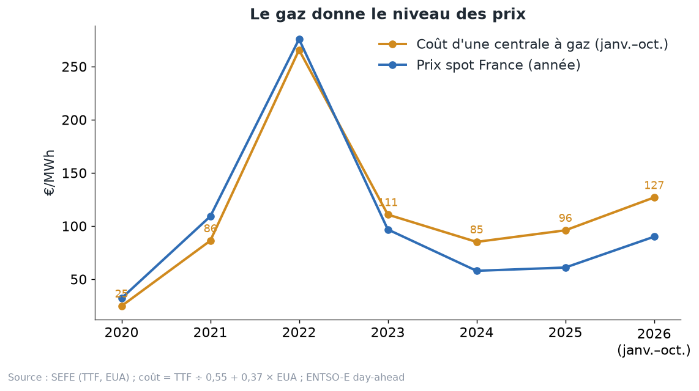
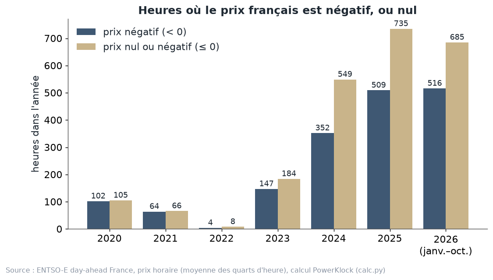
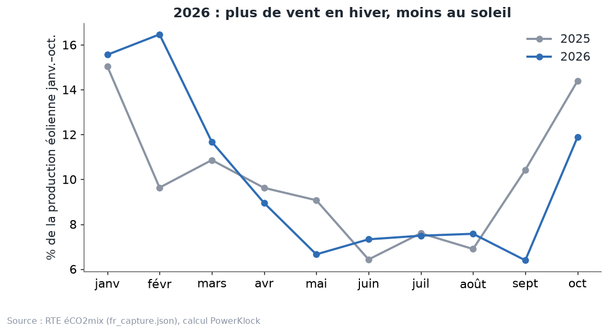

# Chapitre 8 à l'oral — 2026, une année à part, version complète

*Pour Tom · 1er novembre 2026 · à lire à voix haute, environ 15 minutes*

## 1. Pourquoi parler d'une seule année
D'habitude, une année ressemble à la précédente, avec un peu plus de solaire et un peu plus d'éolien. 2026 ne
ressemble à rien de connu. Plusieurs chocs sont arrivés en même temps :
- le **gaz cher**, qui tire les prix moyens vers le haut ;
- **beaucoup d'heures à prix nul ou négatif**, qui tirent le midi vers le bas ;
- un **nucléaire moins souple** au printemps ;
- une **sécheresse** en fin d'été.

Résultat : des prix à la fois plus hauts en moyenne et plus souvent à zéro. C'est important pour toi, parce qu'un
pricer apprend sur le passé. Si une année du passé est bizarre, le pricer apprend des choses bizarres. Ce chapitre
dit ce qui s'est passé, puis pourquoi ça piège les modèles.

Un rappel avant de commencer : les chiffres de 2026 vont de **janvier à octobre**. Ce n'est pas l'année entière.

## 2. Le gaz cher
**Le coût d'une centrale à gaz.** On le calcule avec une formule simple :
coût = prix du gaz (TTF) ÷ 0,55 + 0,37 × prix du CO2.
- Le « ÷ 0,55 » dit qu'une centrale transforme environ 55 % de l'énergie du gaz en électricité.
- Le « 0,37 × CO2 » est le coût des quotas de CO2 qu'elle doit acheter pour chaque MWh.

**Les chiffres** (SEFE pour les prix du gaz et du CO2, calcul PowerKlock `calc.py`) :
- **127 €/MWh** de janvier à octobre 2026 ;
- contre **94 €** en 2025 (débrief du 31 octobre), ou **96 €** si on compare sur janvier–octobre 2025.

Le prix spot moyen français suit : **61 €** en 2025, **90 €** en 2026 (janvier–octobre, ENTSO-E).

**Pourquoi le gaz donne le niveau.** Le gaz est souvent la centrale la plus chère qu'il faut allumer, donc celle
qui fixe le prix des heures difficiles. Et même quand la France est coupée de ses voisins, elle vend à l'Italie, à
la Suisse, à la Grande-Bretagne, où le gaz fixe le prix. L'eau des barrages, elle, se valorise au prix futur, qui
dépend aussi du gaz.

**Le chiffre qui le montre** (débrief du 31 octobre) : pendant les heures où la France est coupée, son prix vaut en
moyenne **0,61 fois** le coût du gaz, **en 2025 comme en 2026**. Le gaz est passé de 94 à 127 €, et le rapport n'a
pas bougé. C'est comme un pourboire calculé en pourcentage : l'addition monte, le pourcentage reste le même.

## 3. Les prix nuls ou négatifs : environ 800 heures
**Rappel.** Un prix négatif veut dire que des producteurs paient pour produire. Ils le font quand s'arrêter leur
coûterait plus cher : un nucléaire qui ne peut pas baisser plus, un parc payé quel que soit le prix, une cogénération
qui doit chauffer.

**Compter au quart d'heure.** Depuis le **1er octobre 2025**, le prix est fixé par quart d'heure. Il faut donc
compter les quarts d'heure à prix nul ou négatif, puis diviser par 4.
- Compté ainsi : **805 heures** en 2026 (janvier–octobre), contre **742** sur toute l'année 2025 (`calc.py`).
- Si on fait d'abord la moyenne de chaque heure, on trouve seulement **670 heures** en 2026. Une heure dont la
  moyenne reste positive peut cacher un ou deux quarts d'heure négatifs.
- pv magazine (2 octobre 2026) parle d'« environ 800 heures ». C'est le comptage au quart d'heure qui retombe dessus.

**Pour 2025, trois chiffres circulent : 742, 735 et 722.** Ce sont trois définitions, pas trois erreurs :
- **742** : quarts d'heure ≤ 0 € divisés par 4 (`calc.json`, `le0_quarter_hours`) ; c'est le bon comptage, puisque le
  prix est au quart d'heure depuis octobre 2025 ;
- **735** : heures ≤ 0 € dans la série horaire du cours (`data/history/fr_hourly/2025.json`, `calc.json`, champ
  `h_le0`), utilisée aux chapitres 1 à 3 ;
- **722** : le chiffre du diaporama du 28 octobre (« Revue des méthodes PPA », diapo 8), tiré des données horaires du
  banc d'essai (`ppa_lab`). L'écart avec 735 n'a pas été expliqué en détail.

(Le même recalcul, en faisant la moyenne des quatre quarts d'heure de chaque heure dans les fichiers journaliers,
donne 732 : encore une variante de la moyenne horaire.)

Pour comparer : **549 heures** à prix nul ou négatif sur toute l'année 2024.

Attention en lisant ce schéma : il compte sur la **moyenne de chaque heure**. Pour 2026, il montre donc moins que
les 805 heures du comptage au quart d'heure.

**Les records** (RTE, bilan du premier semestre 2026) :
- **407 heures négatives** au premier semestre 2026, contre 363 au premier semestre 2025 ;
- **−478,8 €/MWh** le 26 avril 2026 ;
- **−498,7 €/MWh** le 1er mai 2026.

Le plancher de l'enchère était alors de −500 €/MWh. Il est passé à −600 € le 28 mai 2026.

## 4. Le nucléaire moins souple au printemps
**Pourquoi ces records au printemps ?** RTE l'explique dans son bilan du premier semestre 2026.

**Le minimum technique.** Un réacteur peut baisser sa puissance, mais pas jusqu'à zéro. Le plus bas qu'il peut
atteindre s'appelle son minimum technique. D'après RTE, il varie **entre 25 % et 100 %** de sa puissance, selon
notamment l'avancement dans le **cycle du combustible**. En fin de cycle, un réacteur ne module presque plus.

**Au printemps 2026, beaucoup de réacteurs étaient en fin de cycle en même temps.** Résultat :
- le minimum technique de tout le parc était d'environ **31 GW le 1er mai 2026** à midi ;
- contre **19 GW le 1er mai 2025** ;
- le nucléaire a modulé d'environ **10 TWh** au premier semestre 2026, contre près de **20 TWh** un an plus tôt.

**L'image.** Pense à une chorale. D'habitude, beaucoup de chanteurs peuvent baisser la voix quand on le leur
demande. Au printemps 2026, une bonne partie ne pouvait plus chanter moins fort. Le volume minimum de la chorale a
monté de 19 à 31. À midi, avec le soleil en plus, il y avait trop de son : le prix a plongé.

**Une correction importante.** Notre débrief du 31 octobre attribuait cela à un accord RTE–EDF du 27 mars 2026,
qu'il présentait comme un « minimum national de production nucléaire ». C'est faux :
- cet accord (CRE, délibération 2026-67) permet à RTE de garder certains réacteurs allumés pour régler la
  **tension** du réseau, du 4 avril au 30 octobre 2026 ;
- RTE juge que ces demandes n'ont joué « qu'un rôle marginal » ;
- la vraie cause, c'est le **cycle du combustible**.

## 5. La sécheresse de fin d'été
**Ce qu'on a mesuré** (analyse de la session du 31 octobre, ENTSO-E et RTE) :
- le remplissage des réservoirs des barrages : **−14 %** en moyenne annuelle (2017, autre année sèche : −20 %) ;
- le vent : **−4 %**.

RTE notait encore des stocks d'eau proches de la moyenne fin juin. C'est la fin de l'été qui a été sèche : pv
magazine relève environ **−1,5 GW** d'hydraulique en septembre.

**Pourquoi sécheresse et vent vont ensemble.** Les dépressions venues de l'Atlantique apportent à la fois le vent
et la pluie. Les anticyclones sont calmes, secs, souvent chauds. Sur une dizaine d'années, la corrélation entre le
remplissage des réservoirs et le vent est de **+0,32**, et **+0,42 en hiver** (même analyse). On l'a vu au
chapitre 7.

**Et le nucléaire ?** Les centrales en bord de rivière doivent baisser leur production quand l'eau est trop chaude
ou trop basse. RTE estime que, en cas de sécheresse prolongée en fin d'été, l'effet pourrait atteindre **2 à 3 GW**,
mais qu'il reste « de second ordre » sur l'année.

Une année sèche cumule donc trois choses : moins d'eau, moins de vent, parfois moins de nucléaire. Les prix montent.

## 6. L'éolien a bien tenu : 0,936 → 0,976
**D'abord, d'où vient ce chiffre.** Tu m'as demandé s'il venait de RTE. Non. RTE ne publie pas de taux de capture.
C'est un calcul du **pricer PowerKlock**, dans sa convention appelée « curt » :
1. on ne compte que les MWh **payés**, c'est-à-dire produits quand le prix est positif ;
2. on calcule la capture **mois par mois** : prix moyen obtenu par l'éolien ÷ prix moyen du mois ;
3. on fait la moyenne des mois, en donnant plus de poids aux mois où l'éolien produit le plus.

Résultat, de janvier à octobre : **0,936 en 2025, 0,976 en 2026**. Ce sont des chiffres « year to date », comme tu
l'as rappelé.

**L'année entière est toujours un peu plus basse.** Le même calcul sur l'année entière donne **0,906 en 2024** et
**0,923 en 2025**. Novembre et décembre font en général baisser la moyenne. Donc 0,976 n'est pas la capture de 2026 :
c'est son cumul à fin octobre.

**Les autres définitions donnent d'autres niveaux** (`fr_capture.json`, janvier–octobre) :
- calculée d'un seul bloc sur la période, au lieu de mois par mois : **0,971 → 0,976** ;
- avec toute la production comptée, même celle des heures à prix nul ou négatif : **0,891 → 0,888**.

Le sens est le même : 2026 au moins aussi bon que 2025. Mais on ne compare que des chiffres de **même définition**.
C'est comme comparer des températures : il faut savoir si c'est en degrés Celsius ou Fahrenheit.

**Pourquoi l'éolien a bien tenu.** Il a soufflé au bon moment.
- **43,7 %** de sa production de janvier à octobre 2026 est tombée de janvier à mars ;
- contre **35,5 %** en 2025 (RTE éCO2mix, calcul PowerKlock).

L'hiver, l'électricité est chère. Et quand le vent souffle en hiver, il souffle moins en même temps que le soleil
de midi. Ses MWh ont donc valu plus. **C'est de la chance météo, pas une tendance.**

## 7. Pourquoi 2026 piège les modèles
Un modèle de prix apprend sur le passé. Or 2026 contient des situations qu'**aucune année d'apprentissage** n'avait
montrées. Quatre pièges.

**Piège 1 : les pics des heures calmes.** Avec le gaz à 127 €, la règle de prix sous-estime les pics des heures sans
vent : erreur horaire de **33 €** (débrief du 31 octobre). Cela fausse la valeur relative du vent quand on teste sur
les vraies données. Le générateur y est moins exposé, parce qu'il raisonne en valeur relative.

**Piège 2 : les prix négatifs trop profonds.** Si on exprime tout en proportion du gaz, un gaz cher rend aussi les
prix négatifs plus profonds dans la simulation. Pour 2025, une règle apprise avec du gaz cher simulait des prix
négatifs de **−12 à −17 €**, quand la réalité était de **−2 à −7 €** (commentaire de `scripts/ppa_scenarios.py`). Or les prix négatifs viennent des renouvelables et du
nucléaire qui ne s'arrêtent pas, pas du gaz. Depuis le 30 octobre, la partie négative du prix est donc apprise en
euros, à part.

**Piège 3 : le nucléaire raide.** Aucune année apprise n'avait un minimum technique de **31 GW** au printemps. Le
modèle ne peut pas deviner une situation qu'il n'a jamais vue. C'est une cause probable des erreurs sur 2026.

**Piège 4 : le modèle de la France isolée.** Son biais monte à **+8 €** en 2026, contre **+1 €** en 2024–2025
(dossier couplage).

**Ce que ça fait aux tests.** Plusieurs méthodes « gagnaient » en moyenne, mais perdaient **4 à 11 €** sur 2026
sans ancrage :
- la correction par situation : **−4 à −8 €** ;
- le « tout combiné » : **−11 €**.

Elles ont été écartées pour cette raison. À l'inverse, lire la limite d'export JAO de chaque heure a beaucoup aidé
sur 2026 : pour 2026 pricée un an avant, l'erreur est passée de **−7,62 à +1,65 €** en solaire et de **+7,17 à
+2,19 €** en éolien (commentaire de `scripts/ppa_scenarios.py`).

## 8. Ce que ça change pour un PPA
**L'ancrage de janvier 2027.** Le pricer recale son niveau sur la dernière année complète (on le verra au
chapitre 9). Aujourd'hui, c'est 2025. En janvier 2027, ce sera 2026. Si 2026 est atypique, le facteur de recalage le
sera aussi. Il faudra regarder ce facteur de près ce mois-là. La fiche des paramètres prévoit justement de revoir
l'ancrage en janvier, et après une année atypique.

**Ne pas ancrer sur un cumul partiel.** Pour un PPA éolien 2027–2029 signé en novembre, tu as répondu : « 0,923, ou
le 12 mois roulant ». 0,923 est le bon réflexe : c'est une année civile complète. Le 0,976 de 2026 est un cumul à fin
octobre, sur une année de chance météo.

**Le marché à terme voit aussi 2027 à part.** Au 30–31 octobre, le Cal 2027 cotait **128,16 €/MWh**, le Cal 2028
**70,94** et le Cal 2029 **62,97** (EEX, via SEFE ; fiche des paramètres du pricer). La crise du gaz est dans le prix
de 2027, beaucoup moins après.

## À retenir
1. 2026 : gaz cher (127 € contre 94–96 €), donc prix moyens hauts.
2. Environ 800 heures à prix nul ou négatif, **comptées au quart d'heure** (805 ; 670 si on moyenne d'abord chaque
   heure). Records à −478,8 € et −498,7 €.
3. Le nucléaire a été moins souple au printemps à cause du **cycle du combustible** (31 GW de minimum contre 19 GW),
   pas à cause de l'accord RTE–EDF.
4. Fin d'été sèche : moins d'eau, un peu moins de vent.
5. L'éolien a eu de la chance : capture 0,936 → 0,976 de janvier à octobre, convention « curt » du pricer, pas un
   chiffre RTE. L'année entière finit toujours un peu plus bas.
6. Une année aussi spéciale ne doit pas servir seule de modèle, ni d'ancrage sans vérification.

## Question pour vérifier
Imagine qu'en janvier 2027, l'année complète 2026 entre dans le pricer et devienne l'année d'ancrage. D'après toi :
- (a) la capture éolienne de 2026 sur l'année entière sera-t-elle plus haute ou plus basse que 0,976 ? Pourquoi ?
- (b) si le générateur n'a pas su reproduire la chance hivernale du vent en 2026, dans quel sens le facteur
  d'ancrage de l'éolien va-t-il bouger, et qu'est-ce que ça fait au prix des PPA éoliens 2028–2029 ?
- (c) quel chiffre de 2026 te paraît le plus dangereux à recopier tel quel dans un modèle : le gaz à 127 €, les
  805 heures à zéro, ou le minimum nucléaire de 31 GW ?

## Pour aller plus loin
- RTE, *Bilan du système électrique, premier semestre 2026* (prix négatifs, nucléaire, hydraulique) —
  https://assets.rte-france.com/prod/public/2026-07/2026-07-16-bilan-semestre1.pdf
- RTE, *Bilan électrique 2025* —
  https://assets.rte-france.com/prod/public/2026-02/Bilan-electrique-2025-principaux-resultats.pdf
- CRE, délibération n° 2026-67 du 27 mars 2026 (accord RTE–EDF sur la tension) —
  https://www.cre.fr/fileadmin/Documents/Deliberations/2026/260327_2026-67_Approbation_Accord_Injection_THT.pdf
- pv magazine, 2 octobre 2026 (environ 800 heures) —
  https://www.pv-magazine.com/2026/10/02/france-hits-record-800-hours-of-negative-zero-electricity-prices/
- Kpler, « Nuclear modulation insights » (février 2026) —
  https://www.kpler.com/blog/nuclear-modulation-insights-volumes-and-units-behaviours
- Dossier PowerKlock : `docs/discussion/cours/calc.json` (recalcul), `docs/discussion/pricing/debrief-2026-10-31.md`
  (à lire avec la correction sur l'accord RTE–EDF).
