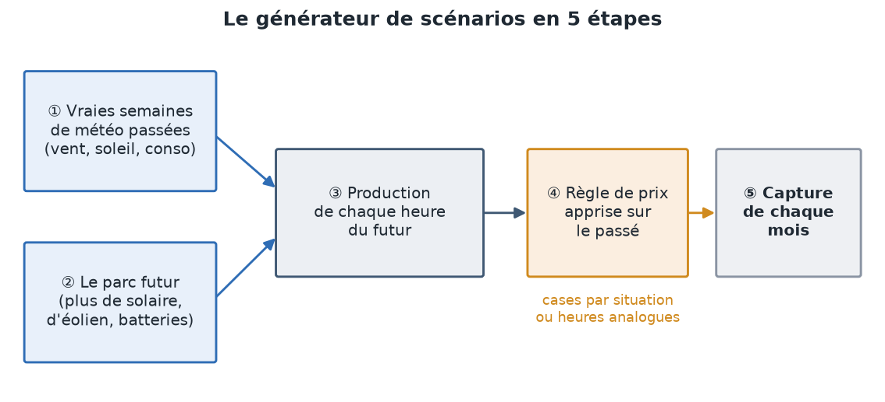
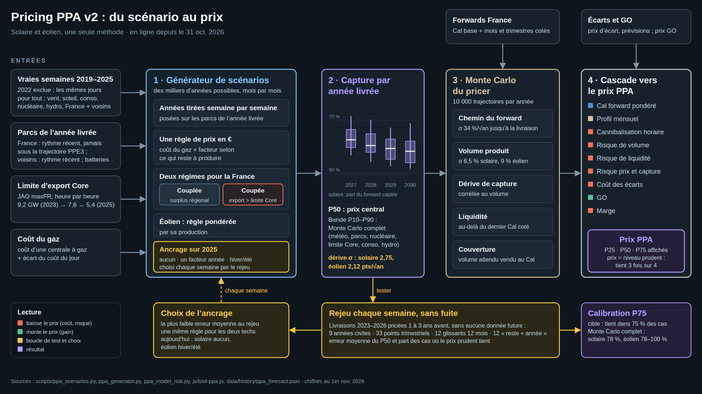
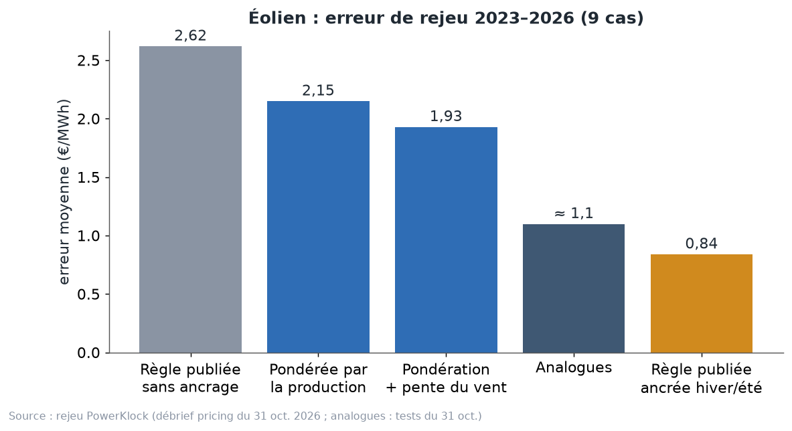

# Chapitre 9 à l'oral — le générateur de scénarios, version complète

*Pour Tom · 1er novembre 2026 · à lire à voix haute, environ 15 minutes*

## 1. Le problème
Tu veux savoir ce que vaudra un MWh solaire ou éolien en 2028. Pour ça, il te faut sa **capture** : le prix obtenu
par le parc divisé par le prix moyen. Mais personne ne connaît la météo de 2028, ni le prix de chaque heure de 2028.

L'idée du générateur : **fabriquer des années possibles**, des milliers, et regarder ce que la capture y vaut. C'est
le cœur du pricer v2, en ligne depuis le 31 octobre 2026. Depuis cette date, c'est **la seule méthode** qui fait le
prix ; les anciennes méthodes restent affichées comme repères.

Il y a cinq étapes. On les prend une par une.

## 2. Étape 1 : de vraies semaines de météo
On ne fabrique pas de la météo au hasard. On reprend de **vraies semaines passées**, de **2019 à 2025**, sans 2022
(l'année de la crise, trop à part).

On les enchaîne pour faire une année : une vraie semaine de janvier 2021, puis une vraie semaine de janvier 2024, et
ainsi de suite. Chaque semaine est prise dans la même saison, avec le même type de jours.

**Le point clé : on garde tout ce qui s'est passé ces jours-là, ensemble.** Le vent, le soleil, la consommation, le
nucléaire, l'eau, les voisins. Au chapitre 7, on a vu que ces choses sont liées : une semaine sèche est souvent une
semaine sans vent ; une semaine venteuse en France l'est souvent en Allemagne. Si on tirait chaque chose à part, on
casserait ces liens.

**L'image.** C'est comme faire un album avec de vraies pages d'anciens albums, plutôt que de découper chaque photo
et de les recoller au hasard. Chaque page reste cohérente.

## 3. Étape 2 : le parc futur
On pose cette météo sur le **parc de l'année livrée** :
- pour la France, le rythme de croissance récent, **jamais sous la trajectoire de la PPE3** ;
- pour les voisins, leur rythme récent ;
- les batteries.

La production par GW installé est ramenée au niveau récent (arrêts, autoconsommation). On obtient la production
de chaque heure du futur : le vent de janvier 2021, mais avec les éoliennes de 2028.

## 4. Étape 3 : la règle de prix
Il faut maintenant un prix pour chaque heure. On utilise une **règle apprise sur le passé**.

**Le prix en proportion du gaz.** La règle dit : prix de l'heure = coût d'une centrale à gaz × un coefficient. Le
coefficient dépend de la situation de l'heure (combien il reste à produire après le solaire, l'éolien et le
nucléaire, à quelle heure, quelle saison).

Pourquoi en proportion du gaz ? Parce qu'on l'a mesuré au chapitre 8 : pendant les heures coupées, le prix français
vaut **0,61 fois** le coût du gaz en 2025 comme en 2026, alors que le gaz est passé de 94 à 127 €. Le pourcentage
tient quand l'addition change.

**Deux exceptions :**
- les **prix négatifs** sont appris à part, **en euros**. Ils viennent des renouvelables et du nucléaire qui ne
  s'arrêtent pas, pas du gaz (adopté le 30 octobre) ;
- la **dernière année apprise pèse deux fois plus** que la précédente. Ton idée du 31 octobre : « les données
  récentes pèsent plus ». Au rejeu, ça a fait passer l'erreur de **1,32 à 1,18 €/MWh** en solaire et de **1,13 à
  0,96** en éolien (commentaire de `scripts/ppa_scenarios.py`).

**Les cases.** La règle range les heures dans des **cases**, comme des tiroirs : « France coupée, beaucoup de
surplus, midi, printemps »… Dans chaque tiroir, elle a appris un coefficient moyen.

## 5. Les deux régimes : couplée ou coupée
C'est le lien direct avec les chapitres 5 et 6. Chaque heure du futur est dans l'un de deux régimes :
- **France couplée** : son prix suit celui de ses voisins ;
- **France coupée** : elle a plus à exporter que ce que les lignes peuvent porter.

**Comment le générateur décide.** Il calcule ce que la France doit exporter : nucléaire disponible + solaire + éolien
− consommation. Il compare ce surplus à la **limite d'export vers Core publiée par JAO** pour cette heure-là (les
jours tirés sont ramenés au niveau de la dernière année connue). Plus le surplus dépasse la limite, plus la chance
que la France soit coupée est grande.

Lire la limite JAO de l'heure, plutôt que le surplus seul, a fait baisser l'erreur de rejeu de **1,19 à 1,07 €** en
solaire et de **3,08 à 2,42 €** en éolien (adopté le 31 octobre, commentaire du script).

**Ce repère se prévoit bien.** Part du vent produite pendant les heures coupées (débrief du 31 octobre) :

| | 2023 | 2024 | 2025 |
|---|---|---|---|
| Indicateur calculé à l'avance | 17 % | 39 % | 66 % |
| Réalité | 18,5 % | 49 % | 67,5 % |

**Au-delà de ce qu'on a vu.** Si le surplus dépasse le plus fort jamais observé, le prix continue de baisser,
jusqu'au plancher observé. Sinon, plus de panneaux ne ferait plus baisser la capture, ce qui serait faux. C'est un
choix de principe que tu as validé le 31 octobre : la méthode doit pouvoir montrer une cannibalisation qui monte.

## 6. Étapes 4 et 5 : la capture, puis la moyenne
- **Étape 4.** Pour chaque mois, capture = prix moyen obtenu par le parc ÷ prix moyen du mois. Le parc s'arrête quand
  le prix est nul ou négatif.
- **Étape 5.** On répète sur des milliers d'années tirées, et on regarde la moyenne et la dispersion. La dispersion
  sert au risque (chapitre 11).

## 7. Le biais de l'éolien : +2,6 €
**Le constat.** Sans correction, la règle paie l'éolien **trop cher d'environ +2,6 €/MWh** (erreur de rejeu 2,62).
Et c'est **presque toujours dans le même sens**, d'un cas à l'autre. Même sur l'année qu'elle a apprise, elle paie
les heures de vent environ **3 % trop cher**.

**Pourquoi.** Un tiroir donne à toutes ses heures le même coefficient : la moyenne du tiroir. Or, dans un même
tiroir, les heures les plus venteuses sont aussi :
- celles où l'Allemagne est venteuse ;
- celles où la France est plus coupée ;
- celles où les voisins paient moins.

Le prix de ces heures-là est donc plus bas que la moyenne du tiroir. La règle leur donne la moyenne : **trop haut**.
Plusieurs choses arrivent ensemble, et un tiroir ne les voit pas toutes.

**L'image.** Un restaurant calcule le pourboire moyen de la soirée. Mais les clients qui viennent les soirs de pluie
laissent moins. Si on applique la moyenne à tout le monde, on surestime ce que rapportent les soirs de pluie.

**Ce n'est pas la forme du modèle.** Trois modèles construits tout à fait autrement font la même erreur :
- la règle par cases ;
- un modèle d'optimisation par semaine (168 heures liées, nucléaire, barrages, gaz, exports) ;
- une régression mensuelle.

Le problème vient de l'information disponible, pas de la façon de la ranger.

**Raffiner les tiroirs n'a pas suffi** (rejeu, éolien sans ancrage, €/MWh) :

| Variante | Erreur |
|---|---|
| Règle publiée | 2,62 |
| Grille surplus × part du vent | 2,31 |
| Pente du vent | 2,38 |
| Courbe de pénétration | 2,39 |

## 8. L'ancrage
**L'image.** Une balance de cuisine qui affiche toujours 3 % de trop. On ne la jette pas. On pèse un objet dont on
connaît le poids, on voit l'erreur, et on la retire de toutes les pesées suivantes.

**La formule.**
capture ancrée (année livrée) = capture du générateur (année livrée) × capture réelle (dernière année connue) ÷
capture du générateur (dernière année connue).

**En mots.** On fait tourner le générateur sur la **dernière année complète**, aujourd'hui 2025, et on regarde de
combien il se trompe. On applique le même rapport à l'année livrée. L'erreur de niveau s'annule. Le générateur ne
donne plus que le **changement** : le parc qui grandit, les batteries, les régimes.

**Trois modes :**
- **sans ancrage** ;
- **un facteur pour l'année** ;
- **hiver/été** : un facteur pour octobre–mars, un autre pour avril–septembre.

**Le choix se fait chaque semaine, par le rejeu.** Chaque dimanche, le pricer rejoue le passé avec les trois modes,
et garde celui qui s'est le moins trompé. La même règle pour le solaire et l'éolien. Aujourd'hui :
- **solaire : sans ancrage** (0,76 €, contre 1,18 avec un facteur annuel et 1,22 en hiver/été). Son niveau était
  déjà juste ; l'ancrage l'abîmerait ;
- **éolien : hiver/été** (0,84 contre 0,96 avec un facteur annuel et 2,62 sans ancrage, avec la règle de la v1).

**Testés et écartés :** ancrer par mois (éolien 1,69), par trimestre (1,52), sur la météo réelle de l'année (1,42),
ou n'appliquer que la moitié du facteur (1,51). Trop de facteurs, c'est recopier le bruit de l'année passée.

**Le défaut.** L'ancrage suppose que l'erreur de l'an dernier sera celle de l'an prochain. Si l'année connue est
atypique, le facteur l'est aussi. C'est exactement le risque de janvier 2027, quand 2026 deviendra l'année d'ancrage
(chapitre 8). Et c'est pour ça qu'on n'ancre jamais sur un cumul partiel.

**Ce que fait le marché.** Pexapark calibre ses modèles sur la cannibalisation implicite des prix de PPA observés.
C'est aussi une forme d'ancrage, sur le marché plutôt que sur l'année passée.

## 9. La pondération par la production (adoptée en v2)
**L'idée vient de la recherche.** Qorbanian, Löhndorf et Wozabal (arXiv 2024, *European Journal of Operational
Research* 2025) apprennent les coûts d'un modèle de prix en donnant à chaque heure un poids égal à la production
attendue de la filière qu'on price. Leur phrase : « we set w_t to the expected capacity factors […] of the technology
we want to price ».

**En mots simples.** Quand on price de l'éolien, les heures sans vent comptent peu : l'éolien n'y vend rien. Alors
on apprend les tiroirs en regardant surtout les heures où le vent produit. Le tiroir se trompe moins là où ça compte.

**Ce que ça donne chez nous.** C'est la seule amélioration qui a tenu sur tous les tirages :
- sur l'année apprise, le facteur d'ancrage passe de **0,97** à **0,99–1,00** : la balance est presque juste ;
- en v2, la règle éolienne est pondérée par la production et, quand la France est coupée, lit aussi la part de
  l'éolien. L'erreur de rejeu de l'éolien passe de **0,84 à 0,56 €/MWh** (sur 3 tirages, `choix_v2.md`).

**Pourquoi pas pour le solaire ?** Pondérée par le solaire, la règle dégrade le solaire : **0,76 → 1,41**. Donc on
garde **un seul générateur**, et seule la pondération suit la filière pricée.

**Une nuance honnête.** Ces auteurs testent leur modèle sur l'Espagne, l'Allemagne et la France, avec la vraie
demande et les vrais échanges, ce qui est plus facile que notre rejeu. Et c'est **en France** que leur modèle marche
le moins bien. Ça ne règle pas tout : sans ancrage, même pondéré, l'éolien reste trop cher d'environ **2,1 à 2,2 €**.

## 10. Les analogues
**L'idée.** Pour chaque heure simulée, on cherche les heures passées qui lui **ressemblent le plus** : même part de
solaire et d'éolien en France et chez les voisins, même excès d'export au-delà de la limite Core, même heure, même
saison. On prend la moyenne de leurs prix (en proportion du gaz).

**L'image.** Pour estimer le prix d'un appartement, on regarde les ventes récentes d'appartements qui lui
ressemblent : même quartier, même taille, même étage.

**Bon pour le vent.** L'analogue d'une heure venteuse est une vraie heure venteuse passée, avec tout ce qui
l'accompagnait : l'Allemagne venteuse, la France coupée. Le biais disparaît : erreur éolienne **d'environ 1,1 €**,
**sans ancrage**, contre 2,62.

**Mauvais pour le solaire.** Le futur sera plus solaire que tout ce qu'on a vu. Les heures passées les plus proches
d'un midi de 2028 sont donc **les pires midis connus**, et l'analogue ne sait pas aller au-delà. Comme estimer un
appartement de 300 m² avec des ventes de 100 m² au plus. Résultat : **4,1 € d'erreur** en solaire. Écartés.

**Le mélange 50/50 analogues + règle : refusé.**
- Il gagne sur les formats glissants : **0,68** (« reste de l'année + année suivante ») et **1,03** (12 mois
  glissants).
- Mais il perd sur les années civiles : **0,89**, contre **0,63** pour la v2.
- Et son pourcentage aurait fini par bouger. Ta règle : on ne change jamais le pourcentage d'un mélange à chaque
  pricing. Ta phrase : « on avait une bonne méthode ».

Les options restent dans le code, désactivées, avec leurs résultats en commentaire.

## 11. La question qui reste
La valeur réelle de l'éolien baisse d'une année à l'autre **plus vite** que tous nos modèles ne le prévoient. Ni la
limite d'export, ni le gaz ne l'expliquent. C'est pour ça que l'éolien reste ancré, et c'est la piste à creuser.

## À retenir
1. Générateur = vraies semaines de météo (2019–2025, sans 2022) + parc de l'année livrée + règle de prix.
2. La règle donne le prix en proportion du gaz, avec deux régimes : France couplée ou coupée, selon la limite JAO de
   l'heure.
3. Les tiroirs surpaient le vent d'environ 2,6 € : dans un même tiroir, les heures venteuses sont aussi les moins
   chères.
4. Ancrage = régler la balance qui pèse 3 % trop lourd, sur la dernière année complète. Le mode est choisi chaque
   semaine par le rejeu : aujourd'hui solaire sans ancrage, éolien hiver/été.
5. v2 : la règle éolienne est pondérée par la production du vent (Qorbanian et al.) : 0,84 → 0,56 €.
6. Analogues : bons pour le vent, mauvais pour le solaire du futur (4,1 €). Le mélange 50/50 a été refusé.

## Question pour vérifier
- (a) Pourquoi le générateur tire-t-il des **semaines entières**, avec toutes leurs variables, plutôt que le vent
  d'une année et le soleil d'une autre ?
- (b) En janvier 2027, l'année d'ancrage devient 2026, où l'éolien a eu de la chance en hiver. Si le générateur ne
  reproduit pas cette chance, le facteur d'ancrage de l'éolien monte-t-il ou baisse-t-il ? Et le prix du PPA ?
- (c) Pourquoi la pondération par la production aide l'éolien mais abîme le solaire, alors que c'est la même idée ?

## Pour aller plus loin
- Qorbanian, Löhndorf et Wozabal, « Valuation of Power Purchase Agreements… », *EJOR* 2025 —
  https://arxiv.org/abs/2403.08846
- Modo Energy, « Capturing cannibalisation » (aligner la météo des prix et de la production) —
  https://forecastdocs.modoenergy.com/docs/capturing-cannibalisation
- Pexapark, prise en compte de la cannibalisation —
  https://help.platform.pexapark.com/en/articles/9577860-how-do-you-account-for-cannibalization
- Stiewe, Xu, Eicke et Hirth, « Cross-border cannibalization » — https://arxiv.org/abs/2405.17166
- Dossier PowerKlock : `docs/discussion/pricing-v2/choix_v2.md` et `parametres.md`, schéma
  `docs/discussion/pricing-v2/schema_v2.png`, débrief `docs/discussion/pricing/debrief-2026-10-31.md`, et les
  commentaires de test dans `scripts/ppa_scenarios.py`.
