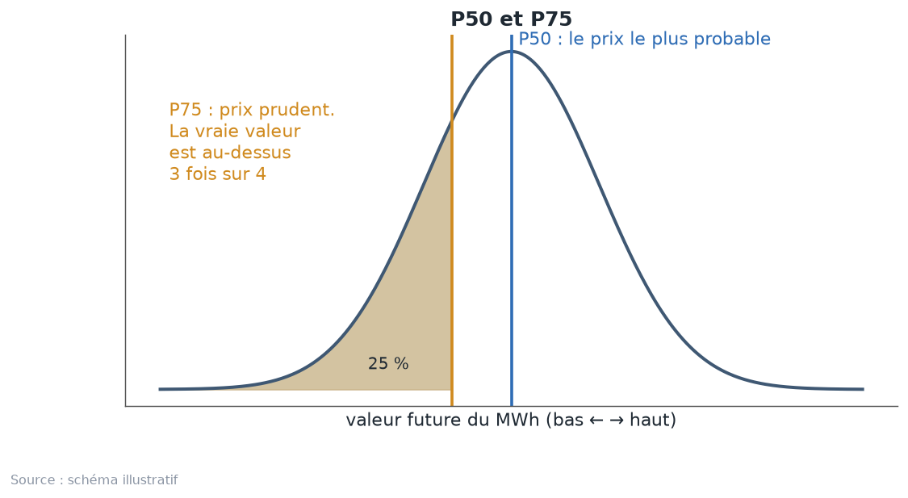
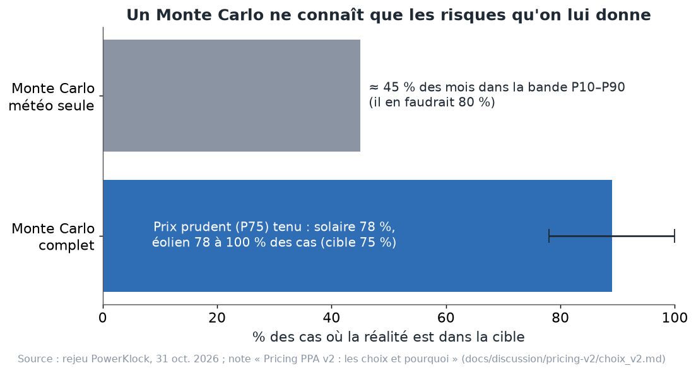
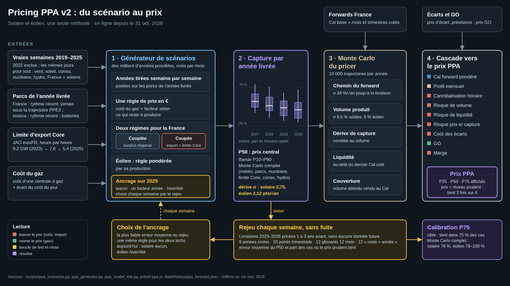
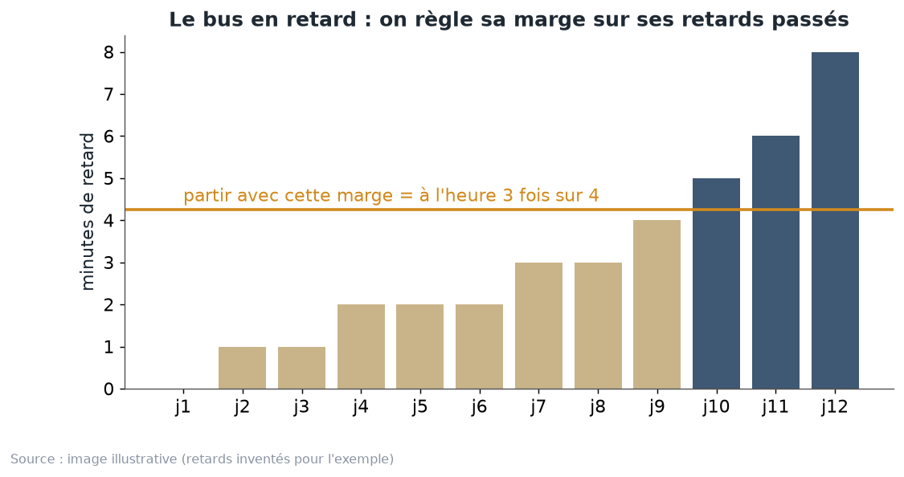

# Chapitre 11 à l'oral — le risque, P50 et P75, version complète

*Pour Tom · 1er novembre 2026 · à lire à voix haute, environ 15 minutes*

## 1. Un prix futur, ce n'est pas un chiffre, c'est un éventail
Personne ne connaît la valeur d'un MWh solaire en 2028. Elle dépendra du vent, du soleil, du nucléaire, du gaz, des
voisins, des lignes. Alors, au lieu d'un seul chiffre, on donne un **éventail** de valeurs possibles, avec leurs
chances.

Pour parler de cet éventail, on utilise des **P** suivis d'un nombre :
- **P50**, c'est le milieu. Une chance sur deux que la réalité soit au-dessus, une sur deux en dessous. C'est la
  médiane.
- **P75**, c'est le **prix prudent**. La réalité sera **au-dessus 3 fois sur 4**. Une fois sur 4 seulement, elle
  sera en dessous.
- **La règle générale** : le Pq est la valeur que la réalité dépasse avec une probabilité de (100 − q) %. P90 : la
  réalité est au-dessus 9 fois sur 10.
- **La bande P10–P90** : l'intervalle qui doit contenir la réalité **8 fois sur 10**. Une fois sur 10 au-dessus, une
  fois sur 10 en dessous.

**L'image.** Un randonneur prépare sa journée. Le P50, c'est le temps de marche « normal ». Le P75, c'est le temps
qu'il annonce à ses amis pour ne pas les faire attendre trop souvent. Il ne prend pas le pire cas, sinon il
partirait à l'aube pour rien. Il prend une marge raisonnable.

## 2. Pourquoi un prix prudent
Quand on signe un PPA, on fixe un prix pour plusieurs années. Si on le fixe au P50, on se trompe dans un sens une
fois sur deux, dans l'autre une fois sur deux. Sur un seul contrat, c'est un pari à pile ou face.

La règle de Tom est simple : **« ne pas perdre d'argent systématiquement »** (note v2). Le pricer prend donc le niveau
qui tient **3 fois sur 4**. La différence entre la valeur du milieu et ce niveau prudent, c'est la **prime de
risque**. C'est le prix de la tranquillité.

Le pricer affiche les trois : **P25, P50 et P75**. Le prix publié est le niveau prudent.

## 3. Le Monte Carlo : tirer des milliers de futurs
Pour fabriquer l'éventail, on utilise un **Monte Carlo**. Le nom vient du casino. Le principe : on lance les dés des
milliers de fois, et on regarde ce qui sort.

Concrètement, chez nous :
- le générateur de scénarios (chapitre 9) fabrique des **milliers d'années possibles**, avec de vraies semaines du
  passé ;
- pour chaque année, on calcule la capture et la valeur du MWh ;
- on range les résultats du plus bas au plus haut, et on lit le P25, le P50, le P75.

**Le piège.** Un Monte Carlo **ne connaît que les risques qu'on lui donne**. S'il ne tire que la météo, il ne sait
pas que le nucléaire peut s'effondrer, que la ligne vers l'Allemagne peut rétrécir, que le parc solaire peut grandir
plus vite que prévu. Il fabrique alors un éventail trop étroit. Et un éventail trop étroit rassure à tort.

**L'image.** Un simulateur de vol qui n'a jamais appris les orages. Le pilote s'entraîne des milliers d'heures, tout
se passe bien, il se croit prêt. Le jour de l'orage, il découvre un risque que son simulateur ne lui a jamais montré.

## 4. Le test : la météo seule est trop étroite
Le 31 octobre, on a vérifié le Monte Carlo sur le passé, avec le rejeu du chapitre 10 : on se met dans le passé, on
calcule la bande, et on regarde si la réalité est tombée dedans.

Avec le générateur qui ne tire **que la météo** :
- la bande P10–P90 a contenu la réalité dans **environ 45 % des mois**. Il en faudrait **80 %** ;
- pire, le **prix prudent éolien n'a tenu dans aucun cas : 0 %** (note v2, `pricing-v2/choix_v2.md`).

En clair, le modèle était beaucoup trop sûr de lui. Il disait « je suis certain à 80 % », et il avait raison moins
d'une fois sur deux.

## 5. Le Monte Carlo complet : ce qu'il tire en plus
Le pricer v2, en ligne depuis le **31 octobre 2026**, ajoute les risques qui manquaient. Pour **chaque scénario**, il
tire au hasard :

- **La croissance du parc** au-delà de la dernière année connue : un multiplicateur entre **0,6 et 1,4**, soit
  **±40 %**. Si l'on attendait 10 GW de solaire en plus, le scénario peut en mettre 6 ou 14.
- **Le niveau du nucléaire** : un multiplicateur de type **lognormale à 4 %**. Repère : EDF annonce 350 à 370 TWh par
  an, soit environ ±3 %. Plus **5 % de chances d'une année de type 2022**, l'année de la corrosion sous contrainte
  (environ −20 % de nucléaire, d'après la fiche des paramètres).
- **La limite d'export vers Core** : un multiplicateur lognormal de **20 % × √années**. Repère : elle est allée de
  5,4 à 9,2 GW entre 2023 et 2026 (JAO).
- **Le niveau de consommation** : lognormale à **2 %**, selon le rythme de l'électrification.
- **Des semaines « chères » ou « bon marché »** : chaque semaine tirée reçoit un rang commun, pour représenter ce qui
  fait monter ou baisser toute une semaine à la fois (pannes, combustibles, comportements).
- **La disponibilité nucléaire de la semaine tirée.**
- **Une année sèche ou humide**, pour les barrages.

**Deux mots à expliquer.**
- **Lognormale** : c'est un multiplicateur centré sur 1, qui ne devient jamais négatif. « Lognormale à 4 % » veut
  dire qu'on tombe le plus souvent entre 0,96 et 1,04, et rarement plus loin. Comme une balance un peu imprécise :
  la plupart des pesées sont justes à quelques pourcents près.
- **√années** (racine carrée du nombre d'années) : l'incertitude grandit avec l'horizon, mais moins vite que le
  temps. À 4 ans, elle est deux fois plus grande qu'à 1 an, pas quatre fois. **L'image** : le brouillard sur une
  route. Plus on regarde loin, moins on voit, mais la visibilité ne s'effondre pas d'un coup.

**Le résultat.** Avec tout ça, le prix prudent a tenu dans **78 à 89 % des cas** (fiche des paramètres du 1er
novembre). La cible est 75 %. La note du 31 octobre au soir donnait 78 % en solaire, 78 à 100 % en éolien. C'est le schéma ci-dessus : la barre bleue.

**Une remarque honnête.** Ces paramètres (±40 % de parc, 5 % de crise) sont des **jugements**, pas des estimations
tirées des données. Ils ont été validés par le rejeu, mais sur peu d'années. Il faudra les tester sur plus
d'années (cours détaillé, 11.5).

## 6. Du générateur au prix : la prime de risque
Le Monte Carlo du générateur ne donne pas directement le prix. Il donne une **dérive de capture** :
- **solaire 2,38 points par √an, éolien 1,90 point par √an** (fiche des paramètres du 1er novembre ; la note du
  31 octobre donnait 2,75 et 2,12).
- En mots : si on price un an avant, la capture solaire peut s'écarter d'environ 2,4 points de pourcentage de ce
  qu'on attend. À 4 ans, deux fois plus, environ 4,8 points (calcul : 2,38 × √4).

Ensuite, le pricer fait son propre Monte Carlo, plus large :
- il tire **10 000 trajectoires** ;
- dans chacune, il fait bouger quatre choses : le **forward** (le prix de marché à terme), le **volume** produit, la
  **capture**, et la **liquidité** (les années trop lointaines pour être cotées) ;
- il suppose que le producteur vend à l'avance le volume attendu au Cal (une couverture « back to back ») ;
- il calcule ce que rapporte un MWh dans chaque trajectoire, les range, et retire
  **prime = valeur juste − 25e centile**.

Le 25e centile, c'est le niveau sous lequel tombent 25 % des trajectoires. Donc le prix publié tient **3 fois sur 4**.

**La corrélation volume–capture.** Une question compte beaucoup : quand le parc produit plus que prévu, sa capture
baisse-t-elle en même temps ? Si oui, les deux risques s'additionnent. La corrélation mesure ce lien : 0, aucun lien ;
1, ils bougent toujours ensemble.
- Avant la v2, on **supposait** 0,3 en solaire et 0,2 en éolien.
- Depuis la v2, on la **mesure** dans le générateur : **0,24 en solaire, 0,32 en éolien** au 1er novembre (0,06 et
  0,26 dans la première mesure du 31 octobre).
- L'éolien a un lien plus fort : une année très venteuse fait baisser les prix pendant les heures de vent.

**Attention, ces chiffres bougent.** Ils sont recalculés chaque dimanche, et la méthode a changé deux fois le
1er novembre : arrêt strictement sous 0 € (8 h 12), puis prime de risque qui suit la sensibilité mesurée du prix capté
au prix de base, 0,96 € par € en solaire et 0,95 en éolien (12 h 25). Les valeurs ci-dessus sont celles de la fiche
à jour (`pricing-v2/parametres.md`). Retiens l'ordre de grandeur et la méthode, pas la deuxième décimale.

## 7. L'autre méthode : nos erreurs passées (jusqu'au 31 octobre)
Avant la v2, on ajoutait une seconde prudence, pour le **risque de modèle** : le risque que le générateur lui-même se
trompe toujours dans le même sens. Le script `scripts/ppa_model_risk.py` faisait ceci :
1. il rejouait le générateur sur chaque livraison depuis 2023, pricée 1, 2 et 3 ans avant ;
2. il notait l'erreur de capture de chaque cas, en points ;
3. il prenait le **75e centile pondéré** de ces erreurs. Le poids d'un cas est **divisé par deux pour chaque année
   d'ancienneté** de sa livraison ;
4. le pricer retirait forwards × ce centile.

En mots : si le prix avait été fixé ainsi par le passé, il n'aurait pas dépassé la valeur réalisée 3 fois sur 4.

**L'image du bus en retard.** Ton bus est souvent en retard. Pour arriver à l'heure 3 fois sur 4, tu regardes ses
retards passés. Tu prends celui qui couvre 3 jours sur 4, et tu pars avec cette marge. Et tu regardes surtout les
retards récents, parce que les horaires changent.

**La théorie derrière.** Barber, Candès, Ramdas et Tibshirani, *Annals of Statistics*, 2023 :
- prendre un quantile de ses erreurs passées donne une marge avec une garantie : c'est la « prédiction conforme » ;
- quand le monde change, donner plus de poids aux erreurs récentes garde une garantie presque aussi bonne ;
- la perte de garantie est bornée par la distance entre le passé pondéré et le présent. Plus le présent ressemble au
  passé récent, plus la garantie tient.

**Pourquoi on l'a retirée du prix.** La bande du Monte Carlo complet contient déjà l'erreur du modèle : elle tire
justement les risques que le modèle oubliait. Garder les deux reviendrait à compter deux fois la même prudence. La
méthode reste utile pour **vérifier** que le prix est assez prudent.

## 8. Garder de la variété
Un dernier piège, plus discret. On pourrait vouloir des scénarios très réalistes : demander que chaque semaine tirée
ait le même nucléaire, le même gaz, la même limite d'export, le même vent que l'année visée.

Le problème : avec trop de critères, **une ou deux années du passé seulement conviennent**. Tous les scénarios
reprennent alors les mêmes semaines. L'éventail se resserre, non pas parce que le futur est sûr, mais parce qu'on
tire toujours les mêmes cartes.

**L'image.** Un sondage où l'on n'interroge que les habitants d'une seule rue. Les réponses se ressemblent toutes, et
on croit à tort que tout le pays pense pareil.

**La règle.** Peu de critères, ceux qui comptent le plus. Et vérifier combien d'années différentes sont réellement
tirées. La fiche des paramètres le contrôle : chaque scénario mélange les 6 années de la réserve de semaines.

## 9. Ce qui reste ouvert
- **Le volume varie trop peu dans le générateur** : 2,1 % en solaire, contre environ 5 % en réalité. Le pricer prend
  donc la dispersion du volume dans les vraies années : **6,5 % en solaire, 9 % en éolien**.
- **La liquidité** : au-delà du dernier Cal coté, on ajoute **5,1 % × √années** d'incertitude sur le prix, mais sans
  source pour l'écart achat–vente.
- **Les paramètres du Monte Carlo complet** sont des jugements : à revoir chaque année, en janvier, quand une année
  complète s'ajoute. La fiche dit de les revoir si la calibration du P75 sort de la zone **65–85 %**.

## À retenir
1. P50 = le milieu. P75 = le prix prudent : la réalité est au-dessus 3 fois sur 4.
2. Le prix publié est le prix prudent. La prime de risque = valeur juste − 25e centile, sur 10 000 trajectoires.
3. Un Monte Carlo ne connaît que les risques qu'on lui donne. Météo seule : environ 45 % des mois dans P10–P90 au
   lieu de 80 %, et le prix prudent éolien n'a jamais tenu.
4. Le Monte Carlo complet tire aussi le parc, le nucléaire (avec une année type 2022), la limite Core, la
   consommation, les semaines chères ou bon marché, l'année sèche ou humide. Prix prudent tenu dans
   78 à 89 % des cas.
5. Le percentile pondéré des erreurs passées (le bus en retard) n'est plus déduit du prix depuis le 31 octobre, mais
   il reste un bon contrôle.
6. Trop de critères tue la variété : un éventail étroit n'est pas forcément un futur sûr.

## Question pour vérifier
Imagine que, l'an prochain, le rejeu montre que le prix prudent éolien n'a tenu que dans 55 % des cas.
- (a) Le prix éolien publié était-il trop haut ou trop bas ?
- (b) Quelle est la première chose à regarder dans le Monte Carlo complet ?
- (c) Pourquoi ne faut-il pas simplement ajouter dix critères au tirage des semaines pour « coller » au futur ?

## Pour aller plus loin
- Barber, Candès, Ramdas et Tibshirani, « Conformal prediction beyond exchangeability », *Annals of Statistics*
  51(2), 2023 — https://arxiv.org/abs/2202.13415
- Pexapark, prix de PPA et « prix de marché du risque » —
  https://help.platform.pexapark.com/en/articles/9577400-what-are-ppa-prices-shown-on-pexaquote-and-the-market-price-of-risk
- EDF, estimation de production nucléaire —
  https://www.edf.fr/groupe-edf/espaces-dedies/journalistes/tous-les-communiques-de-presse/estimation-de-production-nucleaire-d-edf-en-france
- JAO, outil de publication Core (limites d'export) — https://publicationtool.jao.eu/core
- Dossier PowerKlock : `docs/discussion/pricing-v2/choix_v2.md`, `parametres.md`, `scripts/ppa_model_risk.py`,
  cours détaillé, chapitre 11.
