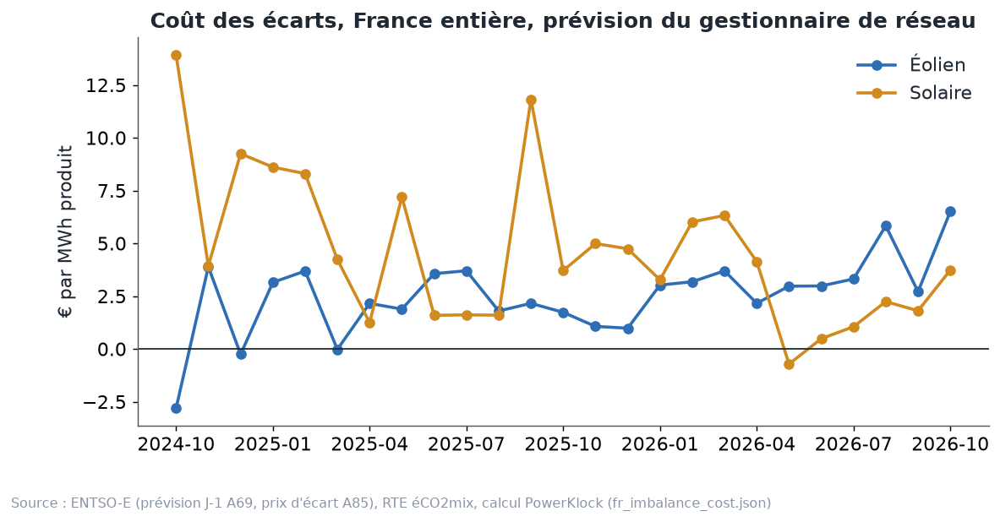

# Chapitre 12 à l'oral — le coût des écarts, version complète

*Pour Tom · 1er novembre 2026 · à lire à voix haute, environ 15 minutes*

## 1. Annoncer la veille, produire le lendemain
L'électricité ne se stocke presque pas. À chaque instant, ce qui est injecté sur le réseau doit être égal à ce qui
est consommé. C'est RTE qui tient cet équilibre en temps réel.

Pour l'aider, chaque acteur s'engage à l'avance :
- la veille, chaque producteur (ou celui qui vend sa production) annonce ce qu'il va injecter, quart d'heure par quart
  d'heure ;
- le lendemain, il produit ce que la météo lui donne réellement ;
- la différence entre l'annonce et le réel, c'est son **écart**.

Celui qui répond de ces écarts devant RTE s'appelle le **responsable d'équilibre**. Pour un parc sous PPA, c'est
souvent l'acheteur ou un agrégateur, selon le contrat.

**L'image.** Un traiteur commande la veille ses ingrédients pour 100 couverts. Le jour même, 90 clients viennent, ou
110. S'il en manque, il court acheter en urgence, plus cher. S'il en reste, il les revend à bas prix. Dans les deux
cas, se tromper coûte.

## 2. Le prix d'écart
Un écart n'est pas réglé au prix spot de la veille. Il est réglé au **prix d'écart**, fixé après coup, en fonction de
ce qu'a coûté à RTE le rééquilibrage du système. Les règles sont fixées par la CRE (délibération 2022-71, règles du
mécanisme d'ajustement et des responsables d'équilibre).

Pourquoi ce prix est souvent défavorable :
- **le parc produit moins que prévu** : il manque de l'énergie. Souvent, c'est au moment où tout le système en manque
  aussi (le vent est tombé partout). RTE doit appeler des moyens rapides et chers. Le prix d'écart est alors **au-dessus
  du spot** : le parc paie cher ce qu'il n'a pas produit ;
- **le parc produit plus que prévu** : il a trop d'énergie. Souvent, tout le système en a trop aussi (le vent a
  forcé partout). Le surplus est **racheté sous le spot**.

C'est le cas le plus courant, pas une loi. Certains mois, l'erreur d'un parc va dans le sens qui aide le système, et
il peut même gagner. On le verra dans les chiffres mensuels.

## 3. La formule, en mots
Le site calcule le coût des écarts ainsi (`data/history/fr_imbalance_cost.json`) :

**Coût par MWh = −Σ (réalisé − prévu) × (prix d'écart − spot) × 0,25 h ÷ Σ production**

Lisons-la morceau par morceau :
- **(réalisé − prévu)** : l'erreur de prévision, en MW, pour chaque quart d'heure. Négative si on a produit moins
  qu'annoncé ;
- **(prix d'écart − spot)** : de combien le prix d'écart s'écarte du spot ce quart d'heure-là ;
- **× 0,25 h** : un quart d'heure, pour passer de MW à MWh ;
- **Σ** : on additionne tous les quarts d'heure du mois ;
- **÷ Σ production** : on divise par toute la production, pour avoir un coût **par MWh produit** ;
- **le signe moins** : il fait qu'un coût apparaît positif.

**Un exemple inventé, pour fixer les idées.** Un quart d'heure, un parc annonce 100 MW et en produit 80 : il manque
20 MW, soit 5 MWh. Le spot est à 60 €, le prix d'écart à 100 €. Il paie 5 × (100 − 60) = 200 € de plus que s'il
avait bien prévu. Additionnés sur des milliers de quarts d'heure, puis divisés par toute la production, ces montants
donnent le coût par MWh.

## 4. National contre parc seul : l'effet portefeuille
**Le chiffre du site est national.** On compare la prévision de production éolienne (ou solaire) de **toute la
France** à la production réelle de toute la France. C'est donc l'erreur d'un portefeuille qui contiendrait tous les
parcs du pays.

Or, à l'échelle nationale, beaucoup d'erreurs **se compensent** :
- un nuage passe sur la Bretagne plus tôt que prévu ;
- au même moment, le soleil revient en Provence plus tôt que prévu ;
- la France entière, elle, s'est à peine trompée.

**L'image de l'assurance.** Une compagnie d'assurance avec un seul client ne sait pas s'il aura un accident cette
année : son résultat est un pari. Une compagnie avec un million de clients sait presque exactement combien d'accidents
elle paiera. Plus il y a de clients, plus les comptes sont prévisibles. Pour les parcs, c'est pareil : plus le
portefeuille est grand et dispersé, plus les erreurs se compensent.

**Les conséquences pour le prix :**
- **un parc seul** a une erreur relative bien plus grande, donc un coût par MWh plus élevé que le chiffre national ;
- **un agrégateur moyen** est entre les deux ;
- le pricer applique le **coût national**. Pour un parc seul, il faut ajouter une marge. La fiche des paramètres
  prévoit un réglage « taille du portefeuille », traité à part.

## 5. Quelle prévision prendre ?
Pour calculer l'écart, il faut une prévision. Deux candidates :
- **la prévision du gestionnaire de réseau** : la prévision de la veille publiée par RTE sur la plateforme européenne
  ENTSO-E (le jeu de données « A69 ») ;
- **notre prévision combinée**, calculée par PowerKlock.

**Les résultats, sur 12 mois :**
- **Éolien** : **3,06 €/MWh** avec la prévision du gestionnaire, **2,82 €/MWh** avec notre prévision combinée. La
  nôtre se trompe moins.
- **Vérification** : notre propre calcul sur `fr_imbalance_cost.json`, de novembre 2025 à octobre 2026, donne
  **3,07** pour la prévision du gestionnaire. Ça recoupe.
- **Solaire** : c'est l'inverse, **la prévision du gestionnaire reste meilleure**.

**Le détail qui comptait : l'interpolation au quart d'heure.** Notre prévision était faite à l'heure. Pendant une
heure, elle restait plate, comme un escalier. Mais le solaire monte le matin et descend le soir en **rampe**, en
continu. Un escalier qui suit une rampe se trompe à chaque marche : trop haut au début de l'heure, trop bas à la fin
(ou l'inverse). Depuis le 31 octobre, notre prévision est **interpolée au quart d'heure** : on trace une ligne droite
entre les heures, et la marche devient une pente.

**La règle de choix.** Depuis le 31 octobre, chaque filière prend la prévision qui s'est **le moins trompée sur les
12 derniers mois**. Aujourd'hui : la nôtre pour l'éolien, celle du gestionnaire pour le solaire. Si ça s'inverse un
jour, le choix suit tout seul.

**Les valeurs dans le pricer.** La fiche des paramètres du 1er novembre donne **2,82 €/MWh en éolien** et
**2,49 €/MWh en solaire**. Pour le solaire, mon recalcul sur le fichier, avec la prévision du gestionnaire et sur
novembre 2025 – octobre 2026, donne 2,38. Je n'ai pas trouvé d'où vient l'écart de 0,11 € (fenêtre de 12 mois
différente, mise à jour du fichier ?). C'est à vérifier avant de citer le chiffre solaire au centime.

## 6. Un coût très variable d'un mois à l'autre
Le chiffre sur 12 mois cache de grosses différences entre les mois.

Ce qu'on lit sur le schéma (prévision du gestionnaire, France entière) :
- le coût va de **−2,8 €/MWh** (éolien, octobre 2024) à **près de +14 €/MWh** (solaire, octobre 2024, 13,9) ;
- le solaire a des pics : **11,8 €** en septembre 2025, **9,3 €** en décembre 2024 ;
- le solaire a même un mois négatif : **−0,7 €** en mai 2026. Ce mois-là, ses erreurs ont plutôt aidé le système ;
- l'éolien est plus régulier, le plus souvent **entre 1 et 4 €**, mais il monte à **5,8 €** en août 2026 et
  **6,5 €** en octobre 2026.

**Pourquoi c'est si variable ?** Le coût dépend de deux choses qui bougent :
- **la taille de l'erreur** : l'erreur de prévision solaire nationale va de 4,8 % (septembre 2026) à 31,1 %
  (novembre 2025) de la production du mois ;
- **le prix d'écart ce mois-là** : une même erreur coûte peu si le système est calme, beaucoup s'il est tendu.

**La leçon pour un PPA.** On ne price pas un contrat de trois ans sur le coût d'un seul mois. On prend une moyenne
longue, ici 12 mois, et on sait qu'elle bougera.

## 7. La modulation des renouvelables à la demande de RTE
Un fait nouveau change le paysage des écarts : les parcs éoliens et solaires **s'arrêtent de plus en plus** quand les
prix sont négatifs ou quand RTE le demande.

Ce que dit RTE :
- **bilan du premier semestre 2026** : **7,4 GW** d'éolien et de solaire sous obligation d'achat peuvent désormais
  s'arrêter aux prix négatifs, et **22 GW** peuvent moduler à la demande de RTE, quatre fois plus qu'avant ;
- la modulation renouvelable a atteint **2,5 TWh** au premier semestre 2026, contre **1,9 TWh** un an plus tôt, soit
  environ **5 %** de la production éolienne et solaire ;
- **bilan 2025** : la modulation pendant les prix négatifs a doublé en 2025, à environ **3 TWh** (1,3 éolien,
  1,6 solaire).

**Pourquoi ça compte pour les écarts.** Notre calcul compare la prévision de la veille à la production **réelle**.
Si des parcs s'arrêtent parce que le prix est négatif ou parce que RTE le demande, la production réelle baisse, et
ce qui ressemble à une « erreur de prévision » est en fait un **arrêt voulu**. Je n'ai pas vérifié comment ces arrêts
sont réglés financièrement, ni quelle part de notre coût national ils représentent. C'est
une question ouverte : avec 22 GW modulables, elle va grossir.

## 8. Les limites
- **Le chiffre est national**, et un parc réel n'est jamais toute la France.
- **Le prix d'écart dépend de règles qui changent** : le pas de 15 minutes, les réserves, les règles de la CRE. Un
  coût mesuré sur 2025–2026 peut ne plus valoir en 2028.
- **Le calcul est « basique »** (c'est le mot du fichier) : il ne tient pas compte d'un responsable d'équilibre qui
  corrige ses positions le jour même sur le marché infrajournalier, ce qu'un vrai agrégateur fait.

## À retenir
1. Un écart = la différence entre ce qu'on a annoncé la veille et ce qu'on a produit, réglée au prix d'écart.
2. Coût par MWh = −Σ (réalisé − prévu) × (prix d'écart − spot) × 0,25 h ÷ Σ production, au quart d'heure.
3. Le chiffre du site est national : les erreurs se compensent comme les risques d'une grande compagnie d'assurance.
   Un parc seul paie plus.
4. Éolien, 12 mois : 3,06 € avec la prévision du gestionnaire, 2,82 € avec notre prévision combinée. Solaire : la
   prévision du gestionnaire reste meilleure.
5. Depuis le 31 octobre : notre prévision est interpolée au quart d'heure, et chaque filière garde la prévision qui
   s'est le moins trompée sur 12 mois.
6. Le coût mensuel varie de −2,8 à près de +14 €/MWh : on price sur une moyenne longue.

## Question pour vérifier
Un client te demande un PPA pour **un seul parc éolien** de 20 MW, isolé dans le Massif central.
- (a) Le coût des écarts à mettre dans son prix est-il au-dessus ou en dessous de 2,82 €/MWh ? Pourquoi ?
- (b) Si, l'an prochain, la prévision du gestionnaire devient meilleure que la nôtre en éolien, que fait le site ?
- (c) Un mois, RTE demande à beaucoup de parcs de s'arrêter. Pourquoi notre coût national peut-il alors être
  trompeur ?

## Pour aller plus loin
- CRE, règles du mécanisme d'ajustement et des responsables d'équilibre (délibération 2022-71) —
  https://www.cre.fr/fileadmin/Documents/Deliberations/import/220310_2022-71_MA-RE.pdf
- RTE, *Bilan du système électrique, premier semestre 2026*, chapitre 7 —
  https://assets.rte-france.com/prod/public/2026-07/2026-07-16-bilan-semestre1.pdf
- RTE, *Bilan électrique 2025* —
  https://assets.rte-france.com/prod/public/2026-02/Bilan-electrique-2025-principaux-resultats.pdf
- ENTSO-E Transparency Platform (prévisions éolien et solaire, prix d'écart) — https://transparency.entsoe.eu/
- Dossier PowerKlock : `data/history/fr_imbalance_cost.json`, `docs/discussion/pricing-v2/parametres.md`, cours
  détaillé, chapitre 12.
