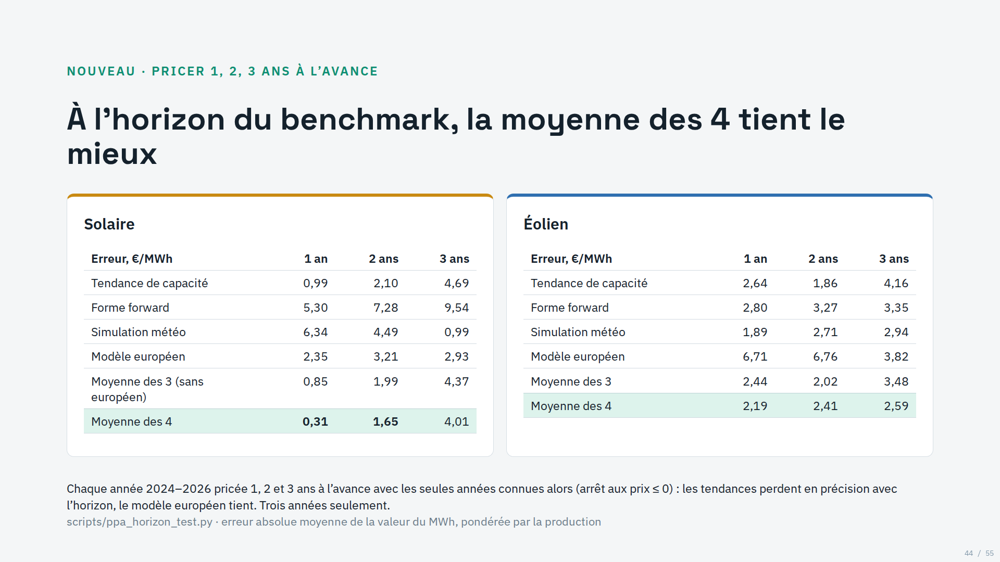
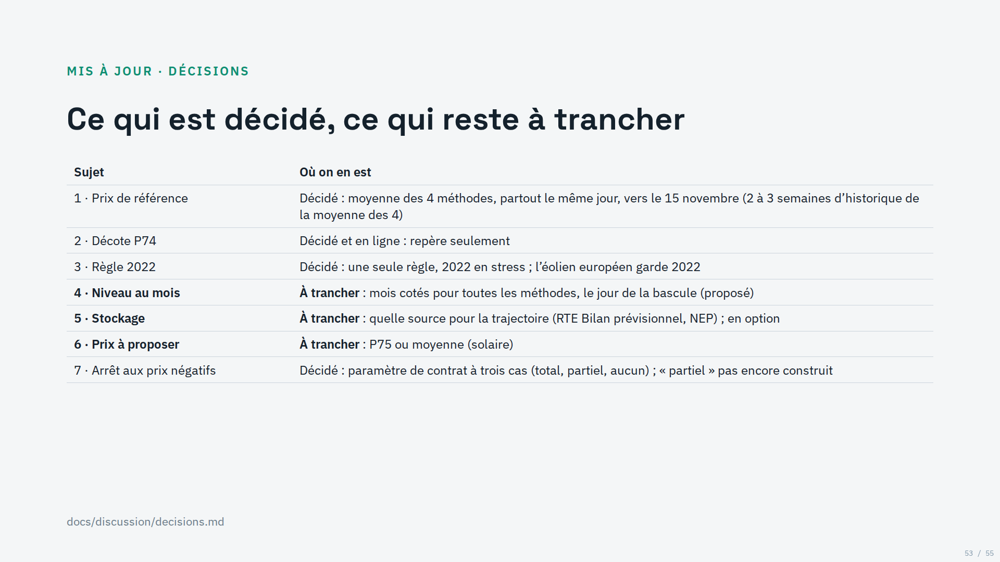

# Chapitre 13 à l'oral — ce qu'on a testé, ce qu'on a gardé, version complète

*Pour Tom · 1er novembre 2026 · à lire à voix haute, environ 15 minutes*

## 1. Le point de départ
Dans la nuit du 30 au 31 octobre, tu as fixé un objectif clair : **trouver une méthode qui n'ait plus besoin de
l'ancrage**, surtout pour l'éolien. L'ancrage, c'est le recalage du modèle sur la dernière année réelle (chapitre 9).
Tu as demandé de tout tester, même ce qui n'était pas raisonnable, et de s'inspirer de la recherche.

Le constat de départ (débrief du 31 octobre) :
- sans ancrage, l'éolien est **surévalué d'environ +2,6 €/MWh** ;
- cette erreur est **presque constante** d'un cas à l'autre : c'est un biais, pas du bruit ;
- trois modèles construits de façon totalement différente font **la même erreur**.

Ce chapitre raconte ce qu'on a essayé, ce qui a marché, ce qui a été décidé, et ce qui reste ouvert.

## 2. Comment lire les résultats
Tous les chiffres viennent du **rejeu** du chapitre 10 :
- livraisons 2023 à 2026, pricées 1, 2 et 3 ans avant : **9 cas par filière** ;
- l'erreur est la moyenne en € sur la valeur d'un MWh. Ces tests datent de la nuit du 30 au 31 octobre : la
  production n'y était pas payée aux prix **≤ 0**. Depuis le 1er novembre, le pricer, le générateur et le rejeu
  arrêtent le parc seulement **strictement sous 0 €** (`pricing-v2/parametres.md`) ; les chiffres ci-dessous gardent
  leur convention d'origine ;
- **plus c'est bas, mieux c'est**.

Deux règles de lecture, déjà vues :
- **le bruit des tirages atteint 0,2 €** : un gain plus petit ne prouve rien, sauf s'il tient sur tous les tirages ;
- **biais contre dispersion** : une montre qui avance toujours de cinq minutes se corrige ; une montre qui avance un
  jour et retarde le lendemain, non.

## 3. Le grand tableau : la valeur du MWh
Erreur moyenne de rejeu, en €/MWh, 9 cas (débrief du 31 octobre, cours détaillé 13.1).

| Test | Solaire sans ancrage | Éolien sans ancrage | Éolien ancré hiver/été | Verdict |
|---|---|---|---|---|
| **Modèle publié jusqu'au 31 oct. (v1)** | **0,76** | 2,62 | 0,84 | la référence ; la v2 publiée fait 0,56 en éolien |
| Pondéré par la production | 1,41–1,43 | 2,10–2,20 | 0,48–0,71 | meilleur en éolien, pire en solaire |
| Pondération + part du vent quand la France est coupée | 1,1 | 2,01 | **0,56** | **adoptée en v2 pour l'éolien** |
| Pondération + pente du vent | — | 1,93 (biais +0,45) | 0,71 | presque sans biais, mais dispersé |
| Résidu du jour réel | 1,88–3,98 | 2,09–4,35 | 0,83–1,60 | écarté |
| Grille surplus × part du vent | 0,93 | 2,31 | 0,86 | écarté |
| Grande-Bretagne / Pays-Bas + Autriche comme modèles | 1,96–2,27 | 2,49–2,95 | 0,65–1,32 | écartés |
| Tout combiné | 2,36 | 3,49 | 0,82 | écarté (−11 € sur 2026) |
| Correction par situation | 2,57 | 1,73 | 0,72 | écartée (−4 à −8 € sur 2026) |
| Limite JAO réelle de l'année livrée (« oracle ») | 0,93 | 2,59 | 0,76 | n'explique pas l'erreur |
| Météo tirée depuis 2023 seulement | 1,44 | 3,02 | 1,01 | écartée |
| Analogues seuls | 4,1 | ≈ 1,1 | — | écartés |
| Mélange 50/50 analogues + règle | — | — | 0,89 sur années civiles, contre 0,63 en v2 | refusé |
| Ancrage sur 12 mois roulants au lieu de l'année civile (6 cas, pricés fin octobre, avec ancrage) | — | — | — | solaire 1,10 → 1,08 ; éolien 1,47 → 1,67 : pas mieux |
| Moyenne des 4 anciennes méthodes (corrigées de leur biais passé) | 2,59 | 2,84 (éolien, telle qu'elle était publiée) | — | remplacée par le générateur seul |
| Modèle d'optimisation par semaine | — | paie trop le vent (+4,3) | — | écarté |
| Régression mensuelle de la capture | 3,2–6,3 | 1,73–3,42 | — | écartée, instable |
| Merit order avec courbes d'offre (v1 à v3) | — | — | — | bon à 1 an, casse à 2–3 ans |

Et pour le risque et les écarts :

| Test | Résultat | Verdict |
|---|---|---|
| Monte Carlo météo seule | P10–P90 ≈ 45 % des mois ; prix prudent éolien tenu 0 % des cas | trop étroit |
| Monte Carlo complet | prix prudent tenu dans 78–89 % des cas (cible 75 %) | **adopté en v2** |
| Prévision combinée des écarts | éolien 3,06 → 2,82 €/MWh | **gardée pour l'éolien** |

## 4. Trois leçons du tableau
**Leçon 1 : beaucoup de tests, peu de vainqueurs.** C'est normal. Un bon modèle est difficile à battre, et 9 cas
(en fait 4 années livrées) laissent peu de place pour trancher.

**Leçon 2 : l'année 2026 casse les idées trop fines.** « Tout combiné » se trompe de 11 € sur 2026, « correction par
situation » de 4 à 8 €. Ce qui colle trop bien au passé se brise sur une année jamais vue. C'est le
**surapprentissage** : l'élève qui apprend les réponses par cœur au lieu de comprendre l'exercice.

**Leçon 3 : solaire et éolien tirent dans des sens opposés.** La pondération par la production améliore l'éolien
(jusqu'à 0,56) mais dégrade le solaire (de 0,76 à plus de 1,4). Les analogues sont bons en éolien (≈ 1,1 sans
ancrage), catastrophiques en solaire (4,1). La raison : un futur plus solaire que tout le passé n'a pas d'analogue,
et reçoit les pires midis connus. D'où la solution : **le même générateur pour les deux, seule la pondération suit
la filière pricée**.

**Le « oracle » est instructif.** Même en donnant au modèle la vraie limite d'export de l'année livrée, qu'on ne
pouvait pas connaître, l'erreur éolienne sans ancrage reste à 2,59. Donc ce n'est pas la limite Core qui explique le
biais. Ni le gaz. La valeur réelle de l'éolien baisse d'une année à l'autre **plus vite que tous les modèles ne le
prévoient**.

## 5. Ce qui a été décidé : le pricer v2
Le pricer v2 est **en ligne depuis le 31 octobre 2026**. Il suit tes règles : pas de recalibrage caché, une seule
méthode pour le solaire et l'éolien, produits liquides seulement, réalisme face à l'historique, tests sur des années
complètes, et jamais changer le pourcentage d'un mélange à chaque pricing.

Les six choix (`pricing-v2/choix_v2.md`) :
1. **Une seule méthode, le générateur.** La moyenne des 4 anciennes méthodes se trompait de 2,59 € (solaire) et
   2,84 € (éolien). Le générateur seul : 0,76 et 0,56. Les anciennes méthodes restent affichées comme repères, hors
   du prix.
2. **L'ancrage choisi par une règle**, chaque semaine : le mode qui s'est le moins trompé au rejeu. Aujourd'hui :
   solaire sans ancrage, éolien hiver/été.
3. **La règle éolienne pondérée par la production**, avec la part du vent quand la France est coupée : 0,84 →
   0,56 €/MWh.
4. **Le mélange 50/50 analogues + règle, refusé.** Ta phrase : « on avait une bonne méthode ».
5. **Un prix prudent plutôt que le P50** : le niveau qui tient 3 fois sur 4, avec P25, P50 et P75 affichés.
6. **La bande du Monte Carlo complet**, sans déduction séparée du risque de modèle.

Le résultat, avec les forwards des 30–31 octobre : **solaire 46,64 €/MWh, éolien 77,39 €/MWh** (prix publié au
1er novembre). Le chemin pour y arriver : 49,75 / 80,69 à la mise en ligne de la v2 le 31 octobre au soir ; 42,88 /
77,20 le 1er novembre au matin, quand une heure à 0 € est devenue produite et payée 0 (même revenu, plus de MWh
payés) ; puis 46,64 / 77,39 à midi, quand la prime de risque a suivi la sensibilité mesurée du marché (prime solaire
5,98 → 2,2 €). Toujours dire de quelle date, et de quelle méthode, est un prix.

## 6. Ce qui reste ouvert
1. **L'éolien reste ancré.** Sans ancrage, tous les modèles le surévaluent de 2 à 2,7 €. Le biais est dans les
   heures où la France est coupée : la règle y est 6,9 € trop haute.
2. **La convention des prix négatifs** : depuis le 1er novembre, le parc s'arrête seulement strictement sous 0 €
   (225 heures à exactement 0 € en 2025). Le seuil est réglable : à choisir selon la clause de chaque contrat.
3. **Les captures s'arrêtent en 2030** : à prolonger pour les PPA longs.
4. **Les arrêts nucléaires 2027** : une option (éolien +2 points), impossible à tester sur le passé. Jusqu'à environ
   21 GW arrêtés en même temps fin mai 2027, d'après les déclarations à ENTSO-E au 30 octobre 2026.
5. **Les prix de PPA observés** comme repère (abonnement Pexapark, usage interne seulement).
6. **La stabilité du choix de méthode** (ta question du 30 octobre) : choisir une fois par an, avec un seuil de 0,2 €,
   pour que la méthode ne change pas d'une semaine à l'autre ? Toujours en suspens.
7. **Deux pistes non testées** : prévoir la tendance de l'écart d'une année sur l'autre, avec l'indicateur de
   coupure prévisible (il suit bien la réalité : 66 % prévu contre 67,5 % réel en 2025) ; et la flexibilité restante
   du nucléaire (Astier et Wolak, NBER, janvier 2026), que nos données ne donnent pas centrale par centrale.

## 7. Ce que font les professionnels
**Pexapark.**
- Là où des prix de PPA sont observés, il calibre ses courbes sur la cannibalisation implicite de ces prix : « le
  consensus du marché, pas une prévision économique ».
- Ailleurs, il extrapole à partir des capacités et de la cannibalisation passée.
- C'est **une forme d'ancrage sur le marché**. Nous ancrons sur la dernière année réelle ; lui sur les contrats
  signés, que nous n'avons pas.

**Modo Energy.**
- Il aligne la météo du profil de production et celle des prix. Sans cet alignement, la cannibalisation est
  sous-estimée et les revenus surestimés de plus de 10 % en 2045.
- Notre générateur est aligné **par construction** : chaque semaine tirée apporte, le même jour, le vent, le soleil,
  la consommation et le prix.

**AFRY et Aurora.**
- Des **modèles fondamentaux complets** : chaque centrale d'Europe, ses coûts, le réseau, avec des scénarios de long
  terme.
- **L'image** : eux reconstruisent toute la ville maison par maison ; nous regardons comment la ville a réagi, semaine
  après semaine, et nous la déplaçons vers l'année visée.
- Plus complet, mais plus lourd, et moins facile à tester honnêtement sur le passé.

**Qorbanian, Löhndorf et Wozabal** (*EJOR*, 2025).
- Un modèle fondamental dont les coûts sont appris sur l'historique, avec un apprentissage **pondéré par la production
  de la filière pricée**. C'est d'eux qu'on a pris l'idée adoptée en v2 pour l'éolien.
- Leur test utilise la vraie demande, la vraie météo et les vrais échanges : plus facile que notre rejeu.
- **La France est le pays où leur modèle marche le moins bien.** Rassurant pour nous : la France est difficile pour
  tout le monde.

**Chatziandreou et Karbach** (arXiv, juillet 2026) : le prix juste d'un PPA = forward base + correction de profil +
correction de covariance prix–volume. C'est la même décomposition que ta méthode en trois étapes. Mais calibré sur
l'Allemagne, pour un horizon court.

**Où nous situer.** Entre Pexapark et Aurora : un modèle simple, transparent, qui garde les liens physiques (de
vraies semaines) et qui mesure ses erreurs honnêtement.

## 8. L'histoire des méthodes (27–31 octobre)
Avant le générateur, il y a eu une semaine de méthodes. Il faut la connaître : les anciennes méthodes restent
affichées dans le pricer comme repères, et on te demandera un jour pourquoi on les a quittées.

**La source.** Le diaporama « Revue des méthodes PPA » du 28 octobre 2026
(`docs/discussion/deck-ppa/Revue_methodes_PPA_2026-10-28.html`, 55 diapos). Les numéros de diapo sont donnés entre
parenthèses. Attention : ses chiffres datent des forwards du 25–27 octobre et de la convention « arrêt aux prix
≤ 0 ». Ils ne se comparent pas directement aux prix d'aujourd'hui.

### 8.1 Le cadre commun : le niveau et la forme
Toutes les méthodes partageaient la même idée (diapo 11) : **valeur du MWh = niveau du mois (le forward) × forme du
mois (la capture) × part payée**. Le niveau vient du marché ; seule la forme est modélisée. Les méthodes ne
diffèrent que sur la forme.

L'hypothèse cachée : niveau et forme sont supposés **indépendants**. C'est faux en crise : en 2022, le solaire a capté
104,6 % du prix de base (diapo 11 ; chapitre 2).

### 8.2 Les méthodes, une par une
**Méthode 1 : la décote P74** (diapos 17–19).
- *Le mécanisme.* On calcule la décote (1 − capture) de chaque année passée, 2016–2025 sans 2022. On prend le 74e
  centile, une décote prudente, et on l'applique à toutes les années futures. Résultat : capture solaire **88,4 %**
  pour 2027, 2028 et 2029, alors que 2025 a fait 77,0 %.
- *L'image.* Prévoir la météo de demain en disant « il fera comme d'habitude ». C'est la référence à battre.
- *L'erreur.* Elle ne voit aucune tendance : toujours en retard d'une marche. Trop optimiste de **15,7 €** en
  solaire 2026. Erreur moyenne au rejeu 2020–2026 : **solaire 6,8 €, éolien 5,3 €** (diapo 19).
- *Décision du 27 octobre :* gardée comme repère, « non utilisable pour pricer » (diapos 3 et 53).

**Méthode 2 : la tendance de capacité** (diapos 20–22).
- *Le mécanisme.* Chaque année passée est un point : la capacité solaire installée (en logarithme) contre la
  capture. La pente vaut **−0,146 par unité de ln(GW)**, soit environ −10 points de capture quand le parc double.
  On part du dernier point réel, pas de la droite : 77,0 % − 0,146 × ln(39,0 ÷ 28,3) = **72,3 %** en 2027
  (diapo 20).
- *Pourquoi le logarithme.* Chaque GW de plus pèse un peu moins que le précédent.
- *L'erreur.* La pente est un fourre-tout : elle mélange le parc français, les voisins, la demande, sans les
  distinguer. Elle ne voit ni les voisins, ni le stockage. Une erreur de 10 % sur la capacité future coûte environ
  1,4 point de capture (diapo 15). Erreur au rejeu : **solaire 4,9 €, éolien 5,2 €** ; la meilleure seule en
  solaire (diapo 22).

**Méthode 3 : la forme forward** (diapos 23–25).
- *Le mécanisme.* Trois étapes : (1) un « squelette » de prix heure par heure, moyenne des années d'apprentissage ;
  (2) le profil du parc valorisé sur ce squelette ; (3) une correction annuelle **c** pour la cannibalisation.
- *L'erreur, en un chiffre.* À 14 h en été, le squelette dit **70 %** du prix moyen ; la réalité de l'été 2025 est
  **6 %** (diapo 23). Le squelette, moyenne de dix ans, ne voit presque pas le trou de midi. Toute la différence
  retombe sur c, qui a un an de retard.
- *L'image.* Un plan de ville de 2015 : les rues sont justes, mais les nouveaux quartiers manquent.
- Erreur au rejeu : **solaire 5,6 €, éolien 4,9 €** ; trop optimiste en solaire 2025 et 2026 (+5,3 et +8,8 €)
  (diapo 25). Le squelette récent la ramenait à 5,84 € en solaire (diapo 54), mais elle a été remplacée avant.

**Méthode 4 : le modèle européen** (diapos 26–29).
- *Le mécanisme.* Pour chaque heure, la « part résiduelle » : (demande − solaire − éolien − nucléaire) ÷ demande, sur
  France, Allemagne, Belgique et Espagne ensemble. Une table apprise sur 5 ans donne le prix relatif selon cette
  part (tranches de 2,5 %, 6 groupes saison × moment). On y pose le parc de l'année livrée sous la météo de chaque
  année passée.
- *Sa force.* La seule à voir les voisins et le trou de midi ; la meilleure sur les années de réglage (0,7 €).
- *L'erreur.* Instable hors réglage : solaire 2024 trop pessimiste (−4,1 €), éolien 2025–2026 trop optimiste
  (+7,0 et +8,8 €). Elle suppose un couplage parfait des 4 pays : pas de congestion, pas de stockage. Erreur au
  rejeu : **solaire 5,4 €, éolien 5,8 €** (diapo 28).

**Méthodes 5 et 6 : les Monte Carlo** (diapo 30).
- La 5 reprend le modèle européen mais **tire** les prix dans la table au lieu de prendre la moyenne : c'est ce qui
  fait apparaître les prix négatifs. 300 tirages suffisaient (P10–P90 stables à ±0,5 €). Même centre que la 4.
- La 6 tire la correction c de la forme forward. Sa dispersion (0,3 à 0,4 point) était bien trop faible.
- Le défaut des tirages : 1 087 heures ≤ 0 € simulées pour 2025, contre 722 réelles ; pour l'éolien 2023, 9 contre
  171.

**Méthode 7 : la simulation météo** (diapos 32–34).
- *Le mécanisme.* Des années météo simulées donnent la production heure par heure ; le prix vient d'une table de
  prix **moyens** selon la demande nette française, apprise sur 2 ans.
- *L'erreur.* France seule, et une moyenne de case passe rarement sous zéro : presque pas de prix négatifs. Solaire
  trop pessimiste en 2025 et 2026 (−5,1 et −13,2 €). Erreur au rejeu : **solaire 5,7 €, éolien 4,1 €** (la
  meilleure seule en éolien).

### 8.3 Le 28 octobre : pourquoi la moyenne des quatre
Le 27 octobre, on a décidé de publier la **moyenne des 4 méthodes** (capacité, forme forward, simulation météo,
modèle européen), pour une bascule vers le 15 novembre (diapo 53). Trois raisons :

1. **Elle se trompait deux fois moins.** Au walk-forward 2020–2026, en solaire : **3,5 €** pour la moyenne, contre
   **6,8 €** pour la décote P74 et **5,0 €** pour « choisir chaque année la meilleure méthode jusque-là »
   (diapo 41). En éolien, 3,9 € contre 5,3.
2. **Des poids égaux battent des poids optimisés.** Avec six années de test, chercher les meilleurs poids, c'est
   surtout apprendre du bruit (diapo 46). Aucune méthode ne gagnait deux ans de suite (diapos 42–43).
3. **Les erreurs se compensaient.** En 2026, la forme forward se trompait de +8,8 € et la simulation météo de
   −13,2 € ; la moyenne : −0,4, −0,1, −0,1 € sur 2024, 2025, 2026 (diapo 45). L'image : quatre montres, deux qui
   avancent, deux qui retardent ; la moyenne donne presque l'heure juste.

**Le test des horizons** (diapo 44). Un PPA 2027–2029 se price 1, 2 et 3 ans avant la livraison. On a donc rejoué
2024–2026 à chacun de ces horizons (arrêt aux prix ≤ 0, trois années seulement) :

*Diapo 44 du 28 octobre 2026 : erreur moyenne de la valeur du MWh, €/MWh, `scripts/ppa_horizon_test.py`.*

- en solaire, la moyenne des 4 est la meilleure à 1 an (**0,31**) et à 2 ans (**1,65**) ; à 3 ans, 4,01, derrière
  la simulation météo (0,99) et le modèle européen (2,93) ;
- en éolien, elle est la meilleure à 3 ans (**2,59**), mais à 2 ans le modèle européen l'abîme (2,02 à trois
  méthodes, 2,41 à quatre).

**Trois tests qui ont montré les limites** :
- **Les facteurs** (diapo 47). On a confronté l'erreur mensuelle de capture à 7 causes possibles (nucléaire, hydro,
  demande, exports, pompage et batteries, solaire de la région, niveau des prix), sur 82 mois. Pouvoir explicatif
  hors échantillon **négatif** : R² **−0,09** en solaire, **−0,19** en éolien. Un R² négatif veut dire : faire
  plus mal que de prévoir simplement la moyenne. Ça ne prouve pas que ces facteurs ne jouent pas ; avec six années,
  on ne peut pas les isoler.
- **La bande** (diapos 48–49). La fourchette à 80 % de la moyenne a contenu la réalité **2 années sur 3**, en solaire
  comme en éolien. À 80 %, on devrait rater une fois sur cinq ; on a raté une fois sur trois. La bande était trop
  étroite, calée sur des années calmes. C'est le même défaut que la « météo seule » du chapitre 11.
- **La calibration externe** (diapo 55). Trois choses manquaient : les courbes de charge réelles des parcs Selfee,
  pour tester le facteur « parc seul » **0,887** ; et des prix de PPA signés (**LevelTen, Pexapark** : sources
  payantes, sans API ouverte). Ce besoin reste ouvert (section 6).

*Diapo 53 du 28 octobre 2026 : l'état des décisions ce jour-là. La ligne 1 (moyenne des 4) a été abandonnée trois
jours plus tard.*

### 8.4 Le 31 octobre : pourquoi on l'a quittée
Trois jours plus tard, le rejeu de la v2 donnait un autre verdict (`v2_simple.html`, diapo 8 ;
`v2_detail.html`, diapos 25 et 30), sur les 9 cas des livraisons 2023–2026 pricées 1 à 3 ans avant :

| Erreur moyenne, €/MWh | Solaire | Éolien |
|---|---|---|
| Moyenne des 4 anciennes méthodes | 2,59 | 2,84 |
| Générateur v2 | **0,76** | **0,56** |

**Attention : ce ne sont pas les mêmes protocoles.** Le 3,5 € du 28 octobre et le 2,59 € du 31 ne se comparent pas :
- le 28 octobre : un **walk-forward** sur 2020–2026, années de réglage et de verdict séparées, le forward remplacé
  par le prix réalisé du mois (diapos 39–40 et 50) ;
- le 31 octobre : le rejeu **sans fuite** de la v2, sur les livraisons 2023–2026 seulement, pricées 1 à 3 ans avant,
  avec ce qu'on savait à la date (forwards, parcs, limite Core) (`v2_detail.html`, diapo 24).

Ce qui compte : **sur le même protocole**, celui du 31, le générateur se trompe 3 à 5 fois moins que la moyenne.

**La deuxième raison : tes règles** (`v2_detail.html`, diapo 30). La moyenne corrigeait chaque méthode de son biais
passé : c'est un recalibrage caché. Et elle mélangeait des méthodes au lieu d'en avoir une seule pour les deux
filières.

**Et la compensation des erreurs ?** Elle marchait parce que les méthodes se trompaient dans des sens opposés.
Mais une compensation ne dit pas pourquoi chacune se trompe : la diapo 46 le disait déjà, en 2026 toutes sauf une
étaient trop optimistes en solaire.

**Les anciennes méthodes restent dans le pricer, hors du prix** : décote P74, tendance de capacité, forme forward,
simulation météo, modèle européen (`v2_detail.html`, diapo 37). Elles servent à repérer un écart anormal.

*Note sur les schémas.* Les graphiques `img/replay_solar.png` et `replay_wind.png` (rejeu des méthodes, 30 octobre)
et `cannibalisation_methodes_2027_2029.png` existent, mais ils colorent le modèle européen en violet : on ne les
montre pas ici (règle de Tom : le violet est réservé au nucléaire).

## 9. Conclusion : tout le cours en une histoire
Reprenons depuis le début, comme une seule histoire.

**Chapitres 1 et 2.** Chaque heure, le prix est fixé par la dernière centrale appelée, le merit order. Quand le
soleil brille partout à midi, des centrales à coût nul poussent le prix vers zéro, parfois sous zéro. Un parc solaire
vend donc surtout aux heures où le prix est bas : sa **capture** baisse à mesure que le parc grandit. C'est la
**cannibalisation**. La capture solaire payée est passée de 0,85 en 2023 à 0,56 en 2026 (janvier–octobre).

**Chapitre 3.** Un PPA fixe un prix pour des années. Ce prix, c'est le forward × la capture, moins la prime de risque,
moins le coût des écarts, plus les garanties d'origine, moins la marge.

**Chapitres 4 à 6.** La France a un système à part : beaucoup de nucléaire, de plus en plus de solaire, et elle
exporte presque tout le temps. Mais les lignes vers ses voisins ne suffisent plus. La limite d'export vers Core est
tombée de 9,2 GW en 2023 à 5,4 en 2025 (5,9 en 2026). De plus en plus souvent, la France est **coupée** : seule face à son
surplus, son prix décroche. En 2025, **67,5 %** de l'éolien français est produit dans ces heures-là.

**Chapitres 7 et 8.** Tout arrive en même temps : le vent fait baisser le prix chez nous et chez les voisins, la
sécheresse retire de l'hydraulique, le gaz fixe le prix des heures calmes. Et 2026 a tout combiné : gaz cher, prix
négatifs record, sécheresse. Une année qu'aucun modèle n'avait vue.

**Chapitre 9.** Pour prévoir la capture, on ne coupe pas ces liens : on tire de **vraies semaines** du passé, où tout
est arrivé ensemble, et on les pose sur les parcs de l'année visée. Avec deux régimes, couplée et coupée.

**Chapitre 10.** On ne croit pas un modèle sur parole : on le **rejoue** sur le passé, sans tricher, et on ne
retient un gain que s'il dépasse le bruit.

**Chapitre 11.** Le futur est un éventail. On fixe le prix au niveau **prudent**, qui tient 3 fois sur 4. Mais un
Monte Carlo ne connaît que les risques qu'on lui donne : il faut lui apprendre le nucléaire, le réseau, le parc.

**Chapitre 12.** Même avec le bon prix, se tromper de prévision coûte : environ **2,8 à 3 €/MWh** en éolien au
niveau national, plus pour un parc seul.

**Chapitre 13.** On a beaucoup testé, gardé peu, et ce qu'on a gardé est en ligne.

**Ce qu'il faut retenir du tout.**
- Les prix de l'électricité dépendent de liens qui arrivent ensemble : météo, voisins, réseau, gaz, nucléaire.
- Un bon pricer garde ces liens, mesure ses erreurs honnêtement, et règle sa prudence sur ses erreurs passées.
- Le plus dur reste l'éolien : sa valeur baisse plus vite que ce que les modèles prévoient. **Le prochain chantier,
  c'est de comprendre pourquoi.**

## À retenir
1. Objectif de la nuit du 31 octobre : se passer de l'ancrage. Aucune méthode n'y arrive pour l'éolien.
2. Le gain qui tient : la règle éolienne pondérée par la production (0,84 → 0,56 €/MWh), idée de Qorbanian et al.
3. Le pricer v2 : une seule méthode, l'ancrage choisi par le rejeu, un prix prudent, le Monte Carlo complet.
4. Ce qui colle trop bien au passé se casse sur 2026 : méfiance envers les modèles trop fins.
5. Les pros font aussi de l'ancrage (Pexapark) ou des modèles géants (AFRY, Aurora). Nous sommes entre les deux.
6. Le chantier ouvert : pourquoi la valeur de l'éolien baisse plus vite que prévu.
7. L'histoire : le 28 octobre, la moyenne des 4 méthodes (3,5 € contre 6,8 au walk-forward) ; le 31, le générateur
   seul (0,76 / 0,56 contre 2,59 / 2,84 au rejeu v2). Deux protocoles différents : on ne compare que des chiffres
   d'un même protocole.

## Question pour vérifier
Un collègue te propose une nouvelle méthode. Au rejeu, elle donne 0,45 €/MWh en éolien ancré, contre 0,56 pour la v2,
sur un seul tirage.
- (a) Faut-il l'adopter tout de suite ? Qu'est-ce qui manque pour trancher ?
- (b) Elle donne 1,6 €/MWh en solaire. Quelle solution la v2 a-t-elle trouvée pour ce genre de cas ?
- (c) Elle se trompe de −9 € sur 2026 et très peu sur les autres années. Qu'est-ce que ça t'inspire ?

## Pour aller plus loin
- Qorbanian, Löhndorf et Wozabal, « Valuation of Power Purchase Agreements… », *EJOR* 2025 —
  https://arxiv.org/abs/2403.08846
- Pexapark, méthode de calcul — https://help.platform.pexapark.com/en/articles/9582613-what-is-the-pexapark-calculation-methodology
- Pexapark, prise en compte de la cannibalisation —
  https://help.platform.pexapark.com/en/articles/9577860-how-do-you-account-for-cannibalization
- Modo Energy, « Capturing cannibalisation » — https://forecastdocs.modoenergy.com/docs/capturing-cannibalisation
- Stiewe, Xu, Eicke et Hirth, « Cross-border cannibalization » — https://arxiv.org/abs/2405.17166
- Hirth (2013), « The market value of variable renewables » —
  https://cadmus.eui.eu/bitstream/handle/1814/27135/RSCAS_2013_36.pdf
- Dossier PowerKlock : `docs/discussion/pricing/debrief-2026-10-31.md`, `docs/discussion/pricing-v2/choix_v2.md`,
  `parametres.md`, commentaires de `scripts/ppa_scenarios.py`.
