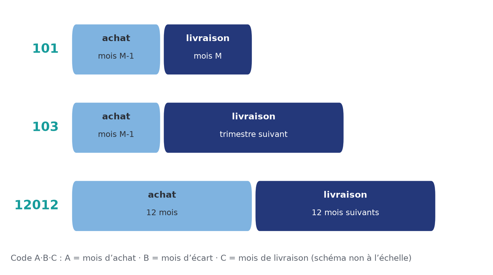
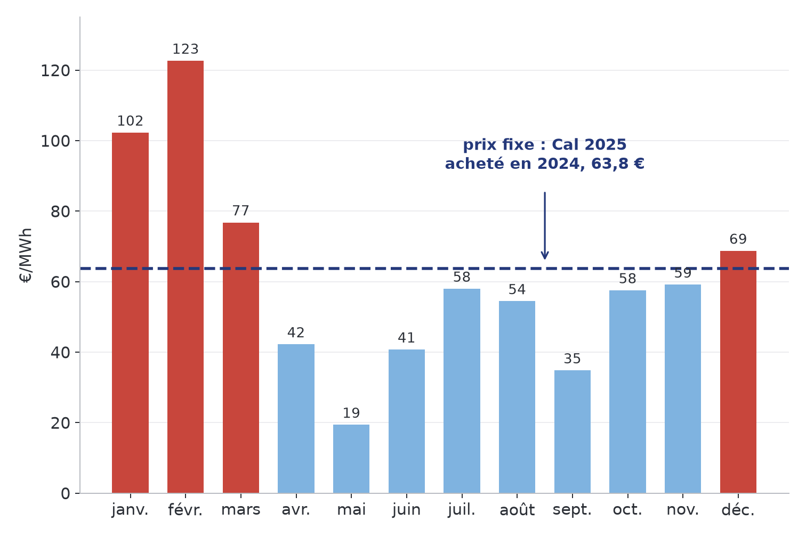
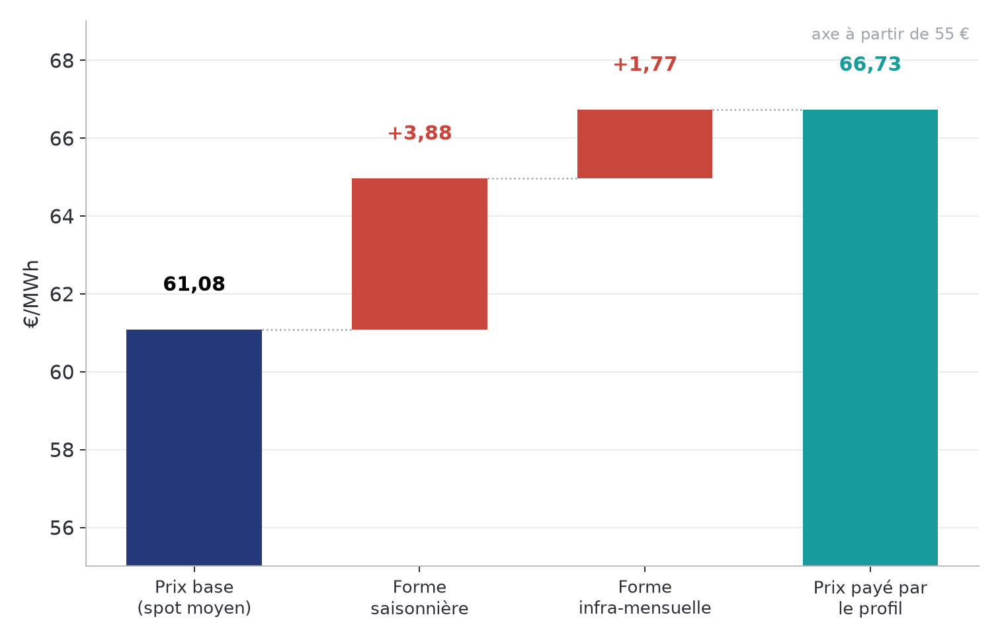
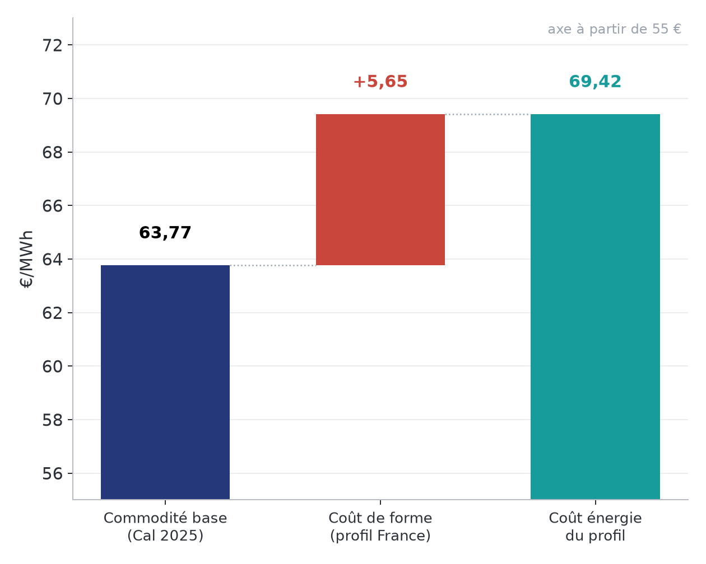

# Chapitre 14 à l'oral — le fournisseur et ses produits, version complète

*Pour Tom · 5 novembre 2026 · à lire à voix haute, environ 15 minutes*

Les chapitres 1 à 13 regardaient le marché depuis le parc : un producteur qui vend son profil. Ce chapitre fait le
chemin inverse. On se met à la place de celui qui **achète** sur le marché pour **revendre** à des clients : le
fournisseur. C'est le miroir du PPA. Le diaporama de référence est la partie 2 de ta formation,
`formation/partie2/Formation_partie2_fournisseur.pdf` (13 diapositives, citées « diapo n »).

## 1. Le métier du fournisseur
Un fournisseur porte trois casquettes, souvent dans la même entreprise (diapo 2) :
- **fournisseur face au client** : le contrat, le changement de fournisseur, la facture de tous les coûts ;
- **responsable d'équilibre face à RTE** : il doit équilibrer son périmètre au quart d'heure, et il paie les écarts ;
- **accès au marché** : il achète et vend l'énergie, en bourse (EEX pour le terme, EPEX SPOT pour le spot) ou de gré
  à gré.

**Un métier à haut risque et à faible marge.** La marge brute vaut environ **5 à 10 % de la facture** du client
(diapo 2, ordre de grandeur de ta formation, pas de source publique). Donc si l'énergie coûte 10 % de plus que
prévu, la marge disparaît.

D'où deux réflexes :
- **couvrir chaque vente aussitôt**, c'est le *back-to-back* : je vends un prix fixe à un client le matin, j'achète
  le même volume à terme dans la journée ;
- **facturer des primes de risque** pour ce qu'on ne peut pas couvrir.

**L'image.** Une agence de voyages qui vend des séjours à prix fixe un an à l'avance réserve les avions le jour même
où elle vend : si elle attend et que le kérosène flambe, elle vend à perte.

## 2. Les produits : qui porte le risque ?
Six produits (diapo 3). La question à poser à chaque fois : **qui porte le risque de prix, le client ou le
fournisseur ?**

- **Prix fixe.** Un prix connu à la signature, pour toute la durée. Le client ne porte aucun risque ; le
  fournisseur, beaucoup. Il facture donc des primes plus élevées.
- **Indexé spot.** Le client paie la moyenne mensuelle ou trimestrielle du day-ahead. Risque partagé. Le prix n'est
  connu qu'après la livraison.
- **Indexé forward.** Le client paie la moyenne des cotations à terme avant la livraison. Risque partagé, prix
  connu avant la livraison.
- **Dynamique.** Le client paie le day-ahead de chaque quart d'heure. Il porte presque tout le risque ; il faut un
  compteur communicant.
- **Click volume.** Le client fixe des blocs en MW quand il le veut ; le reste est au spot. Pour les grands clients
  qui suivent le marché.
- **Click %.** Chaque click fixe une **part** de la consommation, avec sa forme ; le reste au spot.

**Le code A·B·C des indexés forward** (diapo 5) :

- **A** = le nombre de mois pendant lesquels on achète, **B** = le nombre de mois d'écart, **C** = le nombre de mois
  livrés.
- **101** : on achète pendant le mois d'avant, on livre un mois. **103** : on achète pendant un mois, on livre le
  trimestre suivant. **12012** : on achète pendant douze mois, on livre les douze mois suivants.
- Comment le fournisseur se couvre : il achète **1/X du volume chaque jour de bourse**. Pour un 101 livré en
  octobre, s'il y a 21 jours de bourse en septembre, il achète 1/21 du volume chaque jour. Son prix d'achat moyen
  colle alors à la moyenne des cotations que paie le client.
- Le client porte le prix du marché ; le fournisseur garde les risques de **volume** et de **forme**.

**Le bon produit dépend du client** (diapo 6) : celui qui ne veut aucune surprise prend le fixe ; celui qui suit
les marchés prend un click ou un indexé ; celui qui peut déplacer sa consommation prend le dynamique, pour profiter
des heures à prix bas ou négatifs. Ce qui cannibalise le solaire (chapitre 2) est une
aubaine pour un client flexible.

## 3. Fixe ou spot ? L'exemple de 2025

*Prix day-ahead France (ENTSO-E). Cal 2025 base : moyenne des clôtures de 2024. La diapositive 4 cite EEX ; le
cours (chapitre 1) cite SEFE via la base PowerKlock, qui relaie ces cotations EEX. Calcul PowerKlock.*

- Un client au prix fixe a payé toute l'année le **Cal 2025, acheté pendant 2024 à 63,8 €/MWh** en moyenne (hors
  forme et frais).
- Au spot, il aurait payé **102 € en janvier, 123 € en février**, mais **19 € en mai**.
- Sur l'année, le spot moyen a été de **61,1 €**. Le fixe a coûté un peu plus, environ 2,7 €, en échange d'aucune
  surprise.

C'est la table du chapitre 1. Ces 2,7 € ne sont pas une « erreur » du fixe : c'est le prix de l'assurance. En 2026,
l'assurance a payé : Cal 2026 coté 59,5 €, spot 90,1 € de janvier à octobre (chapitre 1).

## 4. La couverture, pas à pas
Chaque vente à prix fixe est couverte aussitôt, puis **affinée jusqu'à la livraison** (diapo 7) :
1. **À la signature** : on achète l'année en ruban, le **Cal base**.
2. **L'année d'avant** : on ajuste par **trimestre**, parce que le client consomme plus en hiver.
3. **Le trimestre d'avant** : on ajuste par **mois**.
4. **La veille, à midi** : on ajuste au **quart d'heure** sur le **day-ahead**.
5. **Le jour même** : on corrige les prévisions en **intraday**.
6. **Après** : RTE facture ce qui reste, au **prix d'écart**.

**La position ouverte.** Position ouverte = achats + production − consommation.
- **Négative** : le fournisseur est **court** (*short*), il doit acheter.
- **Positive** : il est **long**, il doit revendre.
- **Nulle** : il est **plat** (*flat*).

À chaque étape, l'objectif est de ramener la position à zéro au meilleur prix.

**Le lien avec le pricer PPA.** Le pricer v2 fait la même chose, à l'envers. Il suppose que l'acheteur du PPA
**couvre le volume attendu au Cal** (chapitre 3) : il revend en ruban ce que le parc produira. Ensuite, comme le
parc produit à midi et en été, il est long à midi et court le soir : c'est le risque de forme. Le fournisseur a le
problème opposé : son client consomme l'hiver et le soir, il est court quand c'est cher.

## 5. Le coût de forme : le miroir du taux de capture
Un client ne consomme pas en ruban. Il consomme plus l'hiver et plus le matin et le soir. Donc il paie plus cher
que le prix base.

*Consommation RTE et prix day-ahead au quart d'heure, France, 2025 (35 036 quarts d'heure), calcul PowerKlock
(diapo 9).*

- **Coût de forme = prix pondéré par la consommation − prix base.**
- Prix base 2025 (spot moyen) : **61,08 €**. Prix payé par le profil de la consommation française : **66,73 €**.
  Écart : **+5,65 €/MWh**.
- Dont **saisonnier +3,88 €** : on consomme plus l'hiver, quand l'électricité est chère.
- Dont **infra-mensuel +1,77 €** : on consomme plus le matin et le soir qu'à midi, quand le solaire fait baisser
  les prix.

**C'est le miroir exact du taux de capture.** Un parc solaire produit quand c'est bon marché : sa capture est
**sous 1**. Le profil de consommation achète quand c'est cher : son « taux de capture » est **au-dessus de 1**,
66,73 ÷ 61,08 = **1,092**. Le solaire qui cannibalise le midi rend le midi moins cher pour tout le monde ; c'est
justement pour ça que la forme infra-mensuelle coûte au consommateur : il consomme peu à midi.

**Additif ou multiplicatif ?** Le diaporama ajoute le coût de forme au Cal (diapo 8) :

- Additif (diaporama) : 63,77 + 5,65 = **69,42 €**.
- Multiplicatif (comme le cours fait pour le PPA, forward × capture) : 63,77 × 66,73 ÷ 61,08 = 63,77 × 1,092 =
  **69,67 €**.
- Écart : **environ 0,25 €**.

Pourquoi deux réponses ? L'additif dit « la forme coûte 5,65 € quel que soit le niveau des prix ». Le multiplicatif
dit « la forme coûte 9,2 % du prix ». Quand le Cal est proche du spot, les deux se rejoignent (ici 63,8 contre 61,1,
donc 0,25 € seulement). Quand les prix doublent, l'écart double aussi. Pour le PPA, le pricer prend le ratio. Pour un
fournisseur, la règle n'est pas tranchée dans nos fichiers : retiens qu'il faut choisir une convention et la garder,
comme pour la capture.

**Le piège.** Le +5,65 € est mesuré après coup, sur le spot 2025. À la signature, le fournisseur ne le connaît pas :
il l'estime avec les prix à terme des mois et des produits pointe, et l'historique. Et chaque client a sa forme : un
bureau, une usine en 3×8 ou un logement chauffé à l'électricité n'ont pas le même coût. C'est pour ça qu'on le
calcule client par client.

## 6. Construire un prix fixe, et ses risques
**Prix = A × prix de référence + B** (diapo 8) :
- **A** multiplie ce qui suit le prix : la forme, l'équilibrage ;
- **B** ajoute ce qui n'en dépend pas : certificats, frais, marge.

Les étages : commodité base (63,8 € pour 2025), coût de forme (+5,7 €), primes de risque (volume, prix, écarts),
certificats (garanties d'origine, CEE), capacité, frais et marge.

**Trois risques** (diapo 10) :
- **Prix** : le spot s'écarte du forward. Effet ≈ (spot − forward) × forme réalisée.
- **Volume** : le client consomme plus ou moins. Effet ≈ (forward − spot moyen) × (volume réel − volume prévu).
  Exemple : un hiver doux, le client consomme moins ; le fournisseur revend au spot un volume qu'il avait acheté au
  forward. Si le spot est plus bas, il perd.
- **Forme** : le profil change. Effet ≈ forward × (forme réelle − forme prévue).

Trois remarques :
- Un contrat fixe porte le risque de volume **sur toute sa durée** ; un indexé 101 seulement **sur un mois**.
- Un produit dynamique n'a presque pas de risque à long terme.
- **Les trois risques se recoupent** : on les évalue ensemble, on ne les additionne pas. Un hiver froid fait monter
  à la fois la consommation, le prix et le poids des heures chères. Les trois tombent du même côté.

**Le lien avec le chapitre 11.** C'est la même logique que le P75 du pricer PPA : on tire des futurs où volume, prix
et forme bougent **ensemble**, on regarde la marge du fournisseur dans chaque futur, et la prime est l'écart entre
la marge moyenne et une marge prudente. Le pricer a mesuré une corrélation volume–capture (0,24 en solaire, 0,32 en
éolien) au lieu de la supposer ; pour un fournisseur, la corrélation température–consommation–prix joue le même rôle.

## 7. Les écarts côté fournisseur
Ce que la prévision n'a pas vu, RTE le facture au prix d'écart (diapo 11).
- **Pas de règlement : 15 minutes**, en France depuis le **1er janvier 2025** (avant : 30 minutes). C'est vérifié
  dans la délibération CRE 2025-153.
- Ne pas confondre avec le **day-ahead au quart d'heure**, qui date du **1er octobre 2025** (chapitre 5). Les écarts
  sont passés au quart d'heure d'abord, le marché la veille ensuite.
- **Volume d'écart** = prévision − volume alloué : mesuré au quart d'heure pour les compteurs communicants, profilé
  pour les autres.
- **Coût** = écart × (prix d'écart − day-ahead).

**Comment le réduire** :
- mieux prévoir (météo, historique du client) et corriger en intraday ;
- **regrouper des clients aux profils différents** : les erreurs se compensent. C'est l'effet portefeuille du
  chapitre 12, où l'éolien France entière coûtait 3,06 €/MWh avec la prévision du gestionnaire de réseau et 2,82 avec
  notre prévision combinée. Le diaporama ne donne pas de chiffre pour la consommation ;
- facturer le risque dans une **prime d'écart**, ou le laisser au client : l'option **pass-through**.

## 8. Ce que paie un client en France en 2026
L'énergie n'est qu'une partie de la facture (diapo 12). Le diaporama ne donne aucun montant pour les autres étages ;
voici ce qui est vérifié dans les textes officiels.

- **Énergie** : marché + forme + primes + marge, tout ce qui précède.
- **Capacité.** Nouveau mécanisme : RTE devient l'acheteur central des capacités, et les fournisseurs paient une
  **taxe de répartition des coûts**, dont la CRE fixe le montant unitaire et qui est répartie selon la consommation
  pendant la période de livraison. La **première période de livraison va de novembre 2026 à mars 2027** (CRE,
  délibération 2026-42 du 10 février 2026). Les jours de pointe sont choisis par RTE en hiver. Le montant 2026-27 a
  été fixé par la CRE le 10 septembre 2026 ; je ne l'ai pas lu dans le texte de la CRE, donc je ne le cite pas ici.
- **CEE, 6e période** : du **1er janvier 2026 au 31 décembre 2030** (décret 2025-1048 du 30 octobre 2025). Obligation
  totale de **1 050 TWhc par an**, dont 280 TWhc « précarité » (DGEC). Le coût par MWh d'électricité n'est pas
  publié par l'État.
- **Garanties d'origine** : pour les offres vertes, 1 GO = 1 MWh renouvelable.
- **TURPE 7** : le tarif de réseau, fixé par la CRE, **en vigueur depuis le 1er août 2025** pour environ quatre ans
  (délibérations 2025-39 et 2025-40).
- **Accise** sur l'électricité : **30,85 €/MWh** pour les ménages et assimilés à partir du 1er février 2026 (BOFiP,
  majoration outre-mer comprise). La loi de finances 2026 l'a ensuite baissée au 1er août 2026 ; ce nouveau niveau,
  je ne l'ai pas trouvé dans un texte officiel.
- **TVA** : 20 % sur tout, abonnement compris, depuis le 1er août 2025 (le taux réduit de 5,5 % sur l'abonnement a
  été supprimé par la loi de finances 2025).

**La fin de l'ARENH.** Jusqu'au 31 décembre 2025, les fournisseurs achetaient une part du nucléaire d'EDF à
**42 €/MWh**. Pour un client au tarif réglementé, l'ARENH couvrait **43,8 %** de la consommation en 2025 (CRE).
Depuis 2026, tout s'achète au marché : le tarif réglementé lisse ses achats sur deux ans, **63,9 €/MWh** d'énergie
en 2026 contre **103,0** en 2025 (CRE, dossier couplage). Le **VNU** reverse aux consommateurs une partie des
revenus nucléaires d'EDF au-dessus de **78 €/MWh** (et plus fort au-dessus de **110**). Pour 2026, la CRE estime ce
revenu à **66,08 €/MWh** : rien à reverser.

## À retenir
1. Le fournisseur vend à prix fixe ce qu'il achète à prix variable : son métier, c'est gérer ce risque, avec 5 à
   10 % de marge.
2. Il couvre chaque vente aussitôt : Cal, puis trimestres, mois, day-ahead, intraday ; RTE facture le reste.
3. Prix d'un client = commodité base + coût de forme + risques + certificats + capacité + marge, puis réseau et
   taxes.
4. Le coût de forme de la consommation française valait +5,65 €/MWh en 2025 : c'est le miroir du taux de capture
   d'un parc.
5. Les risques de prix, volume et forme vont ensemble : on les évalue ensemble, comme le P75.
6. Les écarts sont réglés au quart d'heure depuis janvier 2025 : bien prévoir et mélanger les clients, c'est
   gagner de la marge.

## Question pour vérifier
Un client industriel te demande en novembre 2026 un prix fixe pour 2027. Il consomme surtout l'hiver, en journée.
- (a) Son coût de forme sera-t-il plus haut ou plus bas que les +5,65 € de la consommation française ? Pourquoi ?
- (b) Si le Cal 2027 coûte 20 % de plus que le spot de référence, l'écart entre la méthode additive et la méthode
  multiplicative grandit-il ou rétrécit-il ?
- (c) Un hiver très froid : quels risques jouent, et dans quel sens ?

*Réponse attendue :*
- (a) la saison pèse plus lourd (hiver) : plus haut côté saisonnier. Côté heures, la journée inclut le creux de midi
  du solaire, ce qui le tire vers le bas. Au total, sans doute plus haut, mais il faut le calculer avec sa courbe.
- (b) il grandit : l'écart vaut à peu près (Cal − spot de référence) × 9 %.
- (c) volume et prix ensemble : il consomme plus, au moment où le spot est haut. Le fournisseur, court, rachète cher.
  Les risques s'ajoutent dans le même sens : c'est pour ça qu'on ne les additionne pas comme s'ils étaient
  indépendants.

## Pour aller plus loin
- CRE, délibération 2025-153 (passage du règlement des écarts de 30 à 15 minutes au 1er janvier 2025) —
  https://www.cre.fr/fileadmin/Documents/Deliberations/2025/250611_2025-153_ISP15.pdf
- CRE, délibération 2026-42 (méthodologie du nouveau mécanisme de capacité, période novembre 2026 – mars 2027) —
  https://www.cre.fr/fileadmin/Documents/Deliberations/2026/260210_2026-42_Methodologie_mecanisme_capacite.pdf
- CRE, délibérations TURPE 7 HTB (2025-39) et HTA-BT (2025-40), en vigueur au 1er août 2025 —
  https://www.cre.fr/fileadmin/Documents/Deliberations/2025/250204_2025-39_TURPE_7_HTB.pdf et
  https://www.cre.fr/fileadmin/Documents/Deliberations/2025/250204_2025-40_TURPE_7_HTA-BT.pdf
- Décret 2025-1048 du 30 octobre 2025 (6e période des CEE) —
  https://www.legifrance.gouv.fr/jorf/id/JORFTEXT000052486193 ; DGEC, webinaire P6 du 2 décembre 2025 —
  https://www.ecologie.gouv.fr/sites/default/files/documents/2025-12-02%20Webinaire%20DGEC%20P6%20CEE%20vweb.pdf
- BOFiP, tarifs d'accise sur l'électricité 2026 — https://bofip.impots.gouv.fr/bofip/14903-PGP.html
- Médiateur national de l'énergie, TVA au 1er août 2025 —
  https://www.energie-info.fr/hausse-de-la-tva-les-changements-le-1er-aout-2025-sur-vos-factures-denergie/
- CRE, TRVE 2026 (fin de l'ARENH) — https://www.cre.fr/fileadmin/Documents/Deliberations/2026/260114_2026-06_TRVE_2026.pdf ;
  VNU 2026 — https://www.cre.fr/fileadmin/Documents/Deliberations/2026/260226_2026-52_Tarif_unitaire_minoration_du_vnu_2026.pdf
- Diaporama : `docs/discussion/formation/partie2/Formation_partie2_fournisseur.pdf` ; dossier couplage, diapositives
  19 et 25.
