# Le cours à l'oral — les 13 chapitres en entier

*Pour Tom · PowerKlock · 1er novembre 2026 · environ 15 minutes par chapitre*

Chaque chapitre se lit seul et finit par une question pour vérifier.

## Chapitre 1 à l'oral — les bases : prix spot, merit order, forward, prix négatifs, version complète

*Pour Tom · 1er novembre 2026 · à lire à voix haute, environ 15 minutes*

### 1. Le prix spot : une enchère chaque jour
L'électricité se stocke mal. Ce qui est produit doit être consommé au même moment. Il faut donc décider, chaque
jour, qui produit quoi le lendemain, et à quel prix. C'est le rôle de l'**enchère de la veille** (le *day-ahead*).
Le prix qui en sort s'appelle le **prix spot**.

Comment ça se passe :
- Chaque jour, avant **midi** (heure de Paris), les producteurs et les acheteurs déposent leurs offres pour le
  lendemain, auprès des bourses (EPEX, Nord Pool…).
- Les vendeurs disent : « je produis tant de MWh, à partir de tel prix ».
- Les acheteurs disent : « j'achète tant de MWh, jusqu'à tel prix ».
- Depuis le **1er octobre 2025**, il y a une offre par **quart d'heure**. Avant, c'était par heure.
- Un seul programme, **Euphemia**, calcule les prix de toute l'Europe d'un coup (le couplage, SDAC). On le verra au
  chapitre 5.
- Le prix est borné : pas plus de **4 000 €/MWh**, pas moins de **−600 €/MWh** (−500 jusqu'au 28 mai 2026).

L'image : un grand marché aux enchères qui ferme tous les jours à midi, et qui fixe en une fois les prix des 96
quarts d'heure du lendemain.

**Une unité, pour ne pas se perdre.** Un MWh, c'est un mégawattheure : une puissance d'un mégawatt pendant une heure.
Les prix sont toujours en euros par MWh (€/MWh).

### 2. Le merit order : l'escalier des centrales
Comment l'enchère trouve-t-elle le prix ? On range les offres de vente de la moins chère à la plus chère. Ça forme un
escalier : c'est le **merit order**, « l'ordre de mérite ».

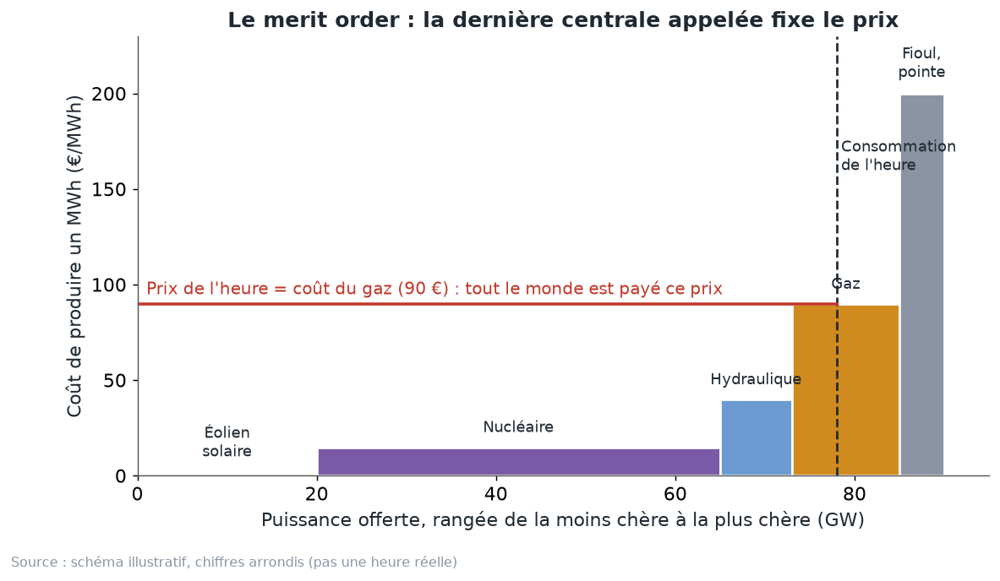

Sur le schéma (chiffres arrondis, pas une heure réelle) :
- d'abord le **vent et le soleil**, presque gratuits : pas de combustible ;
- puis le **nucléaire**, peu cher à faire tourner ;
- puis l'**hydraulique** ;
- puis le **gaz** ;
- tout au bout, le **fioul** et les centrales de pointe.

On trace la consommation de l'heure : un trait vertical. On monte l'escalier jusqu'à ce trait. **La dernière marche
dont on a besoin fixe le prix.** Sur le schéma, c'est le gaz, à 90 €.

**Et tout le monde touche ce prix.** L'éolienne, qui ne coûte presque rien, est payée 90 € comme la centrale à gaz.
On appelle ça le prix marginal, ou *pay-as-clear*. C'est comme au marché aux fruits : le dernier cageot vendu fixe le
prix de tous les cageots.

**Pourquoi chaque centrale offre à son coût variable.** Le coût variable, c'est ce que coûte un MWh de plus :
surtout le combustible et le CO2.
- Si une centrale offre plus cher que ce coût, elle risque de ne pas être appelée, alors qu'elle aurait gagné de
  l'argent.
- Si elle offre moins cher, elle risque de produire à perte.
- Le plus simple pour elle, c'est donc d'offrir à son vrai coût.

**Le coût d'une centrale à gaz**, la formule qu'on utilise (dossier couplage, `methodologie.md`) :
- coût ≈ prix du gaz (TTF) ÷ 0,55 + 0,37 × prix du CO2 (EUA) ;
- on divise par 0,55 parce que la centrale transforme 55 % de l'énergie du gaz en électricité ;
- on ajoute 0,37 tonne de CO2 par MWh produit, qu'il faut payer.

Pour le charbon : prix du charbon (API2) ÷ 0,38 + 0,90 × prix du CO2.

Notre calcul donne un coût moyen d'une centrale à gaz de **127 €/MWh de janvier à octobre 2026**, contre **96 €
sur les mêmes mois de 2025** (calcul `calc.py`, prix SEFE). C'est la crise du gaz de 2026 (chapitre 8).

**L'exception : l'eau des barrages.** L'eau ne coûte rien, mais elle est rare : un lac ne se remplit pas sur
commande. Le barrage n'offre donc pas à zéro. Il offre à la **valeur d'usage** de l'eau : ce qu'il gagnerait en la
gardant pour plus tard, par exemple pour un soir d'hiver. Comme quelqu'un qui garde sa dernière bouteille d'eau dans
le désert : elle ne lui a rien coûté, mais il ne la vend pas pour trois sous.

**Ce qu'il faut garder en tête pour la France.** Le gaz fixe souvent le prix, même quand la France n'en brûle presque
pas, parce qu'elle est reliée à ses voisins. Même quand la France est coupée de l'Allemagne, son prix reste
proportionnel au coût du gaz : en moyenne environ **0,6 fois** ce coût dans les heures coupées de 2025 et de 2026
(débrief du 31 octobre). On y revient aux chapitres 6 et 7.

### 3. Le forward : fixer le prix à l'avance
Le spot, c'est le prix du lendemain. Mais un industriel, ou un parc solaire, veut souvent connaître son prix des
mois ou des années à l'avance. Pour ça, il y a le **forward**.

Un forward, c'est un contrat signé aujourd'hui pour une livraison future, à un prix fixé aujourd'hui. On peut
acheter :
- un **mois** ;
- un **trimestre** ;
- une **année civile** entière : on l'appelle le **Cal** (pour *calendar*). « Cal 2027 », c'est toute l'année 2027.

Et deux formes :
- **base** : le même MW à toutes les heures, jour et nuit, semaine et week-end ;
- **pointe** : de 8 h à 20 h, en semaine seulement.

L'image : **réserver une chambre d'hôtel six mois avant**. On fixe le prix tout de suite. Parfois on paie trop, parfois
on a fait une affaire. Mais on sait à quoi s'attendre.

**Le forward est un pari, et il se trompe dans les deux sens.**

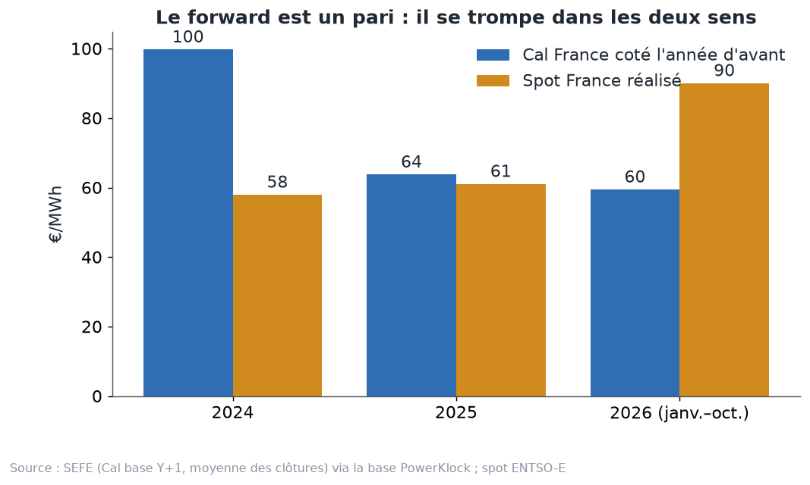

| Livraison | Cal France coté l'année d'avant | Spot réalisé |
|---|---|---|
| 2024 | 99,8 | 58,0 |
| 2025 | 63,8 | 61,1 |
| 2026 | 59,5 | 90,1 (janvier–octobre) |

Source : SEFE via la base PowerKlock (moyenne des clôtures de l'année d'avant), spot ENTSO-E (`couplage/forwards.json`).

- En 2024, le marché avait coté presque 100 €, et le spot a fini à 58 €. Celui qui avait acheté à l'avance a payé
  cher.
- En 2025, le forward a vu juste, à 3 € près.
- En 2026, c'est l'inverse de 2024 : coté 60, réalisé 90.

**Le forward bouge vite.** Le Cal 2027 France a été coté en moyenne **64,8 €** de janvier à fin octobre 2026
(`forwards.json`). Le 30 octobre 2026, il clôturait à **128,16 €** (`pricing-v2/parametres.md`), soit environ le
double de sa moyenne de l'année. Les Cal suivants sont bien plus bas : **70,94 €** pour 2028 et **62,97 €** pour 2029
(même source). Le marché parie donc sur une année 2027 chère, puis un retour au calme. Ce n'est qu'un pari.

**Le forward voit déjà le découplage de la France.** L'écart entre le Cal France et le Cal Allemagne est passé de
**+3 €/MWh** pour la livraison 2024 à **−37 €** pour la livraison 2027 (`couplage/forwards.json`) : la France est
attendue nettement moins chère que l'Allemagne.

**Pourquoi c'est central pour un PPA.** Le prix d'un PPA part du forward (chapitre 3). Si le forward bouge de 10 €,
le prix du PPA bouge presque d'autant. C'est le premier étage de la fusée.

### 4. Les prix négatifs : on paie pour qu'on vous prenne l'électricité
Un prix négatif, c'est un monde à l'envers : le producteur **paie** pour livrer. Pourquoi accepterait-il ?

Parce que s'arrêter lui coûterait encore plus cher. Qui est dans ce cas :
- un **réacteur nucléaire** qui ne peut pas baisser plus vite, ou plus bas ;
- un **parc sous obligation d'achat**, ou sous un ancien complément de rémunération : il est payé par l'État quel
  que soit le prix du marché, donc il n'a pas de raison de s'arrêter ;
- une **cogénération**, qui doit produire de la chaleur pour une usine ou un réseau de chauffage, et produit de
  l'électricité en même temps.

L'image : un **embouteillage sur une autoroute sans sortie**. Trop de voitures arrivent en même temps, et certaines ne
peuvent pas faire demi-tour. Alors on paie ceux qui acceptent de se retirer.

Quand ça arrive : surtout à **midi, au printemps et en été**, quand le soleil produit beaucoup, que la consommation est
modérée, et que le nucléaire ne peut pas descendre plus bas.

**Les chiffres.**

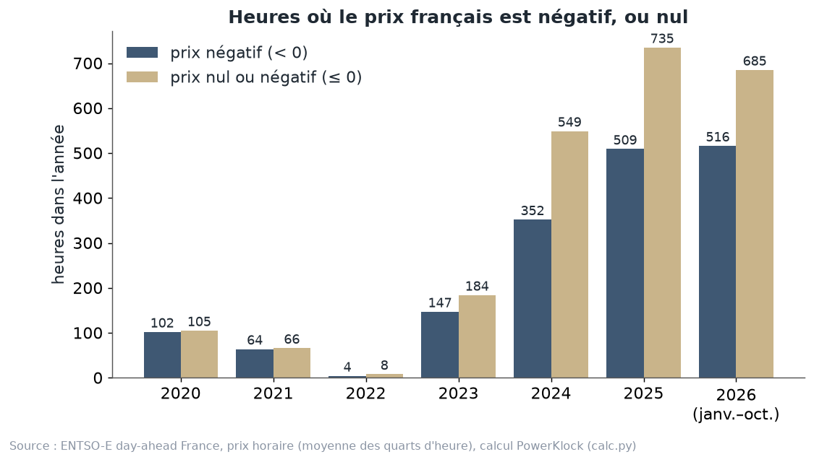

| | 2023 | 2024 | 2025 | 2026 (janv.–oct.) |
|---|---|---|---|---|
| Heures à prix négatif (< 0) | 147 | 352 | 509 | 516 |
| Heures à prix nul ou négatif (≤ 0) | 184 | 549 | 735 | 685 |

Source : ENTSO-E, prix horaire = moyenne des quarts d'heure, calcul PowerKlock (`calc.py`).

- RTE compte **352** heures négatives en 2024 et **513** en 2025 : notre comptage retombe dessus.
- RTE en compte déjà **407 au premier semestre 2026**, contre 363 au premier semestre 2025.
- Deux records en 2026 : **−478,8 €/MWh le 26 avril** et **−498,7 €/MWh le 1er mai** (RTE, bilan du premier
  semestre 2026).
- En 2025, il y a eu **225 heures à exactement 0 €** (`parametres.md`). C'est pour ça que « négatif » et « nul ou
  négatif » donnent des chiffres si différents.

**Le piège : compter au quart d'heure.** Depuis le 1er octobre 2025, il y a un prix par quart d'heure. Si on fait
d'abord la moyenne de chaque heure, on perd les quarts d'heure négatifs d'une heure dont la moyenne reste positive.

| Prix nuls ou négatifs en 2026 (janvier–octobre) | Heures |
|---|---|
| Comptés au quart d'heure (nombre de quarts d'heure ÷ 4) | **805** |
| Comptés sur la moyenne de chaque heure | 670 |
| pv magazine, 2 octobre 2026 | « environ 800 » |

C'est le comptage au quart d'heure qui retombe sur pv magazine. **Désormais, on compte au quart d'heure.**

L'image : une classe où un élève a 2 sur 20 et un autre 18. La moyenne de 10 cache celui qui a 2. La moyenne de
l'heure cache de la même façon le quart d'heure négatif.

**Les parcs commencent à s'arrêter.** D'après RTE (bilan 2025), l'éolien et le solaire ont réduit leur production
pendant les prix négatifs deux fois plus en 2025 : environ **3 TWh**, dont 1,3 pour l'éolien et 1,6 pour le solaire.
Un parc qui vend au prix du marché a intérêt à s'arrêter quand le prix passe sous zéro.

**Et le nucléaire ?** Une correction importante (déjà faite dans le cours, à ne pas oublier) :
- au printemps 2026, le nucléaire a moins baissé sa production qu'en 2025 (environ 10 TWh de modulation contre près
  de 20 TWh) ;
- la raison, c'est le **cycle du combustible** : le minimum technique du parc était d'environ **31 GW le 1er mai
  2026**, contre **19 GW** un an plus tôt (RTE, bilan du premier semestre 2026) ;
- ce n'est **pas** l'accord RTE–EDF du 27 mars 2026, qui sert à régler la tension du réseau et dont RTE juge le rôle
  « marginal » (CRE, délibération 2026-67).

Une recherche récente va dans le même sens : en 2024, les heures où toute la souplesse disponible du nucléaire était
utilisée correspondent à des prix nuls ou négatifs (Astier et Wolak, NBER, janvier 2026, cité dans le débrief).

### 5. Ce que ça change pour un PPA
Trois idées à emporter vers les chapitres suivants :
- **Le merit order explique la cannibalisation.** Quand le soleil produit beaucoup, il pousse le gaz hors de
  l'escalier, et le prix tombe. Le solaire fait donc baisser le prix des heures où il produit (chapitre 2).
- **Le forward est le point de départ du prix d'un PPA**, et il se trompe. D'où une prime de risque (chapitre 3).
- **Les heures négatives tombent en plein cœur de la production solaire.** Dans le pricer, la production n'est pas
  payée quand le prix est négatif ou nul (chapitre 3). Plus il y a d'heures ≤ 0, plus le MWh solaire perd de la
  valeur.

### À retenir
1. Une enchère chaque jour avant midi, un prix par quart d'heure depuis octobre 2025.
2. Merit order : on range les centrales de la moins chère à la plus chère ; la dernière nécessaire fixe le prix, et
   tout le monde touche ce prix.
3. Chaque centrale offre à son coût variable ; le barrage offre à la valeur de son eau.
4. Le forward fixe le prix à l'avance ; il se trompe dans les deux sens (100 coté, 58 réalisé en 2024 ; 60 coté,
   90 réalisé en 2026).
5. Prix négatif = trop de production qui ne peut pas ou ne veut pas s'arrêter. 147 heures en 2023, 509 en 2025.
6. Depuis octobre 2025, on compte les prix négatifs au quart d'heure : 805 heures ≤ 0 en 2026, pas 670.

### Question pour vérifier
Imagine un dimanche de mai, à 13 h, très ensoleillé, avec peu de consommation.
- (a) Quelle centrale est probablement la dernière marche de l'escalier, et pourquoi le prix peut-il passer sous
  zéro ?
- (b) Si le prix d'une heure est +5 €, mais que deux de ses quarts d'heure sont à −20 €, combien de « temps à prix
  négatif » compte-t-on avec chaque méthode ?
- (c) Un acheteur a pris du Cal 2026 à 59,5 €. Le spot a fini à 90 €. A-t-il gagné ou perdu, par rapport à acheter au
  spot ?

### Pour aller plus loin
- EPEX SPOT et al., *Euphemia public description* —
  https://www.mercatoelettrico.org/EN/MenuBiblioteca/Documenti/20181212EuphemiaPublicDescription.pdf
- RTE, *Bilan électrique 2025* —
  https://assets.rte-france.com/prod/public/2026-02/Bilan-electrique-2025-principaux-resultats.pdf
- RTE, *Bilan du système électrique, premier semestre 2026* (prix négatifs, p. 33 et suivantes) —
  https://assets.rte-france.com/prod/public/2026-07/2026-07-16-bilan-semestre1.pdf
- pv magazine, 2 octobre 2026, « France hits record 800 hours of negative, zero electricity prices » —
  https://www.pv-magazine.com/2026/10/02/france-hits-record-800-hours-of-negative-zero-electricity-prices/
- CRE, délibération n° 2026-67 du 27 mars 2026 —
  https://www.cre.fr/fileadmin/Documents/Deliberations/2026/260327_2026-67_Approbation_Accord_Injection_THT.pdf
- Dossier PowerKlock : `docs/discussion/cours/calc.json`, `docs/discussion/couplage/forwards.json`,
  `docs/discussion/couplage/methodologie.md`.

## Chapitre 2 à l'oral — capture et cannibalisation, version complète

*Pour Tom · 1er novembre 2026 · à lire à voix haute, environ 15 minutes*

### 1. Un MWh n'a pas la même valeur à toutes les heures
Au chapitre 1, on a vu que le prix change à chaque quart d'heure. Un MWh produit un soir d'hiver vaut beaucoup. Un
MWh produit un dimanche de mai à 13 h vaut presque rien, parfois moins que rien.

Un parc solaire ou éolien ne choisit pas ses heures. Il produit quand il y a du soleil ou du vent. La question est
donc simple : **combien vaut, en moyenne, un MWh de ce parc**, comparé au prix moyen de l'année ?

L'image : **le marchand de glaces sur la plage**. Seul, il vend ses glaces cher. Si vingt marchands arrivent sur la
même plage, à la même heure, le prix des glaces baisse pour tout le monde. Le soleil, c'est pareil : tous les
panneaux de France produisent en même temps, à midi.

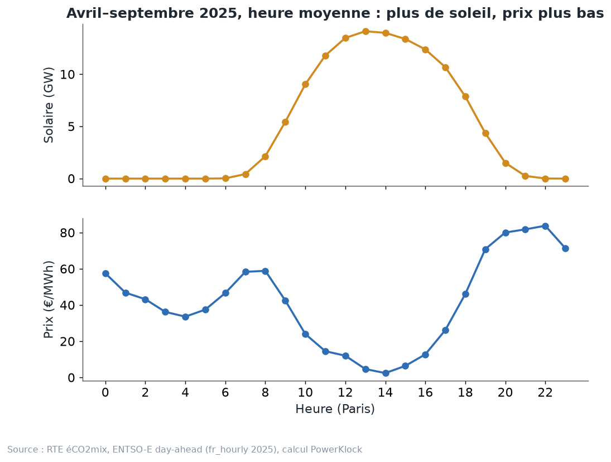

Regarde le schéma (heure moyenne, avril à septembre 2025, RTE éCO2mix et ENTSO-E) :
- en haut, la production solaire monte le matin, culmine vers 13 h, redescend le soir ;
- en bas, le prix fait exactement l'inverse : il est au plus bas en début d'après-midi, et remonte le soir quand le
  soleil se couche ;
- les deux courbes sont **en miroir**.

### 2. Le taux de capture : la formule, en mots simples
Trois quantités, pour un parc qui produit une certaine quantité à chaque heure :
- **La valeur du MWh du parc (V).** On multiplie la production de chaque heure par le prix de cette heure, on
  additionne, et on divise par la production totale. C'est une moyenne des prix **pondérée par la production** : les
  heures où le parc produit beaucoup comptent beaucoup.
- **Le prix de base (B).** La moyenne simple des prix de toutes les heures. C'est ce que vaudrait un MWh « plat »,
  produit pareil à toutes les heures.
- **Le taux de capture (c) = V ÷ B.**

Si la capture vaut 1, le MWh du parc vaut le prix moyen. Si elle vaut 0,56, il vaut 56 % du prix moyen.

L'image : **un bulletin scolaire avec coefficients**. La moyenne simple de l'année, c'est B. Mais le parc a mis ses
plus gros coefficients sur les matières où il a les plus mauvaises notes (les midis d'été). Sa moyenne pondérée, V,
est donc plus basse.

**Pourquoi V et B diffèrent.** On peut écrire :
V = B + (lien entre production et prix) ÷ production moyenne.

Ce « lien », les statisticiens l'appellent la **covariance**. En mots :
- si le parc produit plutôt aux heures chères, le lien est positif, et V dépasse B ;
- s'il produit plutôt aux heures bon marché, le lien est négatif, et V tombe sous B.

Le solaire produit aux heures où le prix baisse : le lien est négatif, sa capture passe sous 1.

**La convention du site.** La production aux heures où le prix est négatif ou nul n'est pas payée : ces MWh sont
perdus. Le site publie la capture « payée » : la valeur des MWh produits aux heures à prix positif, divisée par la
base. (Le pricer passe à « non payé seulement si le prix est strictement négatif » : chapitre 3.)

### 3. Les vrais chiffres en France

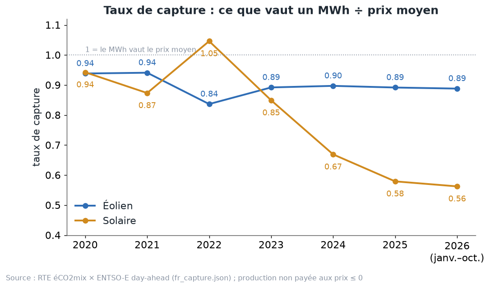

Capture « payée » (RTE éCO2mix × ENTSO-E, `data/history/fr_capture.json`) :

| | 2020 | 2021 | 2022 | 2023 | 2024 | 2025 | 2026 (janv.–oct.) |
|---|---|---|---|---|---|---|---|
| Éolien | 0,94 | 0,94 | 0,84 | 0,89 | 0,90 | 0,89 | 0,89 |
| Solaire | 0,94 | 0,87 | 1,05 | 0,85 | 0,67 | 0,58 | 0,56 |

Comment le lire :
- **Le solaire s'effondre** : de 0,85 en 2023 à 0,58 en 2025, puis 0,56 sur les dix premiers mois de 2026. Un MWh
  solaire vaut un peu plus de la moitié d'un MWh moyen.
- **2022 est à part** : le solaire est au-dessus de 1. Cette année-là, le soleil produisait pendant des heures chères
  (crise du gaz et nucléaire très bas). C'est pour ça que le générateur de scénarios exclut 2022 de ses années
  d'apprentissage (chapitre 9).
- **L'éolien tient** autour de 0,89 : il perd peu.

**Le lien avec les prix négatifs.** La chute du solaire depuis 2023 suit la montée des heures à prix nul ou négatif
(chapitre 1) : 184 heures en 2023, 735 en 2025. En 2025, ces heures tombaient presque toutes à midi, au printemps et
en été (`cours_detail.md`), c'est-à-dire au cœur de la production solaire.

### 4. La cannibalisation : les parcs se mangent entre eux
Quand la capture baisse **parce qu'il y a de plus en plus de parcs**, on parle de **cannibalisation**. Chaque nouveau
panneau ajoute de la production aux mêmes heures, ce qui fait encore baisser le prix de ces heures, pour lui et pour
tous les autres.

Le lien avec le merit order (chapitre 1) : à midi, le solaire pousse les centrales chères hors de l'escalier. La
dernière marche est plus basse, donc le prix aussi. Plus il y a de solaire, plus on descend l'escalier, jusqu'au
sous-sol : les prix négatifs.

**Ce que dit la recherche.**
- **Hirth (2013)**, la référence : la valeur du vent passe de **110 %** à **50 à 80 %** du prix moyen quand sa part
  dans la production passe de 0 à 30 %.
- **Stiewe, Xu, Eicke et Hirth** (30 zones européennes, 2015–2023) : ce sont aussi **les parcs des voisins** qui
  cannibalisent. Pour le vent, un point de pénétration chez les voisins enlève 0,49 point de valeur, presque autant
  que chez soi (0,62). Pour le solaire, c'est même plus fort chez les voisins : 2,38 contre 1,39. On appelle ça la
  « cannibalisation transfrontalière ».

L'image : la plage n'est pas fermée. Les marchands de glaces de la plage d'à côté vendent aussi à vos clients.

### 5. Pourquoi l'éolien résiste mieux, et pourquoi il faut rester prudent
L'éolien perd moins de valeur que le solaire, pour deux raisons :
- **le vent ne souffle pas partout en même temps** : la production est plus étalée que celle du soleil, qui culmine
  partout à midi ;
- **il souffle plus l'hiver et la nuit**, quand on consomme beaucoup et que les prix sont plus hauts.

Mais l'éolien n'est pas à l'abri :
- en 2025, **67,5 %** de la production éolienne française est tombée dans des heures où la France était coupée de ses
  voisins (débrief du 31 octobre) ;
- dans ces heures-là, le vent français fait baisser le prix français, et lui seul ;
- d'une année à l'autre, la valeur réelle de l'éolien a baissé plus que tous nos modèles ne le prévoyaient. Sans
  recalage sur la dernière année réelle, tous les modèles le surévaluent d'environ 2 à 2,7 €/MWh
  (`pricing-v2/choix_v2.md`). C'est une vraie incertitude, pas résolue.

### 6. La méthode en 3 étapes : profil, puis cannibalisation
Ta méthode découpe la différence entre V et B en deux morceaux.

**Étape 1, le forward.** Le prix d'un MWh plat. C'est B (on le verra au chapitre 3).

**Étape 2, le profil : l'effet calendrier.** On découpe l'année en cases « mois × heure » (par exemple : juillet,
13 h). Dans chaque case, on prend la production moyenne du parc et le prix moyen. Le profil, c'est ce que le parc
gagnerait si, **à l'intérieur de chaque case**, les prix n'avaient aucun lien avec sa production. Le soleil produit à
midi l'été, et les midis d'été sont plutôt bon marché : le profil coûte déjà quelque chose.

**Étape 3, la cannibalisation : l'effet foule.** C'est le reste. À l'intérieur d'une même case, les heures où le parc
produit plus sont moins chères, **justement parce que** lui et ses semblables produisent. Un mardi de juillet très
ensoleillé à 13 h est moins cher qu'un mardi de juillet nuageux à 13 h.

L'image : le profil, c'est savoir que **les glaces se vendent moins cher l'été** ; la cannibalisation, c'est
constater que **les jours de grand soleil**, quand tous les marchands sont sur la plage, elles se vendent encore moins
cher.

**Les vrais chiffres du pricer** (`pricing-v2/parametres.md`, calculés avant le passage à la règle « strictement
négatif ») :

| €/MWh | Profil mensuel | Cannibalisation horaire |
|---|---|---|
| Solaire | −5,97 | −26,82 |
| Éolien | +7,87 | −10,68 |

Comment le lire :
- pour le **solaire**, le profil coûte un peu (environ 6 €), mais la cannibalisation coûte beaucoup plus (environ
  27 €) : le problème, ce n'est pas l'été, ce sont les midis où tout le monde produit ;
- pour l'**éolien**, le profil **rapporte** (environ +8 €) : le vent souffle plus l'hiver, quand les mois sont chers.
  Mais la cannibalisation reprend environ 11 € ;
- la somme des deux donne la décote totale du prix capté.

Ici, le profil est mesuré par les forwards des mois comparés au Cal, et la cannibalisation par les heures à
l'intérieur du mois (`parametres.md`).

**Tu n'es pas seul à découper comme ça.** Chatziandreou et Karbach (arXiv 2607.27814, juillet 2026) écrivent le prix
juste d'un PPA pay-as-produced comme : forward base + correction de profil + correction du lien prix-volume. C'est la
même décomposition. Leur calibrage porte sur l'Allemagne 2023–2024, pour des PPA courts.

**Un piège connu, évité par construction.** Modo Energy montre que si la météo du profil de production n'est pas la
même que celle des prix, on sous-estime la cannibalisation, et on surestime les revenus de plus de 10 % en 2045. Le
générateur PowerKlock tire production et prix dans les mêmes semaines réelles : ils sont alignés (débrief du
31 octobre).

### 7. Les pièges : il y a plusieurs captures
**Le plus grand piège : la capture a plusieurs définitions.** Exemple vécu avec l'éolien :
- **0,89** en 2025 : la capture « payée » nationale du site (tableau plus haut) ;
- **0,923** en 2025 : le calcul du pricer, dans sa convention « curt ». On prend la capture des MWh payés mois par
  mois, puis la moyenne pondérée par la production ;
- **0,936 → 0,976** de 2025 à 2026 : la même convention, mais sur janvier–octobre seulement (year to date) ;
- **0,971 → 0,976** : d'un seul bloc sur janvier–octobre ;
- **0,891 → 0,888** : avec toute la production comptée, même celle des prix ≤ 0.

Aucun de ces chiffres ne vient de RTE : RTE ne publie pas de taux de capture. **On ne compare que des chiffres de même
définition** (`SESSION_DISCUSSION.md`).

**Deuxième piège : le year to date n'est pas l'année entière.** Dans la convention du pricer, l'année entière finit
toujours un peu sous le cumul à fin octobre : 0,906 en 2024 et 0,923 en 2025. Les deux derniers mois changent donc le
résultat ; on n'a pas isolé précisément pourquoi. Pour pricer, on s'ancre sur une année civile complète, pas sur un cumul partiel.

**Troisième piège : la base.** La capture dépend du prix moyen choisi : spot de l'année, forward, ou spot des seules
heures payées.

**Quatrième piège : un parc n'est pas la France.** Un vrai parc n'a pas le profil national. Sa capture peut s'écarter
de plusieurs points selon sa région et son orientation. Test sur les régions RTE en solaire : partir du national et
ajouter l'écart propre du parc se trompe de 1,2 point, contre 5,5 points en regardant le parc seul
(`parametres.md`).

**Une nuance utile : la décote est surtout un montant en euros.** Quand le prix de base monte d'un euro, le prix capté
monte d'environ 0,96 € en solaire et 0,95 € en éolien (même mois d'une année sur l'autre, trois dernières années,
`parametres.md`). Autrement dit, la décote en euros bouge peu quand les prix montent. Elle se comporte moins comme un
pourcentage fixe qu'on pourrait le croire. C'est mesuré, pas certain : sur 2024–2025 seul, on trouve 0,84 en solaire.

### À retenir
1. Capture = valeur du MWh du parc ÷ prix moyen. En dessous de 1, le parc produit plutôt aux heures bon marché.
2. Le solaire est passé de 0,85 (2023) à 0,58 (2025) et 0,56 (2026, janvier–octobre). L'éolien tient vers 0,89.
3. Cannibalisation : plus il y a de parcs qui produisent aux mêmes heures, plus ces heures sont bon marché. Les
   parcs des voisins comptent presque autant que les nôtres.
4. Méthode en 3 étapes : forward, profil (l'effet calendrier), cannibalisation (l'effet foule). En solaire, c'est la
   cannibalisation qui coûte le plus.
5. Toujours dire quelle capture on utilise, et ne comparer que des chiffres de même définition et sur des années
   complètes.

### Question pour vérifier
Imagine qu'on ajoute beaucoup de batteries en France, qui se chargent à midi et se déchargent le soir.
- (a) Qu'arrive-t-il, d'après toi, au prix de midi et à la capture solaire ?
- (b) Lequel des deux morceaux bouge le plus : le profil ou la cannibalisation ?
- (c) Un collègue te dit : « la capture éolienne 2026 est de 0,976, donc mieux qu'en 2025 (0,923) ». Qu'est-ce qui
  cloche ?

### Pour aller plus loin
- L. Hirth (2013), « The market value of variable renewables », *Energy Economics* —
  https://cadmus.eui.eu/bitstream/handle/1814/27135/RSCAS_2013_36.pdf
- Stiewe, Xu, Eicke et Hirth, « Cross-border cannibalization » — https://arxiv.org/abs/2405.17166
- Pexapark, « How do you account for cannibalization? » —
  https://help.platform.pexapark.com/en/articles/9577860-how-do-you-account-for-cannibalization
- Modo Energy, « Capturing cannibalisation » — https://forecastdocs.modoenergy.com/docs/capturing-cannibalisation
- Chatziandreou et Karbach (juillet 2026), arXiv 2607.27814 — https://arxiv.org/abs/2607.27814
- Dossier PowerKlock : `data/history/fr_capture.json`, `fr_regional_capture.json`,
  `docs/discussion/pricing-v2/parametres.md`, `docs/discussion/pricing/debrief-2026-10-31.md`.

## Chapitre 3 à l'oral — le PPA et son prix, version complète

*Pour Tom · 1er novembre 2026 · à lire à voix haute, environ 15 minutes*

### 1. Qu'est-ce qu'un PPA
Un **PPA** (*Power Purchase Agreement*), c'est un contrat de vente d'électricité **long**, souvent de 3 à 15 ans,
entre un producteur (un parc solaire ou éolien) et un acheteur (un industriel, un fournisseur), **à un prix fixé
d'avance**.

Pourquoi les deux y gagnent :
- le **producteur** sait combien il touchera chaque MWh pendant des années : sa banque lui prête plus facilement ;
- l'**acheteur** sait combien il paiera, et il achète de l'électricité renouvelable, avec ses certificats.

**Le format qu'on price : le pay-as-produced.** L'acheteur prend **toute** la production du parc, **à l'heure où elle
arrive**, au prix fixe. Il ne choisit ni la quantité ni les heures.

L'image : **l'abonnement chez un maraîcher**. Tu t'engages à acheter toutes ses tomates, quand elles poussent, à un
prix fixé d'avance. Le problème : ses tomates arrivent toutes en août, quand il y en a partout. Tu ne vas donc pas
payer le prix moyen de la tomate dans l'année. Tu vas payer moins, sinon tu perds de l'argent.

Ce que l'acheteur prend comme risques :
- **le risque de profil** : il reçoit beaucoup de MWh à midi, quand ils valent peu (chapitre 2) ;
- **le risque de volume** : une année peu ventée, il reçoit moins que prévu, et doit acheter le reste au marché ;
- **le risque de prix** : le marché peut baisser pendant 3 ans, et lui reste à son prix fixe.

Le prix d'un PPA doit donc répondre à une question : **combien vaut, aujourd'hui, un MWh de ce parc livré dans le
futur, une fois tous ces risques payés ?**

### 2. La cascade : du forward au prix du PPA
Le prix se construit en cascade, étage par étage :

**Prix PPA = forward × capture − prime de risque − coût des écarts + garanties d'origine − marge**

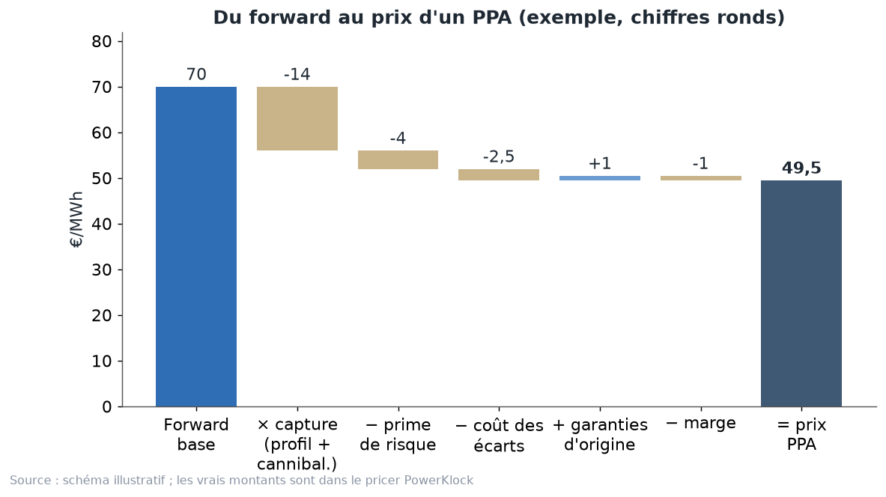

Le schéma est un exemple en chiffres ronds (pas un vrai prix) : on part de 70 €, la capture enlève 14 €, la prime de
risque 4 €, les écarts 2,5 €, les garanties d'origine ajoutent 1 €, la marge enlève 1 €, et on arrive à 49,5 €. Les
vrais montants sont dans le pricer (section 6).

Chaque étage, avec une image :
- **Le forward** : le prix d'un MWh « plat », livré pareil à toutes les heures, coté aujourd'hui pour les années du
  contrat (chapitre 1). C'est le prix de la tomate moyenne de l'année.
- **× la capture** : le MWh du parc ne vaut pas le MWh plat. On multiplie par le taux de capture (chapitre 2). C'est
  la décote de la tomate d'août.
- **− la prime de risque** : personne ne sait vraiment ce que vaudra le solaire en 2028. Celui qui prend ce risque se
  fait payer. C'est l'**assurance**.
- **− le coût des écarts** : le parc ne produit jamais exactement ce qu'il a annoncé la veille. L'écart se règle à un
  prix moins favorable que le spot. C'est le **bus qui arrive en retard** : il faut payer un taxi pour le trajet
  manquant (chapitre 12).
- **+ les garanties d'origine (GO)** : un certificat électronique qui prouve qu'un MWh a été produit à partir d'une
  source renouvelable. Une GO correspond à un MWh, et le registre français est tenu par EEX pour le ministère (EEX,
  lien en fin de chapitre). L'acheteur les reçoit avec l'électricité : c'est un **petit plus** qui s'ajoute au prix.
- **− la marge** : la rémunération de celui qui gère le contrat.

### 3. Ta méthode en 3 étapes
Ta méthode découpe le cœur de la cascade, « forward × capture », en trois étapes :

1. **Le forward** : le prix moyen attendu d'un MWh plat.
2. **Le profil** : on n'achète pas un MWh plat, mais un MWh solaire ou éolien, qui tombe à certaines heures et
   certains mois. C'est l'**effet calendrier**.
3. **La cannibalisation** : ces heures sont moins chères **justement parce que** le parc et ses semblables produisent.
   C'est l'**effet foule**.

Profil + cannibalisation = la capture. Les vrais chiffres du pricer (`pricing-v2/parametres.md`, avant le passage à la
règle « strictement négatif ») :
- **solaire** : profil −5,97 €, cannibalisation −26,82 € ;
- **éolien** : profil +7,87 €, cannibalisation −10,68 €.

En solaire, c'est l'effet foule qui coûte cher. En éolien, l'effet calendrier rapporte (le vent souffle l'hiver),
mais l'effet foule reprend plus.

**Le forward, mois par mois.** Le pricer ne prend pas un seul chiffre par année :
- il prend le **mois** coté si on l'a, sinon le **trimestre**, sinon le **Cal**, découpé par une forme saisonnière ;
- il pondère chaque mois par la **production attendue** du parc : un mois de juillet compte beaucoup pour le solaire,
  un mois de janvier beaucoup pour l'éolien ;
- il n'utilise que des **produits liquides**, ceux qui s'échangent vraiment (SEFE / EEX). C'est une de tes règles.

La formule complète, en mots : pour chaque mois, forward du mois × capture du mois × production payée du mois ; on
additionne, on divise par la production payée totale, puis on applique le reste de la cascade.

### 4. La convention : pas payé quand le prix est négatif
**La règle du site** : la production n'est pas payée quand le prix est négatif. Pourquoi ?
- Les PPA récents prévoient souvent que l'acheteur **ne paie pas** les MWh produits à prix négatif. C'est une clause
  d'arrêt (*curtailment*). Le parc s'arrête, ou il produit sans être payé.
- Compter ces MWh au prix fixe surestimerait la valeur du parc.
- En 2025, il y a eu **735 heures à prix nul ou négatif**, presque toutes à midi, au printemps et en été : le cœur de
  la production solaire (`calc.py`, `cours_detail.md`).

L'image : un **contrat de livraison de lait** qui dit : « les jours où la laiterie est pleine, on ne vous prend pas
votre lait ». Le producteur doit en tenir compte dans son prix.

**Un changement du 1er novembre, à connaître.**
- Jusqu'au 31 octobre, la règle était : pas payé quand le prix est **nul ou négatif** (≤ 0).
- Depuis le 1er novembre au matin, le pricer applique : pas payé seulement quand le prix est **strictement négatif**
  (< 0). Une heure à 0 € est produite et payée 0 €.
- Ça compte : il y a eu **225 heures à exactement 0 €** en 2025 (`parametres.md`).
- Le seuil est réglable dans le pricer : il faut le choisir **à chaque contrat**, selon sa clause de prix négatifs.

### 5. Le pricer v2 : comment PowerKlock calcule le prix
Le pricer v2 est **en ligne depuis le 31 octobre 2026**. Il remplace une moyenne de quatre méthodes par une seule.

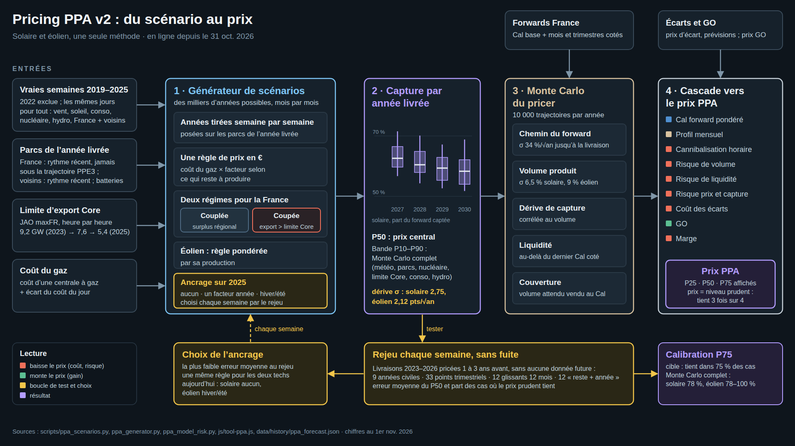

On lit le schéma de gauche à droite, en quatre blocs.

**Bloc 1 : le générateur de scénarios.** Il fabrique des milliers d'années possibles :
- faites de **vraies semaines de 2019 à 2025** (2022 exclue), où vent, soleil, consommation, nucléaire et hydraulique
  sont pris les mêmes jours, en France et chez les voisins ;
- posées sur les **parcs de l'année livrée** (France : rythme récent, jamais sous la trajectoire PPE3 ; batteries) ;
- avec **une seule règle de prix en euros** : coût d'une centrale à gaz × un facteur qui dépend de ce qui reste à
  produire ;
- et **deux régimes** : France couplée à ses voisins, ou coupée quand son export dépasse sa limite Core de l'heure
  (chapitres 5 et 6).

L'image : un **simulateur de vol**. On rejoue des milliers de vols avec de vraies conditions météo du passé, mais sur
l'avion d'aujourd'hui.

**Pour l'éolien, une règle pondérée par la production.** La règle de prix est apprise en donnant plus de poids aux
heures où le vent produit (idée de Qorbanian, Löhndorf et Wozabal). Erreur éolienne au rejeu : **0,84 → 0,56 €/MWh**.

**Un recalage, choisi par une règle : l'ancrage.**
- Formule : capture(année) = générateur(année) × réalisé(2025) ÷ générateur(2025).
- Trois modes : aucun, un facteur sur l'année, un facteur hiver et un facteur été.
- Chaque semaine, le rejeu garde le mode qui s'est le moins trompé, avec la même règle pour les deux technologies.
- Aujourd'hui : **solaire sans ancrage**, **éolien ancré hiver/été**.
- Pourquoi l'éolien reste ancré : sans ancrage, tous les modèles testés le surévaluent de 2 à 2,7 €, et l'erreur est
  dans les heures où la France est coupée. Aucune méthode testée ne la supprime (débrief du 31 octobre).

**Bloc 2 : la capture par année livrée.** Le générateur donne une capture centrale (P50) et une bande P10–P90.

**Bloc 3 : le Monte Carlo du pricer.** Il tire **10 000 trajectoires** : chemin du forward, volume produit, dérive de
la capture, liquidité. Il suppose que le volume attendu est revendu au Cal (couverture *back to back*).

**Bloc 4 : la cascade et le prix prudent.**
- La prime de risque = **valeur juste − 25e centile** des 10 000 futurs.
- Le prix publié est donc le **prix prudent** : il tient **3 fois sur 4**. P25, P50 et P75 sont affichés.
- Ta règle : « ne pas perdre d'argent systématiquement ».

L'image : un **parapluie**. On ne s'habille pas pour la météo moyenne, mais pour 3 jours sur 4.

**Le Monte Carlo complet.** La bande ne tire pas que la météo. Elle tire aussi la croissance des parcs (± 40 %), le
nucléaire (avec 5 % de chance d'une année type 2022), la limite Core, la consommation, une année sèche ou humide. La
bande contient donc déjà l'erreur du modèle : plus de déduction séparée pour le risque de modèle. Avant le
31 octobre, on en retirait une à part.

**Comment on sait que ça marche : le rejeu.** On se replace dans le passé, sans aucune donnée future :
- livraisons 2023–2026 pricées 1 à 3 ans avant (9 cas par technologie), plus des points trimestriels et glissants ;
- erreur moyenne du générateur seul : **0,76 €/MWh en solaire, 0,56 en éolien** ;
- l'ancienne moyenne de quatre méthodes se trompait de **2,59 et 2,84 €** ;
- le prix prudent a tenu dans **78 à 89 %** des cas (cible 75 %) ;
- le hasard des tirages vaut environ **0,2 €** : seuls les gains plus grands que ça comptent.

### 6. Les vrais chiffres d'aujourd'hui
Contrat 2027–2029, forwards des 30–31 octobre 2026.

**Les ingrédients** (`pricing-v2/parametres.md`) :

| Étage | Valeur |
|---|---|
| Cal France base | 2027 : 128,16 · 2028 : 70,94 · 2029 : 62,97 €/MWh |
| Capture (générateur v2) | solaire ≈ 57 % du Cal, éolien ≈ 93 % |
| Coût des écarts | solaire 2,49, éolien 2,82 €/MWh |
| Garanties d'origine | + 1,81 €/MWh |
| Marge | 1 €/MWh |
| Volatilité des forwards | Cal+1 34 % par an |
| Dispersion du volume | solaire ± 6,5 %, éolien ± 9 % |
| Dégradation des panneaux | 0,4 % par an (hypothèse) |

**Le prix publié au 1er novembre : solaire 46,64 €/MWh, éolien 77,39 €/MWh** (`parametres.md`).

Il a bougé trois fois en un jour, pour des raisons de **méthode**, pas de marché (mêmes forwards) :
- **31 octobre, 20 h 57** : le pricer v2 est mis en ligne, **49,75 / 80,69** (la v1, la nuit d'avant, donnait 47,07 /
  77,78) ;
- **1er novembre, 8 h 12** : une heure à 0 € est désormais produite et payée 0. Le même revenu se répartit sur plus
  de MWh payés, donc le prix par MWh baisse : **42,88 / 77,20** ;
- **1er novembre, 12 h 25** : la prime de risque suit maintenant la sensibilité mesurée du prix capté au prix de base
  (0,96 € par € en solaire, 0,95 en éolien) au lieu d'une part fixe. La prime solaire tombe de 5,98 à 2,2 € :
  **46,64 / 77,39**.

L'image : le prix d'un plat au restaurant. Si on change la taille de la portion (les heures à 0 € comptées), le
prix par bouchée change, même si le plat coûte pareil. Toujours dire **de quelle date et de quelle méthode** est un
prix. Ensuite, il bouge chaque jour avec les forwards.

**Une remarque sur la forme de la courbe.** Le Cal 2027 (128,16 €) est environ deux fois plus cher que le Cal 2029
(62,97 €). Un PPA 2027–2029 tire donc une bonne part de sa valeur de la première année. Avec ces mêmes cotations, un
contrat qui commencerait en 2028 vaudrait nettement moins.

### 7. Limites et questions ouvertes
- **L'éolien reste ancré.** On corrige un biais qu'on n'explique pas encore.
- **Le volume varie trop peu dans le générateur** (solaire 2,1 % contre environ 5 %). L'écart de volume du pricer vient
  donc des vraies années.
- **Captures jusqu'en 2030 seulement** : à prolonger pour les PPA longs.
- **Liquidité** : au-delà du dernier Cal coté, on ajoute une incertitude de 5,1 % par année, mais sans source d'écart
  achat–vente.
- **Arrêts nucléaires 2027** : une option seulement (éolien + 2 points), impossible à tester sur le passé.
- **La prime de risque doit-elle dépendre de la durée du contrat ?** Aujourd'hui, l'horizon élargit seulement la
  bande.
- **Pas de prix de PPA observés.** Pexapark, lui, calibre ses modèles sur des transactions réelles. Nous ne les avons
  pas.

**Tes règles, qui tranchent tout le reste** (`choix_v2.md`) : pas de recalibrage caché ; une seule méthode pour le
solaire et l'éolien ; produits liquides seulement ; réalisme face à l'historique ; tests sur des années complètes ;
jamais changer le pourcentage d'un mélange à chaque pricing.

### À retenir
1. PPA pay-as-produced : l'acheteur prend toute la production, quand elle vient, à prix fixe. Il prend le risque de
   profil, de volume et de prix.
2. Prix = forward × capture − prime de risque − coût des écarts + garanties d'origine − marge.
3. Ta méthode : forward, profil (effet calendrier), cannibalisation (effet foule).
4. Les MWh produits à prix négatif ne sont pas payés ; le seuil (≤ 0 ou < 0) se choisit selon la clause du contrat.
5. Pricer v2 : une seule méthode, le générateur ; un prix prudent qui tient 3 fois sur 4 ; testé par rejeu chaque
   semaine.
6. Prix publié au 1er novembre : solaire 46,64, éolien 77,39 €/MWh ; un prix se cite toujours avec sa date et sa
   méthode.

### Question pour vérifier
Un client veut un PPA solaire 2027–2029, avec une clause qui le fait payer même les heures à 0 €, mais pas les heures
négatives.
- (a) Par rapport à la règle « ≤ 0 », le prix du PPA monte-t-il ou baisse-t-il ? Pourquoi ?
- (b) Si le Cal 2027 retombe demain de 128 € à 70 €, quel étage de la cascade bouge le plus, et dans quel sens va le
  prix ?
- (c) Pourquoi le prix publié est-il le prix qui tient 3 fois sur 4, et pas le prix central ?

### Pour aller plus loin
- Pexapark, prix d'un PPA = valeur attendue − prix de marché du risque —
  https://help.platform.pexapark.com/en/articles/9577400-what-are-ppa-prices-shown-on-pexaquote-and-the-market-price-of-risk
- Pexapark, méthode de calcul —
  https://help.platform.pexapark.com/en/articles/9582613-what-is-the-pexapark-calculation-methodology
- Qorbanian, Löhndorf et Wozabal, « Valuation of Power Purchase Agreements for Corporate Renewable Energy
  Procurement », *European Journal of Operational Research*, 2025 — https://arxiv.org/abs/2403.08846
- EEX, registre français des garanties d'origine —
  https://www.eex.com/en/services/registry-services/french-guarantees-of-origin-registry
- Dossier PowerKlock : `docs/discussion/pricing-v2/choix_v2.md`, `parametres.md`, `schema_v2.png`,
  `docs/discussion/pricing/debrief-2026-10-31.md`.

## Chapitre 4 à l'oral — le système français, version complète

*Pour Tom · 1er novembre 2026 · à lire à voix haute, environ 15 minutes*

### 1. La maison et sa grosse chaudière
Le système électrique français ressemble à une grande maison chauffée par une énorme chaudière : le **nucléaire**.
Elle produit beaucoup et pour pas cher. Mais elle n'aime pas qu'on la baisse trop, et on ne l'éteint pas comme une
lampe.

Autour de la chaudière, il y a trois autres choses :
- les **barrages** : la réserve d'eau de la maison, qu'on garde pour les heures chères ;
- le **solaire et l'éolien** : ils produisent quand il y a du soleil ou du vent, et ils poussent vite ;
- les **voisins** : quand la maison produit trop, elle vend le surplus par les lignes.

Le parc installé fin 2025, d'après RTE (bilan 2025) :
- nucléaire **63,0 GW**, Flamanville 3 compris ;
- solaire **30,4 GW** (+5,9 GW en un an). Il a dépassé l'hydraulique, à **25,7 GW** ;
- éolien terrestre **23,9 GW**, éolien en mer **1,9 GW** ;
- gaz **12,4 GW**.

En 2025, le nucléaire a produit **373,0 TWh** (RTE). Plus de 95 % de l'électricité française était bas carbone.

**L'idée du chapitre.** La France a souvent plus d'électricité qu'elle n'en consomme. Le prix français dépend donc
surtout de deux choses : jusqu'où le nucléaire peut baisser, et combien la France peut vendre à ses voisins.

### 2. Le nucléaire module, mais pas jusqu'à zéro
**Moduler**, c'est baisser la production quand on n'a pas besoin de tout, puis la remonter. C'est comme lever le pied
de l'accélérateur sans couper le moteur.

Un réacteur peut moduler, avec trois sortes de limites :
- **la vitesse.** D'après EDF, un réacteur en suivi de charge peut passer de 100 % à 20 % de sa puissance en environ
  30 minutes, deux fois par jour ;
- **le nombre de fois.** On ne peut pas monter et descendre sans arrêt ;
- **le cycle du combustible.** C'est la limite la plus importante.

**Le minimum technique.** C'est la puissance la plus basse qu'un réacteur peut tenir sans s'arrêter. RTE indique
qu'il varie **entre 25 % et 100 %** de sa puissance, « notamment [selon] l'avancement dans le cycle du combustible »
(bilan du premier semestre 2026).
- En milieu de cycle, un réacteur peut descendre bas : il est souple.
- En fin de cycle, il ne module presque plus. Son minimum peut aller jusqu'à 100 % : il tourne à fond ou il s'arrête.

**L'image.** Un cycliste en milieu d'étape peut ralentir et accélérer comme il veut. En fin d'étape, il n'a plus de
marge : il garde son rythme ou il descend du vélo. Les réacteurs, c'est pareil avec leur combustible.

**Le minimum du parc.** Pour tout le parc, RTE additionne les minimums déclarés par EDF, réacteur par réacteur (les
« chroniques Pmin », publiées au titre de REMIT). Il dépend :
- du nombre de réacteurs allumés : plus élevé en hiver, quand presque tous tournent ;
- de leur place dans le cycle du combustible ;
- du jour : EDF garde ses marges de baisse pour les week-ends et les jours fériés, quand on consomme moins.

**La modulation change de forme.**
- Kpler (février 2026) : la modulation du nucléaire a augmenté de **17 %** en 2025, et **70 %** de ses volumes sont
  désormais commerciaux (le prix est bas), pas techniques.
- RTE (bilan 2025) : le nucléaire module maintenant plus **en milieu de journée**, au printemps et en été. Avant, il
  modulait plutôt la nuit et le week-end. La cause, c'est le soleil de midi.
- Dans nos données, le plus bas taux d'utilisation du nucléaire observé (1er centile, production ÷ disponible) est de
  **0,63** en 2024–2025 (`couplage/methodologie.md`).

**Ce que dit la recherche.** Astier et Wolak (NBER, janvier 2026) montrent qu'en 2024, les heures où toute la
flexibilité du nucléaire était déjà utilisée correspondent à des prix nuls ou négatifs. Autrement dit : quand la
chaudière est au plus bas et qu'il reste trop d'électricité, le prix plonge.

### 3. Printemps 2026 : un nucléaire moins souple
Au premier semestre 2026, le nucléaire a beaucoup moins modulé. Les chiffres viennent de RTE, bilan du premier
semestre 2026, chapitre 6.
- **Modulation :** environ **10 TWh**, contre près de **20 TWh** au premier semestre 2025. (La synthèse du même bilan
  écrit « 15 à 20 TWh » pour 2025 : RTE précise que ses estimations sont incertaines.)
- **Pourquoi :** surtout moins d'arrêts de réacteurs pour modulation, et un peu moins de baisses de puissance.
- **Minimum technique du parc :** en moyenne **36,6 GW** de janvier à juin 2026, soit **+4,0 GW (+12 %)** par rapport
  à 2025. La production moyenne était de **43,7 GW**. La marge de baisse était donc petite.
- **Fin avril et début mai :** le minimum était **8,8 GW** plus haut qu'un an plus tôt.

**Le 1er mai, à midi.**
- Minimum technique : environ **31 GW** en 2026, contre **19 GW** en 2025.
- Production nucléaire entre 12 h et 16 h : **32,0 GW** en 2026, contre **21,6 GW** en 2025.
- Dans les deux cas, le parc était tout près de son minimum. Il ne pouvait pas descendre plus.

**Pourquoi c'est arrivé** (RTE) : plus de réacteurs avaient une modulation limitée, surtout pour des raisons de
cycle du combustible, et moins de réacteurs étaient à l'arrêt.

**La conséquence.** Des prix négatifs plus profonds. RTE relève deux records : **−478,8 €/MWh le 26 avril** et
**−498,7 €/MWh le 1er mai 2026**. Et **407 heures** de prix négatifs au premier semestre 2026, soit 10 % du temps.

**Un point important.** Ces jours-là, la France n'a pas « importé » des prix négatifs de ses voisins. RTE note
qu'elle était très exportatrice à midi les 26 avril et 1er mai 2026, alors qu'elle importait plus de 6 GW depuis
Core sur les mêmes créneaux en 2025. Le surplus était bien français.

### 4. L'accord RTE–EDF sur la tension : ce qu'il est, et ce qu'il n'est pas
**Ce qu'il est.** Le 27 mars 2026, la CRE a approuvé un accord entre RTE et EDF (délibération n° 2026-67). C'est une
**option** : RTE peut demander à certains réacteurs de **rester allumés**, du 4 avril au 30 octobre 2026, pour régler la
**tension** du réseau. EDF reçoit alors une compensation, avec une formule connue à l'avance.

**La tension, en image.** La tension, c'est comme la pression de l'eau dans les tuyaux d'une maison. Elle doit rester
dans une plage : ni trop haute, ni trop basse. Les grosses centrales aident à la régler, comme des vannes. Un réacteur
arrêté parce que le prix est bas ne règle plus rien. Dans certaines zones, RTE a donc besoin d'en garder quelques-uns
allumés.

**Ce qu'il n'est pas.** Ce n'est **pas un minimum national de production nucléaire**. Notre débrief du 31 octobre
le présentait ainsi, et c'était faux.

**Son effet réel** (RTE, bilan du premier semestre 2026, section 6.2) : un **rôle marginal**.
- La très grande majorité des demandes visait des réacteurs qu'EDF avait déjà prévu de garder en marche.
- Au premier semestre, seuls **11 jours** ont connu une imposition effective, avec **un à trois réacteurs**.
- Le 1er mai 2026, l'imposition explique **moins de 2 GW** sur les environ 10 GW d'écart de production avec le
  1er mai 2025.
- Quand un réacteur est imposé alors qu'EDF voulait l'arrêter, EDF baisse souvent un autre réacteur ailleurs. L'effet
  est surtout **géographique**, pas sur le total.

**À retenir de cette section.** Si le nucléaire a moins modulé en 2026, c'est le **combustible**, pas l'accord sur la
tension.

### 5. Le nucléaire n'est pas toujours là
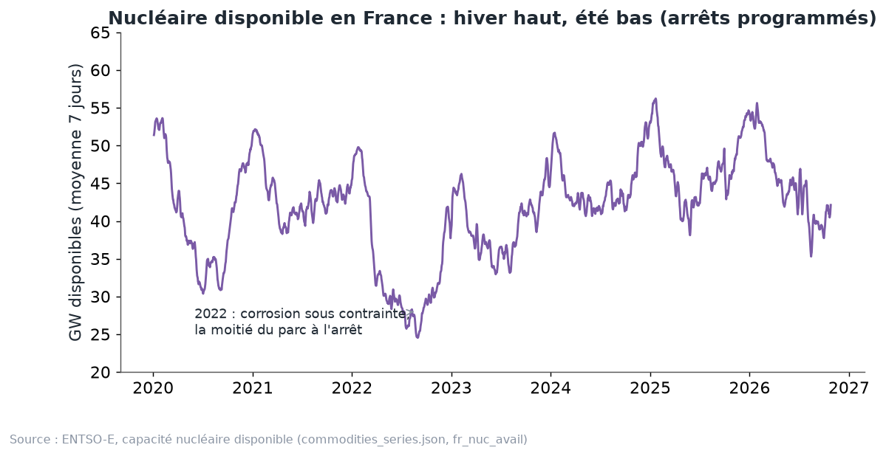

Regarde la courbe. Chaque année, elle dessine une vague : haute en hiver, basse en été.
- **Pourquoi.** EDF place ses arrêts programmés (rechargement du combustible, maintenance) au printemps
  et en été, quand on consomme moins.
- **2022, le creux.** Des problèmes de corrosion sous contrainte : la moitié du parc à l'arrêt. La France a importé,
  et le prix a explosé.
- **Depuis,** la disponibilité remonte chaque année. RTE prévoyait environ **45 GW** en moyenne jusqu'à fin août 2026,
  contre 43 GW en 2025, près des records.

**2027.** Les arrêts déjà déclarés à ENTSO-E (au 30 octobre 2026, `calc.py`) donnent :
- jusqu'à environ **21 GW** indisponibles en même temps, fin mai (20,7 GW le 22 mai) ;
- **18 GW** au plus fort d'avril ;
- **11 GW** en moyenne sur l'année.

Attention : ces plannings bougent souvent. EDF prévoit **350 à 370 TWh** de nucléaire en 2026 comme en 2027.

**Chaleur et sécheresse.** Les centrales au bord des fleuves rejettent de l'eau chaude. Quand le fleuve est déjà
trop chaud, ou trop bas, elles doivent baisser leur production.
- Pendant les canicules de 2026, la perte de disponibilité a atteint jusqu'à environ **8 GW fin juin** et **9 GW vers
  mi-juillet**, selon les jours (RTE, bilan du premier semestre 2026).
- En cas de sécheresse longue en fin d'été, l'effet pourrait atteindre **2 à 3 GW** de plus (Chooz, voire Cattenom).
- Mais sur l'année, RTE juge ces pertes « de second ordre » en volume.

### 6. L'hydraulique : la batterie naturelle
Il y a trois sortes de barrages :
- **le fil de l'eau** : l'usine produit quand l'eau passe. On ne peut rien stocker. C'est un moulin sur une rivière ;
- **les lacs** : ils gardent l'eau des semaines ou des mois. C'est un réservoir qu'on ouvre quand le prix est haut ;
- **les STEP** (stations de transfert d'énergie par pompage) : elles pompent l'eau vers le haut quand l'électricité
  est bon marché, et la font redescendre dans les turbines quand elle est chère. C'est une vraie batterie.

**L'eau a un prix.** Le gestionnaire d'un lac ne turbine pas dès qu'il peut. Il compare le prix d'aujourd'hui au prix
qu'il pourra obtenir plus tard. On appelle ça la **valeur de l'eau**. Et ce prix futur dépend beaucoup du gaz
(chapitre 7) : même en France, l'eau des lacs se valorise donc en partie au prix du gaz.

**Les chiffres (RTE).**
- 2025 : **62,4 TWh**, soit −12,9 TWh après une année 2024 exceptionnelle. C'est un niveau normal.
- Premier semestre 2026 : **34,5 TWh** (−0,4 TWh). L'hiver a été très humide, le printemps parmi les dix moins
  pluvieux depuis 1959. Les stocks, faibles en début d'année, sont revenus près de la moyenne fin juin.

Pour le générateur, le stock des réservoirs (ENTSO-E, `hydro_reservoirs.json`) dit combien d'énergie « de réserve »
le pays a. On en reparle au chapitre 7 : une année sèche est souvent aussi une année peu venteuse.

### 7. Les exports : la France vend presque tout le temps
**2025** (RTE, bilan 2025) :
- solde exportateur record de **92,3 TWh** (89 TWh en 2024) ;
- la France a été exportatrice nette **près de 99 % du temps** ;
- par frontière, en TWh : Italie **26,2**, Belgique + Allemagne **23,1**, Grande-Bretagne **22,6**, Suisse **20,1**,
  Espagne **0,2**.

**Premier semestre 2026** (RTE) : nouveau record, **51,0 TWh** en six mois, contre 37,8 TWh au premier semestre 2025.
- Allemagne–Belgique 13,9, Grande-Bretagne 12,4, Italie 14,4, Suisse 11,3 TWh.
- Espagne : à peu près à l'équilibre, légèrement importatrice (−1,0 TWh).

**Combien ça rapporte.**
- 2025 : **5,4 Md€** au prix français, « de l'ordre de 9 Md€ » au prix des pays acheteurs.
- Premier semestre 2026 : **3,0 Md€**, ou environ **5,7 Md€** au prix des acheteurs. Le MWh exporté vaut
  **61,2 €** au prix français, **111,6 €** au prix des pays acheteurs.

RTE écrit que la France n'a pas « bradé » son électricité. Mais l'écart entre les deux prix montre une chose : les
lignes sont souvent pleines, et le prix français reste en dessous de celui de ses clients. C'est le sujet des
chapitres 5 et 6.

### 8. Le solaire et l'éolien poussent, les batteries arrivent
- **Solaire :** +5,9 GW en 2025, 30,4 GW en fin d'année (RTE). Il a dépassé l'hydraulique en puissance.
- **Éolien :** le terrestre ralentit pour la troisième année (+0,9 GW en 2025). L'éolien en mer avance (Yeu–Noirmoutier).
- **Début 2026 :** le rythme baisse un peu. **2,1 GW** de renouvelables en plus sur les cinq premiers mois de 2026,
  contre 2,5 GW un an plus tôt (dont solaire +1,9 GW, éolien terrestre +0,2 GW).

**Dans le générateur PowerKlock :**
- le solaire et l'éolien français grandissent au **rythme de la dernière année**, jamais sous la trajectoire PPE3 ;
- ceux des voisins grandissent à leur propre rythme, plafonné par leurs objectifs 2030.

**Les batteries.** Elles se chargent à midi, quand le soleil fait baisser le prix, et se vident le soir. Elles
remontent donc un peu le prix de midi. Leur effet sur la capture est testé dans `scripts/ppa_storage_test.py`. On ne
donne pas de chiffre ici : le cours n'en a pas de vérifié.

### 9. Le solaire et l'éolien savent aussi baisser
Longtemps, beaucoup de parcs produisaient même à prix négatif. Ceux sous **obligation d'achat** touchaient un tarif
fixe, quel que soit le prix du marché. Ils n'avaient aucune raison de s'arrêter. Ça change.
- **2025** (RTE) : la modulation de l'éolien et du solaire pendant les prix négatifs a **doublé**, à environ **3 TWh**
  (1,3 éolien terrestre, 1,6 solaire).
- **Depuis mi-avril 2026,** EDF OA (l'acheteur obligé) peut demander aux parcs sous obligation d'achat de s'arrêter aux
  prix négatifs. Cela concernait environ **7,4 GW** en juin 2026 (5,1 GW d'éolien, 2,3 GW de solaire).
- **22 GW** d'éolien et de solaire peuvent maintenant moduler à la demande de RTE : quatre fois plus qu'avant.
- **Premier semestre 2026 :** **2,5 TWh** modulés (1,4 solaire, 1 éolien terrestre, 0,1 éolien en mer), contre 1,9 TWh
  un an plus tôt. C'est **6 %** du productible solaire et **4 %** de l'éolien terrestre.

**L'image.** Avant, seule la chaudière savait baisser. Maintenant, les panneaux et les éoliennes ont aussi un bouton.
Plus il y a de boutons, moins le prix a besoin de plonger pour équilibrer le système.

### 10. Ce que ça change pour un PPA
- **Le minimum nucléaire fixe le plancher du prix.** Quand le nucléaire est à son minimum et qu'il reste du surplus, le
  prix tombe à zéro ou en dessous. Un printemps où le combustible rend le parc rigide, comme 2026, donne plus d'heures
  négatives. Ce sont des heures solaires.
- **Les arrêts programmés comptent.** Un printemps 2027 avec jusqu'à 21 GW indisponibles laisserait plus de place
  au solaire et à l'éolien, et soutiendrait la capture. Mais ces plannings bougent.
- **Les exports sont la soupape.** Ce que la France ne peut pas vendre à ses voisins fait baisser son propre prix.
- **Un parc qui s'arrête aux prix négatifs** ne vend pas ces MWh-là. C'est pour ça que notre prix PPA ne paie pas la
  production aux prix ≤ 0 (chapitre 3).

### À retenir
1. Le nucléaire est la base. Il module, mais garde un minimum qui va de 25 à 100 % de la puissance, selon le
   combustible.
2. Au printemps 2026, le parc était moins souple (environ 31 GW de minimum le 1er mai, contre 19 GW) : deux fois moins
   de modulation, et des prix négatifs records.
3. L'accord RTE–EDF sur la tension n'est pas un minimum national : RTE juge son rôle « marginal ».
4. Le nucléaire est haut en hiver, bas en été. 2027 : jusqu'à environ 21 GW d'arrêts déclarés fin mai.
5. Les barrages sont la batterie naturelle, et l'eau se valorise au prix futur.
6. La France exporte presque tout le temps : 92,3 TWh en 2025, 51,0 TWh au seul premier semestre 2026.
7. Le solaire et l'éolien grandissent, et savent de plus en plus s'arrêter aux prix négatifs.

### Question pour vérifier
Imagine un printemps 2027 où beaucoup de réacteurs sont **en milieu de cycle** (donc souples), et où les arrêts
programmés atteignent bien 21 GW fin mai. Qu'arrive-t-il, d'après toi :
- (a) au nombre d'heures à prix négatif en mai, par rapport à 2026 ;
- (b) à la capture d'un parc solaire français ce printemps-là ;
- (c) à la part des exports dans l'équilibre du système à midi ?

### Pour aller plus loin
- RTE, *Bilan du système électrique, premier semestre 2026* (chapitre 6 sur le nucléaire, chapitre 7 sur la
  modulation renouvelable) — https://assets.rte-france.com/prod/public/2026-07/2026-07-16-bilan-semestre1.pdf
- RTE, *Bilan électrique 2025, principaux résultats* —
  https://assets.rte-france.com/prod/public/2026-02/Bilan-electrique-2025-principaux-resultats.pdf
- CRE, délibération n° 2026-67 du 27 mars 2026 —
  https://www.cre.fr/fileadmin/Documents/Deliberations/2026/260327_2026-67_Approbation_Accord_Injection_THT.pdf
- Kpler, « Nuclear modulation insights » (février 2026) —
  https://www.kpler.com/blog/nuclear-modulation-insights-volumes-and-units-behaviours
- EDF, estimation de production nucléaire —
  https://www.edf.fr/groupe-edf/espaces-dedies/journalistes/tous-les-communiques-de-presse/estimation-de-production-nucleaire-d-edf-en-france
- Dossier PowerKlock : `docs/discussion/cours/cours_detail.md` (chapitre 4), `calc.py` (arrêts 2027),
  `docs/discussion/couplage/methodologie.md` (minimum nucléaire du modèle).

## Chapitre 5 à l'oral — le couplage européen, version complète

*Pour Tom · 1er novembre 2026 · à lire à voix haute, environ 15 minutes*

### 1. Pourquoi coupler les marchés
Chaque pays a ses centrales, avec leurs coûts. Coupler, c'est laisser l'électricité aller du pays où elle est
bon marché vers celui où elle est chère. Le pays vendeur gagne : il vend plus cher que chez lui. Le pays acheteur
gagne aussi : il paie moins cher que chez lui.

C'est la même idée que le commerce entre deux villes : chacune fait ce qu'elle fait le moins cher. L'ACER, le
régulateur européen, estime le gain des échanges d'électricité à environ **34 milliards d'euros en 2021**.

### 2. Comment marche l'enchère
- Chaque jour, avant **midi**, chaque producteur et chaque acheteur dépose ses offres pour le lendemain, dans sa zone.
- Depuis le **1er octobre 2025**, il y a une offre par **quart d'heure**, plus par heure.
- Un seul programme, **Euphemia**, calcule tout en même temps pour l'Europe (le *couplage unique*, SDAC). Il
  cherche les échanges qui créent le plus de gain total, sans dépasser ce que les lignes peuvent porter.
- Il en sort **un prix par zone** et **un échange par frontière**.
- Bornes : le prix ne peut pas dépasser **4 000 €/MWh**, ni descendre sous **−600 €/MWh** (−500 jusqu'au 28 mai 2026).

**Qui est dedans ?**
- Les pays de l'UE (et la Norvège).
- La **Suisse** n'en a jamais fait partie.
- La **Grande-Bretagne** en est sortie le **1er janvier 2021**.

Avec ces deux-là, la capacité des lignes est vendue à part, aux enchères (« explicites »). C'est pour ça que la
France n'a presque jamais le même prix que la Suisse ou la Grande-Bretagne.

### 3. Les lignes : deux façons de compter la place
**L'ancienne façon (NTC).** On donnait une capacité fixe par frontière : « France → Allemagne : 3 000 MW ». Simple,
mais faux : l'électricité ne suit pas les contrats.

**La façon actuelle (flow-based)**, en zone Core depuis le **8 juin 2022** :
- Quand la France vend 1 000 MW à l'Allemagne, l'électricité prend **tous les chemins à la fois** : une partie passe
  par la Belgique, une partie directement, une partie par la Suisse. Comme l'eau qui coule dans un delta.
- Pour chaque ligne importante (une **ligne critique**, ou CNEC), les gestionnaires calculent quelle part de chaque
  échange y passe. Ce sont les **PTDF**. Exemple de la littérature : si une ligne a un PTDF de 0,45, alors 1 000 MW
  d'export y ajoutent 450 MW.
- L'enchère accepte une combinaison d'échanges tant qu'**aucune** ligne critique ne déborde.

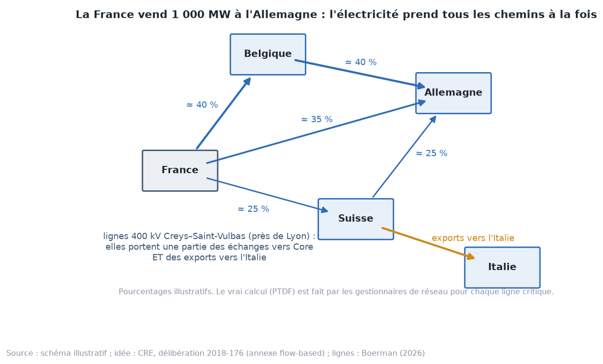

**La règle des 70 %.** Le droit européen (règlement 2019/943) demande que chaque ligne critique laisse au moins
**70 %** de sa capacité aux échanges entre zones. En 2024, les gestionnaires de Core n'en ont donné en moyenne que
**54 %** sur les lignes les plus chargées (ACER). Atteindre 70 % aurait apporté au moins **580 millions d'euros** de
gain (ACER, 2025).

**Conséquence.** La « limite d'export de la France » n'est pas un nombre fixe. C'est le maximum que la France peut
exporter vers Core à cette heure-là, compte tenu de tout le reste du réseau. JAO la publie chaque heure (`maxNetPos`).

### 4. La rente de congestion : deux villages, un camion
Rappel de l'image : le village A a trop de pommes (30 €), le village B pas assez (60 €), un seul camion de 5 caisses.
Le camion achète à 30, revend à 60, et garde 30 € par caisse.

En électricité, avec un cas du dossier couplage :
- la France est à 32 €, l'Allemagne à 60 €, la ligne pleine passe 5 000 MW ;
- le producteur français touche 32 €, l'acheteur allemand paie 60 € ;
- les 28 € d'écart × 5 000 MWh = **140 000 € par heure** vont aux gestionnaires de la ligne.

**Qui reçoit la rente ?**
- Elle est partagée **50/50** entre les gestionnaires des deux côtés (ACER, décision 16/2023).
- En France, RTE en reverse une partie aux détenteurs de droits de long terme, et le reste fait baisser le
  **TURPE**, le tarif de réseau payé par les consommateurs.

**Les chiffres 2025 (CRE)** : recettes brutes de RTE sur les frontières de l'UE, **2,05 milliards d'euros**.
- Par frontière : Italie 0,97, Core 0,72, Espagne 0,35.
- Reversé aux détenteurs de droits de long terme : 0,80 milliard.
- Excédent déduit du TURPE : **0,46 milliard**.

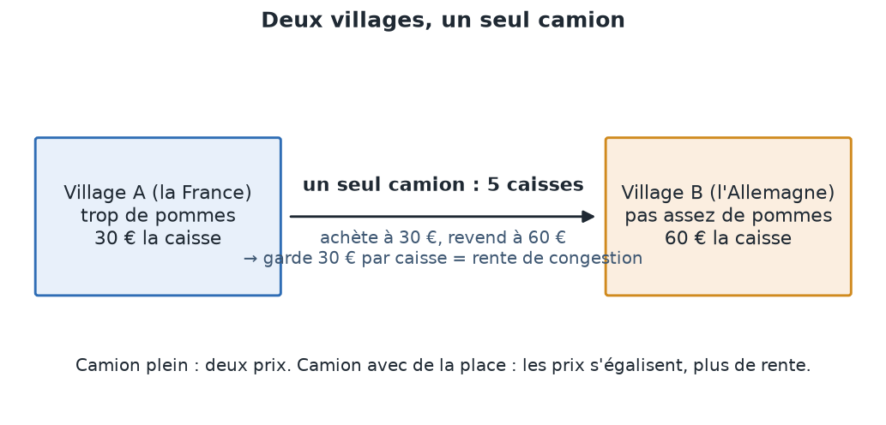

### 5. Dans quel état est la France ?
On dit qu'une frontière est **couplée** quand les deux prix sont égaux **au centime près** (règle de la CRE).

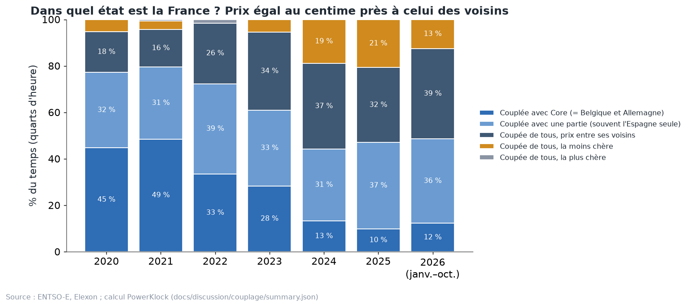

En 2025 :
- **couplée avec Core** (même prix que la Belgique et l'Allemagne) : **10 %** du temps, contre 49 % en 2021 ;
- **couplée avec une partie des voisins** : **37 %**, presque toujours l'Espagne seule. France et Espagne forment
  un bloc exportateur ;
- **coupée de tous, entre ses voisins** : **32 %** ;
- **coupée de tous, la moins chère** : **21 %**. La France exporte alors **14,1 GW** en moyenne, son prix est de
  **51 €** et celui de l'Allemagne de **94 €** ;
- **coupée de tous, la plus chère** : **0 %** depuis 2024. La France n'importe plus à pleine ligne.

**Le point clé.** Plus la France est coupée, plus son prix est bas : 75 € quand elle est couplée avec Core, 51 €
quand elle est la moins chère de tous. Mais même là, elle exporte à fond. Notre modèle estime que sans ces exports,
son prix serait de l'ordre de 4 € (estimation, jamais observée).

### 6. Pourquoi la limite vers Core baisse
Limite d'export moyenne de la France vers Core (JAO) : **9,2 GW en 2023, 7,7 en 2024, 5,4 en 2025, 5,9 en 2026**.

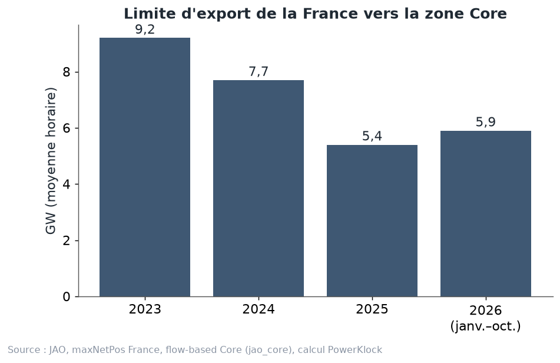

**L'explication (Boerman, 2026).**
- La France exporte beaucoup vers l'**Italie**, par la Suisse. Ces flux, hors du marché Core, sont **prévus à
  l'avance** par RTE et réservés sur les lignes : c'est le *FUAF*.
- Ils passent par deux lignes 400 kV près de Lyon, **Creys–Saint-Vulbas**.
- Ce qui est réservé pour l'Italie n'est plus disponible pour Core. Plus de FUAF, moins de marge, donc une limite
  d'export plus basse pour la France.
- La seconde ligne Creys–Saint-Vulbas limite les échanges **49 % du temps en 2026**, contre 21 % en 2025.
- Sa « valeur » (ce que gagnerait l'Europe avec 1 MW de plus sur cette ligne) est passée d'environ **190 à
  310 €/MWh**.
- Pas de remontée à attendre sans renforcement du réseau.

**L'image.** Le camion vers l'Allemagne et le camion vers l'Italie partagent le même pont. Plus on réserve de
place sur le pont pour l'Italie, moins il en reste pour l'Allemagne.

### 7. Ce que ça change pour un PPA
- **67,5 %** de la production éolienne française de 2025 est tombée dans des heures où la France était coupée de ses
  voisins. Pendant ces heures-là, le vent français fait baisser le prix français, pas le prix européen. La
  cannibalisation est plus forte.
- C'est pour ça que le générateur de scénarios a **deux régimes**, « couplée » et « coupée ». Il décide du régime de
  chaque heure en comparant le surplus français à la limite d'export JAO de l'heure.
- Si la limite remonte un jour (renforcement du réseau), la France sera plus souvent au prix de ses voisins, et la
  capture du solaire et de l'éolien remontera. Si elle continue de baisser, l'inverse. C'est un des risques que le
  Monte Carlo complet tire au hasard : limite × lognormale de 20 % × √années.

### À retenir
1. Une seule enchère pour l'Europe, un prix par zone, des échanges limités par les lignes.
2. Flow-based : l'électricité prend tous les chemins, et chaque ligne critique compte.
3. Ligne pleine = deux prix + une rente pour les gestionnaires de réseau (en France, une partie baisse le TURPE).
4. La France est de moins en moins au prix de ses voisins : 10 % du temps avec Core en 2025.
5. La limite vers Core baisse surtout à cause des flux vers l'Italie sur les lignes près de Lyon.
6. Pour un PPA, c'est central : la plupart des MWh éoliens tombent dans des heures où la France est seule face à
   son surplus.

### Question pour vérifier
Imagine que RTE renforce les lignes Creys–Saint-Vulbas en 2028. Qu'arrive-t-il, d'après toi :
- (a) au prix spot moyen français ;
- (b) à la capture d'un parc solaire français ;
- (c) à la rente de congestion à la frontière avec l'Allemagne ?

### Pour aller plus loin
- EPEX SPOT et al., *Euphemia public description* —
  https://www.mercatoelettrico.org/EN/MenuBiblioteca/Documenti/20181212EuphemiaPublicDescription.pdf
- CRE, annexe flow-based de la délibération 2018-176 —
  https://www.cre.fr/fileadmin/Documents/Deliberations/import/180906-2018-176_FLOW_BASED_annexe.pdf
- ACER, capacité transfrontalière et règle des 70 % — https://www.acer.europa.eu/monitoring/cross-zonal-electricity-trade-2025
- CRE, rapport sur l'utilisation des recettes de congestion 2025 —
  https://www.cre.fr/fileadmin/Documents/Rapports_et_etudes/2026/260407_Rapport_Utilisation_recettes_congestion_2025.pdf
- Boerman (2026), « Flowbased: export restrictions of France » — https://boerman.dev/posts/flowbased/highfuaf2026/
- JAO, outil de publication Core — https://publicationtool.jao.eu/core
- Dossier PowerKlock : `docs/discussion/couplage/couplage_europeen.pdf`, `methodologie.md`, `sources.md`.

## Chapitre 6 à l'oral — la France couplée ou coupée, version complète

*Pour Tom · 1er novembre 2026 · à lire à voix haute, environ 15 minutes*

### 1. Deux mots à bien comprendre
On reprend les deux villages et le camion du chapitre 5.
- **Couplée** : le camion a encore de la place. Les deux villages ont **le même prix**.
- **Coupée** : le camion est plein. Chaque village garde **son propre prix**, et l'écart va au propriétaire du camion
  (la rente de congestion).

**Comment on compte.** Il y a deux règles, et il faut toujours dire laquelle on utilise.
- **Au centime près** (la règle de la CRE) : deux prix sont égaux si l'écart est sous 0,01 €. Nos taux
  France–Allemagne : 49 % en 2021, 34 % en 2022, 29 % en 2023, 14 % en 2024, 11 % en 2025. Ceux de la CRE : 49, 34,
  29, 14 et 10 %. Ils retombent les uns sur les autres.
- **À 1 € près** (`calc.py`) : plus tolérant. Il compte comme « presque égaux » des prix séparés par quelques
  centimes d'arrondi ou par une petite congestion. Exemple : « couplée avec Core » passe de 10 % à 17 % en 2025
  (dossier couplage).

Ce chapitre utilise surtout la règle à 1 €, parce que c'est celle du schéma qui suit. Quand on parle des « états de
couplage » (couplée avec Core, coupée de tous), c'est la règle au centime.

### 2. La France s'est séparée de l'Allemagne
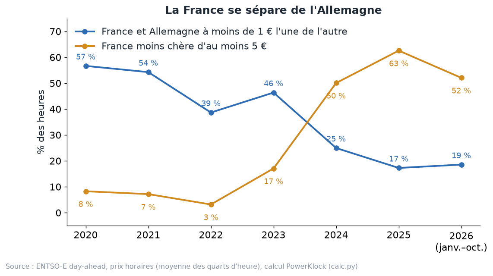

La courbe bleue : la part des heures où la France et l'Allemagne sont à **moins de 1 €** l'une de l'autre (`calc.py`,
prix ENTSO-E).

| 2020 | 2021 | 2022 | 2023 | 2024 | 2025 | 2026 (janv.–oct.) |
|---|---|---|---|---|---|---|
| 57 % | 54 % | 39 % | 46 % | 25 % | 17 % | 19 % |

En 2020, plus d'une heure sur deux, les deux pays avaient presque le même prix. En 2025, moins d'une heure sur cinq.

La courbe orange : la part des heures où la France est **moins chère d'au moins 5 €**. Elle passe de **8 %** en 2020
à **63 %** en 2025, puis **52 %** sur janvier–octobre 2026.

**Les prix moyens annuels** (ENTSO-E, dossier couplage) :
- 2020–2021 : prix proches, la France souvent un peu plus chère ;
- 2022 : crise, la France plus chère (277 € contre 236 €), elle importe ;
- 2024 : **58 € contre 79 €** ; 2025 : **61 € contre 90 €**.

RTE (bilan 2025) le dit aussi : les prix français se sont « largement découplés de ceux de l'ensemble des pays
voisins ».

**Pourquoi** (dossier couplage, page « Les causes ») :
- **plus de surplus** : nucléaire disponible de 33,8 GW en 2022 à 46,9 GW en 2025 ; éolien + solaire de 6,5 à 9,4 GW
  en moyenne ; consommation basse (50,7 GW en moyenne en 2025) ;
- **moins de place sur les lignes Core** : limite d'export de la France de 9,2 GW (2023) à 5,4 GW (2025), surtout à
  cause des flux vers l'Italie (chapitre 5).

**L'image.** Le village A produit de plus en plus de pommes, et le camion rétrécit. Il est plein de plus en plus
souvent.

### 3. Quand la France est coupée, elle est presque toujours la moins chère
**Deux heures sur trois.** En 2025, la France est moins chère que l'Allemagne environ deux heures sur trois.
Le chiffre exact dépend de la règle :
- **68 %** des heures si on compte toute heure où la France est sous l'Allemagne, même d'un centime (dossier
  couplage, frontière par frontière) ;
- **67 %** dans le débrief du 31 octobre ;
- **63 %** si on exige au moins 5 € d'écart (`calc.py`, 5 460 heures).

Dans ces heures, le prix moyen est d'environ **58 € en France contre 103 € en Allemagne** (débrief), soit 45 €
d'écart.

**Et quand la France est plus chère ?** En 2025, ça arrive environ 1 800 heures (1 822). On pourrait croire que la
France manque d'électricité. Non : le dossier couplage montre qu'elle **exporte dans 96 %** de ces heures (7,7 GW en
moyenne). C'est l'Allemagne qui déborde de vent et de soleil : l'éolien et le solaire y couvrent **64 %** de sa
consommation dans ces heures (contre 36 % quand la France est moins chère), et son prix est négatif dans **23 %** de
ces heures.

**Coupée en importatrice : jamais depuis 2024.** La France n'importe plus à pleine ligne (dossier couplage, 0 heure
en 2024 et 2025).

### 4. Même coupée, la France suit l'Allemagne
C'est le point le plus surprenant du chapitre.

On prend les heures coupées de 2025 et on les sépare en deux, selon le vent **allemand** (débrief du 31 octobre) :

| Heures coupées 2025 | Prix France | Prix Allemagne | Export vers Core |
|---|---|---|---|
| Vent allemand faible | **67,5 €** | 123 € | 4,5 GW |
| Vent allemand fort | **42,4 €** | 82 € | 4,5 GW |

La ligne vers Core est pleine dans les deux cas : la France y exporte la même chose. Pourtant, le prix français bouge
de 25 € avec le vent allemand.

**Pourquoi ?** La France a d'autres portes de sortie :
- l'**Italie**, la **Suisse**, la **Grande-Bretagne**, l'**Espagne**.
- Quand le vent allemand tombe, le prix allemand monte. Les pays autour (Italie, Suisse…) voient leurs prix monter
  aussi, et paient plus cher l'électricité française qui leur arrive par les autres frontières. Le prix français
  monte.

**L'image.** Le village A a un camion vers B, plein. Mais il a aussi des charrettes vers C, D et E. Quand les pommes
manquent en B, les prix montent aussi en C, D et E. Les charrettes vendent plus cher, et le prix monte en A.

**Le lien avec la recherche.** C'est ce que Stiewe, Xu, Eicke et Hirth appellent la **cannibalisation
transfrontalière** : le vent des voisins fait baisser la valeur de nos éoliennes presque autant que notre propre vent
(on le détaille au chapitre 7).

### 5. Le vent tombe surtout dans les heures coupées
Part de la production éolienne française tombée dans des heures où la France est coupée :

| | 2023 | 2024 | 2025 |
|---|---|---|---|
| Réalité | 18,5 % | 49 % | **67,5 %** |
| Indicateur prévisible | 17 % | 39 % | 66 % |

Sources : débrief du 31 octobre. L'**indicateur prévisible**, c'est le surplus français au-delà de la limite d'export
Core, calculé à l'avance. Il suit très bien la réalité, surtout en 2025.

**Pourquoi c'est logique.** Le vent souffle souvent longtemps, et sur toute l'Europe en même temps. C'est justement
quand il y a du vent que la France a le plus de surplus, donc que la ligne est pleine. Le MWh éolien vaut alors le
prix français, pas le prix allemand.

C'est pour ça que notre générateur de scénarios a **deux régimes**, « couplée » et « coupée ». Il choisit le régime de
chaque heure en comparant le surplus français à la limite d'export JAO de l'heure.

### 6. Et si la France était isolée ? Une estimation de modèle
**La question.** Le couplage a-t-il fait monter le prix spot français ?

Pour y répondre, il faudrait connaître le prix d'une France **sans aucun échange**. Ce monde n'a jamais existé. On
doit donc l'**estimer** avec un modèle. Tout ce qui suit est une estimation, pas une observation.

**La méthode, en quatre étapes** (dossier couplage, `methodologie.md`) :
1. **Le volume demandé aux centrales pilotables** (nucléaire, lacs, STEP, gaz, charbon, fioul), d'après RTE éCO2mix :
   consommation + exports nets − éolien − solaire − fil de l'eau − bioénergies.
2. **La courbe apprise.** Un modèle apprend, sur environ 60 000 heures (2020–2026), le prix en fonction de ce volume,
   du nucléaire disponible, du coût du gaz et du charbon, et du moment (mois, heure, week-end). Le modèle est forcé
   à monter avec le volume et avec le prix des combustibles.
3. **La France isolée.** Même heure, mêmes centrales, même vent, même soleil, mais **exports = 0**. On relit la courbe
   à ce volume plus petit.
4. **Les bornes physiques.**
   - Sous le minimum nucléaire (63 % du nucléaire disponible en 2024–2025), il faut écrêter le surplus : le prix vaut
     alors le prix négatif médian de l'année (environ 0 €).
   - Au-dessus de toute la capacité, c'est une pénurie : on compte ces heures à part.

**L'image.** C'est comme estimer le prix des pommes du village A si le pont était coupé. On connaît la courbe des
vendeurs de A. On regarde à quel prix ils vendraient s'il fallait tout écouler sur place.

**La validation.** On vérifie le modèle sur les heures coupées, où le prix réel est déjà celui du marché français
seul. Chaque heure est prédite par un modèle qui ne l'a jamais vue.
- Une heure prise seule : erreur de **±15 à 20 €**.
- Biais annuel : **+0,6 à +2,6 €** de 2020 à 2025, et **+8 €** en 2026.
- Le biais est toujours positif : le modèle surestime un peu le prix isolé. L'effet du couplage est donc plutôt
  sous-estimé.

### 7. Les résultats : +38 € en 2025
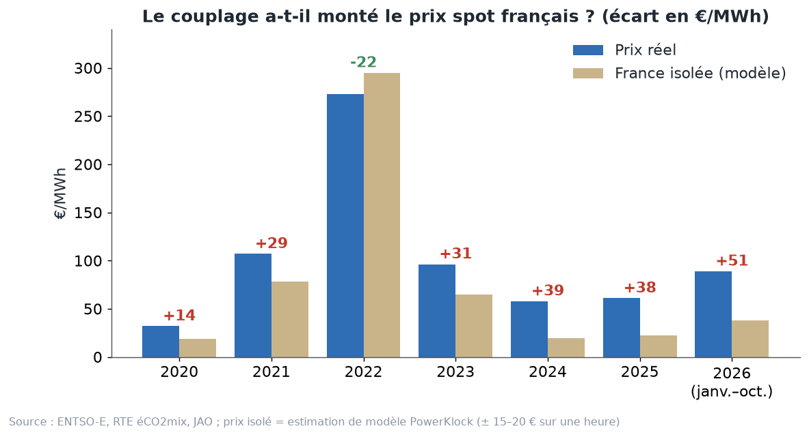

| Année | Prix réel | France isolée (modèle) | Écart |
|---|---|---|---|
| 2020 | 32 | 19 | +14 |
| 2021 | 107 | 78 | +29 |
| 2022 | 273 | 295 | **−22** |
| 2023 | 96 | 65 | +31 |
| 2024 | 58 | 19 | +39 |
| 2025 | 61 | 23 | **+38** |
| 2026 (janv.–oct.) | 89 | 38 | +51 |

En €/MWh, hors heures de pénurie.

**Comment le lire.**
- **Les années où la France exporte,** le couplage fait monter son prix spot. En 2025, une France isolée aurait eu
  environ **23 €** au lieu de **61 €**. Avec 90 TWh de trop et personne à qui les vendre, le nucléaire aurait modulé
  sans arrêt, et il aurait fallu écrêter environ **8,9 TWh** de surplus.
- **En 2022, c'est l'inverse :** la France importait, et les voisins ont fait **baisser** son prix (−22 €). Ils ont
  aussi couvert **89 heures** où, seule, elle aurait manqué d'énergie.
- **Robustesse 2025 :** le prix isolé va de **17 à 25 €**, selon le plancher choisi et les heures d'apprentissage.

**Le paradoxe.** La France est de plus en plus coupée de l'Allemagne, mais l'écart avec une France isolée
**grandit**. Pourquoi ? Même coupée, elle exporte toujours à pleine ligne. Dans l'état « coupée, la moins chère » de
2025, elle exporte **14,1 GW** en moyenne, à **51 €**. Sans ces exports, le modèle donne un prix de l'ordre de **4 €**.

**Les limites, à dire à chaque fois.**
- C'est une **borne théorique à court terme** : même parc, même consommation.
- À long terme, deux effets jouent en sens contraire. Une France isolée en surplus aurait arrêté plus de réacteurs
  (prix plus haut). Ses offres n'auraient plus de coûts d'opportunité européens (prix plus bas). **Le sens net est
  inconnu.**
- **Aucune étude publiée** ne chiffre l'effet du couplage sur le prix français. On ne peut donc pas recouper ce
  chiffre.

### 8. La comparaison sans modèle
On peut aussi regarder les données sans modèle. On compare les heures où la France est **couplée avec Core** aux
heures où elle est **coupée de tous**, mais **à situation française égale** : même année, même trimestre, même moment
de la journée, même surplus français (par tranches de 2 GW).

| Année | Couplée (brut) | Coupée (brut) | Écart à situation égale | Heures coupées comparées |
|---|---|---|---|---|
| 2023 | 99 € | 86 € | +9 € | 66 % |
| 2024 | 68 € | 54 € | +2 € | 39 % |
| 2025 | 74 € | 56 € | −2 € | 23 % |

Source : `couplage/observed.json`, calcul PowerKlock.

**Comment le lire.**
- L'écart brut est grand : **18 €** en 2025. Mais ce ne sont pas les mêmes heures : le vent, la saison et la
  consommation ne sont pas les mêmes.
- À situation égale, l'écart tombe à **−2 à +9 €** en 2023–2025.
- **Le prix français dépend d'abord de son surplus.** Le couplage décide surtout s'il rejoint ses voisins ou non.

**Pourquoi les deux chiffres ne se contredisent pas.** La comparaison sans modèle oppose deux mondes où la France
**échange dans les deux cas**. Elle ne dit pas ce que serait une France sans aucun échange. Le +38 € répond à une
autre question : « et si le pont n'existait pas du tout ? ». Attention aussi : en 2025, on ne compare que 23 % des
heures coupées, car beaucoup n'ont pas d'heure couplée semblable.

### 9. Où va l'argent (2025)
Si le prix spot français est plus haut grâce au couplage, l'argent ne disparaît pas. Le dossier couplage (calcul
PowerKlock, comparé à la France isolée) donne pour 2025 :

**D'où vient l'argent :**
- la consommation française vaut **17,1 Md€** de plus **au prix spot**. **Ce n'est pas la facture** : les clients
  achètent surtout à terme, avec un ou deux ans de lissage ;
- les acheteurs étrangers paient **10,0 Md€** pour les exports.

**Qui le reçoit :**
- le **nucléaire** : **16,2 Md€** de chiffre d'affaires en plus. EDF est détenue à 100 % par l'État depuis juin 2023.
  Jusqu'en 2025, l'ARENH vendait une partie du nucléaire à 42 € : c'est donc un maximum ;
- l'**hydraulique** : 2,6 Md€ ;
- l'**éolien et le solaire** : **2,8 Md€**. Pour les parcs sous contrat de soutien, l'État paie la différence entre
  le tarif garanti et le prix de marché : un prix plus haut allège la dépense publique ;
- gaz, charbon, fioul et bioénergies : 1,2 Md€ ;
- la **rente de congestion** : **4,5 Md€**, partagée entre RTE et les voisins. L'excédent de la part de RTE fait
  baisser le TURPE (459,7 M€ en 2025, CRE).

**L'image.** Le village A vend ses pommes plus cher grâce au pont. Les habitants de A paient leurs pommes plus cher
aussi, mais les vergers (surtout celui de l'État) encaissent plus, et le péage du pont rembourse une partie de
l'entretien des routes.

### 10. Ce que ça change pour un PPA
- **Un MWh éolien vaut le prix de la zone quand la ligne a de la place, et seulement le prix français quand elle est
  pleine.** En 2025, deux MWh éoliens sur trois sont tombés dans des heures coupées.
- **Même coupée, la France suit les voisins.** Un modèle qui ignore le vent allemand se tromperait sur le prix des
  heures coupées.
- **La limite d'export est un risque du PPA.** Si elle remonte (nouvelles lignes), la France rejoint plus souvent ses
  voisins, et la capture remonte. Si elle baisse encore, l'inverse.
- **Le forward a déjà intégré le découplage** : l'écart Cal France − Allemagne passe de +3 € (livraison 2024) à
  −37 € (livraison 2027) (SEFE, dossier couplage).

### À retenir
1. Couplée = même prix que le voisin. Coupée = ligne pleine, deux prix. Toujours dire la règle (au centime ou à 1 €).
2. France et Allemagne à moins de 1 € : 57 % des heures en 2020, 17 % en 2025.
3. Quand elle est coupée, la France est presque toujours la moins chère, et elle exporte quand même à pleine ligne.
4. Même coupée, elle suit l'Allemagne, par l'Italie, la Suisse, la Grande-Bretagne et l'Espagne.
5. 67,5 % de l'éolien français de 2025 est tombé dans des heures coupées.
6. France isolée : 23 € au lieu de 61 € en 2025, soit +38 € dus au couplage. C'est une estimation de modèle, jamais
   observée.
7. Sans modèle, à situation égale, couplée ou coupée change peu le prix : c'est le surplus qui décide.

### Question pour vérifier
Une heure de mai 2025, la France est coupée de tous ses voisins et la ligne vers Core est pleine. D'un coup, le vent
tombe en Allemagne. D'après toi :
- (a) le prix français monte-t-il, baisse-t-il ou reste-t-il pareil, et par quel chemin ;
- (b) l'export de la France vers Core change-t-il ;
- (c) pourquoi le chiffre « +38 € » ne contredit-il pas l'écart de −2 € trouvé sans modèle ?

### Pour aller plus loin
- CRE, *Rapport de surveillance des marchés de gros 2025*, pp. 79–82 (convergence des prix) —
  https://www.cre.fr/fileadmin/Documents/Rapports_et_etudes/2026/Rapport_de_surveillance_2025.pdf
- RTE, *Bilan électrique 2025* (exports, prix découplés) —
  https://assets.rte-france.com/prod/public/2026-02/Bilan-electrique-2025-principaux-resultats.pdf
- CRE, rapport sur l'utilisation des recettes de congestion 2025 —
  https://www.cre.fr/fileadmin/Documents/Rapports_et_etudes/2026/260407_Rapport_Utilisation_recettes_congestion_2025.pdf
- Stiewe, Xu, Eicke et Hirth, « Cross-border cannibalization » — https://arxiv.org/abs/2405.17166
- Dossier PowerKlock : `docs/discussion/couplage/couplage_europeen.pdf`, `methodologie.md` (sections 2, 3 bis et 7),
  `sources.md` ; `docs/discussion/pricing/debrief-2026-10-31.md` (section 4).

## Chapitre 7 à l'oral — les interactions, version complète

*Pour Tom · 1er novembre 2026 · à lire à voix haute, environ 15 minutes*

### 1. Rien n'arrive seul
Le prix d'une heure ne dépend pas d'une seule chose. Il dépend de plusieurs choses qui **arrivent ensemble** :
- le **vent**, chez nous et chez les voisins ;
- le **soleil**, chez nous et chez les voisins ;
- la **pluie**, qui remplit les barrages ;
- la **chaleur**, qui gêne le nucléaire ;
- le **gaz**, qui donne le niveau général des prix.

Ces choses ne sont pas indépendantes. C'est la même météo qui les apporte. Une grosse dépression venue de
l'Atlantique apporte du vent **et** de la pluie, sur toute l'Europe de l'Ouest. Un anticyclone, c'est l'inverse :
calme, sec, souvent chaud.

**L'image.** C'est comme un orchestre. On ne peut pas comprendre la musique en écoutant un seul instrument. Le vent,
la pluie et le soleil jouent la même partition, et le gaz donne le tempo.

**Pourquoi c'est important pour un PPA.** Si on tire le vent, la pluie et la chaleur au hasard, chacun de son côté,
on casse ces liens. On obtient des années qui n'existent pas, par exemple une année très sèche mais très venteuse.
C'est pour ça que notre générateur tire la météo **par semaines entières d'une même année réelle** : les liens restent
intacts.

### 2. Le vent et le prix
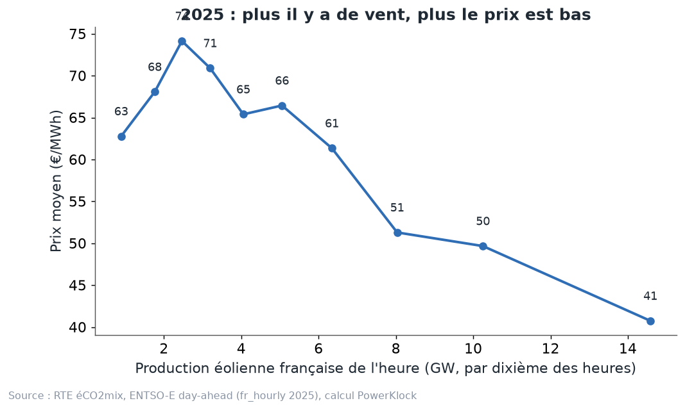

On range toutes les heures de 2025 selon la production éolienne française, et on les coupe en dix paquets égaux. Pour
chaque paquet, on calcule le prix moyen (RTE éCO2mix, ENTSO-E, calcul PowerKlock).
- Autour de **2,5 GW** de vent, le prix moyen est de **74 €**.
- Pour le dixième des heures le plus venteux (environ **15 GW** en moyenne), il tombe à **41 €**.

**Une petite surprise.** Les heures sans vent du tout ne sont pas les plus chères (63 € pour le premier paquet). Ce
sont souvent des heures d'été, avec beaucoup de soleil, qui fait déjà baisser le prix.

**Pourquoi le vent fait baisser le prix : deux causes qui s'additionnent.**
1. **Chez nous.** Le vent ne coûte rien à produire. Il entre en bas du merit order et pousse les centrales plus
   chères hors du marché. Le prix baisse.
2. **Chez les voisins.** Quand il y a du vent en France, il y a souvent du vent en Allemagne aussi : c'est la même
   météo qui traverse l'Europe. Les voisins ont alors moins besoin de notre électricité, et la paient moins cher.

**L'image.** Tu vends des parapluies au marché. Quand il pleut, tu en as beaucoup à vendre. Mais il pleut aussi chez
tous les vendeurs voisins. Tout le monde a des parapluies en même temps, et le prix baisse deux fois.

C'est ce que les spécialistes appellent la **cannibalisation** : plus il y a d'éoliennes, plus elles produisent
toutes en même temps, et moins chaque MWh éolien vaut.

### 3. Le vent et le soleil des voisins
**L'étude.** Stiewe, Xu, Eicke et Hirth ont mesuré cet effet sur **30 zones de prix européennes, de 2015 à 2023**. Ils
regardent la « valeur » de l'éolien et du solaire. C'est le **value factor** : le prix capté par la filière, divisé
par le prix moyen. Pour nous, c'est la capture du chapitre 2.

Ils mesurent combien cette valeur baisse quand la part du vent ou du soleil augmente d'un point, chez nous et chez
les voisins :

| Filière | Un point de plus chez nous | Un point de plus chez les voisins |
|---|---|---|
| Éolien | −0,62 point de valeur | −0,49 point de valeur |
| Solaire | −1,39 point de valeur | **−2,38 point de valeur** |

(L'article donne −0,486 pour le vent des voisins, arrondi à 0,48 dans son résumé.)

**Comment le lire.**
- **Pour l'éolien,** le vent des voisins pèse presque autant que le nôtre. Si la part du vent monte d'un point
  partout en même temps, l'éolien perd environ **1 point** de valeur.
- **Pour le solaire, c'est pire :** le soleil des voisins pèse **plus** que le nôtre. Si la part du solaire monte d'un
  point partout, le solaire perd presque **4 points**.

**Pourquoi le solaire est plus touché.** Le midi est le même pour tout le monde. Quand il fait beau à Paris, il fait
souvent beau à Berlin et à Madrid, à la même heure. Et nos voisins, l'Allemagne et l'Espagne surtout, ont beaucoup de
solaire. Les auteurs notent d'ailleurs que les interconnexions stabilisent mieux la valeur de l'éolien que celle du
solaire.

**Le lien avec le chapitre 6.** Même quand la France est coupée, le vent allemand fait bouger le prix français : 67,5 €
dans les heures coupées de 2025 où le vent allemand est faible, 42,4 € quand il est fort (débrief du 31 octobre). C'est
la même cannibalisation transfrontalière, vue dans nos propres données.

**Pour le pricing.** Un modèle qui ne regarde que la France sous-estime la cannibalisation. C'est pour ça que le
générateur fait grandir le solaire et l'éolien des voisins aussi, à leur propre rythme, plafonné par leurs objectifs
2030.

### 4. Le soleil et le midi

Avril–septembre 2025, heure moyenne (RTE éCO2mix, ENTSO-E, calcul PowerKlock) :
- le prix est autour de **60 €** le matin, vers 7–8 h ;
- il tombe à **moins de 5 €** vers **14 h**, quand le soleil est au plus haut ;
- il remonte à **plus de 80 €** le soir, quand le soleil se couche et que tout le monde rentre chez soi.

C'est la **courbe de canard** : vue de profil, la courbe du prix a la forme d'un canard, avec le ventre creux à midi
et le cou dressé le soir.

**Et ça grossit.** RTE prévoyait, pour l'été 2026, un pic de production solaire « de l'ordre de 20 GW » en milieu de
journée (bilan du premier semestre 2026). Chaque année, il y a plus de panneaux, et le creux de midi se creuse.

**Ce qui amortit le creux :**
- le nucléaire qui module à midi (chapitre 4) ;
- les STEP et les batteries, qui se chargent à midi ;
- les exports, tant que les lignes ont de la place ;
- le solaire et l'éolien qui s'arrêtent aux prix négatifs.

**Pour un PPA solaire.** C'est le cœur de la cannibalisation solaire. Notre capture solaire « payée » est passée de
**0,85 (2023) à 0,56 (2026, janvier–octobre)** (`fr_capture.json`).

### 5. La sécheresse et le vent
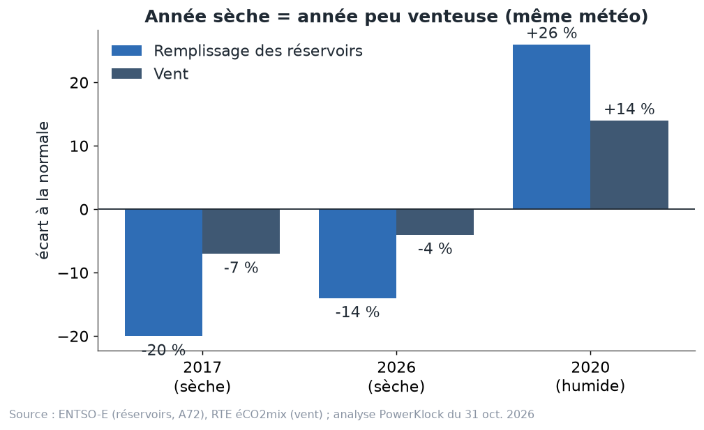

C'est le lien le plus surprenant : **une année sèche est souvent aussi une année peu venteuse.**

**Les chiffres** (analyse de la session du 31 octobre, réservoirs ENTSO-E A72 et vent RTE) :
- lien (corrélation) entre le remplissage des réservoirs et le vent : **+0,32** sur l'année, **+0,42 en hiver** ;
- **2017**, année sèche : réservoirs **−20 %** sous la normale, vent **−7 %** ;
- **2026**, année sèche : réservoirs **−14 %**, vent **−4 %** ;
- **2020**, année humide : réservoirs **+26 %**, vent **+14 %**.

Une corrélation de +0,32, c'est un lien réel mais modéré : les deux vont souvent dans le même sens, pas toujours.

**Un mot sur 2026.** RTE décrit un premier semestre contrasté : un hiver très humide (le février le plus pluvieux
jamais observé), puis un printemps parmi les dix moins pluvieux depuis 1959. Les stocks d'eau, faibles en début
d'année, étaient revenus près de la moyenne fin juin. Notre « −14 % » est une moyenne sur l'année : il ne dit pas que
les barrages étaient bas tous les mois. (Ce chiffre vient de l'analyse du 31 octobre ; le script n'est pas dans le
dépôt.)

**Le mécanisme.**
- Les **dépressions atlantiques** apportent vent **et** pluie.
- Les **anticyclones** sont calmes, secs, souvent chauds.
- **La chaleur baisse aussi le nucléaire** : l'eau des fleuves est trop chaude pour refroidir les centrales. Pendant
  les canicules de 2026, la perte a atteint jusqu'à environ 8 à 9 GW certains jours (RTE).
- RTE note aussi que les canicules conduisent « régulièrement (mais pas systématiquement) à une forte diminution de
  la production éolienne en Europe ».

**L'image.** Un été d'anticyclone, c'est une semaine où toute la maison tourne au ralenti : les barrages sont bas, les
éoliennes ne tournent pas, et la chaudière nucléaire a du mal à se refroidir. Tout manque en même temps.

**Conséquence pour le pricing.** Une année sèche cumule moins d'hydraulique, moins de vent, et parfois moins de
nucléaire. Le prix moyen monte. Et la capture de l'éolien peut monter aussi : il souffle justement quand l'eau manque
et que le prix est haut. Tirer la météo par semaines entières d'une même année garde ces liens. Tirer chaque variable
à part les casserait.

### 6. Le gaz donne l'échelle
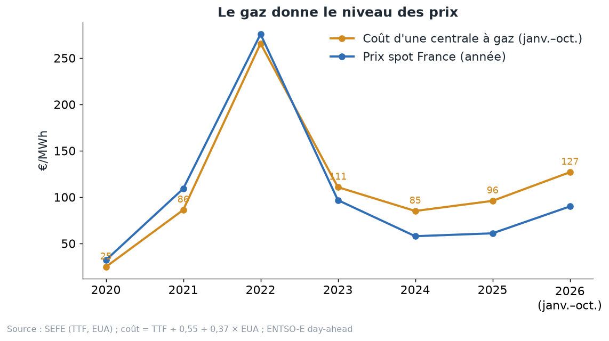

**Le coût d'une centrale à gaz.** On le calcule avec une formule simple : prix du gaz (TTF) ÷ 0,55 (le rendement de la
centrale) + 0,37 × prix du CO2 (EUA). Sur janvier–octobre, il valait **96 €** en 2025 et **127 €** en 2026 (`calc.py`,
SEFE). (Le débrief du 31 octobre dit 94 € pour 2025. Les fichiers ne disent pas d'où vient cet écart de 2 € ; retiens
« 94 à 96 € ».)

**Le constat.** Le schéma montre que le prix spot français suit le coût du gaz, année après année. Il était au-dessus
de 2020 à 2022, en dessous depuis 2023.

**Même dans les heures coupées.** On pourrait croire que, coupée de ses voisins, la France ne voit plus le gaz : chez
elle, le gaz est rarement la dernière centrale appelée. Pourtant, dans les heures coupées (débrief du 31 octobre) :
- prix ÷ coût d'une centrale à gaz ≈ **0,61** en moyenne, en 2025 **et** en 2026, alors que le gaz a fortement monté ;
- plus finement : **0,42 à 0,45** dans les heures coupées venteuses, **0,72 à 0,78** dans les heures coupées calmes,
  stable de 2024 à 2026.

**Pourquoi.**
- Même coupée, la France vend à l'Italie, à la Suisse et à la Grande-Bretagne, où le gaz fixe souvent le prix.
- L'eau des barrages se valorise au prix futur, qui dépend du gaz.

**L'image.** Le gaz, c'est l'échelle. Le vent, le soleil et l'eau disent sur quel barreau on se trouve. Quand le gaz
double, toute l'échelle s'allonge, mais le barreau d'une heure venteuse reste à peu près au même endroit : vers 0,4 à
0,45 de la hauteur.

**Conséquence pour le pricing.** Le générateur exprime les prix **en proportion du coût du gaz**. Ce constat le
justifie : on peut changer le niveau du gaz sans changer la forme des prix.

### 7. Ce qui reste ouvert
- **Le lien sécheresse–vent** repose sur une dizaine d'années. Une seule année peut le contredire.
- **Le rapport prix ÷ gaz de 0,6** tiendra-t-il si la limite d'export vers Core change fortement ? On ne l'a pas
  testé.
- **Les chiffres de Stiewe et al.** sont des moyennes sur 30 zones européennes. Ils ne sont pas propres à la France.

### 8. Ce que ça change pour un PPA
- **Éolien :** il souffle en même temps que chez les voisins. Il faut modéliser le vent allemand avec le vent
  français, pas séparément.
- **Solaire :** le soleil des voisins pèse plus que le nôtre. La croissance du solaire allemand et espagnol est un
  risque pour un PPA solaire français, même si la France ne construit plus rien.
- **Météo :** tirer des semaines réelles entières garde ensemble le vent, la pluie et la chaleur.
- **Gaz :** il fixe le niveau. Un PPA signé quand le gaz est cher a un prix plus haut, mais la capture (le rapport)
  dépend surtout du reste.

### À retenir
1. Rien n'arrive seul : vent, pluie, chaleur et voisins vont ensemble, parce que c'est la même météo.
2. Plus il y a de vent, plus le prix baisse : 74 € à environ 2,5 GW de vent, 41 € à environ 15 GW (2025).
3. Le vent des voisins pèse presque autant que le nôtre ; le soleil des voisins pèse plus que le nôtre (Stiewe et al.).
4. Le soleil creuse le prix de midi : moins de 5 € vers 14 h en été 2025, plus de 80 € le soir.
5. Une année sèche est souvent peu venteuse, et souvent chaude : moins d'eau, moins de vent, moins de nucléaire.
6. Le gaz donne l'échelle : dans les heures coupées, le prix français vaut environ 0,6 fois le coût d'une centrale à
   gaz.

### Question pour vérifier
Imagine l'été 2027 : long anticyclone sur toute l'Europe, chaud et sec, et le gaz monte de 30 %. D'après toi :
- (a) que deviennent la production des barrages, le vent et le nucléaire en France ;
- (b) le prix moyen français monte-t-il ou baisse-t-il, et par quels chemins ;
- (c) la capture d'un parc éolien français cet été-là monte-t-elle ou baisse-t-elle ?

### Pour aller plus loin
- Stiewe, Xu, Eicke et Hirth, « Cross-border cannibalization: Spillover effects of wind and solar energy on
  interconnected European electricity markets » — https://arxiv.org/abs/2405.17166
- Hirth (2013), « The market value of variable renewables », *Energy Economics* —
  https://cadmus.eui.eu/bitstream/handle/1814/27135/RSCAS_2013_36.pdf
- RTE, *Bilan du système électrique, premier semestre 2026* (météo, chaleur et nucléaire, stocks d'eau) —
  https://assets.rte-france.com/prod/public/2026-07/2026-07-16-bilan-semestre1.pdf
- Modo Energy, « Capturing cannibalisation » (pourquoi aligner la météo des prix et de la production) —
  https://forecastdocs.modoenergy.com/docs/capturing-cannibalisation
- Dossier PowerKlock : `docs/discussion/cours/cours_detail.md` (chapitre 7), `docs/discussion/pricing/debrief-2026-10-31.md`
  (section 4), `docs/discussion/cours/calc.json`.

## Chapitre 8 à l'oral — 2026, une année à part, version complète

*Pour Tom · 1er novembre 2026 · à lire à voix haute, environ 15 minutes*

### 1. Pourquoi parler d'une seule année
D'habitude, une année ressemble à la précédente, avec un peu plus de solaire et un peu plus d'éolien. 2026 ne
ressemble à rien de connu. Plusieurs chocs sont arrivés en même temps :
- le **gaz cher**, qui tire les prix moyens vers le haut ;
- **beaucoup d'heures à prix nul ou négatif**, qui tirent le midi vers le bas ;
- un **nucléaire moins souple** au printemps ;
- une **sécheresse** en fin d'été.

Résultat : des prix à la fois plus hauts en moyenne et plus souvent à zéro. C'est important pour toi, parce qu'un
pricer apprend sur le passé. Si une année du passé est bizarre, le pricer apprend des choses bizarres. Ce chapitre
dit ce qui s'est passé, puis pourquoi ça piège les modèles.

Un rappel avant de commencer : les chiffres de 2026 vont de **janvier à octobre**. Ce n'est pas l'année entière.

### 2. Le gaz cher
**Le coût d'une centrale à gaz.** On le calcule avec une formule simple :
coût = prix du gaz (TTF) ÷ 0,55 + 0,37 × prix du CO2.
- Le « ÷ 0,55 » dit qu'une centrale transforme environ 55 % de l'énergie du gaz en électricité.
- Le « 0,37 × CO2 » est le coût des quotas de CO2 qu'elle doit acheter pour chaque MWh.

**Les chiffres** (SEFE pour les prix du gaz et du CO2, calcul PowerKlock `calc.py`) :
- **127 €/MWh** de janvier à octobre 2026 ;
- contre **94 €** en 2025 (débrief du 31 octobre), ou **96 €** si on compare sur janvier–octobre 2025.

Le prix spot moyen français suit : **61 €** en 2025, **90 €** en 2026 (janvier–octobre, ENTSO-E).

**Pourquoi le gaz donne le niveau.** Le gaz est souvent la centrale la plus chère qu'il faut allumer, donc celle
qui fixe le prix des heures difficiles. Et même quand la France est coupée de ses voisins, elle vend à l'Italie, à
la Suisse, à la Grande-Bretagne, où le gaz fixe le prix. L'eau des barrages, elle, se valorise au prix futur, qui
dépend aussi du gaz.

**Le chiffre qui le montre** (débrief du 31 octobre) : pendant les heures où la France est coupée, son prix vaut en
moyenne **0,61 fois** le coût du gaz, **en 2025 comme en 2026**. Le gaz est passé de 94 à 127 €, et le rapport n'a
pas bougé. C'est comme un pourboire calculé en pourcentage : l'addition monte, le pourcentage reste le même.

### 3. Les prix nuls ou négatifs : environ 800 heures
**Rappel.** Un prix négatif veut dire que des producteurs paient pour produire. Ils le font quand s'arrêter leur
coûterait plus cher : un nucléaire qui ne peut pas baisser plus, un parc payé quel que soit le prix, une cogénération
qui doit chauffer.

**Compter au quart d'heure.** Depuis le **1er octobre 2025**, le prix est fixé par quart d'heure. Il faut donc
compter les quarts d'heure à prix nul ou négatif, puis diviser par 4.
- Compté ainsi : **805 heures** en 2026 (janvier–octobre), contre **742** sur toute l'année 2025 (`calc.py`).
- Si on fait d'abord la moyenne de chaque heure, on trouve seulement **670 heures** en 2026. Une heure dont la
  moyenne reste positive peut cacher un ou deux quarts d'heure négatifs.
- pv magazine (2 octobre 2026) parle d'« environ 800 heures ». C'est le comptage au quart d'heure qui retombe dessus.

Pour comparer : **549 heures** à prix nul ou négatif sur toute l'année 2024.

Attention en lisant ce schéma : il compte sur la **moyenne de chaque heure**. Pour 2026, il montre donc moins que
les 805 heures du comptage au quart d'heure.

**Les records** (RTE, bilan du premier semestre 2026) :
- **407 heures négatives** au premier semestre 2026, contre 363 au premier semestre 2025 ;
- **−478,8 €/MWh** le 26 avril 2026 ;
- **−498,7 €/MWh** le 1er mai 2026.

Le plancher de l'enchère était alors de −500 €/MWh. Il est passé à −600 € le 28 mai 2026.

### 4. Le nucléaire moins souple au printemps
**Pourquoi ces records au printemps ?** RTE l'explique dans son bilan du premier semestre 2026.

**Le minimum technique.** Un réacteur peut baisser sa puissance, mais pas jusqu'à zéro. Le plus bas qu'il peut
atteindre s'appelle son minimum technique. D'après RTE, il varie **entre 25 % et 100 %** de sa puissance, selon
notamment l'avancement dans le **cycle du combustible**. En fin de cycle, un réacteur ne module presque plus.

**Au printemps 2026, beaucoup de réacteurs étaient en fin de cycle en même temps.** Résultat :
- le minimum technique de tout le parc était d'environ **31 GW le 1er mai 2026** à midi ;
- contre **19 GW le 1er mai 2025** ;
- le nucléaire a modulé d'environ **10 TWh** au premier semestre 2026, contre près de **20 TWh** un an plus tôt.

**L'image.** Pense à une chorale. D'habitude, beaucoup de chanteurs peuvent baisser la voix quand on le leur
demande. Au printemps 2026, une bonne partie ne pouvait plus chanter moins fort. Le volume minimum de la chorale a
monté de 19 à 31. À midi, avec le soleil en plus, il y avait trop de son : le prix a plongé.

**Une correction importante.** Notre débrief du 31 octobre attribuait cela à un accord RTE–EDF du 27 mars 2026,
qu'il présentait comme un « minimum national de production nucléaire ». C'est faux :
- cet accord (CRE, délibération 2026-67) permet à RTE de garder certains réacteurs allumés pour régler la
  **tension** du réseau, du 4 avril au 30 octobre 2026 ;
- RTE juge que ces demandes n'ont joué « qu'un rôle marginal » ;
- la vraie cause, c'est le **cycle du combustible**.

### 5. La sécheresse de fin d'été
**Ce qu'on a mesuré** (analyse de la session du 31 octobre, ENTSO-E et RTE) :
- le remplissage des réservoirs des barrages : **−14 %** en moyenne annuelle (2017, autre année sèche : −20 %) ;
- le vent : **−4 %**.

RTE notait encore des stocks d'eau proches de la moyenne fin juin. C'est la fin de l'été qui a été sèche : pv
magazine relève environ **−1,5 GW** d'hydraulique en septembre.

**Pourquoi sécheresse et vent vont ensemble.** Les dépressions venues de l'Atlantique apportent à la fois le vent
et la pluie. Les anticyclones sont calmes, secs, souvent chauds. Sur une dizaine d'années, la corrélation entre le
remplissage des réservoirs et le vent est de **+0,32**, et **+0,42 en hiver** (même analyse). On l'a vu au
chapitre 7.

**Et le nucléaire ?** Les centrales en bord de rivière doivent baisser leur production quand l'eau est trop chaude
ou trop basse. RTE estime que, en cas de sécheresse prolongée en fin d'été, l'effet pourrait atteindre **2 à 3 GW**,
mais qu'il reste « de second ordre » sur l'année.

Une année sèche cumule donc trois choses : moins d'eau, moins de vent, parfois moins de nucléaire. Les prix montent.

### 6. L'éolien a bien tenu : 0,936 → 0,976
**D'abord, d'où vient ce chiffre.** Tu m'as demandé s'il venait de RTE. Non. RTE ne publie pas de taux de capture.
C'est un calcul du **pricer PowerKlock**, dans sa convention appelée « curt » :
1. on ne compte que les MWh **payés**, c'est-à-dire produits quand le prix est positif ;
2. on calcule la capture **mois par mois** : prix moyen obtenu par l'éolien ÷ prix moyen du mois ;
3. on fait la moyenne des mois, en donnant plus de poids aux mois où l'éolien produit le plus.

Résultat, de janvier à octobre : **0,936 en 2025, 0,976 en 2026**. Ce sont des chiffres « year to date », comme tu
l'as rappelé.

**L'année entière est toujours un peu plus basse.** Le même calcul sur l'année entière donne **0,906 en 2024** et
**0,923 en 2025**. Novembre et décembre font en général baisser la moyenne. Donc 0,976 n'est pas la capture de 2026 :
c'est son cumul à fin octobre.

**Les autres définitions donnent d'autres niveaux** (`fr_capture.json`, janvier–octobre) :
- calculée d'un seul bloc sur la période, au lieu de mois par mois : **0,971 → 0,976** ;
- avec toute la production comptée, même celle des heures à prix nul ou négatif : **0,891 → 0,888**.

Le sens est le même : 2026 au moins aussi bon que 2025. Mais on ne compare que des chiffres de **même définition**.
C'est comme comparer des températures : il faut savoir si c'est en degrés Celsius ou Fahrenheit.

**Pourquoi l'éolien a bien tenu.** Il a soufflé au bon moment.
- **43,7 %** de sa production de janvier à octobre 2026 est tombée de janvier à mars ;
- contre **35,5 %** en 2025 (RTE éCO2mix, calcul PowerKlock).

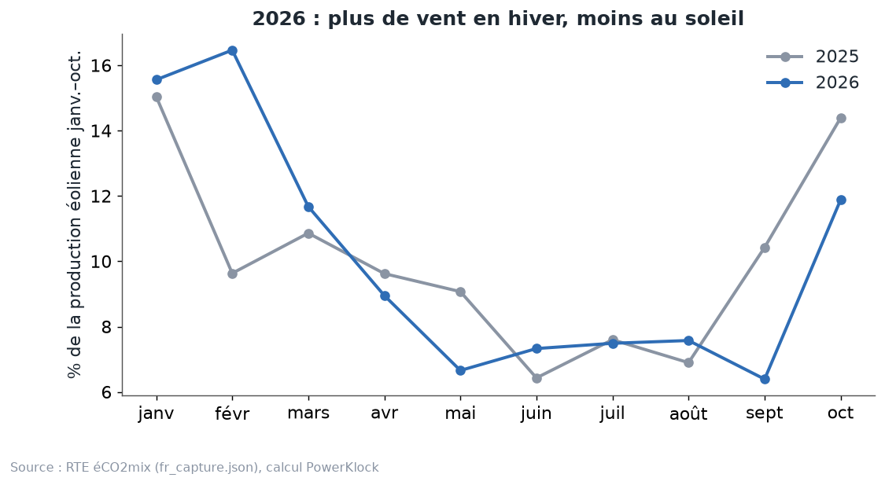

L'hiver, l'électricité est chère. Et quand le vent souffle en hiver, il souffle moins en même temps que le soleil
de midi. Ses MWh ont donc valu plus. **C'est de la chance météo, pas une tendance.**

### 7. Pourquoi 2026 piège les modèles
Un modèle de prix apprend sur le passé. Or 2026 contient des situations qu'**aucune année d'apprentissage** n'avait
montrées. Quatre pièges.

**Piège 1 : les pics des heures calmes.** Avec le gaz à 127 €, la règle de prix sous-estime les pics des heures sans
vent : erreur horaire de **33 €** (débrief du 31 octobre). Cela fausse la valeur relative du vent quand on teste sur
les vraies données. Le générateur y est moins exposé, parce qu'il raisonne en valeur relative.

**Piège 2 : les prix négatifs trop profonds.** Si on exprime tout en proportion du gaz, un gaz cher rend aussi les
prix négatifs plus profonds dans la simulation. Pour 2025, une règle apprise avec du gaz cher simulait des prix
négatifs de **−12 à −17 €**, quand la réalité était de **−2 à −7 €** (commentaire de `scripts/ppa_scenarios.py`). Or les prix négatifs viennent des renouvelables et du
nucléaire qui ne s'arrêtent pas, pas du gaz. Depuis le 30 octobre, la partie négative du prix est donc apprise en
euros, à part.

**Piège 3 : le nucléaire raide.** Aucune année apprise n'avait un minimum technique de **31 GW** au printemps. Le
modèle ne peut pas deviner une situation qu'il n'a jamais vue. C'est une cause probable des erreurs sur 2026.

**Piège 4 : le modèle de la France isolée.** Son biais monte à **+8 €** en 2026, contre **+1 €** en 2024–2025
(dossier couplage).

**Ce que ça fait aux tests.** Plusieurs méthodes « gagnaient » en moyenne, mais perdaient **4 à 11 €** sur 2026
sans ancrage :
- la correction par situation : **−4 à −8 €** ;
- le « tout combiné » : **−11 €**.

Elles ont été écartées pour cette raison. À l'inverse, lire la limite d'export JAO de chaque heure a beaucoup aidé
sur 2026 : pour 2026 pricée un an avant, l'erreur est passée de **−7,62 à +1,65 €** en solaire et de **+7,17 à
+2,19 €** en éolien (commentaire de `scripts/ppa_scenarios.py`).

### 8. Ce que ça change pour un PPA
**L'ancrage de janvier 2027.** Le pricer recale son niveau sur la dernière année complète (on le verra au
chapitre 9). Aujourd'hui, c'est 2025. En janvier 2027, ce sera 2026. Si 2026 est atypique, le facteur de recalage le
sera aussi. Il faudra regarder ce facteur de près ce mois-là. La fiche des paramètres prévoit justement de revoir
l'ancrage en janvier, et après une année atypique.

**Ne pas ancrer sur un cumul partiel.** Pour un PPA éolien 2027–2029 signé en novembre, tu as répondu : « 0,923, ou
le 12 mois roulant ». 0,923 est le bon réflexe : c'est une année civile complète. Le 0,976 de 2026 est un cumul à fin
octobre, sur une année de chance météo.

**Le marché à terme voit aussi 2027 à part.** Au 30–31 octobre, le Cal 2027 cotait **128,16 €/MWh**, le Cal 2028
**70,94** et le Cal 2029 **62,97** (EEX, via SEFE ; fiche des paramètres du pricer). La crise du gaz est dans le prix
de 2027, beaucoup moins après.

### À retenir
1. 2026 : gaz cher (127 € contre 94–96 €), donc prix moyens hauts.
2. Environ 800 heures à prix nul ou négatif, **comptées au quart d'heure** (805 ; 670 si on moyenne d'abord chaque
   heure). Records à −478,8 € et −498,7 €.
3. Le nucléaire a été moins souple au printemps à cause du **cycle du combustible** (31 GW de minimum contre 19 GW),
   pas à cause de l'accord RTE–EDF.
4. Fin d'été sèche : moins d'eau, un peu moins de vent.
5. L'éolien a eu de la chance : capture 0,936 → 0,976 de janvier à octobre, convention « curt » du pricer, pas un
   chiffre RTE. L'année entière finit toujours un peu plus bas.
6. Une année aussi spéciale ne doit pas servir seule de modèle, ni d'ancrage sans vérification.

### Question pour vérifier
Imagine qu'en janvier 2027, l'année complète 2026 entre dans le pricer et devienne l'année d'ancrage. D'après toi :
- (a) la capture éolienne de 2026 sur l'année entière sera-t-elle plus haute ou plus basse que 0,976 ? Pourquoi ?
- (b) si le générateur n'a pas su reproduire la chance hivernale du vent en 2026, dans quel sens le facteur
  d'ancrage de l'éolien va-t-il bouger, et qu'est-ce que ça fait au prix des PPA éoliens 2028–2029 ?
- (c) quel chiffre de 2026 te paraît le plus dangereux à recopier tel quel dans un modèle : le gaz à 127 €, les
  805 heures à zéro, ou le minimum nucléaire de 31 GW ?

### Pour aller plus loin
- RTE, *Bilan du système électrique, premier semestre 2026* (prix négatifs, nucléaire, hydraulique) —
  https://assets.rte-france.com/prod/public/2026-07/2026-07-16-bilan-semestre1.pdf
- RTE, *Bilan électrique 2025* —
  https://assets.rte-france.com/prod/public/2026-02/Bilan-electrique-2025-principaux-resultats.pdf
- CRE, délibération n° 2026-67 du 27 mars 2026 (accord RTE–EDF sur la tension) —
  https://www.cre.fr/fileadmin/Documents/Deliberations/2026/260327_2026-67_Approbation_Accord_Injection_THT.pdf
- pv magazine, 2 octobre 2026 (environ 800 heures) —
  https://www.pv-magazine.com/2026/10/02/france-hits-record-800-hours-of-negative-zero-electricity-prices/
- Kpler, « Nuclear modulation insights » (février 2026) —
  https://www.kpler.com/blog/nuclear-modulation-insights-volumes-and-units-behaviours
- Dossier PowerKlock : `docs/discussion/cours/calc.json` (recalcul), `docs/discussion/pricing/debrief-2026-10-31.md`
  (à lire avec la correction sur l'accord RTE–EDF).

## Chapitre 9 à l'oral — le générateur de scénarios, version complète

*Pour Tom · 1er novembre 2026 · à lire à voix haute, environ 15 minutes*

### 1. Le problème
Tu veux savoir ce que vaudra un MWh solaire ou éolien en 2028. Pour ça, il te faut sa **capture** : le prix obtenu
par le parc divisé par le prix moyen. Mais personne ne connaît la météo de 2028, ni le prix de chaque heure de 2028.

L'idée du générateur : **fabriquer des années possibles**, des milliers, et regarder ce que la capture y vaut. C'est
le cœur du pricer v2, en ligne depuis le 31 octobre 2026. Depuis cette date, c'est **la seule méthode** qui fait le
prix ; les anciennes méthodes restent affichées comme repères.

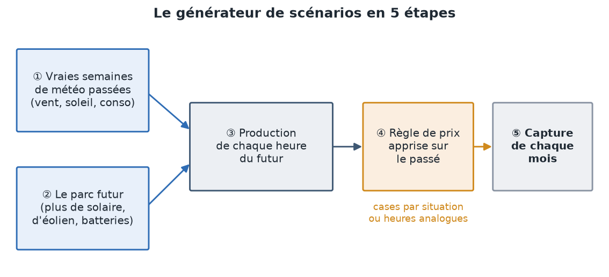

Il y a cinq étapes. On les prend une par une.

### 2. Étape 1 : de vraies semaines de météo
On ne fabrique pas de la météo au hasard. On reprend de **vraies semaines passées**, de **2019 à 2025**, sans 2022
(l'année de la crise, trop à part).

On les enchaîne pour faire une année : une vraie semaine de janvier 2021, puis une vraie semaine de janvier 2024, et
ainsi de suite. Chaque semaine est prise dans la même saison, avec le même type de jours.

**Le point clé : on garde tout ce qui s'est passé ces jours-là, ensemble.** Le vent, le soleil, la consommation, le
nucléaire, l'eau, les voisins. Au chapitre 7, on a vu que ces choses sont liées : une semaine sèche est souvent une
semaine sans vent ; une semaine venteuse en France l'est souvent en Allemagne. Si on tirait chaque chose à part, on
casserait ces liens.

**L'image.** C'est comme faire un album avec de vraies pages d'anciens albums, plutôt que de découper chaque photo
et de les recoller au hasard. Chaque page reste cohérente.

### 3. Étape 2 : le parc futur
On pose cette météo sur le **parc de l'année livrée** :
- pour la France, le rythme de croissance récent, **jamais sous la trajectoire de la PPE3** ;
- pour les voisins, leur rythme récent ;
- les batteries.

La production par GW installé est ramenée au niveau récent (arrêts, autoconsommation). On obtient la production
de chaque heure du futur : le vent de janvier 2021, mais avec les éoliennes de 2028.

### 4. Étape 3 : la règle de prix
Il faut maintenant un prix pour chaque heure. On utilise une **règle apprise sur le passé**.

**Le prix en proportion du gaz.** La règle dit : prix de l'heure = coût d'une centrale à gaz × un coefficient. Le
coefficient dépend de la situation de l'heure (combien il reste à produire après le solaire, l'éolien et le
nucléaire, à quelle heure, quelle saison).

Pourquoi en proportion du gaz ? Parce qu'on l'a mesuré au chapitre 8 : pendant les heures coupées, le prix français
vaut **0,61 fois** le coût du gaz en 2025 comme en 2026, alors que le gaz est passé de 94 à 127 €. Le pourcentage
tient quand l'addition change.

**Deux exceptions :**
- les **prix négatifs** sont appris à part, **en euros**. Ils viennent des renouvelables et du nucléaire qui ne
  s'arrêtent pas, pas du gaz (adopté le 30 octobre) ;
- la **dernière année apprise pèse deux fois plus** que la précédente. Ton idée du 31 octobre : « les données
  récentes pèsent plus ». Au rejeu, ça a fait passer l'erreur de **1,32 à 1,18 €/MWh** en solaire et de **1,13 à
  0,96** en éolien (commentaire de `scripts/ppa_scenarios.py`).

**Les cases.** La règle range les heures dans des **cases**, comme des tiroirs : « France coupée, beaucoup de
surplus, midi, printemps »… Dans chaque tiroir, elle a appris un coefficient moyen.

### 5. Les deux régimes : couplée ou coupée
C'est le lien direct avec les chapitres 5 et 6. Chaque heure du futur est dans l'un de deux régimes :
- **France couplée** : son prix suit celui de ses voisins ;
- **France coupée** : elle a plus à exporter que ce que les lignes peuvent porter.

**Comment le générateur décide.** Il calcule ce que la France doit exporter : nucléaire disponible + solaire + éolien
− consommation. Il compare ce surplus à la **limite d'export vers Core publiée par JAO** pour cette heure-là (les
jours tirés sont ramenés au niveau de la dernière année connue). Plus le surplus dépasse la limite, plus la chance
que la France soit coupée est grande.

Lire la limite JAO de l'heure, plutôt que le surplus seul, a fait baisser l'erreur de rejeu de **1,19 à 1,07 €** en
solaire et de **3,08 à 2,42 €** en éolien (adopté le 31 octobre, commentaire du script).

**Ce repère se prévoit bien.** Part du vent produite pendant les heures coupées (débrief du 31 octobre) :

| | 2023 | 2024 | 2025 |
|---|---|---|---|
| Indicateur calculé à l'avance | 17 % | 39 % | 66 % |
| Réalité | 18,5 % | 49 % | 67,5 % |

**Au-delà de ce qu'on a vu.** Si le surplus dépasse le plus fort jamais observé, le prix continue de baisser,
jusqu'au plancher observé. Sinon, plus de panneaux ne ferait plus baisser la capture, ce qui serait faux. C'est un
choix de principe que tu as validé le 31 octobre : la méthode doit pouvoir montrer une cannibalisation qui monte.

### 6. Étapes 4 et 5 : la capture, puis la moyenne
- **Étape 4.** Pour chaque mois, capture = prix moyen obtenu par le parc ÷ prix moyen du mois. Le parc s'arrête quand
  le prix est nul ou négatif.
- **Étape 5.** On répète sur des milliers d'années tirées, et on regarde la moyenne et la dispersion. La dispersion
  sert au risque (chapitre 11).

### 7. Le biais de l'éolien : +2,6 €
**Le constat.** Sans correction, la règle paie l'éolien **trop cher d'environ +2,6 €/MWh** (erreur de rejeu 2,62).
Et c'est **presque toujours dans le même sens**, d'un cas à l'autre. Même sur l'année qu'elle a apprise, elle paie
les heures de vent environ **3 % trop cher**.

**Pourquoi.** Un tiroir donne à toutes ses heures le même coefficient : la moyenne du tiroir. Or, dans un même
tiroir, les heures les plus venteuses sont aussi :
- celles où l'Allemagne est venteuse ;
- celles où la France est plus coupée ;
- celles où les voisins paient moins.

Le prix de ces heures-là est donc plus bas que la moyenne du tiroir. La règle leur donne la moyenne : **trop haut**.
Plusieurs choses arrivent ensemble, et un tiroir ne les voit pas toutes.

**L'image.** Un restaurant calcule le pourboire moyen de la soirée. Mais les clients qui viennent les soirs de pluie
laissent moins. Si on applique la moyenne à tout le monde, on surestime ce que rapportent les soirs de pluie.

**Ce n'est pas la forme du modèle.** Trois modèles construits tout à fait autrement font la même erreur :
- la règle par cases ;
- un modèle d'optimisation par semaine (168 heures liées, nucléaire, barrages, gaz, exports) ;
- une régression mensuelle.

Le problème vient de l'information disponible, pas de la façon de la ranger.

**Raffiner les tiroirs n'a pas suffi** (rejeu, éolien sans ancrage, €/MWh) :

| Variante | Erreur |
|---|---|
| Règle publiée | 2,62 |
| Grille surplus × part du vent | 2,31 |
| Pente du vent | 2,38 |
| Courbe de pénétration | 2,39 |

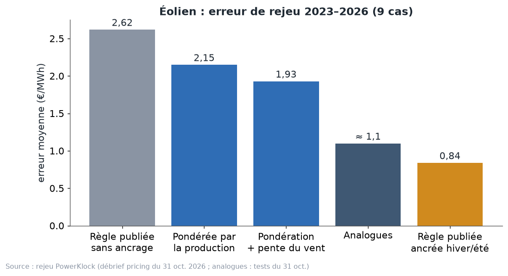

### 8. L'ancrage
**L'image.** Une balance de cuisine qui affiche toujours 3 % de trop. On ne la jette pas. On pèse un objet dont on
connaît le poids, on voit l'erreur, et on la retire de toutes les pesées suivantes.

**La formule.**
capture ancrée (année livrée) = capture du générateur (année livrée) × capture réelle (dernière année connue) ÷
capture du générateur (dernière année connue).

**En mots.** On fait tourner le générateur sur la **dernière année complète**, aujourd'hui 2025, et on regarde de
combien il se trompe. On applique le même rapport à l'année livrée. L'erreur de niveau s'annule. Le générateur ne
donne plus que le **changement** : le parc qui grandit, les batteries, les régimes.

**Trois modes :**
- **sans ancrage** ;
- **un facteur pour l'année** ;
- **hiver/été** : un facteur pour octobre–mars, un autre pour avril–septembre.

**Le choix se fait chaque semaine, par le rejeu.** Chaque dimanche, le pricer rejoue le passé avec les trois modes,
et garde celui qui s'est le moins trompé. La même règle pour le solaire et l'éolien. Aujourd'hui :
- **solaire : sans ancrage** (0,76 €, contre 1,18 avec un facteur annuel et 1,22 en hiver/été). Son niveau était
  déjà juste ; l'ancrage l'abîmerait ;
- **éolien : hiver/été** (0,84 contre 0,96 avec un facteur annuel et 2,62 sans ancrage, avec la règle de la v1).

**Testés et écartés :** ancrer par mois (éolien 1,69), par trimestre (1,52), sur la météo réelle de l'année (1,42),
ou n'appliquer que la moitié du facteur (1,51). Trop de facteurs, c'est recopier le bruit de l'année passée.

**Le défaut.** L'ancrage suppose que l'erreur de l'an dernier sera celle de l'an prochain. Si l'année connue est
atypique, le facteur l'est aussi. C'est exactement le risque de janvier 2027, quand 2026 deviendra l'année d'ancrage
(chapitre 8). Et c'est pour ça qu'on n'ancre jamais sur un cumul partiel.

**Ce que fait le marché.** Pexapark calibre ses modèles sur la cannibalisation implicite des prix de PPA observés.
C'est aussi une forme d'ancrage, sur le marché plutôt que sur l'année passée.

### 9. La pondération par la production (adoptée en v2)
**L'idée vient de la recherche.** Qorbanian, Löhndorf et Wozabal (arXiv 2024, *European Journal of Operational
Research* 2025) apprennent les coûts d'un modèle de prix en donnant à chaque heure un poids égal à la production
attendue de la filière qu'on price. Leur phrase : « we set w_t to the expected capacity factors […] of the technology
we want to price ».

**En mots simples.** Quand on price de l'éolien, les heures sans vent comptent peu : l'éolien n'y vend rien. Alors
on apprend les tiroirs en regardant surtout les heures où le vent produit. Le tiroir se trompe moins là où ça compte.

**Ce que ça donne chez nous.** C'est la seule amélioration qui a tenu sur tous les tirages :
- sur l'année apprise, le facteur d'ancrage passe de **0,97** à **0,99–1,00** : la balance est presque juste ;
- en v2, la règle éolienne est pondérée par la production et, quand la France est coupée, lit aussi la part de
  l'éolien. L'erreur de rejeu de l'éolien passe de **0,84 à 0,56 €/MWh** (sur 3 tirages, `choix_v2.md`).

**Pourquoi pas pour le solaire ?** Pondérée par le solaire, la règle dégrade le solaire : **0,76 → 1,41**. Donc on
garde **un seul générateur**, et seule la pondération suit la filière pricée.

**Une nuance honnête.** Ces auteurs testent leur modèle sur l'Espagne, l'Allemagne et la France, avec la vraie
demande et les vrais échanges, ce qui est plus facile que notre rejeu. Et c'est **en France** que leur modèle marche
le moins bien. Ça ne règle pas tout : sans ancrage, même pondéré, l'éolien reste trop cher d'environ **2,1 à 2,2 €**.

### 10. Les analogues
**L'idée.** Pour chaque heure simulée, on cherche les heures passées qui lui **ressemblent le plus** : même part de
solaire et d'éolien en France et chez les voisins, même excès d'export au-delà de la limite Core, même heure, même
saison. On prend la moyenne de leurs prix (en proportion du gaz).

**L'image.** Pour estimer le prix d'un appartement, on regarde les ventes récentes d'appartements qui lui
ressemblent : même quartier, même taille, même étage.

**Bon pour le vent.** L'analogue d'une heure venteuse est une vraie heure venteuse passée, avec tout ce qui
l'accompagnait : l'Allemagne venteuse, la France coupée. Le biais disparaît : erreur éolienne **d'environ 1,1 €**,
**sans ancrage**, contre 2,62.

**Mauvais pour le solaire.** Le futur sera plus solaire que tout ce qu'on a vu. Les heures passées les plus proches
d'un midi de 2028 sont donc **les pires midis connus**, et l'analogue ne sait pas aller au-delà. Comme estimer un
appartement de 300 m² avec des ventes de 100 m² au plus. Résultat : **4,1 € d'erreur** en solaire. Écartés.

**Le mélange 50/50 analogues + règle : refusé.**
- Il gagne sur les formats glissants : **0,68** (« reste de l'année + année suivante ») et **1,03** (12 mois
  glissants).
- Mais il perd sur les années civiles : **0,89**, contre **0,63** pour la v2.
- Et son pourcentage aurait fini par bouger. Ta règle : on ne change jamais le pourcentage d'un mélange à chaque
  pricing. Ta phrase : « on avait une bonne méthode ».

Les options restent dans le code, désactivées, avec leurs résultats en commentaire.

### 11. La question qui reste
La valeur réelle de l'éolien baisse d'une année à l'autre **plus vite** que tous nos modèles ne le prévoient. Ni la
limite d'export, ni le gaz ne l'expliquent. C'est pour ça que l'éolien reste ancré, et c'est la piste à creuser.

### À retenir
1. Générateur = vraies semaines de météo (2019–2025, sans 2022) + parc de l'année livrée + règle de prix.
2. La règle donne le prix en proportion du gaz, avec deux régimes : France couplée ou coupée, selon la limite JAO de
   l'heure.
3. Les tiroirs surpaient le vent d'environ 2,6 € : dans un même tiroir, les heures venteuses sont aussi les moins
   chères.
4. Ancrage = régler la balance qui pèse 3 % trop lourd, sur la dernière année complète. Le mode est choisi chaque
   semaine par le rejeu : aujourd'hui solaire sans ancrage, éolien hiver/été.
5. v2 : la règle éolienne est pondérée par la production du vent (Qorbanian et al.) : 0,84 → 0,56 €.
6. Analogues : bons pour le vent, mauvais pour le solaire du futur (4,1 €). Le mélange 50/50 a été refusé.

### Question pour vérifier
- (a) Pourquoi le générateur tire-t-il des **semaines entières**, avec toutes leurs variables, plutôt que le vent
  d'une année et le soleil d'une autre ?
- (b) En janvier 2027, l'année d'ancrage devient 2026, où l'éolien a eu de la chance en hiver. Si le générateur ne
  reproduit pas cette chance, le facteur d'ancrage de l'éolien monte-t-il ou baisse-t-il ? Et le prix du PPA ?
- (c) Pourquoi la pondération par la production aide l'éolien mais abîme le solaire, alors que c'est la même idée ?

### Pour aller plus loin
- Qorbanian, Löhndorf et Wozabal, « Valuation of Power Purchase Agreements… », *EJOR* 2025 —
  https://arxiv.org/abs/2403.08846
- Modo Energy, « Capturing cannibalisation » (aligner la météo des prix et de la production) —
  https://forecastdocs.modoenergy.com/docs/capturing-cannibalisation
- Pexapark, prise en compte de la cannibalisation —
  https://help.platform.pexapark.com/en/articles/9577860-how-do-you-account-for-cannibalization
- Stiewe, Xu, Eicke et Hirth, « Cross-border cannibalization » — https://arxiv.org/abs/2405.17166
- Dossier PowerKlock : `docs/discussion/pricing-v2/choix_v2.md` et `parametres.md`, schéma
  `docs/discussion/pricing-v2/schema_v2.png`, débrief `docs/discussion/pricing/debrief-2026-10-31.md`, et les
  commentaires de test dans `scripts/ppa_scenarios.py`.

## Chapitre 10 à l'oral — tester honnêtement, version complète

*Pour Tom · 1er novembre 2026 · à lire à voix haute, environ 15 minutes*

### 1. Pourquoi tester
Un pricer donne toujours un chiffre. Et un chiffre a toujours l'air juste. La seule façon de savoir si une méthode
est bonne, c'est de regarder ce qu'elle aurait dit **dans le passé**, et de comparer avec ce qui s'est vraiment passé.

Tout ce qu'on a décidé au chapitre 9 (l'ancrage, la pondération, le refus des analogues) vient de ces tests. Ce
chapitre dit comment on teste, et surtout jusqu'où on peut croire un test.

### 2. Le rejeu sans fuite
**L'image.** Un prévisionniste météo qui veut savoir s'il est bon ne regarde pas ses prévisions d'hier avec la météo
d'aujourd'hui sous les yeux. Il ressort ses vieilles prévisions, telles qu'il les avait faites, et il les compare à
ce qui est arrivé.

**Chez nous.** On fait semblant d'être fin 2022. On oublie tout ce qui s'est passé après. On price 2023, 2024 et 2025
avec seulement ce qu'on savait alors. Puis on compare au réel. C'est le **rejeu**.

**« Sans fuite » veut dire : aucune information du futur ne doit entrer.** Une fuite, c'est comme un élève qui a vu
les réponses de l'examen : sa note ne dit rien de ce qu'il sait. Concrètement (`scripts/ppa_model_risk.py`) :
- la règle de prix n'apprend que sur les **années complètes connues** à la date du pricing ;
- le parc de l'année livrée est **estimé** avec ce qu'on savait alors, pas lu dans les données réelles ;
- l'ancrage se fait sur la dernière année connue à cette date, exactement comme aujourd'hui ;
- la limite d'export JAO des jours tirés est ramenée au niveau de la dernière année connue.

**Un exemple de ce qui serait une fuite.** On a essayé de donner au générateur la vraie limite JAO de l'année livrée
(un « oracle », qu'on ne peut pas connaître à l'avance). Ça n'a même pas expliqué l'erreur de l'éolien (2,59 contre
2,62, débrief du 31 octobre). Mais si ça avait aidé, on n'aurait pas pu le garder : on ne connaît pas la limite de
2028 aujourd'hui.

### 3. Les 9 cas
**La grille.** Livraisons 2023, 2024, 2025 et 2026 (mois complets seulement), pricées **1, 2 ou 3 ans avant**. Ça
ferait 12 cas. On garde seulement ceux dont la dernière année connue est 2022 ou après, parce qu'avant, il n'y a pas
de limites JAO et le marché était dans un autre régime. Trois cas tombent (2023 pricée 2 ou 3 ans avant, 2024 pricée
3 ans avant). Il reste **9 cas par filière**.

**L'erreur d'un cas.** Valeur du MWh pricée − valeur réalisée, en €/MWh. La production n'est pas payée aux prix nuls
ou négatifs. On résume les 9 cas par l'**erreur moyenne absolue** : la taille moyenne de l'erreur, sans regarder son
sens. Et on regarde à part le **biais** : la moyenne avec le sens.

**Les résultats du pricer v2** (`choix_v2.md`) : **0,76 €/MWh** en solaire, **0,56** en éolien. Pour comparer, la
moyenne des quatre anciennes méthodes se trompait de 2,59 € en solaire et 2,84 € en éolien.

**D'autres formats, pour ne pas dépendre d'un seul découpage.** Le rejeu, refait chaque semaine, compte aussi :
- **33 points trimestriels** ;
- **12 glissants sur 12 mois** ;
- **12 « reste de l'année + année suivante »**.

Ces formats ressemblent à ce que tu signes vraiment. Mais attention : c'est sur les formats glissants que le mélange
50/50 avec les analogues gagnait (0,68 et 1,03), alors qu'il perdait sur les années civiles (0,89 contre 0,63). Ta
règle tranche : on teste sur des **années complètes**.

**Un autre test : le prix prudent tient-il ?** Le prix publié doit tenir dans 3 cas sur 4. Au rejeu, avec le Monte
Carlo complet, il tient dans **78 à 89 %** des cas (fiche des paramètres du 1er novembre). On le verra au chapitre 11.

### 4. Biais contre dispersion
**L'image : deux montres.**
- La première **avance toujours de cinq minutes**. Elle est fausse, mais facile à corriger : tu retires cinq minutes.
  C'est le **biais**.
- La seconde avance un jour, retarde le lendemain. Elle est peut-être juste en moyenne, mais tu ne peux jamais lui
  faire confiance. C'est la **dispersion**.

**Chez nous.**
- L'éolien sans ancrage a un **biais** : environ **+2,6 €**, presque toujours dans le même sens. L'ancrage l'enlève,
  comme on retire les cinq minutes.
- Aucune correction simple n'enlève la **dispersion**.

**L'exemple qui le montre** (débrief du 31 octobre). « Pondération + pente du vent », sans ancrage :
- le biais tombe à **+0,45 €** : presque plus de biais ;
- mais l'erreur moyenne reste **1,93 €**.

Le biais a disparu, la dispersion est restée. Une méthode sans biais n'est pas forcément une bonne méthode.

### 5. Le bruit des tirages : 0,2 €
**Le générateur tire des semaines au hasard.** Si on change le tirage, le résultat bouge un peu. Comme lancer des dés
plusieurs fois : la moyenne n'est jamais exactement la même.

**Ce qu'on a mesuré** (éolien ancré hiver/été, €/MWh, débrief du 31 octobre) :

| Tirage | Modèle publié (v1) | Modèle pondéré |
|---|---|---|
| 1 | 0,84 | 0,71 |
| 2 | 0,77 | 0,64 |
| 3 | 0,71 | 0,48 |

L'écart entre tirages atteint **0,2 €**.

**La règle qu'on en tire.** Un gain ne compte que s'il dépasse **0,2 €**, ou s'il tient sur **tous** les tirages. Le
modèle pondéré passe ce test : il gagne sur chacun des trois tirages. C'est pour ça qu'il a été adopté.

**Plus de tirages ne règle pas tout.** Passer de 30 à 60 années tirées ne bouge le rejeu que de **0,03 €** au plus.
Doubler les tirages ne fait donc pas disparaître le problème : il faut regarder plusieurs tirages différents.

### 6. Les 9 cas ne sont pas indépendants
**Le piège.** On dit « 9 cas », mais les trois horizons d'une même livraison partagent **la même année réelle**. Si
2026 est bizarre, elle est bizarre pour 2026 pricée 1 an avant, 2 ans avant et 3 ans avant. En réalité, on n'a que
**4 années livrées**.

**L'image.** Demander leur avis à neuf personnes, dont trois ont lu le même journal ce matin. Ce n'est pas neuf avis
indépendants.

**La conséquence.** Une seule année atypique, comme 2026, déplace toute la moyenne. On l'a vu au chapitre 8 :
certaines méthodes gagnaient en moyenne mais perdaient 4 à 11 € sur 2026.

### 7. Ton exemple : le 12 mois roulant
**Ta question.** Pour un PPA éolien 2027–2029 signé en novembre, sur quelle capture pricer ? Tu as répondu :
« 0,923, ou le 12 mois roulant (jamais essayé) ».

**En fait, il a été essayé**, fin octobre (commentaire de `scripts/ppa_scenarios.py`, à la ligne d'`ANCHOR`). L'idée :
ancrer sur les **12 derniers mois complets** plutôt que sur la dernière année civile. Résultat, en pricing à fin
octobre, sur **6 cas** :
- solaire : **1,10 → 1,08 €/MWh** ;
- éolien : **1,47 → 1,67 €/MWh**.

Pas retenu.

**Puis je t'ai demandé : « 6 cas suffisent-ils pour trancher ? »** Tu as répondu non. Et c'est juste, pour trois
raisons :
1. **le bruit des tirages** (0,2 €) vaut à peu près l'écart mesuré en éolien, et bien plus que l'écart en solaire ;
2. **les cas ne sont pas indépendants** : plusieurs partagent la même année livrée ;
3. **une année atypique pèse lourd** : avec 6 cas, 2026 compte pour beaucoup.

**Le bon verdict.** On ne peut pas dire que le 12 mois roulant est **pire**. On peut seulement dire qu'il n'est **pas
mieux**. Et quand une méthode n'est pas mieux, on garde celle qu'on a : l'année civile complète, plus simple, et sans
ancrage sur un cumul partiel.

### 8. Comment trancher mieux
Pour vraiment comparer « année civile » et « 12 mois roulant », il faudrait :
- **pricer à chaque fin de mois**, pas seulement fin octobre. On aurait beaucoup plus de cas ;
- le faire **sur plusieurs tirages** ;
- regarder surtout le **biais**, pas seulement l'erreur moyenne : est-ce que l'une des deux se trompe toujours dans
  le même sens ?

C'est ce que les prévisionnistes appellent l'**origine glissante** : on avance le point de départ de la prévision
pas à pas, et à chaque pas on ne s'entraîne que sur ce qui précède. Le manuel de Hyndman et Athanasopoulos l'explique
très bien (lien en fin de chapitre).

Même avec plus de points de départ, il restera le problème des années livrées : les cas d'une même année se
ressemblent. Plus de points aident à mesurer le bruit, pas à inventer des années indépendantes.

### 9. Le surapprentissage du choix
**Le danger le plus discret.** On a testé des dizaines de variantes : le débrief du 31 octobre en liste une
vingtaine. Si on garde celle qui a le meilleur score, on risque de garder celle qui a **eu de la chance** sur ces
quatre années, pas celle qui est la meilleure.

**L'image.** Vingt personnes lancent chacune une pièce cinq fois. L'une fait cinq « pile » d'affilée. Elle n'a pas
une pièce magique : sur vingt essais, un résultat étonnant finit toujours par sortir.

**Nos garde-fous :**
- un **seuil de 0,2 €** : en dessous, c'est peut-être du hasard ;
- des **vérifications sur plusieurs tirages** ;
- une préférence pour les méthodes qui ont **une raison physique**. La pondération par la production en a une : elle
  regarde surtout les heures où le vent produit vraiment. C'est aussi pour ça qu'on l'a gardée ;
- une préférence pour la **simplicité** quand deux méthodes se valent.

**Le choix de chaque semaine est lui aussi un choix.** Chaque dimanche, le rejeu choisit le mode d'ancrage qui s'est
le moins trompé. Si deux modes sont très proches, le choix peut basculer d'une semaine à l'autre, pour une raison de
hasard. D'où ta question du 30 octobre : faut-il un choix **annuel**, avec un historique recalculé et un seuil de
0,2 €, pour que la méthode ne change pas d'une semaine à l'autre ? **Elle est toujours en suspens.** Le seuil de 0,2 €
correspond justement au bruit des tirages qu'on a mesuré.

### À retenir
1. Rejeu = pricer le passé sans tricher, avec seulement ce qu'on savait alors, puis comparer au réel.
2. 9 cas par filière (livraisons 2023–2026, 1 à 3 ans avant), plus des formats trimestriels et glissants. On tranche
   sur les années complètes.
3. Biais = la montre qui avance toujours de 5 minutes (l'ancrage la corrige). Dispersion = la montre qui avance et
   retarde (rien de simple ne la corrige).
4. Le hasard des tirages vaut jusqu'à 0,2 € : un gain plus petit ne prouve rien, sauf s'il tient sur tous les
   tirages.
5. 9 cas, c'est en réalité 4 années livrées. Une année comme 2026 pèse lourd.
6. Le 12 mois roulant (éolien 1,47 → 1,67 sur 6 cas) : « pas mieux », plutôt que « pire ». 6 cas ne suffisent pas.
7. Plus on essaie de variantes, plus on risque de garder la chanceuse.

### Question pour vérifier
- (a) Une nouvelle méthode fait passer l'erreur éolienne de 0,56 à 0,45 €/MWh sur un seul tirage. Tu l'adoptes ?
  Qu'est-ce que tu demandes avant ?
- (b) Une méthode a un biais de 0 € mais une erreur moyenne de 2 €. Une autre a un biais de +0,8 € et une erreur
  moyenne de 0,8 €. Laquelle préfères-tu, et pourquoi ?
- (c) Pourquoi « livraison 2026 pricée 1, 2 et 3 ans avant » ne compte-t-il pas vraiment comme trois preuves ?

### Pour aller plus loin
- Hyndman et Athanasopoulos, *Forecasting: Principles and Practice*, section « Time series cross-validation »
  (l'origine glissante) — https://otexts.com/fpp3/tscv.html
- Barber, Candès, Ramdas et Tibshirani, « Conformal prediction beyond exchangeability », *Annals of Statistics*
  2023 (donner plus de poids aux cas récents) — https://arxiv.org/abs/2202.13415
- Dossier PowerKlock : `docs/discussion/pricing-v2/choix_v2.md` (« Comment on le sait »),
  `docs/discussion/pricing/debrief-2026-10-31.md` (tous les tests et le hasard des tirages),
  `scripts/ppa_model_risk.py` (le protocole du rejeu), `data/history/ppa_model_risk.json` (les erreurs de chaque
  cas, mises à jour chaque semaine).

## Chapitre 11 à l'oral — le risque, P50 et P75, version complète

*Pour Tom · 1er novembre 2026 · à lire à voix haute, environ 15 minutes*

### 1. Un prix futur, ce n'est pas un chiffre, c'est un éventail
Personne ne connaît la valeur d'un MWh solaire en 2028. Elle dépendra du vent, du soleil, du nucléaire, du gaz, des
voisins, des lignes. Alors, au lieu d'un seul chiffre, on donne un **éventail** de valeurs possibles, avec leurs
chances.

Pour parler de cet éventail, on utilise des **P** suivis d'un nombre :
- **P50**, c'est le milieu. Une chance sur deux que la réalité soit au-dessus, une sur deux en dessous. C'est la
  médiane.
- **P75**, c'est le **prix prudent**. La réalité sera **au-dessus 3 fois sur 4**. Une fois sur 4 seulement, elle
  sera en dessous.
- **La règle générale** : le Pq est la valeur que la réalité dépasse avec une probabilité de (100 − q) %. P90 : la
  réalité est au-dessus 9 fois sur 10.
- **La bande P10–P90** : l'intervalle qui doit contenir la réalité **8 fois sur 10**. Une fois sur 10 au-dessus, une
  fois sur 10 en dessous.

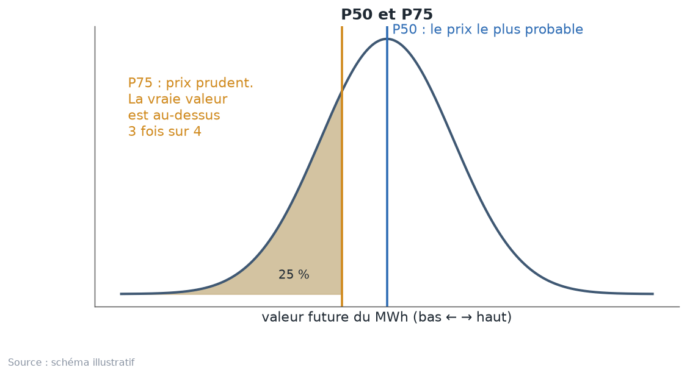

**L'image.** Un randonneur prépare sa journée. Le P50, c'est le temps de marche « normal ». Le P75, c'est le temps
qu'il annonce à ses amis pour ne pas les faire attendre trop souvent. Il ne prend pas le pire cas, sinon il
partirait à l'aube pour rien. Il prend une marge raisonnable.

### 2. Pourquoi un prix prudent
Quand on signe un PPA, on fixe un prix pour plusieurs années. Si on le fixe au P50, on se trompe dans un sens une
fois sur deux, dans l'autre une fois sur deux. Sur un seul contrat, c'est un pari à pile ou face.

La règle de Tom est simple : **« ne pas perdre d'argent systématiquement »** (note v2). Le pricer prend donc le niveau
qui tient **3 fois sur 4**. La différence entre la valeur du milieu et ce niveau prudent, c'est la **prime de
risque**. C'est le prix de la tranquillité.

Le pricer affiche les trois : **P25, P50 et P75**. Le prix publié est le niveau prudent.

### 3. Le Monte Carlo : tirer des milliers de futurs
Pour fabriquer l'éventail, on utilise un **Monte Carlo**. Le nom vient du casino. Le principe : on lance les dés des
milliers de fois, et on regarde ce qui sort.

Concrètement, chez nous :
- le générateur de scénarios (chapitre 9) fabrique des **milliers d'années possibles**, avec de vraies semaines du
  passé ;
- pour chaque année, on calcule la capture et la valeur du MWh ;
- on range les résultats du plus bas au plus haut, et on lit le P25, le P50, le P75.

**Le piège.** Un Monte Carlo **ne connaît que les risques qu'on lui donne**. S'il ne tire que la météo, il ne sait
pas que le nucléaire peut s'effondrer, que la ligne vers l'Allemagne peut rétrécir, que le parc solaire peut grandir
plus vite que prévu. Il fabrique alors un éventail trop étroit. Et un éventail trop étroit rassure à tort.

**L'image.** Un simulateur de vol qui n'a jamais appris les orages. Le pilote s'entraîne des milliers d'heures, tout
se passe bien, il se croit prêt. Le jour de l'orage, il découvre un risque que son simulateur ne lui a jamais montré.

### 4. Le test : la météo seule est trop étroite
Le 31 octobre, on a vérifié le Monte Carlo sur le passé, avec le rejeu du chapitre 10 : on se met dans le passé, on
calcule la bande, et on regarde si la réalité est tombée dedans.

Avec le générateur qui ne tire **que la météo** :
- la bande P10–P90 a contenu la réalité dans **environ 45 % des mois**. Il en faudrait **80 %** ;
- pire, le **prix prudent éolien n'a tenu dans aucun cas : 0 %** (note v2, `pricing-v2/choix_v2.md`).

En clair, le modèle était beaucoup trop sûr de lui. Il disait « je suis certain à 80 % », et il avait raison moins
d'une fois sur deux.

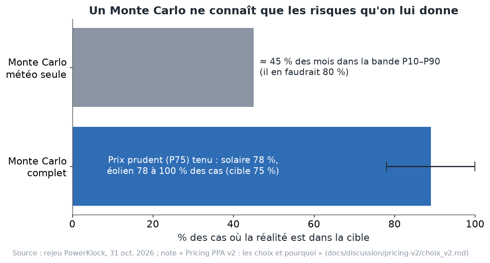

### 5. Le Monte Carlo complet : ce qu'il tire en plus
Le pricer v2, en ligne depuis le **31 octobre 2026**, ajoute les risques qui manquaient. Pour **chaque scénario**, il
tire au hasard :

- **La croissance du parc** au-delà de la dernière année connue : un multiplicateur entre **0,6 et 1,4**, soit
  **±40 %**. Si l'on attendait 10 GW de solaire en plus, le scénario peut en mettre 6 ou 14.
- **Le niveau du nucléaire** : un multiplicateur de type **lognormale à 4 %**. Repère : EDF annonce 350 à 370 TWh par
  an, soit environ ±3 %. Plus **5 % de chances d'une année de type 2022**, l'année de la corrosion sous contrainte
  (environ −20 % de nucléaire, d'après la fiche des paramètres).
- **La limite d'export vers Core** : un multiplicateur lognormal de **20 % × √années**. Repère : elle est allée de
  5,4 à 9,2 GW entre 2023 et 2026 (JAO).
- **Le niveau de consommation** : lognormale à **2 %**, selon le rythme de l'électrification.
- **Des semaines « chères » ou « bon marché »** : chaque semaine tirée reçoit un rang commun, pour représenter ce qui
  fait monter ou baisser toute une semaine à la fois (pannes, combustibles, comportements).
- **La disponibilité nucléaire de la semaine tirée.**
- **Une année sèche ou humide**, pour les barrages.

**Deux mots à expliquer.**
- **Lognormale** : c'est un multiplicateur centré sur 1, qui ne devient jamais négatif. « Lognormale à 4 % » veut
  dire qu'on tombe le plus souvent entre 0,96 et 1,04, et rarement plus loin. Comme une balance un peu imprécise :
  la plupart des pesées sont justes à quelques pourcents près.
- **√années** (racine carrée du nombre d'années) : l'incertitude grandit avec l'horizon, mais moins vite que le
  temps. À 4 ans, elle est deux fois plus grande qu'à 1 an, pas quatre fois. **L'image** : le brouillard sur une
  route. Plus on regarde loin, moins on voit, mais la visibilité ne s'effondre pas d'un coup.

**Le résultat.** Avec tout ça, le prix prudent a tenu dans **78 à 89 % des cas** (fiche des paramètres du 1er
novembre). La cible est 75 %. La note du 31 octobre au soir donnait 78 % en solaire, 78 à 100 % en éolien. C'est le schéma ci-dessus : la barre bleue.

**Une remarque honnête.** Ces paramètres (±40 % de parc, 5 % de crise) sont des **jugements**, pas des estimations
tirées des données. Ils ont été validés par le rejeu, mais sur peu d'années. Il faudra les tester sur plus
d'années (cours détaillé, 11.5).

### 6. Du générateur au prix : la prime de risque
Le Monte Carlo du générateur ne donne pas directement le prix. Il donne une **dérive de capture** :
- **solaire 2,38 points par √an, éolien 1,90 point par √an** (fiche des paramètres du 1er novembre ; la note du
  31 octobre donnait 2,75 et 2,12).
- En mots : si on price un an avant, la capture solaire peut s'écarter d'environ 2,4 points de pourcentage de ce
  qu'on attend. À 4 ans, deux fois plus, environ 4,8 points (calcul : 2,38 × √4).

Ensuite, le pricer fait son propre Monte Carlo, plus large :
- il tire **10 000 trajectoires** ;
- dans chacune, il fait bouger quatre choses : le **forward** (le prix de marché à terme), le **volume** produit, la
  **capture**, et la **liquidité** (les années trop lointaines pour être cotées) ;
- il suppose que le producteur vend à l'avance le volume attendu au Cal (une couverture « back to back ») ;
- il calcule ce que rapporte un MWh dans chaque trajectoire, les range, et retire
  **prime = valeur juste − 25e centile**.

Le 25e centile, c'est le niveau sous lequel tombent 25 % des trajectoires. Donc le prix publié tient **3 fois sur 4**.

**La corrélation volume–capture.** Une question compte beaucoup : quand le parc produit plus que prévu, sa capture
baisse-t-elle en même temps ? Si oui, les deux risques s'additionnent. La corrélation mesure ce lien : 0, aucun lien ;
1, ils bougent toujours ensemble.
- Avant la v2, on **supposait** 0,3 en solaire et 0,2 en éolien.
- Depuis la v2, on la **mesure** dans le générateur : **0,24 en solaire, 0,32 en éolien** au 1er novembre (0,06 et
  0,26 dans la première mesure du 31 octobre).
- L'éolien a un lien plus fort : une année très venteuse fait baisser les prix pendant les heures de vent.

**Attention, ces chiffres bougent.** Ils sont recalculés chaque dimanche, et la méthode a changé deux fois le
1er novembre : arrêt strictement sous 0 € (8 h 12), puis prime de risque qui suit la sensibilité mesurée du prix capté
au prix de base, 0,96 € par € en solaire et 0,95 en éolien (12 h 25). Les valeurs ci-dessus sont celles de la fiche
à jour (`pricing-v2/parametres.md`). Retiens l'ordre de grandeur et la méthode, pas la deuxième décimale.

### 7. L'autre méthode : nos erreurs passées (jusqu'au 31 octobre)
Avant la v2, on ajoutait une seconde prudence, pour le **risque de modèle** : le risque que le générateur lui-même se
trompe toujours dans le même sens. Le script `scripts/ppa_model_risk.py` faisait ceci :
1. il rejouait le générateur sur chaque livraison depuis 2023, pricée 1, 2 et 3 ans avant ;
2. il notait l'erreur de capture de chaque cas, en points ;
3. il prenait le **75e centile pondéré** de ces erreurs. Le poids d'un cas est **divisé par deux pour chaque année
   d'ancienneté** de sa livraison ;
4. le pricer retirait forwards × ce centile.

En mots : si le prix avait été fixé ainsi par le passé, il n'aurait pas dépassé la valeur réalisée 3 fois sur 4.

**L'image du bus en retard.** Ton bus est souvent en retard. Pour arriver à l'heure 3 fois sur 4, tu regardes ses
retards passés. Tu prends celui qui couvre 3 jours sur 4, et tu pars avec cette marge. Et tu regardes surtout les
retards récents, parce que les horaires changent.

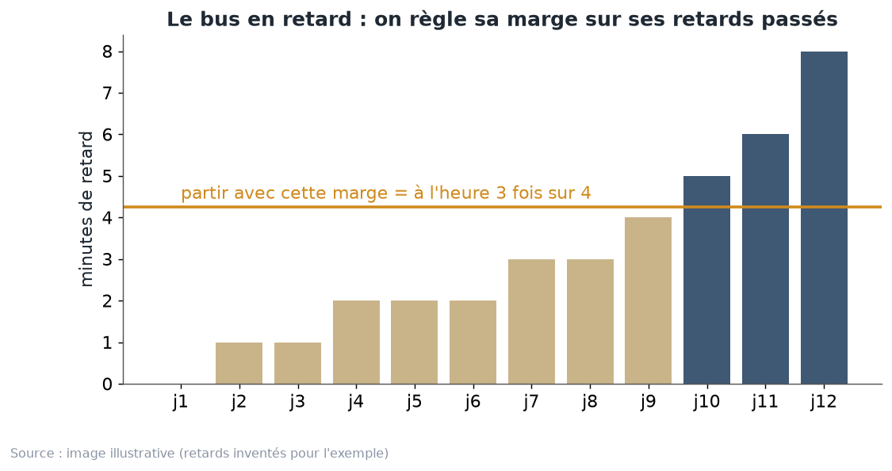

**La théorie derrière.** Barber, Candès, Ramdas et Tibshirani, *Annals of Statistics*, 2023 :
- prendre un quantile de ses erreurs passées donne une marge avec une garantie : c'est la « prédiction conforme » ;
- quand le monde change, donner plus de poids aux erreurs récentes garde une garantie presque aussi bonne ;
- la perte de garantie est bornée par la distance entre le passé pondéré et le présent. Plus le présent ressemble au
  passé récent, plus la garantie tient.

**Pourquoi on l'a retirée du prix.** La bande du Monte Carlo complet contient déjà l'erreur du modèle : elle tire
justement les risques que le modèle oubliait. Garder les deux reviendrait à compter deux fois la même prudence. La
méthode reste utile pour **vérifier** que le prix est assez prudent.

### 8. Garder de la variété
Un dernier piège, plus discret. On pourrait vouloir des scénarios très réalistes : demander que chaque semaine tirée
ait le même nucléaire, le même gaz, la même limite d'export, le même vent que l'année visée.

Le problème : avec trop de critères, **une ou deux années du passé seulement conviennent**. Tous les scénarios
reprennent alors les mêmes semaines. L'éventail se resserre, non pas parce que le futur est sûr, mais parce qu'on
tire toujours les mêmes cartes.

**L'image.** Un sondage où l'on n'interroge que les habitants d'une seule rue. Les réponses se ressemblent toutes, et
on croit à tort que tout le pays pense pareil.

**La règle.** Peu de critères, ceux qui comptent le plus. Et vérifier combien d'années différentes sont réellement
tirées. La fiche des paramètres le contrôle : chaque scénario mélange les 6 années de la réserve de semaines.

### 9. Ce qui reste ouvert
- **Le volume varie trop peu dans le générateur** : 2,1 % en solaire, contre environ 5 % en réalité. Le pricer prend
  donc la dispersion du volume dans les vraies années : **6,5 % en solaire, 9 % en éolien**.
- **La liquidité** : au-delà du dernier Cal coté, on ajoute **5,1 % × √années** d'incertitude sur le prix, mais sans
  source pour l'écart achat–vente.
- **Les paramètres du Monte Carlo complet** sont des jugements : à revoir chaque année, en janvier, quand une année
  complète s'ajoute. La fiche dit de les revoir si la calibration du P75 sort de la zone **65–85 %**.

### À retenir
1. P50 = le milieu. P75 = le prix prudent : la réalité est au-dessus 3 fois sur 4.
2. Le prix publié est le prix prudent. La prime de risque = valeur juste − 25e centile, sur 10 000 trajectoires.
3. Un Monte Carlo ne connaît que les risques qu'on lui donne. Météo seule : environ 45 % des mois dans P10–P90 au
   lieu de 80 %, et le prix prudent éolien n'a jamais tenu.
4. Le Monte Carlo complet tire aussi le parc, le nucléaire (avec une année type 2022), la limite Core, la
   consommation, les semaines chères ou bon marché, l'année sèche ou humide. Prix prudent tenu dans
   78 à 89 % des cas.
5. Le percentile pondéré des erreurs passées (le bus en retard) n'est plus déduit du prix depuis le 31 octobre, mais
   il reste un bon contrôle.
6. Trop de critères tue la variété : un éventail étroit n'est pas forcément un futur sûr.

### Question pour vérifier
Imagine que, l'an prochain, le rejeu montre que le prix prudent éolien n'a tenu que dans 55 % des cas.
- (a) Le prix éolien publié était-il trop haut ou trop bas ?
- (b) Quelle est la première chose à regarder dans le Monte Carlo complet ?
- (c) Pourquoi ne faut-il pas simplement ajouter dix critères au tirage des semaines pour « coller » au futur ?

### Pour aller plus loin
- Barber, Candès, Ramdas et Tibshirani, « Conformal prediction beyond exchangeability », *Annals of Statistics*
  51(2), 2023 — https://arxiv.org/abs/2202.13415
- Pexapark, prix de PPA et « prix de marché du risque » —
  https://help.platform.pexapark.com/en/articles/9577400-what-are-ppa-prices-shown-on-pexaquote-and-the-market-price-of-risk
- EDF, estimation de production nucléaire —
  https://www.edf.fr/groupe-edf/espaces-dedies/journalistes/tous-les-communiques-de-presse/estimation-de-production-nucleaire-d-edf-en-france
- JAO, outil de publication Core (limites d'export) — https://publicationtool.jao.eu/core
- Dossier PowerKlock : `docs/discussion/pricing-v2/choix_v2.md`, `parametres.md`, `scripts/ppa_model_risk.py`,
  cours détaillé, chapitre 11.

## Chapitre 12 à l'oral — le coût des écarts, version complète

*Pour Tom · 1er novembre 2026 · à lire à voix haute, environ 15 minutes*

### 1. Annoncer la veille, produire le lendemain
L'électricité ne se stocke presque pas. À chaque instant, ce qui est injecté sur le réseau doit être égal à ce qui
est consommé. C'est RTE qui tient cet équilibre en temps réel.

Pour l'aider, chaque acteur s'engage à l'avance :
- la veille, chaque producteur (ou celui qui vend sa production) annonce ce qu'il va injecter, quart d'heure par quart
  d'heure ;
- le lendemain, il produit ce que la météo lui donne réellement ;
- la différence entre l'annonce et le réel, c'est son **écart**.

Celui qui répond de ces écarts devant RTE s'appelle le **responsable d'équilibre**. Pour un parc sous PPA, c'est
souvent l'acheteur ou un agrégateur, selon le contrat.

**L'image.** Un traiteur commande la veille ses ingrédients pour 100 couverts. Le jour même, 90 clients viennent, ou
110. S'il en manque, il court acheter en urgence, plus cher. S'il en reste, il les revend à bas prix. Dans les deux
cas, se tromper coûte.

### 2. Le prix d'écart
Un écart n'est pas réglé au prix spot de la veille. Il est réglé au **prix d'écart**, fixé après coup, en fonction de
ce qu'a coûté à RTE le rééquilibrage du système. Les règles sont fixées par la CRE (délibération 2022-71, règles du
mécanisme d'ajustement et des responsables d'équilibre).

Pourquoi ce prix est souvent défavorable :
- **le parc produit moins que prévu** : il manque de l'énergie. Souvent, c'est au moment où tout le système en manque
  aussi (le vent est tombé partout). RTE doit appeler des moyens rapides et chers. Le prix d'écart est alors **au-dessus
  du spot** : le parc paie cher ce qu'il n'a pas produit ;
- **le parc produit plus que prévu** : il a trop d'énergie. Souvent, tout le système en a trop aussi (le vent a
  forcé partout). Le surplus est **racheté sous le spot**.

C'est le cas le plus courant, pas une loi. Certains mois, l'erreur d'un parc va dans le sens qui aide le système, et
il peut même gagner. On le verra dans les chiffres mensuels.

### 3. La formule, en mots
Le site calcule le coût des écarts ainsi (`data/history/fr_imbalance_cost.json`) :

**Coût par MWh = −Σ (réalisé − prévu) × (prix d'écart − spot) × 0,25 h ÷ Σ production**

Lisons-la morceau par morceau :
- **(réalisé − prévu)** : l'erreur de prévision, en MW, pour chaque quart d'heure. Négative si on a produit moins
  qu'annoncé ;
- **(prix d'écart − spot)** : de combien le prix d'écart s'écarte du spot ce quart d'heure-là ;
- **× 0,25 h** : un quart d'heure, pour passer de MW à MWh ;
- **Σ** : on additionne tous les quarts d'heure du mois ;
- **÷ Σ production** : on divise par toute la production, pour avoir un coût **par MWh produit** ;
- **le signe moins** : il fait qu'un coût apparaît positif.

**Un exemple inventé, pour fixer les idées.** Un quart d'heure, un parc annonce 100 MW et en produit 80 : il manque
20 MW, soit 5 MWh. Le spot est à 60 €, le prix d'écart à 100 €. Il paie 5 × (100 − 60) = 200 € de plus que s'il
avait bien prévu. Additionnés sur des milliers de quarts d'heure, puis divisés par toute la production, ces montants
donnent le coût par MWh.

### 4. National contre parc seul : l'effet portefeuille
**Le chiffre du site est national.** On compare la prévision de production éolienne (ou solaire) de **toute la
France** à la production réelle de toute la France. C'est donc l'erreur d'un portefeuille qui contiendrait tous les
parcs du pays.

Or, à l'échelle nationale, beaucoup d'erreurs **se compensent** :
- un nuage passe sur la Bretagne plus tôt que prévu ;
- au même moment, le soleil revient en Provence plus tôt que prévu ;
- la France entière, elle, s'est à peine trompée.

**L'image de l'assurance.** Une compagnie d'assurance avec un seul client ne sait pas s'il aura un accident cette
année : son résultat est un pari. Une compagnie avec un million de clients sait presque exactement combien d'accidents
elle paiera. Plus il y a de clients, plus les comptes sont prévisibles. Pour les parcs, c'est pareil : plus le
portefeuille est grand et dispersé, plus les erreurs se compensent.

**Les conséquences pour le prix :**
- **un parc seul** a une erreur relative bien plus grande, donc un coût par MWh plus élevé que le chiffre national ;
- **un agrégateur moyen** est entre les deux ;
- le pricer applique le **coût national**. Pour un parc seul, il faut ajouter une marge. La fiche des paramètres
  prévoit un réglage « taille du portefeuille », traité à part.

### 5. Quelle prévision prendre ?
Pour calculer l'écart, il faut une prévision. Deux candidates :
- **la prévision du gestionnaire de réseau** : la prévision de la veille publiée par RTE sur la plateforme européenne
  ENTSO-E (le jeu de données « A69 ») ;
- **notre prévision combinée**, calculée par PowerKlock.

**Les résultats, sur 12 mois :**
- **Éolien** : **3,06 €/MWh** avec la prévision du gestionnaire, **2,82 €/MWh** avec notre prévision combinée. La
  nôtre se trompe moins.
- **Vérification** : notre propre calcul sur `fr_imbalance_cost.json`, de novembre 2025 à octobre 2026, donne
  **3,07** pour la prévision du gestionnaire. Ça recoupe.
- **Solaire** : c'est l'inverse, **la prévision du gestionnaire reste meilleure**.

**Le détail qui comptait : l'interpolation au quart d'heure.** Notre prévision était faite à l'heure. Pendant une
heure, elle restait plate, comme un escalier. Mais le solaire monte le matin et descend le soir en **rampe**, en
continu. Un escalier qui suit une rampe se trompe à chaque marche : trop haut au début de l'heure, trop bas à la fin
(ou l'inverse). Depuis le 31 octobre, notre prévision est **interpolée au quart d'heure** : on trace une ligne droite
entre les heures, et la marche devient une pente.

**La règle de choix.** Depuis le 31 octobre, chaque filière prend la prévision qui s'est **le moins trompée sur les
12 derniers mois**. Aujourd'hui : la nôtre pour l'éolien, celle du gestionnaire pour le solaire. Si ça s'inverse un
jour, le choix suit tout seul.

**Les valeurs dans le pricer.** La fiche des paramètres du 1er novembre donne **2,82 €/MWh en éolien** et
**2,49 €/MWh en solaire**. Pour le solaire, mon recalcul sur le fichier, avec la prévision du gestionnaire et sur
novembre 2025 – octobre 2026, donne 2,38. Je n'ai pas trouvé d'où vient l'écart de 0,11 € (fenêtre de 12 mois
différente, mise à jour du fichier ?). C'est à vérifier avant de citer le chiffre solaire au centime.

### 6. Un coût très variable d'un mois à l'autre
Le chiffre sur 12 mois cache de grosses différences entre les mois.

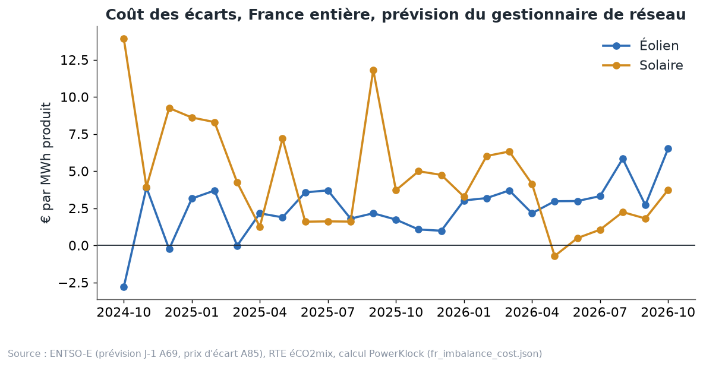

Ce qu'on lit sur le schéma (prévision du gestionnaire, France entière) :
- le coût va de **−2,8 €/MWh** (éolien, octobre 2024) à **près de +14 €/MWh** (solaire, octobre 2024, 13,9) ;
- le solaire a des pics : **11,8 €** en septembre 2025, **9,3 €** en décembre 2024 ;
- le solaire a même un mois négatif : **−0,7 €** en mai 2026. Ce mois-là, ses erreurs ont plutôt aidé le système ;
- l'éolien est plus régulier, le plus souvent **entre 1 et 4 €**, mais il monte à **5,8 €** en août 2026 et
  **6,5 €** en octobre 2026.

**Pourquoi c'est si variable ?** Le coût dépend de deux choses qui bougent :
- **la taille de l'erreur** : l'erreur de prévision solaire nationale va de 4,8 % (septembre 2026) à 31,1 %
  (novembre 2025) de la production du mois ;
- **le prix d'écart ce mois-là** : une même erreur coûte peu si le système est calme, beaucoup s'il est tendu.

**La leçon pour un PPA.** On ne price pas un contrat de trois ans sur le coût d'un seul mois. On prend une moyenne
longue, ici 12 mois, et on sait qu'elle bougera.

### 7. La modulation des renouvelables à la demande de RTE
Un fait nouveau change le paysage des écarts : les parcs éoliens et solaires **s'arrêtent de plus en plus** quand les
prix sont négatifs ou quand RTE le demande.

Ce que dit RTE :
- **bilan du premier semestre 2026** : **7,4 GW** d'éolien et de solaire sous obligation d'achat peuvent désormais
  s'arrêter aux prix négatifs, et **22 GW** peuvent moduler à la demande de RTE, quatre fois plus qu'avant ;
- la modulation renouvelable a atteint **2,5 TWh** au premier semestre 2026, contre **1,9 TWh** un an plus tôt, soit
  environ **5 %** de la production éolienne et solaire ;
- **bilan 2025** : la modulation pendant les prix négatifs a doublé en 2025, à environ **3 TWh** (1,3 éolien,
  1,6 solaire).

**Pourquoi ça compte pour les écarts.** Notre calcul compare la prévision de la veille à la production **réelle**.
Si des parcs s'arrêtent parce que le prix est négatif ou parce que RTE le demande, la production réelle baisse, et
ce qui ressemble à une « erreur de prévision » est en fait un **arrêt voulu**. Je n'ai pas vérifié comment ces arrêts
sont réglés financièrement, ni quelle part de notre coût national ils représentent. C'est
une question ouverte : avec 22 GW modulables, elle va grossir.

### 8. Les limites
- **Le chiffre est national**, et un parc réel n'est jamais toute la France.
- **Le prix d'écart dépend de règles qui changent** : le pas de 15 minutes, les réserves, les règles de la CRE. Un
  coût mesuré sur 2025–2026 peut ne plus valoir en 2028.
- **Le calcul est « basique »** (c'est le mot du fichier) : il ne tient pas compte d'un responsable d'équilibre qui
  corrige ses positions le jour même sur le marché infrajournalier, ce qu'un vrai agrégateur fait.

### À retenir
1. Un écart = la différence entre ce qu'on a annoncé la veille et ce qu'on a produit, réglée au prix d'écart.
2. Coût par MWh = −Σ (réalisé − prévu) × (prix d'écart − spot) × 0,25 h ÷ Σ production, au quart d'heure.
3. Le chiffre du site est national : les erreurs se compensent comme les risques d'une grande compagnie d'assurance.
   Un parc seul paie plus.
4. Éolien, 12 mois : 3,06 € avec la prévision du gestionnaire, 2,82 € avec notre prévision combinée. Solaire : la
   prévision du gestionnaire reste meilleure.
5. Depuis le 31 octobre : notre prévision est interpolée au quart d'heure, et chaque filière garde la prévision qui
   s'est le moins trompée sur 12 mois.
6. Le coût mensuel varie de −2,8 à près de +14 €/MWh : on price sur une moyenne longue.

### Question pour vérifier
Un client te demande un PPA pour **un seul parc éolien** de 20 MW, isolé dans le Massif central.
- (a) Le coût des écarts à mettre dans son prix est-il au-dessus ou en dessous de 2,82 €/MWh ? Pourquoi ?
- (b) Si, l'an prochain, la prévision du gestionnaire devient meilleure que la nôtre en éolien, que fait le site ?
- (c) Un mois, RTE demande à beaucoup de parcs de s'arrêter. Pourquoi notre coût national peut-il alors être
  trompeur ?

### Pour aller plus loin
- CRE, règles du mécanisme d'ajustement et des responsables d'équilibre (délibération 2022-71) —
  https://www.cre.fr/fileadmin/Documents/Deliberations/import/220310_2022-71_MA-RE.pdf
- RTE, *Bilan du système électrique, premier semestre 2026*, chapitre 7 —
  https://assets.rte-france.com/prod/public/2026-07/2026-07-16-bilan-semestre1.pdf
- RTE, *Bilan électrique 2025* —
  https://assets.rte-france.com/prod/public/2026-02/Bilan-electrique-2025-principaux-resultats.pdf
- ENTSO-E Transparency Platform (prévisions éolien et solaire, prix d'écart) — https://transparency.entsoe.eu/
- Dossier PowerKlock : `data/history/fr_imbalance_cost.json`, `docs/discussion/pricing-v2/parametres.md`, cours
  détaillé, chapitre 12.

## Chapitre 13 à l'oral — ce qu'on a testé, ce qu'on a gardé, version complète

*Pour Tom · 1er novembre 2026 · à lire à voix haute, environ 15 minutes*

### 1. Le point de départ
Dans la nuit du 30 au 31 octobre, tu as fixé un objectif clair : **trouver une méthode qui n'ait plus besoin de
l'ancrage**, surtout pour l'éolien. L'ancrage, c'est le recalage du modèle sur la dernière année réelle (chapitre 9).
Tu as demandé de tout tester, même ce qui n'était pas raisonnable, et de s'inspirer de la recherche.

Le constat de départ (débrief du 31 octobre) :
- sans ancrage, l'éolien est **surévalué d'environ +2,6 €/MWh** ;
- cette erreur est **presque constante** d'un cas à l'autre : c'est un biais, pas du bruit ;
- trois modèles construits de façon totalement différente font **la même erreur**.

Ce chapitre raconte ce qu'on a essayé, ce qui a marché, ce qui a été décidé, et ce qui reste ouvert.

### 2. Comment lire les résultats
Tous les chiffres viennent du **rejeu** du chapitre 10 :
- livraisons 2023 à 2026, pricées 1, 2 et 3 ans avant : **9 cas par filière** ;
- l'erreur est la moyenne en € sur la valeur d'un MWh (production non payée aux prix ≤ 0) ;
- **plus c'est bas, mieux c'est**.

Deux règles de lecture, déjà vues :
- **le bruit des tirages atteint 0,2 €** : un gain plus petit ne prouve rien, sauf s'il tient sur tous les tirages ;
- **biais contre dispersion** : une montre qui avance toujours de cinq minutes se corrige ; une montre qui avance un
  jour et retarde le lendemain, non.

### 3. Le grand tableau : la valeur du MWh
Erreur moyenne de rejeu, en €/MWh, 9 cas (débrief du 31 octobre, cours détaillé 13.1).

| Test | Solaire sans ancrage | Éolien sans ancrage | Éolien ancré hiver/été | Verdict |
|---|---|---|---|---|
| **Modèle publié (v1)** | **0,76** | 2,62 | 0,84 | la référence |
| Pondéré par la production | 1,41–1,43 | 2,10–2,20 | 0,48–0,71 | meilleur en éolien, pire en solaire |
| Pondération + part du vent quand la France est coupée | 1,1 | 2,01 | **0,56** | **adoptée en v2 pour l'éolien** |
| Pondération + pente du vent | — | 1,93 (biais +0,45) | 0,71 | presque sans biais, mais dispersé |
| Résidu du jour réel | 1,88–3,98 | 2,09–4,35 | 0,83–1,60 | écarté |
| Grille surplus × part du vent | 0,93 | 2,31 | 0,86 | écarté |
| Grande-Bretagne / Pays-Bas + Autriche comme modèles | 1,96–2,27 | 2,49–2,95 | 0,65–1,32 | écartés |
| Tout combiné | 2,36 | 3,49 | 0,82 | écarté (−11 € sur 2026) |
| Correction par situation | 2,57 | 1,73 | 0,72 | écartée (−4 à −8 € sur 2026) |
| Limite JAO réelle de l'année livrée (« oracle ») | 0,93 | 2,59 | 0,76 | n'explique pas l'erreur |
| Météo tirée depuis 2023 seulement | 1,44 | 3,02 | 1,01 | écartée |
| Analogues seuls | 4,1 | ≈ 1,1 | — | écartés |
| Mélange 50/50 analogues + règle | — | — | 0,89 sur années civiles, contre 0,63 en v2 | refusé |
| Ancrage sur 12 mois roulants au lieu de l'année civile (6 cas, pricés fin octobre, avec ancrage) | — | — | — | solaire 1,10 → 1,08 ; éolien 1,47 → 1,67 : pas mieux |
| Moyenne des 4 anciennes méthodes | 2,59 | — | 2,84 | remplacée par le générateur seul |
| Modèle d'optimisation par semaine | — | paie trop le vent (+4,3) | — | écarté |
| Régression mensuelle de la capture | 3,2–6,3 | 1,73–3,42 | — | écartée, instable |
| Merit order avec courbes d'offre (v1 à v3) | — | — | — | bon à 1 an, casse à 2–3 ans |

Et pour le risque et les écarts :

| Test | Résultat | Verdict |
|---|---|---|
| Monte Carlo météo seule | P10–P90 ≈ 45 % des mois ; prix prudent éolien tenu 0 % des cas | trop étroit |
| Monte Carlo complet | prix prudent tenu dans 78–89 % des cas (cible 75 %) | **adopté en v2** |
| Prévision combinée des écarts | éolien 3,06 → 2,82 €/MWh | **gardée pour l'éolien** |

### 4. Trois leçons du tableau
**Leçon 1 : beaucoup de tests, peu de vainqueurs.** C'est normal. Un bon modèle est difficile à battre, et 9 cas
(en fait 4 années livrées) laissent peu de place pour trancher.

**Leçon 2 : l'année 2026 casse les idées trop fines.** « Tout combiné » se trompe de 11 € sur 2026, « correction par
situation » de 4 à 8 €. Ce qui colle trop bien au passé se brise sur une année jamais vue. C'est le
**surapprentissage** : l'élève qui apprend les réponses par cœur au lieu de comprendre l'exercice.

**Leçon 3 : solaire et éolien tirent dans des sens opposés.** La pondération par la production améliore l'éolien
(jusqu'à 0,56) mais dégrade le solaire (de 0,76 à plus de 1,4). Les analogues sont bons en éolien (≈ 1,1 sans
ancrage), catastrophiques en solaire (4,1). La raison : un futur plus solaire que tout le passé n'a pas d'analogue,
et reçoit les pires midis connus. D'où la solution : **le même générateur pour les deux, seule la pondération suit
la filière pricée**.

**Le « oracle » est instructif.** Même en donnant au modèle la vraie limite d'export de l'année livrée, qu'on ne
pouvait pas connaître, l'erreur éolienne sans ancrage reste à 2,59. Donc ce n'est pas la limite Core qui explique le
biais. Ni le gaz. La valeur réelle de l'éolien baisse d'une année à l'autre **plus vite que tous les modèles ne le
prévoient**.

### 5. Ce qui a été décidé : le pricer v2
Le pricer v2 est **en ligne depuis le 31 octobre 2026**. Il suit tes règles : pas de recalibrage caché, une seule
méthode pour le solaire et l'éolien, produits liquides seulement, réalisme face à l'historique, tests sur des années
complètes, et jamais changer le pourcentage d'un mélange à chaque pricing.

Les six choix (`pricing-v2/choix_v2.md`) :
1. **Une seule méthode, le générateur.** La moyenne des 4 anciennes méthodes se trompait de 2,59 € (solaire) et
   2,84 € (éolien). Le générateur seul : 0,76 et 0,56. Les anciennes méthodes restent affichées comme repères, hors
   du prix.
2. **L'ancrage choisi par une règle**, chaque semaine : le mode qui s'est le moins trompé au rejeu. Aujourd'hui :
   solaire sans ancrage, éolien hiver/été.
3. **La règle éolienne pondérée par la production**, avec la part du vent quand la France est coupée : 0,84 →
   0,56 €/MWh.
4. **Le mélange 50/50 analogues + règle, refusé.** Ta phrase : « on avait une bonne méthode ».
5. **Un prix prudent plutôt que le P50** : le niveau qui tient 3 fois sur 4, avec P25, P50 et P75 affichés.
6. **La bande du Monte Carlo complet**, sans déduction séparée du risque de modèle.

Le résultat, avec les forwards des 30–31 octobre : **solaire 46,64 €/MWh, éolien 77,39 €/MWh** (prix publié au
1er novembre). Le chemin pour y arriver : 49,75 / 80,69 à la mise en ligne de la v2 le 31 octobre au soir ; 42,88 /
77,20 le 1er novembre au matin, quand une heure à 0 € est devenue produite et payée 0 (même revenu, plus de MWh
payés) ; puis 46,64 / 77,39 à midi, quand la prime de risque a suivi la sensibilité mesurée du marché (prime solaire
5,98 → 2,2 €). Toujours dire de quelle date, et de quelle méthode, est un prix.

### 6. Ce qui reste ouvert
1. **L'éolien reste ancré.** Sans ancrage, tous les modèles le surévaluent de 2 à 2,7 €. Le biais est dans les
   heures où la France est coupée : la règle y est 6,9 € trop haute.
2. **La convention des prix négatifs** : depuis le 1er novembre, le parc s'arrête seulement strictement sous 0 €
   (225 heures à exactement 0 € en 2025). Le seuil est réglable : à choisir selon la clause de chaque contrat.
3. **Les captures s'arrêtent en 2030** : à prolonger pour les PPA longs.
4. **Les arrêts nucléaires 2027** : une option (éolien +2 points), impossible à tester sur le passé. Jusqu'à environ
   21 GW arrêtés en même temps fin mai 2027, d'après les déclarations à ENTSO-E au 30 octobre 2026.
5. **Les prix de PPA observés** comme repère (abonnement Pexapark, usage interne seulement).
6. **La stabilité du choix de méthode** (ta question du 30 octobre) : choisir une fois par an, avec un seuil de 0,2 €,
   pour que la méthode ne change pas d'une semaine à l'autre ? Toujours en suspens.
7. **Deux pistes non testées** : prévoir la tendance de l'écart d'une année sur l'autre, avec l'indicateur de
   coupure prévisible (il suit bien la réalité : 66 % prévu contre 67,5 % réel en 2025) ; et la flexibilité restante
   du nucléaire (Astier et Wolak, NBER, janvier 2026), que nos données ne donnent pas centrale par centrale.

### 7. Ce que font les professionnels
**Pexapark.**
- Là où des prix de PPA sont observés, il calibre ses courbes sur la cannibalisation implicite de ces prix : « le
  consensus du marché, pas une prévision économique ».
- Ailleurs, il extrapole à partir des capacités et de la cannibalisation passée.
- C'est **une forme d'ancrage sur le marché**. Nous ancrons sur la dernière année réelle ; lui sur les contrats
  signés, que nous n'avons pas.

**Modo Energy.**
- Il aligne la météo du profil de production et celle des prix. Sans cet alignement, la cannibalisation est
  sous-estimée et les revenus surestimés de plus de 10 % en 2045.
- Notre générateur est aligné **par construction** : chaque semaine tirée apporte, le même jour, le vent, le soleil,
  la consommation et le prix.

**AFRY et Aurora.**
- Des **modèles fondamentaux complets** : chaque centrale d'Europe, ses coûts, le réseau, avec des scénarios de long
  terme.
- **L'image** : eux reconstruisent toute la ville maison par maison ; nous regardons comment la ville a réagi, semaine
  après semaine, et nous la déplaçons vers l'année visée.
- Plus complet, mais plus lourd, et moins facile à tester honnêtement sur le passé.

**Qorbanian, Löhndorf et Wozabal** (*EJOR*, 2025).
- Un modèle fondamental dont les coûts sont appris sur l'historique, avec un apprentissage **pondéré par la production
  de la filière pricée**. C'est d'eux qu'on a pris l'idée adoptée en v2 pour l'éolien.
- Leur test utilise la vraie demande, la vraie météo et les vrais échanges : plus facile que notre rejeu.
- **La France est le pays où leur modèle marche le moins bien.** Rassurant pour nous : la France est difficile pour
  tout le monde.

**Chatziandreou et Karbach** (arXiv, juillet 2026) : le prix juste d'un PPA = forward base + correction de profil +
correction de covariance prix–volume. C'est la même décomposition que ta méthode en trois étapes. Mais calibré sur
l'Allemagne, pour un horizon court.

**Où nous situer.** Entre Pexapark et Aurora : un modèle simple, transparent, qui garde les liens physiques (de
vraies semaines) et qui mesure ses erreurs honnêtement.

### 8. Conclusion : tout le cours en une histoire
Reprenons depuis le début, comme une seule histoire.

**Chapitres 1 et 2.** Chaque heure, le prix est fixé par la dernière centrale appelée, le merit order. Quand le
soleil brille partout à midi, des centrales à coût nul poussent le prix vers zéro, parfois sous zéro. Un parc solaire
vend donc surtout aux heures où le prix est bas : sa **capture** baisse à mesure que le parc grandit. C'est la
**cannibalisation**. La capture solaire payée est passée de 0,85 en 2023 à 0,56 en 2026 (janvier–octobre).

**Chapitre 3.** Un PPA fixe un prix pour des années. Ce prix, c'est le forward × la capture, moins la prime de risque,
moins le coût des écarts, plus les garanties d'origine, moins la marge.

**Chapitres 4 à 6.** La France a un système à part : beaucoup de nucléaire, de plus en plus de solaire, et elle
exporte presque tout le temps. Mais les lignes vers ses voisins ne suffisent plus. La limite d'export vers Core est
passée de 9,2 GW en 2023 à 5,4 en 2025. De plus en plus souvent, la France est **coupée** : seule face à son
surplus, son prix décroche. En 2025, **67,5 %** de l'éolien français est produit dans ces heures-là.

**Chapitres 7 et 8.** Tout arrive en même temps : le vent fait baisser le prix chez nous et chez les voisins, la
sécheresse retire de l'hydraulique, le gaz fixe le prix des heures calmes. Et 2026 a tout combiné : gaz cher, prix
négatifs record, sécheresse. Une année qu'aucun modèle n'avait vue.

**Chapitre 9.** Pour prévoir la capture, on ne coupe pas ces liens : on tire de **vraies semaines** du passé, où tout
est arrivé ensemble, et on les pose sur les parcs de l'année visée. Avec deux régimes, couplée et coupée.

**Chapitre 10.** On ne croit pas un modèle sur parole : on le **rejoue** sur le passé, sans tricher, et on ne
retient un gain que s'il dépasse le bruit.

**Chapitre 11.** Le futur est un éventail. On fixe le prix au niveau **prudent**, qui tient 3 fois sur 4. Mais un
Monte Carlo ne connaît que les risques qu'on lui donne : il faut lui apprendre le nucléaire, le réseau, le parc.

**Chapitre 12.** Même avec le bon prix, se tromper de prévision coûte : environ **2,8 à 3 €/MWh** en éolien au
niveau national, plus pour un parc seul.

**Chapitre 13.** On a beaucoup testé, gardé peu, et ce qu'on a gardé est en ligne.

**Ce qu'il faut retenir du tout.**
- Les prix de l'électricité dépendent de liens qui arrivent ensemble : météo, voisins, réseau, gaz, nucléaire.
- Un bon pricer garde ces liens, mesure ses erreurs honnêtement, et règle sa prudence sur ses erreurs passées.
- Le plus dur reste l'éolien : sa valeur baisse plus vite que ce que les modèles prévoient. **Le prochain chantier,
  c'est de comprendre pourquoi.**

### À retenir
1. Objectif de la nuit du 31 octobre : se passer de l'ancrage. Aucune méthode n'y arrive pour l'éolien.
2. Le gain qui tient : la règle éolienne pondérée par la production (0,84 → 0,56 €/MWh), idée de Qorbanian et al.
3. Le pricer v2 : une seule méthode, l'ancrage choisi par le rejeu, un prix prudent, le Monte Carlo complet.
4. Ce qui colle trop bien au passé se casse sur 2026 : méfiance envers les modèles trop fins.
5. Les pros font aussi de l'ancrage (Pexapark) ou des modèles géants (AFRY, Aurora). Nous sommes entre les deux.
6. Le chantier ouvert : pourquoi la valeur de l'éolien baisse plus vite que prévu.

### Question pour vérifier
Un collègue te propose une nouvelle méthode. Au rejeu, elle donne 0,45 €/MWh en éolien ancré, contre 0,56 pour la v2,
sur un seul tirage.
- (a) Faut-il l'adopter tout de suite ? Qu'est-ce qui manque pour trancher ?
- (b) Elle donne 1,6 €/MWh en solaire. Quelle solution la v2 a-t-elle trouvée pour ce genre de cas ?
- (c) Elle se trompe de −9 € sur 2026 et très peu sur les autres années. Qu'est-ce que ça t'inspire ?

### Pour aller plus loin
- Qorbanian, Löhndorf et Wozabal, « Valuation of Power Purchase Agreements… », *EJOR* 2025 —
  https://arxiv.org/abs/2403.08846
- Pexapark, méthode de calcul — https://help.platform.pexapark.com/en/articles/9582613-what-is-the-pexapark-calculation-methodology
- Pexapark, prise en compte de la cannibalisation —
  https://help.platform.pexapark.com/en/articles/9577860-how-do-you-account-for-cannibalization
- Modo Energy, « Capturing cannibalisation » — https://forecastdocs.modoenergy.com/docs/capturing-cannibalisation
- Stiewe, Xu, Eicke et Hirth, « Cross-border cannibalization » — https://arxiv.org/abs/2405.17166
- Hirth (2013), « The market value of variable renewables » —
  https://cadmus.eui.eu/bitstream/handle/1814/27135/RSCAS_2013_36.pdf
- Dossier PowerKlock : `docs/discussion/pricing/debrief-2026-10-31.md`, `docs/discussion/pricing-v2/choix_v2.md`,
  `parametres.md`, commentaires de `scripts/ppa_scenarios.py`.
