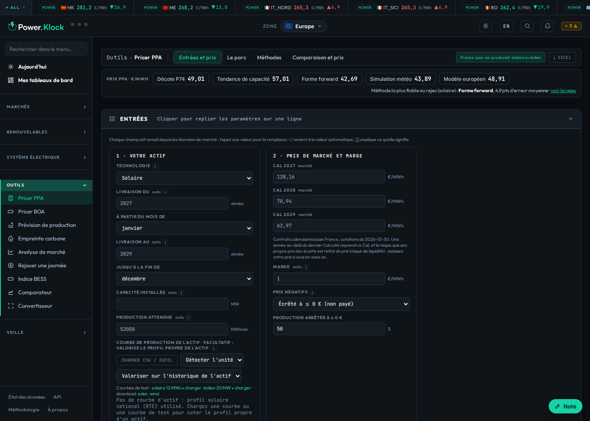

# Pricer PPA : comment le rendre facile et rapide — synthèse du brainstorming

Brainstorming demandé par Tom dans la nuit du 31 octobre au 1er novembre 2026. Contributions : la session
principale (« PowerKlock PPA pricer review »), la session « Cours marché & pricing PPA », et la session
« Couplage / notes », qui a aussi mesuré la page telle qu'elle est. **Proposition seulement : rien n'a été changé
dans le pricer.** Les réponses brutes sont dans `contributions.md`.

## 1. Ce qu'on voit aujourd'hui (mesuré le 1er novembre 2026, version de main)

| Mesure | Valeur |
|---|---|
| Onglets | 11 : Entrées et prix, Le parc, Méthodes, Comparaison et prix, Décote P74, Tendance de capacité, Forme forward, Simulation météo, Court terme (mensuel), M0-indexed, Méthodologie |
| Sections repliables | 14 |
| Graphiques | 39 |
| Champs de saisie | 61 |
| Données chargées à l'ouverture | 3,6 Mo en 30 fichiers, dont `fr_capture.json` (482 Ko) et 11 années horaires `fr_hourly` (≈ 240 Ko chacune) |
| Calcul | ≈ 7 Monte-Carlo de 10 000 trajectoires par calcul, 2 × plus en arrêt partiel (session principale) |

**Le constat partagé par les trois sessions :**
- En haut de page, cinq prix sont affichés au même niveau (Décote P74 49,01, Tendance de capacité 57,01, Forme
  forward 42,69, Simulation météo 43,89, Modèle européen 48,91 €/MWh pour le solaire). La phrase dessous désigne
  « Forme forward » comme méthode la plus fiable au rejeu, alors que le prix publié vient du générateur v2. **On ne
  sait pas quel prix fait foi.**
- Le premier écran est occupé par les saisies : le résultat n'est pas visible sans faire défiler.
- Plusieurs définitions de la « capture » coexistent (payée mois par mois, d'un bloc, toute production).
  L'ancrage et les deux primes de risque (Monte-Carlo du marché, P75 des erreurs passées) ne sont dits simplement
  nulle part.

## 2. Ce sur quoi les trois sessions sont d'accord

1. **Un premier écran « Prix »**, avec quatre champs à gauche et le résultat à droite, visible sans défiler.
   - Les quatre champs : technologie, mon parc, période de livraison, règle des prix ≤ 0.
   - Le résultat : prix prudent P75 en grand, P50 et P25 à côté, date des forwards, puis la cascade
     (Cal → profil mensuel → cannibalisation horaire → risques volume, liquidité, prix et capture → écarts → GO →
     marge), une phrase d'explication en français et en anglais, et le champ « offre reçue ».
2. **Une seule méthode mise en avant**, avec un badge « fait foi » et son erreur de rejeu en €/MWh. Les cinq
   méthodes de référence, leur moyenne, le rejeu, le détail du Monte-Carlo, les trajectoires, les stress et les
   réglages avancés vont dans un volet « Comparer les méthodes », replié.
3. **Un point d'entrée unique « Mon parc »**. On charge une courbe, ou on localise le parc (prévision ERA5), ou on
   donne seulement les MW. Ce point alimente le volume, le risque volume, le profil et le M0.
4. **La vitesse** :
   - Le prix par défaut (profil national, par filière) est **pré-calculé par le job quotidien** et affiché
     instantanément. Le calcul complet ne se lance que si l'utilisateur change un champ ou charge son parc.
   - Les Monte-Carlo tournent dans un **Web Worker** (la page reste fluide). La décomposition des risques est
     réduite à environ 4 000 trajectoires et ne se lance qu'à l'ouverture de la section Risque.
   - Le dernier calcul est mis en cache par jeu de paramètres (localStorage).
   - Les fichiers lourds (`fr_capture.json`, années horaires) se chargent à la demande : à l'ouverture de « Le
     parc » ou des méthodes, pas à l'arrivée.
5. **Un glossaire au survol** (capture, ancrage, P75, coût des écarts, convention ≤ 0), avec une seule convention
   de capture nommée partout et les images du cours (`docs/discussion/cours/`).

## 3. Onglets proposés (11 → 4)

| Onglet | Contenu |
|---|---|
| **Prix** | les 4 champs, le prix P75 / P50 / P25, la cascade, l'offre reçue, la phrase d'explication |
| **Mon parc** | profil, historique des prix captés, volume et risque volume, M0 |
| **Risques** | bande P10–P90, chance de perte, stress (calculés à l'ouverture) |
| **Méthodes** | les 5 méthodes et leur rejeu, le court terme mensuel, le M0 indexé, la méthodologie |

## 4. Ordre de réalisation proposé

1. Pré-calcul du prix par défaut par le job, et premier écran « Prix ». C'est le plus grand gain d'usage et de
   vitesse, et le pricer actuel reste dessous pendant la transition.
2. Badge « fait foi » sur le prix publié, et méthodes repliées dans « Méthodes ».
3. Web Worker, calculs différés et chargement à la demande.
4. Point d'entrée « Mon parc », puis glossaire.

**Décision attendue de Tom :**
- valider les 4 onglets ;
- choisir l'affichage du prix : P75 en grand, ou P50 en grand avec P75 à côté.

Comme c'est une refonte de page, une maquette sera montrée avant de coder.
